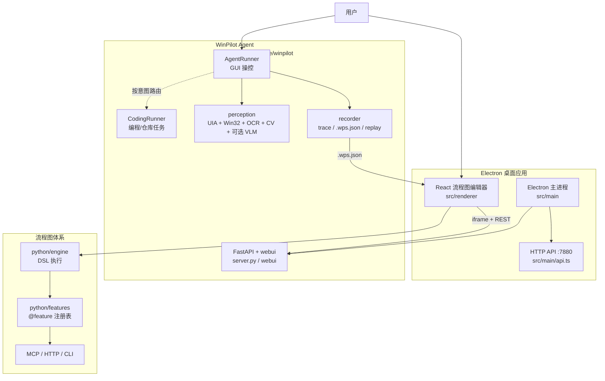

# 灵动脚本 · Lingdong Script

Windows 桌面自动化项目：一边是能实时操控电脑的 WinPilot Agent，一边是可视化流程图编辑器。项目目标不是给单个软件写专用规则，而是把通用桌面操控、可验证执行、录制复用和流程图零-token重放接起来。

当前分支：`feat/winpilot-agent`。

## 当前事实

- 现役 Agent 是 `python/winpilot_home/winpilot/` 下的 WinPilot。
- `python/agent/__main__.py` 只是 Electron IPC 适配器，会通过 `winpilot.agent.router.build_runner` 路由到 GUI `AgentRunner` 或编程 `CodingRunner`。
- WinPilot 主 GUI agent 使用自己的小工具集和感知/动作栈，不使用 `python/features/` 的 @feature 注册表，也不理解流程图格式。
- 流程图编辑器、DSL、Python engine、@feature、MCP 是另一套体系，服务可视化编排和外部集成。
- Agent 跑过的动作可导出 `.wps.json`，再由 `src/renderer/utils/wpsToFlowScript.ts` 纯代码转换成原版 FlowScript 进入画布。
- `config.json`、`traces/`、`scripts/`、`experience_memory.json` 是本机运行数据，不应提交。

## 架构一眼看懂



## 关键目录

| 路径 | 真实职责 |
|---|---|
| `src/main/` | Electron 主进程、HTTP API、Python 子进程和 WinPilot FastAPI 启动 |
| `src/renderer/` | React 流程图编辑器、Agent iframe、导入录制 UI、前端状态 |
| `python/winpilot_home/winpilot/` | 当前 WinPilot Agent、感知、动作、录制、记忆、REST |
| `python/agent/` | WinPilot IPC 适配器，以及仍被旧 engine/@feature 使用的 dialog/menu helper |
| `python/engine/` | FlowScript/DSL 执行引擎 |
| `python/features/` | @feature 注册表，供流程图、MCP、HTTP、DSL 使用 |
| `python/mcp/` | Python MCP server |
| `python/node-red-nodes/` | Node-RED 集成实验/PoC，不是当前主路径 |
| `docs/` | 当前架构文档，按实际代码同步 |

## 快速启动

```bash
npm install
npm run dev
```

开发模式会启动 Vite 和 Electron。Vite 默认端口由 `vite.config.ts` 决定，当前开发脚本会等待 `http://localhost:5200`；Electron 主进程 HTTP API 默认是 `http://127.0.0.1:7880`。

WinPilot Agent 需要在前端 Agent 页面或 `python/winpilot_home/config.json` 配置 DeepSeek/OpenAI 兼容 API key。默认文本模型配置见 `python/winpilot_home/winpilot/config.py`。

## 常用验证

```bash
python -m pytest python/winpilot_home/tests -q
npx vitest run
npm run build
```

说明：根目录 `tests/` 里仍有一部分旧体系/历史实验测试，其中有些引用已删除的旧 Agent 模块；它们不能代表 WinPilot 当前健康度。WinPilot 当前主测试集是 `python/winpilot_home/tests/`。

## 文档入口

| 文档 | 内容 |
|---|---|
| [CLAUDE.md](CLAUDE.md) | 给 AI/开发者的工程速览和红线 |
| [交接说明.md](交接说明.md) | 接手顺序、当前状态、验证方式 |
| [docs/README.md](docs/README.md) | 文档索引 |
| [docs/architecture.md](docs/architecture.md) | 进程、端口、边界和端到端数据流 |
| [docs/winpilot-agent.md](docs/winpilot-agent.md) | WinPilot 循环、工具、感知、验证、记忆、编程子 agent |
| [docs/apis.md](docs/apis.md) | Electron HTTP API、WinPilot REST、IPC、MCP |
| [docs/replay-recording.md](docs/replay-recording.md) | `.wps.json`、trace、人类演示录制、Replayer、导入流程图 |
| [docs/flow-editor.md](docs/flow-editor.md) | 流程图编辑器、节点、DSL、engine、@feature |

## 设计红线

- 主 GUI agent 保持小工具集，不把 @feature 注册表或流程图能力塞进去。
- 新专长优先做独立子 agent，参考 `CodingRunner`。
- GUI-only 任务以真实前端路径和真实屏幕验证为准，避免“日志成功但屏幕没做”的假成功。
- 录制复用走 `.wps.json` 和 `wpsToFlowScript`，不要让 agent 直接感知或编辑流程图内部格式。

## 许可

MIT
