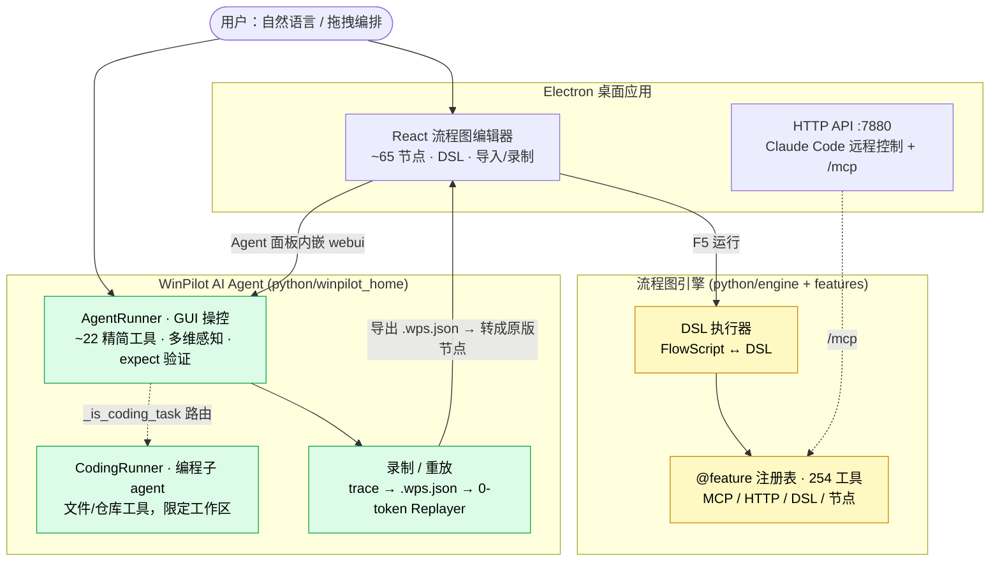

<div align="center">

# 灵动脚本 · Lingdong Script

**Windows 桌面自动化系统 = AI Agent 实时操控 + 可视化流程图编辑器**

*一次 AI 生成 → 永久零 Token 重放*

[](https://www.electronjs.org/)
[](https://reactjs.org/)
[](https://www.typescriptlang.org/)
[](https://www.python.org/)
[](#许可)

</div>

灵动脚本把两种能力合在一个桌面应用里：

- **AI Agent（WinPilot）** —— 用自然语言驱动 LLM **实时操控真实 Windows 桌面**：点击、输入、识图、浏览器、窗口与进程管理。自带多维感知（UIA + OCR + 图像 + 可选 VLM 融合）与"每步验证"。
- **可视化流程图编辑器** —— 把自动化流程画成节点图（~65 种节点 + DSL），保存后**零 Token、零 LLM** 永久重放。

两者打通：**agent 跑过的流程可被录制 → 转成可编辑的原版流程图 → 与指令库节点自由混编 → 一键重放**。

---

## 架构一览



---

## 设计理念

- **主 agent 必须精简**。WinPilot 只有 **~22 个 function-calling 工具**，**绝不挂 254 个 @feature、不感知流程图格式**——给 agent 堆工具是"副优化"，会拖垮性能、破坏提示词前缀缓存。
- **专长拆成独立子 agent**。编程能力是独立的 **CodingRunner**（自带文件/仓库工具），按意图自动路由；GUI agent 主路径零改动。未来的"流程图编排子 agent"等同理另开，而不是把能力塞进同一个 agent。
- **能确定性完成的不走 GUI**。文件 / 进程 / 命令类优先用 `run_shell`(PowerShell) 与全盘秒搜，比点界面又快又稳。
- **每步验证、防假完成**。每个动作可带 `expect` 条件（文字出现 / 窗口出现 / 文件存在 / shell 真值…），执行后校验+重试；`done` 由独立怀疑型 judge 二次核验真实屏幕。
- **复用成熟的流程图体系**。agent 的产物经**纯代码转换层**变成原版节点后进编辑器，复用已有画布/属性面板/引擎，而不是另造一套。

---

## 核心能力

### 1) AI Agent（WinPilot）
- 多维感知融合 `perception/fusion.py`：UIA 控件树 + Win32 + OCR + OpenCV 图标 + 可选 VLM，给每个元素分配稳定 `element_id`，动作优先按 id（UIA 快路径）。
- 动作 + 验证 `action/{executor,verify,shell}`：SendInput/UIA 执行，`verify.py` 的 expect DSL 校验+重试；停止可中断"在途的 LLM 调用"与验证轮询，响应快。
- 记忆与攻略：成功流程存为可复用 `.wps.json`（`reuse_skill` 0-token 重放）+ 事实笔记；per-app 知识放 `playbooks/*.json`（数据形式，加 JSON 即可，不增加工具）。

### 2) 录制与重放
- **三套录制**（输出统一为可入流程图的格式）：普通宏（pynput 坐标）/ 视觉宏 / **agent 行为录制**（trace → `.wps.json`，带语义选择器）+ 人类演示录制（点击瞬间抓元素文字）。
- **离线 0-token Replayer**：按文字在实时屏幕重定位 + expect 校验，支持 `if/loop/变量`。
- **导入到流程图**：`.wps.json` → 原版 65 节点 → 在成熟编辑器里自由编辑、混入指令库节点、F5 运行。

### 3) 可视化流程图编辑器
- ~65 种节点（交互 / 图像 / 控制流 / 系统 / 聚合多合一）+ 端口化分支（condition 的 yes/no、loop 的 loop_body/loop_end）。
- ~130 关键字 DSL ↔ FlowScript 双向无损转换；中文伪代码视图。
- 254 个 `@feature`（`features/registry.py`，懒加载）自动派生 **MCP / CLI / HTTP / DSL / 节点**——服务编辑器与外部集成（**与 agent 解耦**）。

---

## 快速开始

```bash
git clone https://github.com/zoujiapeng/lingdong-script.git
cd lingdong-script
npm install
npm run dev          # Vite + Electron（renderer :5173/5200, HTTP API :7880）
```

或从 [Releases](https://github.com/zoujiapeng/lingdong-script/releases) 下载免安装便携版直接运行。

> 使用 AI Agent 需在 Agent 面板（或 `winpilot_home/config.json`）配置 LLM API Key（默认 DeepSeek 兼容接口）。

---

## 文档

完整文档见 [`docs/`](docs/)：

| 文档 | 内容 |
|---|---|
| [docs/architecture.md](docs/architecture.md) | 总体架构、进程/端口、桥接、数据流（含图） |
| [docs/winpilot-agent.md](docs/winpilot-agent.md) | WinPilot agent 深度：循环、工具、感知、验证、编程子 agent |
| [docs/replay-recording.md](docs/replay-recording.md) | `.wps.json`、离线 Replayer、录制、wps→流程图导入 |
| [docs/flow-editor.md](docs/flow-editor.md) | 流程图编辑器、节点、DSL、引擎、@feature 注册表 |
| [docs/apis.md](docs/apis.md) | HTTP API、WinPilot REST、MCP、IPC |

仓库根 `CLAUDE.md` 是给 AI 助手/贡献者的工程速览。

---

## HTTP API（节选）

主进程内置 `http://127.0.0.1:7880`，供 Claude Code 等外部工具远程操控前端：

```bash
curl -X POST http://127.0.0.1:7880/api/ping                       # 健康检查
curl -X POST http://127.0.0.1:7880/api/run-dsl \
  -d '{"dsl":"CLICK 500 400\nWAIT 2\nSCREENSHOT"}'               # DSL → 流程图
curl -X POST http://127.0.0.1:7880/api/agent-start \
  -d '{"goal":"打开记事本并输入 Hello"}'                          # 启动 AI Agent
# POST /mcp ── 标准 MCP over HTTP；另有 Python MCP(stdio) / TS MCP
```

---

## 常用命令与快捷键

| 命令 | 用途 |
|---|---|
| `npm run dev` | 开发模式（Vite HMR + Electron） |
| `npm run build` | 构建生产版本 |
| `npx electron-builder --win portable` | 打包免安装便携版 |
| `python -m pytest python/winpilot_home/tests/ -q` | WinPilot 测试 |
| `python -m pytest tests/ -q` | 旧引擎/feature 测试 |
| `npx vitest run` | 前端测试 |

| 快捷键 | 用途 |
|---|---|
| F5 | 流程图运行/停止 |
| F6 | 全局宏录制启停 |
| F9 | 全局引擎启停（应用未聚焦也可用） |
| Tab | 切换面板显示 |
| 回车 / Shift+回车 | Agent 输入框：发送 / 换行 |

---

## 技术栈

| 层 | 技术 |
|---|---|
| 前端 | React 18 + TypeScript + Vite 6（Zustand + immer） |
| 桌面 | Electron 33 |
| AI Agent | WinPilot（Python，DeepSeek 兼容 function-calling）+ 编程子 agent |
| 感知 | UIA 控件树 + OCR + OpenCV + 可选 VLM 融合 |
| 引擎/工具 | DSL 执行器 + 254 个 `@feature`（懒加载） |
| 接口 | HTTP API :7880 · WinPilot FastAPI REST · Python/TS/HTTP MCP |
| 调度 | APScheduler |

---

## 许可

MIT
