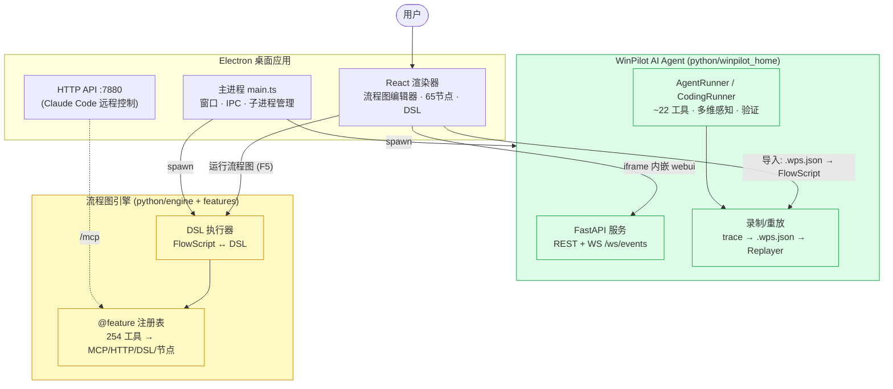

# 灵动脚本 · 文档

> 本目录是项目的**当前**架构文档（2026-06，对应分支 `feat/winpilot-agent`）。
> 旧的 2026-06-06 分析快照（描述已删除的 LingdongAgent）已整体移除并重写。
> 权威速览另见仓库根目录 `CLAUDE.md` 顶部「架构现状」。

## 这是什么

**灵动脚本**是一个 **Windows 桌面自动化系统**，两大能力合一：

1. **AI Agent（WinPilot）** —— 让 LLM 实时操控真实电脑（点击/输入/识图/浏览器/窗口进程），自带多维感知与逐步验证。
2. **可视化流程图编辑器** —— 把自动化流程画成节点图（65 种节点 + DSL），一次生成可永久**零 Token** 重放；agent 跑过的流程可录制、转成可编辑流程图、混入指令库节点。

核心理念：**一次 AI 生成 → 永久零 Token 执行**，同时保留"像通用 Agent 一样临场操控"的能力。

## 文档导航

| 文档 | 内容 |
|---|---|
| [architecture.md](architecture.md) | 总体架构：两大子系统、进程/端口、桥接关系、数据流（含系统图） |
| [winpilot-agent.md](winpilot-agent.md) | WinPilot AI Agent 深度：执行循环、~22 工具、多维感知、动作+验证、编程子 agent、记忆/playbook |
| [replay-recording.md](replay-recording.md) | 重放与录制：`.wps.json` 格式、离线 0-token Replayer、人类演示录制、wps→流程图导入、三套录制 |
| [flow-editor.md](flow-editor.md) | 流程图编辑器：React 前端、65 节点、DSL、执行引擎、@feature 注册表（254）、HTN |
| [apis.md](apis.md) | 接口：三个服务/端口、Electron IPC、HTTP API :7880、WinPilot REST、三个 MCP 入口 |

## 一页架构总览

**关键边界**：WinPilot agent **只有 ~22 个精简工具，完全不用 254 个 @feature**，也不感知流程图格式——这是刻意的，避免拖垮 agent。@feature/65 节点/DSL 只服务于流程图编辑器、引擎、MCP、HTTP API。agent 的产物（`.wps.json`）通过**纯代码转换层**变成原版流程图节点后才进编辑器。详见 [architecture.md](architecture.md)。
