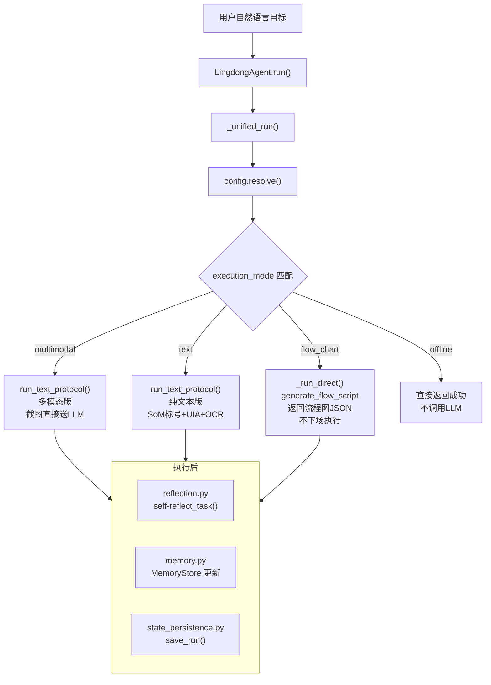
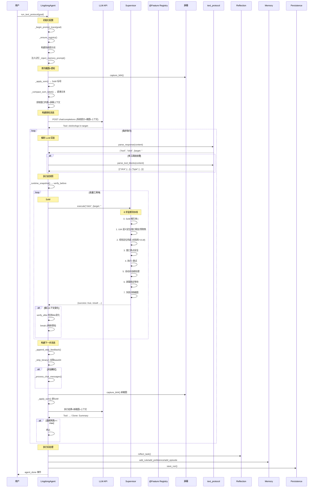
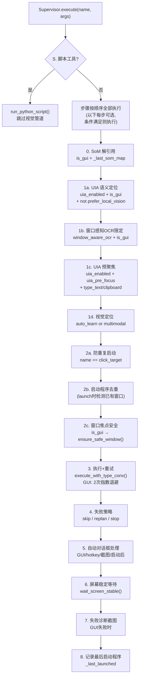
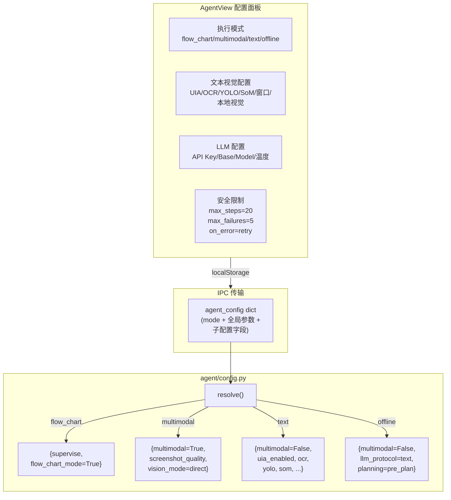
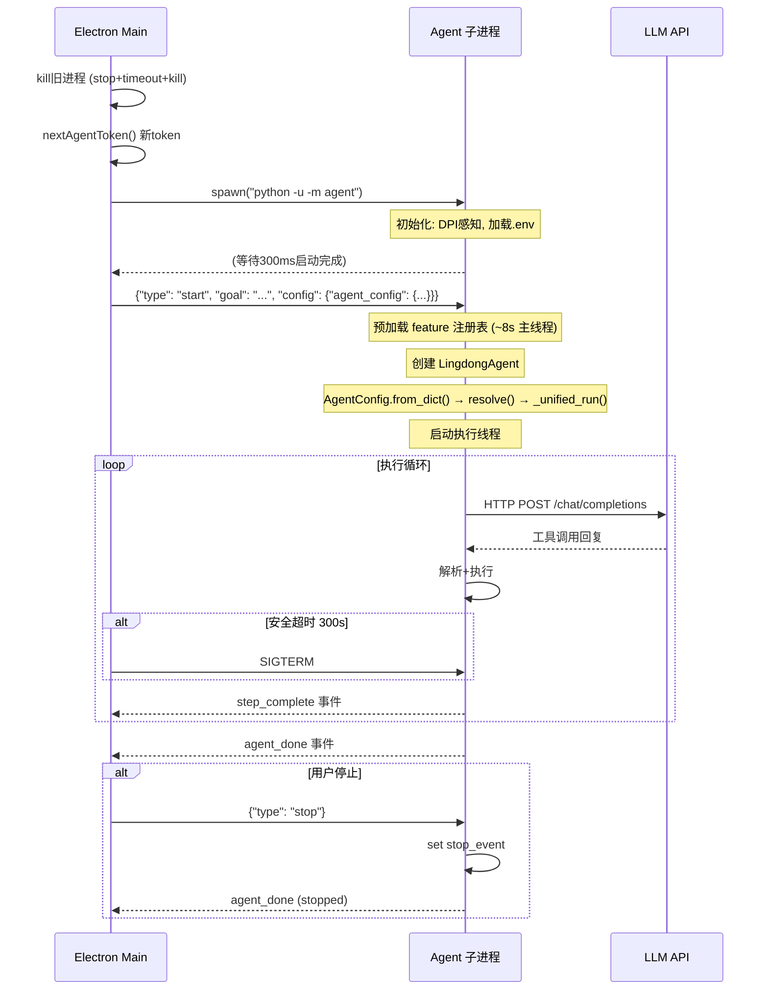

# Agent Runtime 深度分析

> **文档**: `docs/agent-runtime.md`
> **核心文件**: `python/agent/agent.py`, `prompts.py`, `__main__.py`, `supervisor.py`, `config.py`

---

## 1. Agent 执行模式总览



> **旧路由已移除**: 之前有 `resolve_auto()` / `agent_config_from_legacy()` / `LangGraph` / `Planned` / `ComputerUse` 等 5 种旧执行模式。现在统一通过 `AgentConfig.execution_mode` + `resolve()` 分发，仅保留上述 4 种模式。

---

## 2. 4 种执行模式对比

| 特性 | text_protocol (多模态) | text_protocol (纯文本) | flow_chart | offline |
|------|----------------------|----------------------|------------|---------|
| **适用模型** | 多模态 (GPT-4o, Claude Vision) | 纯文本 (DeepSeek, MIMO) | 任意 | 任意 |
| **通信协议** | Tool:/Args:/Done: 文本块 | Tool:/Args:/Done: 文本块 | generate_flow_script | 无 LLM |
| **循环方式** | LLM→解析→执行→截图→重复 | LLM→解析→执行→截图→重复 | 无循环，立即返回 | 无循环 |
| **视觉方案** | 多模态直传 (截图送LLM) | SoM/UIA/OCR | N/A | N/A |
| **LLM 调用** | 每步1次 | 每步1次 | 仅1次 | 0次 |
| **执行成本** | 多次LLM调用 | 多次LLM调用 | 1次LLM | 免费离线 |
| **截图** | 每步1张 (送模型) | 每步1张 (SoM) | 无 | 无 |
| **错误处理** | 重试/停止/跳过 + 去重 | 重试/停止/跳过 + 去重 | N/A | N/A |
| **对话模式** | ✅ guidance_queue | ✅ guidance_queue | ❌ | ❌ |
| **记忆/反思** | ✅ | ✅ | ❌ | ❌ |
| **最佳场景** | 多模态模型 | 纯文本模型 + SoM | 仅流程图生成 | 调试/无网络 |
| **入口方法** | `run_text_protocol()` | `run_text_protocol()` | `_run_direct()` | — |

---

## 3. text_protocol 执行循环 (最常用模式)



---

## 4. Supervisor 监督执行流水线



---

## 5. IPC 协议 (stdin/stdout JSON)

### Electron → Agent (stdin 命令)

| 命令 | 字段 | 说明 |
|------|------|------|
| `start` | `goal`, `config` (含 `agent_config` dict) | 启动 Agent |
| `stop` | — | 优雅停止 |
| `guidance` | `text` | 注入用户指引 |
| `chat` | `text` | 对话模式消息 |
| `status` | — | 查询状态 |
| `memory_query` | — | 查询记忆快照 |

### Agent → Electron (stdout 事件)

| 事件 | 关键字段 | 触发时机 |
|------|----------|----------|
| `agent_start` | goal, engine, model | Agent 开始运行 |
| `plan_state` | plan (DAG) | 计划状态更新 |
| `step_complete` | step_num, tool, args, status, result, thought | 每步完成 |
| `agent_done` | status, total_steps, summary, fail_reason | Agent 结束 |
| `log` | level, message | 任何日志 |
| `agent_reflection` | step_num, insight, rule | 每步反思 |
| `agent_learned` | rules_count, prefs_count, insights, mistakes | 学习结果 |
| `memory_snapshot` | preferences, rules, episodes 计数 | 记忆快照 |
| `agent_chat_response` | text | AI 聊天回复 |
| `status_report` | running, stopped | 状态响应 |
| `error` | message, traceback | 未处理错误 |

---

## 6. AgentConfig 配置系统



### config.py — AgentConfig 数据结构

```python
@dataclass
class AgentConfig:
    execution_mode: str = "flow_chart"  # flow_chart | multimodal | text | offline
    
    # 全局
    memory_enabled: bool = False
    max_steps: int = 20
    max_consecutive_failures: int = 5
    min_success_rate: float = 0.1
    temperature: float = 0.1
    max_tokens: int = 4096
    llm_retries: int = 2
    screenshot_quality: int = 60
    sliding_window_size: int = 0
    on_error: str = "retry"
    
    # 子配置（mode-specific）
    flow_chart_cfg: FlowChartConfig
    multimodal_cfg: MultimodalConfig
    text_vision_cfg: TextVisionConfig
    offline_cfg: OfflineConfig

    def resolve() -> dict:   # 展平成运行时扁平字典
```

**子配置一: FlowChartConfig**
- `supervise: bool` — 监督执行开关

**子配置二: MultimodalConfig**
- `screenshot_quality: int` — 唯一可配参数 (default 60)

**子配置三: TextVisionConfig** (纯文本模型成功路径)
- `uia_enabled: bool` — UIA 控件树 (default False)
- `ocr_enabled: bool` — OCR 文字检测 (default True)
- `yolo_enabled: bool` — YOLO 图标检测 (default False)
- `som_enabled: bool` — SoM 标号 (default True)
- `window_aware_ocr: bool` — 窗口限定 (default True)
- `local_vision: bool` — 本地视觉引擎 (default False)
- `visual_strategy: str` — som | ocr_llm | blind_guess | cli_path
- `llm_protocol: str` — text | function_calling
- `planning: str` — per_step | pre_plan

---

## 7. Agent 进程生命周期



### 统一路由流程

```
__main__.py: _run_agent()
  +-- cfg["agent_config"] → AgentConfig.from_dict()
  |   +-- execution_mode 指定 4 种之一
  |   +-- 子配置由 from_dict() 自动填入
  +-- agent.run(agent_config=cfg) → _unified_run()
  |   +-- config.resolve() → 展平成扁平 dict
  |   +-- 更新 supervisor / LLM 参数
  |   +-- _inject_memory_prompt() + _emit("memory_snapshot")
  |   +-- 按 execution_mode 分发:
  |   |   flow_chart → _run_direct()
  |   |   multimodal → run_text_protocol()
  |   |   text      → run_text_protocol()
  |   |   offline   → 直接返回
  +-- post-task: reflection + memory + persistence
```
