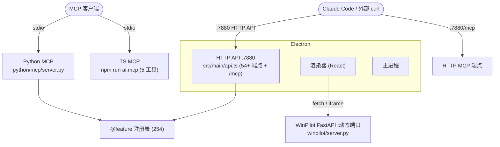

# 接口与协议

> 三个服务/端口，加 Electron IPC、HTTP API、WinPilot REST、三个 MCP 入口。

## 1. 服务与端口一览

| 服务 | 端口/通道 | 用途 |
|---|---|---|
| HTTP API | `:7880`（`API_PORT` 可覆盖） | Claude Code 远程实时控制前端 + `/mcp` |
| WinPilot FastAPI | 动态端口（仅 127.0.0.1，CORS 全开） | agent 聊天/状态/trace/脚本/重放/录制 + WS 事件流 |
| Python MCP | stdio JSON-RPC | 由 254 @feature 动态生成 MCP 工具 |
| TS MCP | stdio | 5 工具（run_flow/list_flows/create_flow/ask_ai/screen_capture） |
| Agent IPC | stdin/stdout JSON | 主进程 ↔ WinPilot agent 子进程 |
| 引擎 IPC | stdin/stdout JSON | 主进程 ↔ 流程图执行引擎 |

## 2. HTTP API `:7880`（节选，`src/main/api.ts`）

供外部（如 Claude Code）curl 实时操控前端画布：

| 端点 | 用途 |
|---|---|
| `POST /api/ping` | 健康检查 |
| `POST /api/load-script` | 加载完整流程图 |
| `POST /api/run-dsl` | DSL 文本 → 流程图 |
| `POST /api/add-node` / `update-node` / `delete-nodes` | 节点增改删 |
| `POST /api/add-edge` / `delete-edges` / `auto-layout` | 连线/排版 |
| `POST /api/create-flow` | DSL/自然语言 → 流程图（含参数检查） |
| `POST /api/engine/start` / `pause` / `resume` | 执行引擎控制 |
| `POST /api/macro/*` | 宏录制启停/列表/播放（F6） |
| `POST /api/agent-start` | 启动 AI Agent |
| `POST /api/features/{list,reload,call}` | @feature 自省/调用 |
| `POST /mcp` | MCP over HTTP（JSON-RPC，首启自动注册到 `~/.claude.json`） |

完整端点见 `src/main/api.ts` 的 `switch (url.pathname)`。

## 3. WinPilot REST（`python/winpilot_home/winpilot/server.py`）

渲染器 Agent 面板 + 「导入/录制」hub 调用（CORS 全开，因仅绑 127.0.0.1）：

| 端点 | 用途 |
|---|---|
| `POST /api/chat` / `stop` / `interject` | 启动任务 / 停止 / 实时插话 |
| `GET /api/status` / `config`，`PATCH /api/config` | 运行状态 / 配置读写 |
| `GET /api/traces` / `trace/{run_id}` / `trace/{id}/shot/{name}` | 列出/读取 trace + 截图 |
| `POST /api/export/{run_id}` | trace → `.wps.json` |
| `GET /api/scripts`，`GET/PUT /api/script/{file}` | 列出/读写 `.wps.json`（PUT 带 schema 校验） |
| `POST /api/replay` | 离线 0-token 重放 `.wps.json` |
| `POST /api/human/{start,stop,status}` | 人类演示录制器 |
| `GET/POST/PUT/DELETE /api/memory`，`/api/session` | 经验记忆 / 会话上下文 |
| `WS /ws/events` | 实时 BUS 事件流（agent_start/step/tool/usage/chat/replay…） |

## 4. MCP 三入口

1. **Python MCP（主）** `python python/mcp/server.py`：由 @feature 注册表动态生成工具（过滤 hidden/deprecated），覆盖交互/感知/控制流/AI规划/宏/系统/调试 7 类。
2. **TS MCP（桥接）** `npm run ai:mcp`：5 个工具用于前端集成与文件管理。
3. **HTTP MCP** `POST :7880/mcp`：标准 MCP JSON-RPC，首次启动自动注册到 `~/.claude.json`。

## 5. Electron IPC

`preload.ts`（contextBridge 暴露）→ `main.ts`（handler）→ Python 子进程。WinPilot 相关：`winpilot:url`（iframe 地址）、`winpilot:ensure`（确保/重启服务 + 返回错误详情）、`agent:*`（start/stop/guidance/chat/status）。所有 Python 子进程经 `spawnPython()` 强制 `PYTHONIOENCODING=utf-8`。
