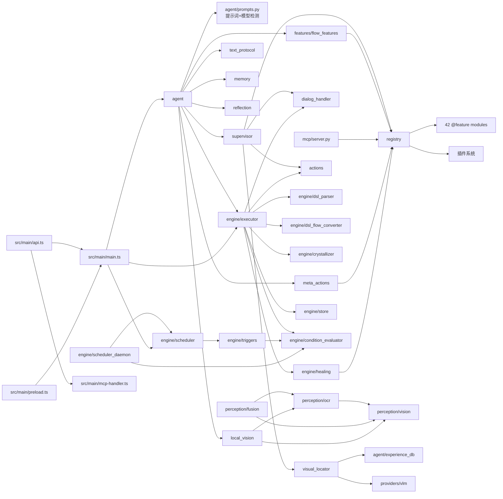

# 系统架构分析 (Part 1: 总体架构)

> **文档**: `docs/architecture.md`
> **版本**: v2.0 | **生成日期**: 2026-06-06
> **前置阅读**: [system-map.md](system-map.md)

---

## 1. 总体架构图

```mermaid
graph TB
    %% ==================== 用户层 ====================
    subgraph User["用户接口层"]
        Canvas["FlowCanvas<br/>可视化流程图编辑器"]
        AgentView["AgentView<br/>AI Agent 配置面板"]
        HTTP_CLI["HTTP API / MCP<br/>Claude Code 远程控制"]
        DSL_Editor["伪代码编辑器<br/>DSL 文本编辑"]
    end

    %% ==================== 前端层 ====================
    subgraph Renderer["Electron Renderer (React + Zustand)"]
        Store["Zustand Store<br/>全局状态管理<br/>script / ui / execution"]
        HTN["HTN Planner<br/>层次化任务网络<br/>10 primitive + 8 composite"]
        Executor["Browser Executor<br/>纯前端流程图执行器"]
        NodeLib["NodeLibrary<br/>55 种节点类型定义"]
    end

    %% ==================== 网关层 ====================
    subgraph Main["Electron Main Process"]
        IPC_Bridge["ipcMain<br/>30+ IPC 处理程序<br/>文件/引擎/Agent/截图/OCR"]
        API_Server["HTTP API Server<br/>:7880<br/>54 端点 + /mcp"]
        MCP_TS["TypeScript MCP<br/>5 tools<br/>stdio/HTTP"]
        Engine_Bridge["Engine Bridge<br/>Python 进程管理<br/>3 级: 持久/单次/原始"]
        Scheduler_Bridge["Scheduler Bridge<br/>APScheduler 守护进程"]
        Feature_Bridge["FeatureCallBridge<br/>持久化 @feature 调用"]
        Process_Mgr["子进程管理器<br/>Agent / 引擎 / 宏录制器"]
    end

    %% ==================== Python 后端 ====================
    subgraph Agent_System["AI Agent 系统"]
        Agent_Main["agent/__main__.py<br/>IPC 入口<br/>stdin/stdout JSON"]
        Lingdong["LingdongAgent<br/>4 种执行模式:<br/>flow_chart/multimodal<br/>text/offline"]
        Supervisor["Supervisor<br/>8 步监督流水线<br/>SoM→UIA→视觉→聚焦<br/>→执行→对话框→稳定→诊断"]
        MetaActions["meta_actions.py<br/>27 元动作<br/>高层 LLM 接口"]
        TextProtocol["text_protocol.py<br/>Tool:/Args: 协议解析"]
        Router["tool_path_selector.py<br/>7 级路径选择<br/>L0 DIRECT~L6 DSL"]
        Memory["memory.py<br/>长期记忆<br/>偏好/规则/经验"]
        Reflection["reflection.py<br/>两阶段自我反思<br/>模式匹配 + LLM"]
    end

    subgraph Engine_System["DSL 引擎系统"]
        DSLParser["dsl_parser.py<br/>78 关键字 AST 解析"]
        DSLExecutor["executor.py<br/>状态机执行器<br/>IDLE→RUNNING→..."]
        FlowConverter["dsl_flow_converter.py<br/>DSL↔FlowScript 双向转换"]
        Crystallizer["crystallizer.py<br/>模板结晶化"]
        Healing["healing.py<br/>自愈流水线<br/>4 级降级策略"]
        Store_P["store.py<br/>SQLite 持久化<br/>检查点/遥测/金库"]
        Optimizer["optimizer.py<br/>遥测驱动优化"]
        Condition["condition_evaluator.py<br/>11 种条件求值"]
    end

    subgraph Feature_System["@Feature 注册系统"]
        Registry["registry.py<br/>FeatureRegistry 单例<br/>@feature 装饰器"]
        Feature_Modules["42 模块<br/>246 注册 / 227 MCP 可见<br/>懒加载"]
        MCP_PY["mcp/server.py<br/>Python MCP Server<br/>~227 tools (动态)"]
    end

    subgraph Trigger_System["触发器系统"]
        Triggers["triggers.py<br/>6 种 watcher<br/>文件/进程/窗口/剪贴板/网络/定时"]
        Scheduler["scheduler.py<br/>优先级任务队列"]
        Daemon["scheduler_daemon.py<br/>独立 APScheduler 进程"]
        NLP["nlp_schedule_parser.py<br/>NL→Cron 表达式"]
    end

    subgraph Perception_Layer["感知层"]
        OCR_Engine["ocr.py<br/>6 后端自动选择<br/>WinOCR→Rapid→Easy→Paddle→Umi→Tesseract"]
        Vision_Engine["vision.py<br/>模板匹配/颜色检测<br/>进度条/场景识别"]
        Fusion["fusion.py<br/>UIA→OCR→模板<br/>三级融合定位"]
        Local_Vision["local_vision_engine.py<br/>YOLOv8 + MobileNet + OCR<br/>本地 GPU 推理"]
        Visual_Locator["visual_locator.py<br/>语义→坐标定位<br/>经验库+VLM"]
    end

    subgraph Execution_Layer["执行层"]
        Actions["actions.py<br/>ActionHandler<br/>16+ 动作优先级链"]
        Dialog["dialog_handler.py<br/>Win32 API 对话框处理<br/>9 种类型"]
        Menu["menu_handler.py<br/>三层菜单策略<br/>win32→键盘→UIA"]
        Browser["browser_features.py<br/>Playwright 浏览器自动化"]
        Wheel["wheel_selector.py<br/>全屏 Tkinter 滚轮选择器"]
        Providers["providers/<br/>LLM API 客户端<br/>DeepSeek / OpenAI / VLM"]
    end

    %% ==================== 连接 ====================
    Canvas --> Store
    AgentView --> Store
    DSL_Editor --> Store
    Store --> IPC_Bridge
    HTN --> Store
    Executor --> Store

    HTTP_CLI --> API_Server
    API_Server --> IPC_Bridge
    IPC_Bridge --> Engine_Bridge

    Engine_Bridge --> Lingdong
    Engine_Bridge --> DSLExecutor
    Engine_Bridge --> MCP_PY
    Feature_Bridge --> Registry

    Agent_Main --> Lingdong
    Lingdong --> Supervisor
    Lingdong --> MetaActions
    Lingdong --> TextProtocol
    Lingdong --> Memory
    Lingdong --> Reflection
    Lingdong --> Router
    Lingdong --> Local_Vision

    Supervisor --> Visual_Locator
    Supervisor --> Dialog
    Supervisor --> Registry

    Lingdong --> FlowFeatures["features/flow_features<br/>generate_flow_script"]

    MetaActions --> Registry

    DSLExecutor --> DSLParser
    DSLExecutor --> Registry
    DSLExecutor --> Condition
    DSLExecutor --> Healing
    DSLExecutor --> Crystallizer
    DSLExecutor --> Store_P
    DSLExecutor --> Dialog

    FlowConverter <--> DSLParser

    Registry --> Feature_Modules
    Registry --> Actions
    MCP_PY --> Registry

    Triggers --> Condition
    Daemon --> Scheduler
    Daemon --> Condition

    OCR_Engine --> Vision_Engine
    Fusion --> OCR_Engine
    Fusion --> Vision_Engine
    Local_Vision --> Perception["perception/ocr+vision"]

    Dialog --> Registry
    Menu --> Registry
```



---

## 2. 模块职责说明

| 模块 | 位置 | 职责 | 关键类/函数 | 行数 |
|------|------|------|-------------|------|
| **Agent Runtime** | `python/agent/` | AI 驱动的桌面自动化执行，4 种模式 | `LingdongAgent`, `Supervisor`, `prompts.py` | ~5500 |
| **DSL Engine** | `python/engine/` | DSL 脚本解析、执行、优化、结晶 | `DSLExecutor`, `DSLParser`, `PlanExecutor` | ~5000 |
| **Feature Registry** | `python/features/` | 246 工具注册、lazy load、多协议导出 | `FeatureRegistry`, `@feature` | ~12000 |
| **IPC Gateway** | `src/main/` | Electron 主进程，子进程管理，HTTP API | `main.ts`, `api.ts`, `engine.ts` | ~3000 |
| **Frontend** | `src/renderer/` | 流程图编辑器，Agent 配置，状态管理 | `Zustand Store`, `FlowCanvas` | ~5000 |
| **Perception** | `python/perception/` | OCR、图像匹配、颜色检测、场景识别 | `OCREngine`, `TemplateMatcher` | ~1400 |
| **Interaction** | `python/interaction/` | 鼠标/键盘/窗口底层操作 | `ActionHandler`, `WheelSelector` | ~1000 |
| **Scheduler** | `python/engine/` | 定时调度，6 种事件触发器 | `TriggerEngine`, `TaskScheduler` | ~1500 |
| **MCP** | `python/mcp/` + `src/ai-interface/` | 3 个 MCP 入口 | `mcp/server.py`, `mcp-handler.ts` | ~1000 |
| **Memory** | `python/agent/` | 长期记忆，自我反思，经验复用 | `MemoryStore`, `ReflectionEngine` | ~1200 |

---

## 3. 数据流向

### 3.1 用户操作 → 执行

```
用户拖拽流程图或输入自然语言
  → Zustand Store 更新 script.nodes/edges
  → IPC engine:start (FlowScript JSON)
  → Engine Bridge (engine.ts)
    → spawn Python engine/engine.py
      → DSLParser: FlowScript → DSL → AST
      → DSLExecutor: 状态机遍历 AST
        → ActionHandler: 每步执行
      → Crystallizer: 成功自动保存模板
    → stdout JSON 事件
  → IPC engine-message 通道
  → Store 更新 execution/node_status
  → React 组件重渲染 (FlowNode 高亮)
```

### 3.2 AI Agent → 执行

```
AgentView 输入目标 + 配置
  → IPC agent:start
  → AgentIPC (__main__.py)
    → LingdongAgent.run()
      → _unified_run() 按配置分派
        → LLM 调用 → 解析 Tool:/Args:
        → Supervisor.execute() 8 步流水线
          → SoM/UIA/OCR 定位
          → 窗口焦点 + 对话框处理
          → FeatureRegistry.execute()
          → 截屏验证
      → Reflection.reflect_task()
      → MemoryStore.update()
    → stdout JSON 事件 (step_complete/log/agent_done)
  → AgentView UI 更新
```

### 3.3 Claude Code → 控制前端

```
curl POST :7880/api/*
  → api.ts switch(url.pathname)
    → 直接处理 (ping/get-state/features)
    → IPC → Renderer (api-command)
    → spawnPythonOneShot (DSL/OCR)
    → Python MCP over HTTP (/mcp)
```

---

## 4. 模块依赖深度



---

## 5. 关键设计模式总结

| 模式 | 使用位置 | 描述 |
|------|----------|------|
| **Singleton** | `FeatureRegistry`, `ExecutionStore`, `MemoryStore` | 全局唯一实例 |
| **Registry** | `@feature` 装饰器 | 功能自动注册+多协议导出 |
| **Decorator** | `@feature(...)`, `@trigger_type(...)`, `@condition(...)` | 声明式注册 |
| **Strategy** | 7 级路径选择, OCR 6 后端, 菜单 3 层策略 | 运行时策略切换 |
| **Chain of Responsibility** | Supervisor 8 步流水线, 融合定位 UIA→OCR→模板 | 逐步降级 |
| **State Machine** | DSLExecutor (6 状态), FlowScript (节点状态) | 确定性状态管理 |
| **Observer** | IPC 事件 (node_start/done/log), Zustand store.subscribe | 事件驱动更新 |
| **Lazy Loading** | `_FEATURE_MODULES` 42 模块 | 启动时零开销 |
| **Adapter** | `AppAdapter` 应用适配器基类 | 应用特定逻辑 |
| **Template Method** | `AppAdapter._match_window()` / `_launch_command()` | 子类覆盖 |
| **Proxy** | `MimoAgent` → `LingdongAgent` | 向后兼容 |
| **Singleton + Lock** | `threading.RLock()` in MemoryStore, ExperienceDB | 线程安全 |
