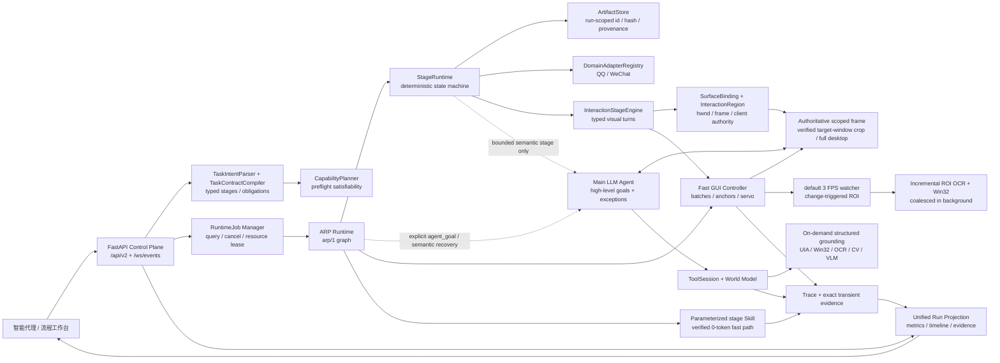
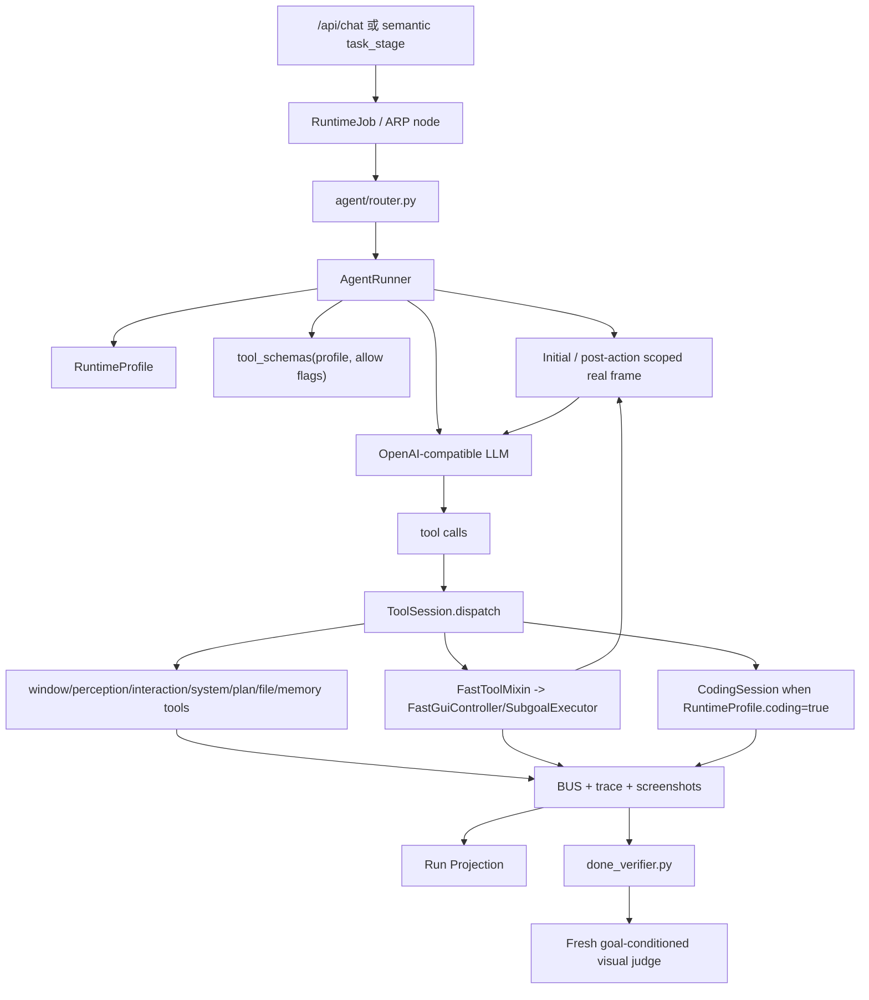

# GUI Agent + ARP 架构

项目对用户呈现为一个原生 Agent Runtime Platform。主模型负责目标、异常和策略；ARP 图负责编排；Fast GUI Controller 负责动作内环；真实帧闭环、按需结构化感知、World Model、trace 和 Run Projection 共同维护可验证状态。

## 总览



## 统一控制平面

前端 `src/renderer/components/platform/PlatformWorkbench.tsx` 不再嵌入旧 WebUI。智能代理、流程工作台、运行记录、技能与学习、系统设置都读取同一套 `/api/v2` contract 和 WebSocket 事件；主体工作台文案使用中文，API、MCP、VLM、URL、坐标字段等技术标识仍保留原名。

后端核心路径：

- `orchestrator/contracts.py`：版本化 `arp/1` 图、节点、重试、Controller 动作白名单和运行前严格验证契约。
- `orchestrator/runtime.py`：图运行、条件、证据门、人工门、取消和节点重试；显式失败恢复边优先于 `fail_fast`。
- `orchestrator/adapters.py`：Agent Goal、Action Batch、Memory-backed Skill Replay、legacy 节点适配和最终运行结果驱动的记忆反馈。
- `orchestrator/projection.py`：将 ARP、Agent、Controller、Perception、Replay 事件折叠成统一运行视图，并从 JSONL trace 恢复历史。
- `tasking/intent.py`、`tasking/compiler.py`：结构化 operation/media/channel/recipient/source/destination，并编译 typed stages、artifact binding 和 completion obligations。
- typed 主路径只使用 `TaskContractCompiler` 持有的同一个 `TaskIntent`：CapabilityPlanner、StageRuntime、ToolSession/AgentRunner、perception 和 Completion Contract 共享该对象，通信上下文由当前 stage 显式注入；只有没有 Task Contract 的 legacy 直连入口才回退解析原句。
- `tasking/capability.py`：以阶段要求与选定 evidence provider 要求的并集做运行前可满足性检查，生成阶段动态工具、Controller、Adapter 和 model role。
- `tasking/stage_runtime.py`、`tasking/artifacts.py`：执行本地状态机并管理 run-scoped 工件；观察帧默认不可发送。
- 阶段 Skill 按 `stage_type + parameters + app_version` 组合，保存前置条件、输出 artifact、验证条件和失败原因；重放成功仍做当前状态验证，miss/fail 只回到当前 `task_stage`，不会重启整项任务。
- `tasking/interaction_stage_runtime.py`、`tasking/interaction.py`：执行实时视觉交互阶段，要求模型输出绑定到确切 frame/artifact 的 typed turn，并把合法动作转换为本地 Controller transaction。
- `perception/surface_binding.py`：用目标 hwnd、capture scope、物理 frame region 和窗口 client authority 维持稳定交互面；检测缺失、初始含糊、陈旧帧、坐标空间变化和未经确认的布局位移均 fail-closed。
- `tasking/adapters.py`、`tasking/completion.py`：通信领域动作与合同验收；粘贴预览不算送达，图片完成要求同一 artifact 的真实发送和发送后视觉对应证据。
- `runtime_jobs.py`：统一 Agent、ARP、Replay 和 schedule 的异步生命周期、取消、查询和 `interactive_runtime` 资源租约。
- Memory verification 也使用同一个 `interactive_runtime` 租约；它不会与 Agent、ARP 或普通 replay 并发争用桌面。
- `automation_ir.py`：新流程和 Skill 的规范 artifact；WPS/FlowScript 是受检 adapter。
- `platform/flowToArpGraph.ts`：把可视化 FlowScript 保守编译为 `arp/1`；点击、文字锚点、输入、键盘、拖拽、启动、聚焦、截图、剪贴板和部分组合节点直接编译为 Controller batch；其余旧节点显式标记 `legacy_flow` 并在运行前拒绝。
- `orchestrator/catalog.py` 的 `CapabilitySpec.flow_node_types` 与 renderer 的 `RUNNABLE_FLOW_NODE_TYPES` 共同形成可见节点目录；只有交集进入节点库和统一搜索。旧定义仍用于打开历史文件，不代表可新建或可运行。

### ARP 节点

原生节点包括 `start`、`end`、`task_stage`、`agent_goal`、`action_batch`、`skill_replay`、`condition`、`delay`、`set_variable`、`evidence_gate`、`human_gate`。每个节点都有 retry、timeout、disabled 和分支语义；自然语言前端入口生成 `task_stage`，`agent_goal` 保留给显式 ARP/兼容调用。

默认新流程是合法且无副作用的 `ARP 低延迟起步流程`，可以直接 Validate/Run。真实复杂流程通常是：

```text
start -> stage_skill -- hit -----------------------> next typed stage
             | miss / replay or post-verify failure
             v
         task_stage -> task_stage -> ... -> completion contract -> end
             | deterministic stage              |
             | semantic stage                    +-> ArtifactStore / DomainAdapter
             +-> bounded AgentRunner
```

实时、共享或状态依赖的界面交互使用独立的 typed 子图，而不是把整句话留给逐点击 Agent：

```text
ObserveScene -> InferInteraction -> PerformTurn -> VerifyLocalEffect
                                                       |
                                                       +-> end (bounded task)
                                                       +-> WaitForExternalChange (persistent session)
```

- `ObserveScene` 捕获不可发送的 observation artifact，绑定目标窗口、权威 frame identity 和候选交互面。
- `InferInteraction` 从原始任务和这张确切画面推断参与者、角色、轮次、规则、`InteractionRegion`、typed actions 与 expected effect。模型不提交物理屏幕坐标。
- `PerformTurn` 只在已证明 Agent 拥有当前轮次时提交一个语义回合；同一回合可包含不依赖中间未知画面的多个 Controller 事件。
- `VerifyLocalEffect` 对动作后权威帧做局部像素证据与原始任务条件下的语义核验。最终 `interaction.task_completed` 必须来自最新权威帧上的独立终态核验，不能由 Controller `ok`、`interaction.turn_resolved` 或任意像素变化替代。
- `WaitForExternalChange` 只用于合同声明的持续会话，watch scope 被限制在已绑定交互区；它不会伪造外部参与者动作，`interaction.external_change_observed` 也只是循环控制/遥测证据，不是最终完成义务。

## 进程和端口

| 进程/服务 | 入口 | 说明 |
| --- | --- | --- |
| Electron HTTP API | `src/main/api.ts` | 默认 `127.0.0.1:7880`，供外部控制前端和查询状态 |
| WinPilot FastAPI | `python/winpilot_home/serve.py` | 由 Electron 托管或手动启动；不要直接跑 uvicorn |
| 原生 Runtime Platform | `src/renderer/components/platform/` | 中文智能代理、流程工作台、运行记录、技能与学习、系统设置 |
| Legacy IPC agent | `python/agent/__main__.py` | Electron stdin/stdout JSON-line 到 WinPilot BUS 的适配器 |
| GUI eval script | `scripts/gui_eval_run.py` | 走同一个 `/api/chat` 路径，写 compact eval 报告 |

`/api/status.runtime` 会返回 runtime contract v2、repo root、PID、动态端口、进程加载/当前 Git commit，以及 Python 源码的 `loaded_stamp`、`current_stamp`、`drifted`。源码漂移一旦在当前进程中被观察到就保持为 true；renderer 会阻止新任务并在空闲时请求重启，`POST /api/v2/arp/runs` 也会独立返回 409。排查多 worktree、热更新后旧解释器或错误服务实例时先看这些字段，不能只看当前 HEAD。
Electron renderer 会等待 `winpilot:ensure` 返回本实例托管的随机端口；固定 `127.0.0.1:8765` 只用于纯浏览器/手动服务 fallback，不能在托管服务仍处于 `starting` 时抢先连接旧实例。

## Agent 与 Controller



关键文件：

| 文件 | 职责 |
| --- | --- |
| `agent/loop.py` | LLM 主循环、上下文折叠、工具调用、usage、done gate 编排 |
| `agent/runtime_profile.py` | 判断本次 run 是否启用 Coding Runtime、workspace、max steps |
| `agent/task_rules.py` | GUI-only、coding task、可见 literal、done gate 辅助规则 |
| `agent/gui_plan_helpers.py` | 通用 GUI schema profile 与纯打开窗口计划判断等 helper；不编码猫、狗或单一应用测试题 |
| `agent/tool_schemas.py` | function-calling schema、allow flags、`standard/lean_gui`；`drawing_gui` 仅是手工配置兼容别名，自动路由不会选择专属绘图 Agent |
| `agent/tools.py` | `ToolSession` 状态、dispatch、目标 hwnd、world、undo stack |
| `agent/*_tools.py` | 具体工具 mixin |
| `agent/done_verifier.py` | 防假成功核验 |
| `fast/subgoal.py` | controller-first routine：输入、点击、绘图、等待、验证 |
| `fast/controller.py` | 本地低延迟动作执行和 fast metrics |
| `action/raw_device.py` | batch 内常见动作直接调用已授权 handler，避免递归 dispatch |
| `fast/perception_daemon.py` | 按 hwnd 共享 watcher 与 ElementCache 的短期常驻 lease |
| `perception/fusion.py` | UIA/Win32/OCR/CV/VLM snapshot 融合 |
| `perception/reducer.py` | 给 LLM 的 compact 感知摘要 |
| `recorder/trace.py` | 异步 trace/截图、Automation IR 主导出、WPS 兼容导出、replay |
| `scheduler.py` | WinPilot Agent 内部计划任务 |
| `model_adapter.py` | provider、thinking 默认、usage/cache/cost 归一化 |

## 状态机

一次直接 `/api/chat` 或有界 semantic/recovery stage 的 AgentRunner 子路径状态流：

```text
queued
  -> waiting_resources（已有交互任务时）
  -> running
  -> LLM step
  -> tool dispatch
  -> evidence written to BUS/trace
  -> done verifier if terminal
  -> done / fail / reply / stopped / error
```

注意：

- `agent_done` 只是运行结束事件，不等于真实任务成功。
- GUI 成功要看 `done_check`、截图、文件/进程/窗口状态和工具 evidence。
- done 被拒绝后，runner 会继续给模型机会修复；judge 异常和超过拒绝阈值都 fail-closed，不会把未验证结果强制升级成 trusted success。

## RuntimeProfile

`RuntimeProfile` 是能力开关，不是 agent 路由：

- 普通 GUI 任务：desktop capability。
- 仓库/代码任务：desktop + Coding Runtime。
- GUI-only 任务：禁用 Coding Runtime，并限制 shell/file 绕路。
- `ToolSession` 使用由 `router.build_runner()` 传入的同一个 profile，避免 runner 和 tools 二次推断不一致。
- `runtime.to_dict().capabilities` 会列出本轮可用能力，例如 `desktop`、`coding`、`replay`、`scheduler`、`automation_ir`、`desktop_action_queue`；这些是 capability，不是用户可见子 agent。

产品层仍只表达一个 Agent；但确定性的前端 typed stage 不会为了形式统一而创建 AgentRunner：

- “帮我改这个 Python 项目” -> Coding Runtime。
- “打开 Photoshop” -> Computer Use / Desktop。
- “部署这个项目” -> Coding + Terminal + Browser 能力协同。

## 模型、提示与动态计划

- `model_adapter.py` 把 `mimo-v2.5` 作为明确支持图片的 native-vision 主模型；`mimo-v2.5-pro` / `mimo-v2-pro` 按 text-only 处理，不能因为名字更强就把截图发给它。MiMo/Reasonix 默认发送 `thinking.disabled`，避免隐藏推理挤占工具参数预算；`api.thinking` 可显式覆盖。实验开关 `controller.native_visual_thinking=false` 默认关闭，它只会在 MiMo native vision 的连续指针几何仍未落地时临时启用，已有真实笔画进展或截断恢复时关闭，不是通用“更聪明”开关。
- `agent/prompts.py` 的基础提示统一为 compact closed-loop contract；`prompt_style` 目前只是兼容输入，不会因 `full` 自动拼接大段领域文本。`agent.playbooks_enabled=false` 默认关闭 playbook，只有用户显式启用才注入匹配内容。提示明确规定真实画面高于 UIA/OCR/规则摘要、每轮最多一笔视觉事务、结果不清楚时 `blocked`，以及不要因工具返回 ok 就宣称完成。
- 连续指针是通用动作形态：手写、签名、描摹、自由路径和画布笔画共用 `drag` / `draw_strokes`、工作面约束和 forward-only 修复；画猫、画狗只是压力测试，不是生产专属能力，也没有对象模板或固定坐标。
- 模型可随时调用 `revise_plan`：用 `steps` 整体替换/清空任务列表，或以原子的 `add`、`update`、`remove`、`move`、`reopen` 操作修改当前 1-based 列表。已完成项随 move 保留，update/reopen 会重新变为 pending；计划只是路线提示，不是完成证据。

## 低延迟 GUI

当前已落地：

- 原生视觉闭环的主路径是 `目标窗口预绑定 → 选择可信画面 scope → 初始真实帧 → 模型决策 → 一笔视觉事务 → 同 scope 动作前重检 → 动作后真实帧 → 下一轮`。`controller.target_window_capture_enabled=true` 默认开启，但只是保守优化：只有目标 hwnd 仍存在、可见、非最小化、就是当前前台、几何可信、至少节省约 8% 桌面面积且任务不要求桌面/多窗口上下文时才裁成目标窗口；否则自动回退完整虚拟桌面。关闭该开关会强制完整桌面，便于 A/B 验证是否负优化。每张模型可见帧都携带 scope/reason/region，坐标始终绑定那一张确切画面。
- 低层视觉动作只能使用匹配当前 hwnd、screen epoch 和窗口区域的新鲜帧。视觉位置以整帧 0..1000 的 `frame_*` 字段提交，由运行时映射到截图对应的物理区域；native schema 不暴露物理 `x/y`。动作前会重新截图：若能从 frame 坐标或当前结构化目标可靠得到动作 ROI，则在目标四周外扩 `controller.visual_preflight_target_margin`（默认 60/1000），按 `controller.visual_preflight_target_change_ratio`（默认 `0.01`）判断；无法可靠定位目标时才按整窗 `controller.visual_preflight_change_ratio`（默认 `0.0025`）判断。超过对应阈值会取消旧动作并把新帧交回模型。缺帧时返回 `visual_grounding_required`；重复无依据操作会安全暂停。
- 原生视觉模型处理普通、无 query `observe` 时，当前 scope 的 JPEG 是权威观测，`native_vision_direct` 跳过 UIA/OCR/VLM 的同帧拆解，且不会暴露重复的二次 VLM 工具。query、`full`、`changed_only`、结构化定位、非视觉模型和 fallback 仍走融合感知；结构化元素与规则不能覆盖相反的真实画面。
- 确定性 Domain Adapter 的观察使用私有 `structured_ui` 模式：先收集 UIA/Win32 结构，跳过全窗 OCR/VLM，再只对收件人栏、确认框、发送按钮或短标签候选区执行 obligation-scoped OCR。这个策略按证据义务缩小感知成本，不把某个应用、联系人或测试坐标写进通用感知层；若目标是自绘/不可访问控件，仍需 scoped OCR、当前帧视觉或显式 fallback。
- OCR 共享引擎按 foreground/background 排队。StageRuntime 在打开会话、发送和验收事务外取得 foreground lease，使尚未开始的预测 OCR 让位给当前合同义务；已经进入 ONNX 的一次推理不能安全抢占，只能等它结束。PerceptionDaemon lease 释放会设置 generation-scoped cancel event、清空 pending，并丢弃释放后才完成或属于旧 generation 的结果，避免跨 run/重获 lease 污染缓存。
- `observe` 严格只读。它可以返回一个已落地的 Controller 提案，但不能从感知路径直接点击、输入或发送；任何桌面 mutation 都必须是下一笔显式事务。
- 实时交互的 `SurfaceBinding` 将视觉候选限制在当前窗口 client authority 内，并把稳定 anchor 与更小的 action ROI 分开：窗口 client region 是安全包络而不是自动可点击区域，中央子集也不会未经连续确认就被当作新的交互面。
- 每个空间动作先核验 observation artifact 的 current-run、purpose、sendable、source window/HWND、实际 capture region、声明 frame region、尺寸、session 和 frame lineage；`ArtifactStore.get()` 还会从磁盘重新核验文件大小、SHA-256 与图像尺寸。任何一项不一致都在坐标映射和物理输入前 fail-closed。
- typed `InteractionAction` 覆盖 `click`、`double_click`、`hover`、`move_mouse`、`drag`、`draw_strokes`、`scroll`、`select_color`、`type_text`、`hotkey`、`hold_key` 和 `wait_stable`。所有空间参数必须落在当前 `InteractionRegion`，并回显当前 frame/artifact identity；Controller 在目标仍为前台且 frame 仍新鲜时才执行本地事务。`mouse_down` / `mouse_up` 只允许作为同一经过平衡校验的 Controller batch 内部动作，与移动/等待组成完整连续事务，不作为独立顶层模型工具。
- `grounding_mode` 区分 `object_anchor`、`semantic_control`、`free_path`、`relative_gesture` 和 `bounded_coordinates`；有可见锚点的点击、拖拽使用当前像素上的多族局部几何修正，自由路径则记录显式 typed policy proof。`effect_region_binding` / `ExpectedInteractionEffect.region_binding` 明确绑定 source、target、surface 或 independent；几何修正后确定性重绑，`auto` 只接受精确 typed 相等，不做 IoU 猜测。
- Task Contract 中的应用启动、聚焦、工件捕获/传递、通信投递、等待和确定性验证由 StageRuntime/Controller 连续执行；LLM 处理目标语义、复杂异常、策略切换和绘图质量。
- `CapabilitySelection` 分别记录 `model_tools` 与 `controller_tools`。绘图模型只提交带语义部件和画布相对几何的场景事务，`draw_strokes` 等原始连续指针能力留在 Controller；每次真实绘图事务后由新鲜目标窗口帧做语义验收，失败只做 forward-only 局部修补。
- `cold_start=true` 是 run 级经验策略，不是测试词特判：编译器移除所有 `skill_replay`，RuntimeProfile 同时关闭经验提示、会话记忆、复用建议、经验写入和反馈，让 E2E 能证明首次探索路径本身可达。
- Communication Adapter 只暴露 `open_conversation`、`resolve_composer`、`paste_or_attach_artifact`、`send_current_composer` 和 `verify_latest_outbound` 等领域能力。QQ 实现使用版本化窗口相对布局、UIA/OCR 和视觉工件匹配；收件人、媒体主题和物理屏幕坐标都不是生产常量。低分辨率附件确认缩略图无法可靠保留像素身份时，预发送绑定要求“当前 run 的精确 artifact/hash/尺寸粘贴回执 + 粘贴前后对齐帧的局部变化 + 新出现的正确收件人单附件确认框”；这只允许执行发送动作，不能满足送达合同。附件确认态与会话中的发送后气泡是两个不同状态，只有后者的发送后同工件匹配能满足送达合同。遗留确认框先做可逆取消并复核，不会被下一次任务沿用。
- 发送后 artifact identity 优先使用 ORB + RANSAC homography，并同时检查匹配框几何、尺度、inlier 比例、目标范围和发送后局部变化；强几何证明成立时直接返回，不再支付 14 组多尺度模板搜索。稀疏线稿、重裁切或大形变缺少足够 keypoint 时才落入 subject-agnostic edge-template fallback；这个 fallback 更慢且可能含糊，不能把“有若干相似边缘”放宽成送达成功。
- `run_action_batch` / ARP `action_batch` 连续执行多个 GUI 动作；动作可以声明 `require_screen_change`、`require_transient`、`require_match`，缺证据即整批失败。
- 满足 `require_transient` 的 press 证据会覆盖底层“未提供 expect”的普通未验证状态并提升为节点级 evidence；捕获成功但证据没有上卷不允许到达 `end`。
- `screen_watch` 持续做便宜帧差；动作前后差分与 watcher 独立，changed-only observe 只理解 ROI。
- 长拖拽和自由路径的动作前新鲜度检查沿实际路径最多均匀采样 12 个局部 ROI，并保留显式 effect region；不再只比较一个跨越端点的大包围框，避免静态背景把局部变化稀释。
- 失败动作是否允许再次调用模型只看 source/target/path/effect 的因果 ROI；整帧 SHA 仅作完全相同时的快路径。无关窗口动画不能伪装成新证据，比较不可用时也 fail-closed，并把 `failed_no_effect_evidence_check` 写入 interaction state 与 trace。
- 鼠标 down 与 up 分离，down 期间同步采样。只在 `delta.changed=true`、press 帧强于 release 后帧时标记 `transient_observed`。
- 瞬态帧会保存为 trace ROI 图片，携带真实屏幕坐标进入 World State；不是只保留 OCR 文本。
- watcher 把普通变化和动作差分 ROI 推给共享 PerceptionDaemon；daemon 合并普通抖动、优先动作变化，只做 OCR/Win32 增量分析，下一次 changed-only observe 可直接消费热缓存。
- verify engine 只并行文件/进程等确定性只读检查与 UIA/OCR；`shell_true` 和所有桌面 mutation 不并发，最终证据仍是 AND 语义。
- `ElementCache` 使用语义、角色、相对位置和当前快照复验；长日志、隐藏标签文本、地址栏不能冒充按钮。
- `click_element` 支持 `visual_anchor`、fallback text、expected region、物理点击和点击前局部视觉伺服修正。
- 按需结构化感知覆盖 UIA、Win32、OCR、传统 CV 和独立 VLM fallback；UIA 丰富时跳过昂贵维度，查询不可靠时定向 OCR。它是原生真实帧的补充，不是纯视觉主路径的前置关卡。
- Perception reducer 只给 LLM compact state，完整元素写入 trace。
- `scope_guard` 在 GUI mutation 前检查前台/目标窗口。若非目标窗口意外抢占前台，Controller 只做有界、应用无关的重新聚焦，要求连续两次前台归属证明，随后废弃旧帧/元素/画布绑定并从 batch 的首个未提交动作继续；已提交动作不会重放，无法恢复则 fail-closed。
- `input_locator` 为 UIA-off 输入框提供 OCR label、placeholder、搜索语义、附近矩形和 synthetic candidate。
- `winpilot` 包入口先初始化 Per-Monitor V2，保证只导入 action executor 的进程也不会落入 DPI 虚拟坐标；`coordinate_diagnostics` / `coordinate_click_test` 再核对物理屏幕和真实鼠标路径。
- `RunProjection` 统一统计 capture、perception、decision、execution、post-verify、replan、VLM 和 skill reuse，并在服务启动时从 trace 恢复历史。typed `stage_trace` 从节点 `runtime_metrics` 保留 `model_calls`、model/Controller/capture 三类耗时和 interaction budget，避免展示摘要截断后丢失审计字段。
- `action/desktop_queue.py` 提供公平资源租约。`physical` 输入全局单写；后台安全的 PostMessage 窗口动作按 `window:<hwnd>` 隔离，不同 hwnd 可并行；同一 hwnd、剪贴板及未知物理目标仍串行。Controller batch 取得一次组合 lease，内部 public action 不重复排队。
- `controller.multi_input_cooperation=false` 是默认关闭的实验开关，不会制造 Windows 并不存在的第二个物理鼠标。开启后优先 UIA/PostMessage 等后台安全输入；物理键盘只在目标就是前台时执行，长按/拖拽/笔画期间持续复核前台和光标，用户移动光标或切走窗口就 fail-closed，中止并由用户取得控制权。`controller.cooperative_cursor_tolerance_px=12` 控制光标所有权容差。
- `action/raw_device.py` 让常见 batch 子动作绕过递归 `ToolSession.dispatch()`；外层权限、scope、trace 和 evidence 仍只执行一次。
- `fast/perception_daemon.py` 按 hwnd 复用 watcher + ElementCache，并维护变化 ROI 的短历史；它过滤光标噪声/大面积视频变化、合并同 ROI 普通更新、保留显式瞬态动作证据。daemon 内环不调用 UIA/VLM，完整融合仍是请求/fallback 路径。
- `recorder/trace.py` 把截图编码/写盘放到有界异步队列，并以 `action_id` 配对 before/after。
- `agent/failure_recovery.py` 的本地恢复探测优先走 `ToolSession.dispatch()`，没有统一 dispatch 时才退回私有 handler；这样 list/focus/observe 恢复动作仍会经过统一 world/screen/watch/scope 入口。

`screen_delta.changed=true`、颜色存在或 `auto_visual_verify.summary_kind=pixel_effect_only` 只说明像素效果发生，不是业务成功或完成证据。原生视觉 GUI 的 `done` 会按相同保守 scope 规则重新捕获新鲜画面，并用用户目标做整图核验；若精确文本只缺少结构化证据，则交给这张新鲜画面的独立 judge 逐字核验，不会为此强制 UIA/OCR observe，也不会直接放行。目标对象、页面、文本或结果看不清时判 false。文件、进程等不可见任务仍以确定性证据为准。

成熟度判断：

- Raw Device adapter 已覆盖常见 Controller mutation；复杂工具仍有意走完整 `ToolSession` 生命周期。
- World Model 已保存窗口、screen bulletin、元素、动作和最近变化；跨 run 的页面阶段分类仍需继续泛化。
- 常规动作可在 Controller/Skill 内环完成，失败回到 Agent/ARP；“所有常规动作都不经 LLM”还不是对任意软件成立的承诺。
- 网页靶场已覆盖真实物理按压的瞬态状态：DOM 收据、非零 ROI、持久化 press 帧、predictive OCR、changed-only 命中和 0 VLM 同时通过。
- 复杂消费软件、远程桌面、游戏和高 DPI 多显示器仍需要更大的 E2E 基准矩阵。
- 当前视觉语义规划与核验仍各需要一次模型调用；快速物理动作并不意味着整项任务低于网络模型延迟。移动目标、遮挡、动画、跨显示器缩放和长会话终止条件仍需单独基准化。
- `structured_ui` 的收益取决于应用暴露的 UIA/Win32 质量；foreground OCR 只能优先排队而不能抢占已经运行的 ONNX 调用；lease cancellation 保证旧结果不进入当前状态，但不等于强杀底层推理。ORB early return 也只适用于通过完整几何与因果变化门槛的强匹配，稀疏或严重变形工件仍需 fallback 与更多耗时。

仍未完成：

- 带正式权重、可部署和可评估的常驻轻量学习型 UI detector（当前 Level 2 是 UIA + OCR + 传统 CV，不冒充 YOLO 已落地）。
- 多显示器/缩放/动画目标下的连续视觉伺服，而不只是点击前局部迭代修正。
- Raw Device adapter 尚未覆盖少数复杂工具；后台并发只开放给已证明不会移动真实鼠标/键盘的动作，不能把任意带 hwnd 的动作误当成可并发。
- 阶段 Skill 已保存 `stage_type`、参数、输出、验证、应用版本和失败原因，并从失败阶段恢复；跨更多软件的大规模版本迁移矩阵仍未完成。
- 历史分位数 dashboard（当前为每 run avg/max 和频率指标）。

## 评测口径

Eval 汇总按闭环结果 fail-closed：`verified_success` 必须同时满足未超时、`status=done`、policy 通过、性能预算通过、有外部 ground truth 且通过，并且不存在 unverified done。没有 ground-truth 检查项的报告标记为 `ungrounded`，不能进入成功率；报告同时记录 Git、模型、视觉配置 hash 与 display/DPI provenance，便于比较真实回归。

2026-07-14 的一次真实前端冷启动画板样本（空白 Paint，目标“用画板画一只猫”）约 55.3 秒，执行 2 次点击和 1 次 `draw_strokes`，没有 undo/clear 死循环；输出只能评价为可辨认但粗糙、语义仍有歧义，不能称为“好看”。这是单次链路基线，只证明前端路径能完成连续指针事务，不是统计成功率，也不能替代跨任务、多次、带外部 ground truth 的 E2E 结果。

2026-07-16 的通用实时交互 opt-in Windows E2E 通过相同的 `/api/v2/task-contracts/compile → /api/v2/arp/runs` 前端路径执行真实鼠标事务。最终矩阵覆盖 `drag_fit`、`precise_click`、`ordered_clicks`、`slider`、四种镜像/反向 corridor 和 `shared_turn`，结果为 `9 passed in 275.30s`。九个 run 全部 `done`、0 次 replan/recovery，合计 12 次模型调用（平均 1.33、最多 2），Controller 平均 2,384 ms；通道任务的 Controller 从当前像素证明 source/target、source footprint、可通行路径、minimum clearance 和终点 overlay，不依赖模型给出的静态折线直接开环执行。显式 bounded drag 的完成证据由 terminal-grade source→target transition、当前像素 grounding 和 guided path proof 组合，避免语义 VLM 把已经完成的移动误判为失败；顺序点击由一次语义计划编译为带后置验证的本地连续事务，点击、绘图和未知交互仍保留必要的语义验收。该矩阵是可重复的输入真实性、路径坐标映射与外部 ground truth 检查，不代表真实桌面软件或任意视觉任务的统计泛化能力。共享回合首次推断耗时 94,395 ms，也说明当前尾延迟仍由外部模型服务主导。

同日用户授权的最终真实 QQ 冷启动 E2E run `arp-20260716-215314-7f98cd` 在 69.896 秒内完成“用画板画一头猪然后截图打开QQ发送给我的手机”，执行 2 次模型调用，`experience_policy=disabled` 且没有 Skill replay；模型耗时 17,318 ms、Controller 51,309 ms。`DrawArtifact`、`CaptureArtifact`、`OpenConversation`、`SendArtifact`、`VerifyDelivery` 五阶段全部 `done`，每阶段 capability preflight 的 `missing_capabilities` 都为空，stage trace 记录所选 evidence provider。当前 run 工件 `art-7cb4d57e14af4211` 的 SHA-256 为 `b3e725f49ca3247506dbd7517fd405c9b892b2c7f329060a562316db1c38d01a`（866×413，10,370 bytes）；正确会话执行真实发送后，可见气泡得到 209 个 good matches / 163 个 homography inliers，匹配区域相对发送前基线变化率为 0.0597，Completion Contract 全部通过。附件确认预览只授权发送动作，不能独立满足送达义务；绘图验收的 `detail_level=low` 也保留在证据里。

另外三种通信改写的真实 run 为 `arp-20260716-130503-a61df0`、`arp-20260716-130643-0dbba1`、`arp-20260716-130708-36a212`，合计 `3 passed in 180.34s`，均产生等价的 artifact/communication obligations 并在正确会话取得发送后证据。测试中的对象、应用和收件人只是合同参数；这些同机样本不能推导跨机器、跨客户端版本的稳定加速或统计成功率。

## Replay / Skill

```text
Agent live run
  -> trace JSONL + screenshots
  -> export automation-ir/1 (+ optional .wps.json compatibility copy)
  -> Replayer 0-token replay
  -> optional FlowScript import for editing
```

当前事实：

- `.wps.json` 是 WinPilot 旧语义重放兼容格式，不是新 artifact 的事实源。
- `automation-ir/1` 是新保存 Flow、Skill 和 trace 导出的规范中间层；`runtime.kind` 区分 `wps_replay` 与 `arp_graph`。Flow IR 保存编译后的 graph 和跨 Python/TypeScript 一致的 projection fingerprint，运行前会拒绝陈旧或被篡改的投影。
- `recorder/trace.py` 是离线 replay 源。
- `POST /api/replay` 返回 `replay_id`；`GET /api/replay/{replay_id}` 查询状态、结果和失败细节；`POST /api/replay/{replay_id}/cancel` 取消。
- FlowScript 导入只是编辑桥，不保证所有节点等价执行。
- 当前预置模板只有由同一 registry 生成 metadata 与脚本的通用可执行模板；模板 ID 不存在时不会静默回退到另一个模板。
- WPS-only 节点带 `_requires_wps_replay`，前端 executor 必须 fail-fast。
- WPS 导入的基础 GUI 节点带 `_source_wps_replay`，会要求真实 Electron feature bridge 或失败，不能浏览器模拟真实桌面成功。
- 当前 Studio 不从动态 `@feature` 索引创建 `tool_call` 节点。`featureList`、属性面板和旧 Electron/Python engine 只保留给历史 Flow/外部兼容入口；当前 store 调用兼容浏览器 executor 时强制 `require_real_features=true`。
- Agent 内的 `reuse_skill` 保留兼容。自然语言 Task Contract 按 `stage_type + parameters + app_version` 组合已验证阶段 Skill；重放后仍执行该阶段的当前状态验证，失败只进入当前 `task_stage`，不会把整项任务退回探索。

Automation IR 没有删除兼容层：Replayer 内部仍执行 WPS-shaped steps，Flow editor 内存仍使用 FlowScript，legacy DSL 仍由 `python/engine/` 处理；但所有新持久化、Skill 和运行编译入口必须先经过 IR，不再新增第四种 metadata envelope。

## Memory

长期记忆当前以 SQLite Memory Graph 为主：

- `python/winpilot_home/memory.db` 是主存储。
- `memory/store.py`、`memory/runtime.py`、`memory/retriever.py`、`memory/packer.py`、`memory/feedback.py`、`memory/compiler.py` 组成运行时。
- `memory/applicability.py` 保存并执行通用 typed applicability：task intent、app/window、app version、stage type、parameters 和 required anchors。显式 ID 与自动召回走同一检查。
- `memory/experience.py` 是旧 recipe API 的兼容门面。
- `python/winpilot_home/experience_memory.json` 只用于迁移/兼容，不是主运行时事实。
- “智能代理”页由 Task Contract 编译器为可复用阶段插入 Memory Graph skill gate；`miss` / `fail` 只进入对应 `task_stage`。记忆正负反馈仍按最终 ARP run 结果计算，不按局部重放提前奖励。
- Agent 完成后只由 `memory/compiler.py` 幂等写一次 episode/recipe/verification observation。同名 provisional 版本不会删除或停用旧 active 版本；新版本真实验证后才以 `supersedes` 关系退役旧版本。
- Apprentice 脚本先是 provisional candidate。`verification-runs` 会绑定候选证据快照与脚本 SHA-256，真实 replay 的结构化 postflight checks 全部通过后才写 `verified_by` 并晋升；排队期间候选或脚本变化会让作业失败。
- `GET /api/scripts` 将合法性和信任分开返回：`valid` 只代表格式可读，`trust=verified` 还要求 active Skill 与当前文件摘要一致。工作台分开展示 verified Skill、draft/invalid artifact、长期记忆和 session memory。

上下文有两条压缩路径。原生视觉路径滚动丢弃旧工具事务并保留当前计划和权威帧；通用 folding checkpoint 保留任务目标、当前 mutable plan、窗口标题/hwnd、run state 与失败原因、world change，以及最近三条工具结果的结论。相同 world/screen/run-state advisory 在内容未变化时不重复进入消息。Session memory 只对“继续/刚才/再来一次”等指代型任务注入，不能替代当前状态证据。

记忆不能弥补硬实力。清除记忆后 agent 变笨，通常说明 routine、感知或验证仍不足，不应依赖历史记忆撑通用能力。

## Scheduler

当前仍有两套调度系统，主线新功能只进入第一套：

- WinPilot Agent 内部调度：`python/winpilot_home/winpilot/scheduler.py`，“系统设置”页与 Agent 工具共用 `python/winpilot_home/agent_schedules.json`，到期后提交统一 RuntimeJob 再走 `AgentRunner`。
- legacy Electron 模板调度：`src/main/schedulerBridge.ts` + `python/engine/scheduler_daemon.py`，数据是 Electron userData 下的 `schedules.json`，服务于流程图/模板体系。

WinPilot Agent 内部调度不是 Windows Task Scheduler。

相关运行时服务：

- 本地文件名搜索：`perception/search.py` 优先走随包 ES 客户端和 Everything 索引，启动时异步预热 IPC；失败后使用有时间上限、会报告 `partial` 的本地扫描。
- Windows 任务提醒：renderer 根据统一 run projection 识别终态，Electron main 统一设置任务栏进度/错误状态、后台闪烁和系统通知，并按 `run_id` 去重。

## 文档维护

- README 写项目总览。
- `CLAUDE.md` 写 AI 最短接手说明。
- `docs/architecture.md` 写结构和边界。
- `docs/winpilot-agent.md` 写运行机制和复盘细节。
- `docs/replay-recording.md` 写 trace / Automation IR / 兼容 WPS / replay / FlowScript 导入。
- 历史 run id 不继续堆进主文档；需要保留时写 eval 报告或 trace。
