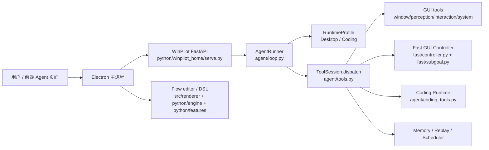
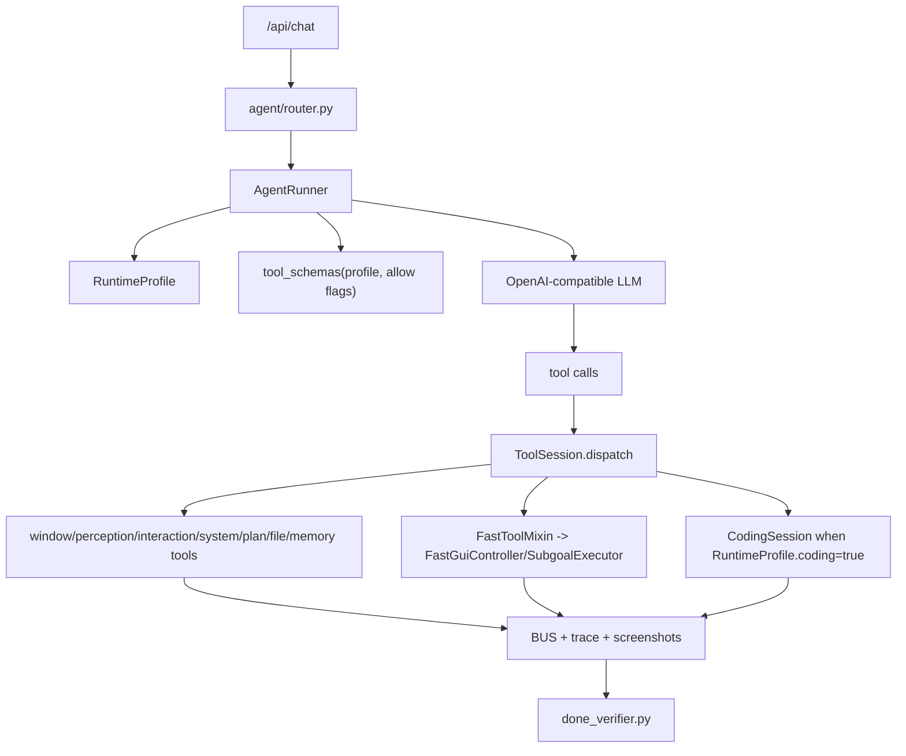

# 当前架构

项目对用户呈现为一个 WinPilot Agent。内部由一个主 runner、多种 Runtime/Capability、低延迟 GUI controller、记忆/replay 系统和 legacy 流程图体系组成。

## 总览



## 两条主线

### WinPilot desktop agent

路径：`python/winpilot_home/winpilot/`

职责是真实 Windows 桌面操作。核心约束：

- 只有一个用户可见 Agent。
- 所有任务进入 `agent/router.py -> AgentRunner`。
- GUI/Computer Use 是默认能力；Coding、Shell、File、Browser、Replay、Scheduler 是按任务和配置启用的 capability。
- done 前必须经过真实证据核验，不能只信模型总结。

### 流程图 / DSL 自动化

路径：`src/renderer/`、`python/engine/`、`python/features/`

职责是可视化编排和 legacy 自动化。它和 WinPilot 的关系是桥接，不是共享工具池：

- FlowScript 是前端画布 JSON。
- `python/engine/` 是 legacy DSL/Flow 执行引擎。
- `python/features/` 是 `@feature` 注册表，供流程图/MCP/HTTP/CLI 使用。
- WinPilot 成功 trace 可导出 `.wps.json`，再由 `src/renderer/utils/wpsToFlowScript.ts` 保守导入 FlowScript。

## 进程和端口

| 进程/服务 | 入口 | 说明 |
| --- | --- | --- |
| Electron HTTP API | `src/main/api.ts` | 默认 `127.0.0.1:7880`，供外部控制前端和查询状态 |
| WinPilot FastAPI | `python/winpilot_home/serve.py` | 由 Electron 托管或手动启动；不要直接跑 uvicorn |
| WinPilot Web UI | `python/winpilot_home/winpilot/webui/` | 前端 Agent 页面通过 iframe 使用 |
| Legacy IPC agent | `python/agent/__main__.py` | Electron stdin/stdout JSON-line 到 WinPilot BUS 的适配器 |
| GUI eval script | `scripts/gui_eval_run.py` | 走同一个 `/api/chat` 路径，写 compact eval 报告 |

`/api/status.runtime` 会返回 repo root、branch、commit、dirty、PID、port。排查多 worktree 或旧服务时先看它。

## Agent 内部



关键文件：

| 文件 | 职责 |
| --- | --- |
| `agent/loop.py` | LLM 主循环、上下文折叠、工具调用、usage、done gate 编排 |
| `agent/runtime_profile.py` | 判断本次 run 是否启用 Coding Runtime、workspace、max steps |
| `agent/task_rules.py` | GUI-only、coding task、可见 literal、done gate 辅助规则 |
| `agent/gui_plan_helpers.py` | GUI schema profile、绘图计划解析、纯打开窗口计划判断等 helper |
| `agent/tool_schemas.py` | function-calling schema、allow flags、`standard/lean_gui/drawing_gui` profile |
| `agent/tools.py` | `ToolSession` 状态、dispatch、目标 hwnd、world、undo stack |
| `agent/*_tools.py` | 具体工具 mixin |
| `agent/done_verifier.py` | 防假成功核验 |
| `fast/subgoal.py` | controller-first routine：输入、点击、绘图、等待、验证 |
| `fast/controller.py` | 本地低延迟动作执行和 fast metrics |
| `perception/fusion.py` | UIA/Win32/OCR/CV/VLM snapshot 融合 |
| `perception/reducer.py` | 给 LLM 的 compact 感知摘要 |
| `recorder/trace.py` | trace、`.wps.json`、replay |
| `scheduler.py` | WinPilot Agent 内部计划任务 |
| `model_adapter.py` | provider、thinking 默认、usage/cache/cost 归一化 |

## 状态机

一次任务的状态流：

```text
queued
  -> running
  -> LLM step
  -> tool dispatch
  -> evidence written to BUS/trace
  -> done verifier if terminal
  -> done / fail / reply / stopped / error
```

注意：

- `agent_done` 只是运行结束事件，不等于真实任务成功。
- GUI 成功要看 `done_check`、截图、文件/进程/窗口状态和工具 evidence。
- done 被拒绝后，runner 会继续给模型机会修复；超过 `done_max_rejects` 才可能 unverified force-accept，这种结果不能写入 trusted skill。

## RuntimeProfile

`RuntimeProfile` 是能力开关，不是 agent 路由：

- 普通 GUI 任务：desktop capability。
- 仓库/代码任务：desktop + Coding Runtime。
- GUI-only 任务：禁用 Coding Runtime，并限制 shell/file 绕路。
- `ToolSession` 使用由 `router.build_runner()` 传入的同一个 profile，避免 runner 和 tools 二次推断不一致。

用户表达仍是一个 Agent：

- “帮我改这个 Python 项目” -> Coding Runtime。
- “打开 Photoshop” -> Computer Use / Desktop。
- “部署这个项目” -> Coding + Terminal + Browser 能力协同。

## 低延迟 GUI

当前已落地：

- LLM 可下达 `execute_subgoal`，由本地 controller 完成输入/点击/等待/验证 routine。
- `run_action_batch` 连续执行多个 GUI 动作，减少每个动作都回 LLM 的 round-trip。
- 顶层 GUI mutation 可自动 fast-wrap 成 batch。
- `screen_watch`、`screen_delta`、changed-only observe、ROI query fallback、perception reducer 已接入。
- `scope_guard` 在 GUI mutation 前检查前台/目标窗口。
- `input_locator` 为 UIA-off 输入框提供 OCR label、placeholder、搜索语义、附近矩形和 synthetic candidate。
- 坐标排查工具 `coordinate_diagnostics` / `coordinate_click_test` 使用物理屏幕坐标和真实鼠标点击路径。
- `action/desktop_queue.py` 已提供同步 single-writer Desktop Action Queue；`action/executor.py` 的真实鼠标、键盘、窗口、剪贴板写入和启动动作会通过这个队列串行化，并在 trace 中发布 `desktop_action_queue` 事件。

仍未完成：

- 常驻轻量视觉模型/YOLO 主循环。
- 成熟视觉伺服控制。
- Desktop Action Queue 的后台异步 job worker、按 target hwnd 的细粒度锁，以及 Raw Device Executor 的完整内环。
- LLM 只处理异常、常规动作完全本地化。
- 稳定 dashboard：p50/p95 GUI latency、LLM round trips、VLM count、skill reuse rate 等。

## Replay / Skill

```text
Agent live run
  -> trace JSONL + screenshots
  -> export .wps.json / automation-ir/1
  -> Replayer 0-token replay
  -> optional FlowScript import for editing
```

当前事实：

- `.wps.json` 是 WinPilot 语义重放格式。
- `automation-ir/1` 是 WPS/Flow/skill 的最小共享 envelope，当前不是唯一事实源。
- `recorder/trace.py` 是离线 replay 源。
- `POST /api/replay` 返回 `replay_id`；`GET /api/replay/{replay_id}` 查询状态、结果和失败细节；`POST /api/replay/{replay_id}/cancel` 取消。
- FlowScript 导入只是编辑桥，不保证所有节点等价执行。
- WPS-only 节点带 `_requires_wps_replay`，前端 executor 必须 fail-fast。
- WPS 导入的基础 GUI 节点带 `_source_wps_replay`，会要求真实 Electron feature bridge 或失败，不能浏览器模拟真实桌面成功。
- `reuse_skill` 会强匹配历史成功脚本并 0-token replay；replay 成功后仍必须 observe/read_text/expect 证明最终状态再 done。

## Memory

长期记忆当前以 SQLite Memory Graph 为主：

- `memory.db` 是主存储。
- `memory/store.py`、`memory/runtime.py`、`memory/retriever.py`、`memory/packer.py`、`memory/feedback.py`、`memory/compiler.py` 组成运行时。
- `memory/experience.py` 是旧 recipe API 的兼容门面。
- `experience_memory.json` 只用于迁移/兼容，不是主运行时事实。

记忆不能弥补硬实力。清除记忆后 agent 变笨，通常说明 routine、感知或验证仍不足，不应依赖历史记忆撑通用能力。

## Scheduler

有两套调度系统：

- WinPilot Agent 内部调度：`python/winpilot_home/winpilot/scheduler.py`，工具是 `schedule_task` / `list_scheduled_tasks` / `cancel_scheduled_task`，数据是 `agent_schedules.json`，到期后仍走 `AgentRunner`。
- legacy Electron 模板调度：`src/main/schedulerBridge.ts` + `python/engine/scheduler_daemon.py`，数据是 Electron userData 下的 `schedules.json`，服务于流程图/模板体系。

WinPilot Agent 内部调度不是 Windows Task Scheduler。

## 文档维护

- README 写项目总览。
- `CLAUDE.md` 写 AI 最短接手说明。
- `docs/architecture.md` 写结构和边界。
- `docs/winpilot-agent.md` 写运行机制和复盘细节。
- `docs/replay-recording.md` 写 trace / `.wps.json` / replay / FlowScript 导入。
- 历史 run id 不继续堆进主文档；需要保留时写 eval 报告或 trace。
