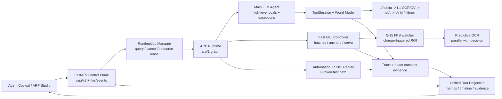
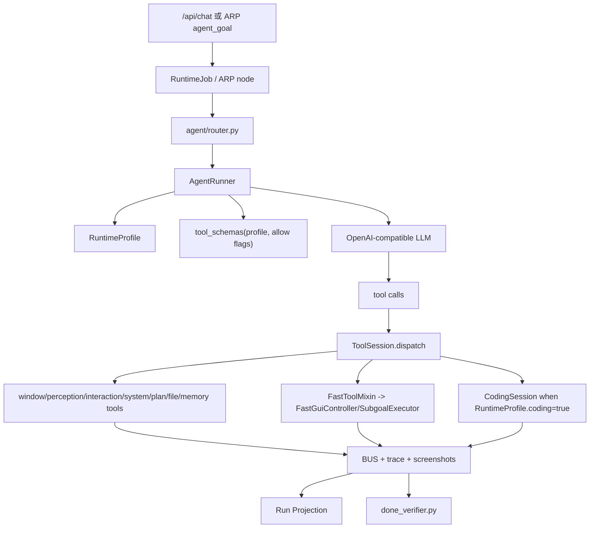

# GUI Agent + ARP 架构

项目对用户呈现为一个原生 Agent Runtime Platform。主模型负责目标、异常和策略；ARP 图负责编排；Fast GUI Controller 负责动作内环；World Model、分层感知、trace 和 Run Projection 共同维护可验证状态。

## 总览



## 统一控制平面

前端 `src/renderer/components/platform/PlatformWorkbench.tsx` 不再嵌入旧 WebUI。Agent、ARP Studio、Runs、Skills、System 都读取同一套 `/api/v2` contract 和 WebSocket 事件。

后端核心路径：

- `orchestrator/contracts.py`：版本化 `arp/1` 图、节点、重试、Controller 动作白名单和运行前严格验证契约。
- `orchestrator/runtime.py`：图运行、条件、证据门、人工门、取消和节点重试；显式失败恢复边优先于 `fail_fast`。
- `orchestrator/adapters.py`：Agent Goal、Action Batch、Memory-backed Skill Replay、legacy 节点适配和最终运行结果驱动的记忆反馈。
- `orchestrator/projection.py`：将 ARP、Agent、Controller、Perception、Replay 事件折叠成统一运行视图，并从 JSONL trace 恢复历史。
- `runtime_jobs.py`：统一 Agent、ARP、Replay 和 schedule 的异步生命周期、取消、查询和 `interactive_runtime` 资源租约。
- `automation_ir.py`：新流程和 Skill 的规范 artifact；WPS/FlowScript 是受检 adapter。
- `platform/flowToArpGraph.ts`：把可视化 FlowScript 保守编译为 `arp/1`；点击、文字锚点、输入、键盘、拖拽、启动、聚焦、截图、剪贴板和部分组合节点直接编译为 Controller batch；其余旧节点显式标记 `legacy_flow` 并在运行前拒绝。

### ARP 节点

原生节点包括 `start`、`end`、`agent_goal`、`action_batch`、`skill_replay`、`condition`、`delay`、`set_variable`、`evidence_gate`、`human_gate`。每个节点都有 retry、timeout、disabled 和分支语义。

默认新流程是合法且无副作用的 `ARP 低延迟起步流程`，可以直接 Validate/Run。真实复杂流程通常是：

```text
start -> skill_replay -- hit ---------------------------> end
             | miss / replay failure
             v
        agent_goal -> action_batch -> evidence_gate ---> end
                           | explicit failure
                           v
                     agent_goal / human_gate
```

## 进程和端口

| 进程/服务 | 入口 | 说明 |
| --- | --- | --- |
| Electron HTTP API | `src/main/api.ts` | 默认 `127.0.0.1:7880`，供外部控制前端和查询状态 |
| WinPilot FastAPI | `python/winpilot_home/serve.py` | 由 Electron 托管或手动启动；不要直接跑 uvicorn |
| 原生 Runtime Platform | `src/renderer/components/platform/` | Agent Cockpit、ARP Studio、Runs、Skills、System |
| Legacy IPC agent | `python/agent/__main__.py` | Electron stdin/stdout JSON-line 到 WinPilot BUS 的适配器 |
| GUI eval script | `scripts/gui_eval_run.py` | 走同一个 `/api/chat` 路径，写 compact eval 报告 |

`/api/status.runtime` 会返回 repo root、branch、commit、dirty、PID、port。排查多 worktree 或旧服务时先看它。
Electron renderer 会等待 `winpilot:ensure` 返回本实例托管的随机端口；固定 `127.0.0.1:8765` 只用于纯浏览器/手动服务 fallback，不能在托管服务仍处于 `starting` 时抢先连接旧实例。

## Agent 与 Controller



关键文件：

| 文件 | 职责 |
| --- | --- |
| `agent/loop.py` | LLM 主循环、上下文折叠、工具调用、usage、done gate 编排 |
| `agent/runtime_profile.py` | 判断本次 run 是否启用 Coding Runtime、workspace、max steps |
| `agent/task_rules.py` | GUI-only、coding task、可见 literal、done gate 辅助规则 |
| `agent/gui_plan_helpers.py` | GUI schema profile、绘图计划解析、纯打开窗口计划判断等 helper |
| `agent/tool_schemas.py` | function-calling schema、allow flags、`standard/lean_gui/drawing_gui` profile |
| `agent/tools.py` | `ToolSession` 状态、dispatch、目标 hwnd、world、undo stack |
| `agent/*_tools.py` | 具体工具 mixin |
| `agent/done_verifier.py` | 防假成功核验 |
| `fast/subgoal.py` | controller-first routine：输入、点击、绘图、等待、验证 |
| `fast/controller.py` | 本地低延迟动作执行和 fast metrics |
| `action/raw_device.py` | batch 内常见动作直接调用已授权 handler，避免递归 dispatch |
| `fast/perception_daemon.py` | 按 hwnd 共享 watcher 与 ElementCache 的短期常驻 lease |
| `perception/fusion.py` | UIA/Win32/OCR/CV/VLM snapshot 融合 |
| `perception/reducer.py` | 给 LLM 的 compact 感知摘要 |
| `recorder/trace.py` | 异步 trace/截图、Automation IR 主导出、WPS 兼容导出、replay |
| `scheduler.py` | WinPilot Agent 内部计划任务 |
| `model_adapter.py` | provider、thinking 默认、usage/cache/cost 归一化 |

## 状态机

一次任务的状态流：

```text
queued
  -> waiting_resources（已有交互任务时）
  -> running
  -> LLM step
  -> tool dispatch
  -> evidence written to BUS/trace
  -> done verifier if terminal
  -> done / fail / reply / stopped / error
```

注意：

- `agent_done` 只是运行结束事件，不等于真实任务成功。
- GUI 成功要看 `done_check`、截图、文件/进程/窗口状态和工具 evidence。
- done 被拒绝后，runner 会继续给模型机会修复；judge 异常和超过拒绝阈值都 fail-closed，不会把未验证结果强制升级成 trusted success。

## RuntimeProfile

`RuntimeProfile` 是能力开关，不是 agent 路由：

- 普通 GUI 任务：desktop capability。
- 仓库/代码任务：desktop + Coding Runtime。
- GUI-only 任务：禁用 Coding Runtime，并限制 shell/file 绕路。
- `ToolSession` 使用由 `router.build_runner()` 传入的同一个 profile，避免 runner 和 tools 二次推断不一致。
- `runtime.to_dict().capabilities` 会列出本轮可用能力，例如 `desktop`、`coding`、`replay`、`scheduler`、`automation_ir`、`desktop_action_queue`；这些是 capability，不是用户可见子 agent。

用户表达仍是一个 Agent：

- “帮我改这个 Python 项目” -> Coding Runtime。
- “打开 Photoshop” -> Computer Use / Desktop。
- “部署这个项目” -> Coding + Terminal + Browser 能力协同。

## 低延迟 GUI

当前已落地：

- LLM 可下达 `execute_subgoal` 或 ARP `agent_goal`；本地 controller 完成输入、点击、等待和验证 routine。
- `run_action_batch` / ARP `action_batch` 连续执行多个 GUI 动作；动作可以声明 `require_screen_change`、`require_transient`、`require_match`，缺证据即整批失败。
- 满足 `require_transient` 的 press 证据会覆盖底层“未提供 expect”的普通未验证状态并提升为节点级 evidence；捕获成功但证据没有上卷不允许到达 `end`。
- `screen_watch` 持续做便宜帧差；动作前后差分与 watcher 独立，changed-only observe 只理解 ROI。
- 鼠标 down 与 up 分离，down 期间同步采样。只在 `delta.changed=true`、press 帧强于 release 后帧时标记 `transient_observed`。
- 瞬态帧会保存为 trace ROI 图片，携带真实屏幕坐标进入 World State；不是只保留 OCR 文本。
- 动作触发后立即异步 OCR 变化 ROI；下一次 changed-only observe 可直接消费 predictive cache。
- verify engine 只并行文件/进程等确定性只读检查与 UIA/OCR；`shell_true` 和所有桌面 mutation 不并发，最终证据仍是 AND 语义。
- `ElementCache` 使用语义、角色、相对位置和当前快照复验；长日志、隐藏标签文本、地址栏不能冒充按钮。
- `click_element` 支持 `visual_anchor`、fallback text、expected region、物理点击和点击前局部视觉伺服修正。
- 分层感知已覆盖 UIA、Win32、OCR、传统 CV 和强 VLM fallback；UIA 丰富时跳过昂贵维度，查询不可靠时定向 OCR。
- Perception reducer 只给 LLM compact state，完整元素写入 trace。
- `scope_guard` 在 GUI mutation 前检查前台/目标窗口。
- `input_locator` 为 UIA-off 输入框提供 OCR label、placeholder、搜索语义、附近矩形和 synthetic candidate。
- `winpilot` 包入口先初始化 Per-Monitor V2，保证只导入 action executor 的进程也不会落入 DPI 虚拟坐标；`coordinate_diagnostics` / `coordinate_click_test` 再核对物理屏幕和真实鼠标路径。
- `RunProjection` 统一统计 capture、perception、decision、execution、post-verify、replan、VLM 和 skill reuse，并在服务启动时从 trace 恢复历史。
- `action/desktop_queue.py` 提供 single-writer Desktop Action Queue；Controller batch 取得一次 coalesced lease，内部 public action 不重复排队。
- `action/raw_device.py` 让常见 batch 子动作绕过递归 `ToolSession.dispatch()`；外层权限、scope、trace 和 evidence 仍只执行一次。
- `fast/perception_daemon.py` 按 hwnd 复用 watcher + ElementCache，lease 归零后保留 45 秒热状态；昂贵 OCR/CV/VLM 仍由变化或请求触发。
- `recorder/trace.py` 把截图编码/写盘放到有界异步队列，并以 `action_id` 配对 before/after。
- `agent/failure_recovery.py` 的本地恢复探测优先走 `ToolSession.dispatch()`，没有统一 dispatch 时才退回私有 handler；这样 list/focus/observe 恢复动作仍会经过统一 world/screen/watch/scope 入口。

成熟度判断：

- Raw Device adapter 已覆盖常见 Controller mutation；复杂工具仍有意走完整 `ToolSession` 生命周期。
- World Model 已保存窗口、screen bulletin、元素、动作和最近变化；跨 run 的页面阶段分类仍需继续泛化。
- 常规动作可在 Controller/Skill 内环完成，失败回到 Agent/ARP；“所有常规动作都不经 LLM”还不是对任意软件成立的承诺。
- 网页靶场已覆盖真实物理按压的瞬态状态：DOM 收据、非零 ROI、持久化 press 帧、predictive OCR、changed-only 命中和 0 VLM 同时通过。
- 复杂消费软件、远程桌面、游戏和高 DPI 多显示器仍需要更大的 E2E 基准矩阵。

仍未完成：

- 带正式权重、可部署和可评估的常驻轻量学习型 UI detector（当前 Level 2 是 UIA + OCR + 传统 CV，不冒充 YOLO 已落地）。
- 多显示器/缩放/动画目标下的连续视觉伺服，而不只是点击前局部迭代修正。
- 按 target hwnd 的细粒度并发锁和完整 Raw Device Executor 内环。
- 跨软件高成功率 skill 参数化、版本迁移和失效检测。
- 历史分位数 dashboard（当前为每 run avg/max 和频率指标）。

## Replay / Skill

```text
Agent live run
  -> trace JSONL + screenshots
  -> export automation-ir/1 (+ optional .wps.json compatibility copy)
  -> Replayer 0-token replay
  -> optional FlowScript import for editing
```

当前事实：

- `.wps.json` 是 WinPilot 旧语义重放兼容格式，不是新 artifact 的事实源。
- `automation-ir/1` 是新保存 Flow、Skill 和 trace 导出的规范中间层；WPS/FlowScript/DSL 是兼容格式。
- `recorder/trace.py` 是离线 replay 源。
- `POST /api/replay` 返回 `replay_id`；`GET /api/replay/{replay_id}` 查询状态、结果和失败细节；`POST /api/replay/{replay_id}/cancel` 取消。
- FlowScript 导入只是编辑桥，不保证所有节点等价执行。
- WPS-only 节点带 `_requires_wps_replay`，前端 executor 必须 fail-fast。
- WPS 导入的基础 GUI 节点带 `_source_wps_replay`，会要求真实 Electron feature bridge 或失败，不能浏览器模拟真实桌面成功。
- Agent 内的 `reuse_skill` 会强匹配历史成功脚本并 0-token replay，随后仍需当前状态证据。ARP `skill_replay` 也可按 task / memory id 检索；只有非空且每个执行叶子通过 Replayer 验证的脚本才产生节点 evidence，空脚本不能完成流程。

Automation IR 没有删除兼容层：Replayer 内部仍执行 WPS-shaped steps，Flow editor 内存仍使用 FlowScript，legacy DSL 仍由 `python/engine/` 处理；但所有新持久化、Skill 和运行编译入口必须先经过 IR，不再新增第四种 metadata envelope。

## Memory

长期记忆当前以 SQLite Memory Graph 为主：

- `memory.db` 是主存储。
- `memory/store.py`、`memory/runtime.py`、`memory/retriever.py`、`memory/packer.py`、`memory/feedback.py`、`memory/compiler.py` 组成运行时。
- `memory/experience.py` 是旧 recipe API 的兼容门面。
- `experience_memory.json` 只用于迁移/兼容，不是主运行时事实。
- Agent Cockpit 默认目标图先走 Memory Graph 的 verified Skill fast path，`miss` / `fail` 再升级到 Agent；记忆正负反馈在整个 ARP run 结束后按最终结果计算，不按局部重放结果提前奖励。

记忆不能弥补硬实力。清除记忆后 agent 变笨，通常说明 routine、感知或验证仍不足，不应依赖历史记忆撑通用能力。

## Scheduler

当前仍有两套调度系统，主线新功能只进入第一套：

- WinPilot Agent 内部调度：`python/winpilot_home/winpilot/scheduler.py`，System 页面与 Agent 工具共用 `agent_schedules.json`，到期后提交统一 RuntimeJob 再走 `AgentRunner`。
- legacy Electron 模板调度：`src/main/schedulerBridge.ts` + `python/engine/scheduler_daemon.py`，数据是 Electron userData 下的 `schedules.json`，服务于流程图/模板体系。

WinPilot Agent 内部调度不是 Windows Task Scheduler。

相关运行时服务：

- 本地文件名搜索：`perception/search.py` 优先走随包 ES 客户端和 Everything 索引，启动时异步预热 IPC；失败后使用有时间上限、会报告 `partial` 的本地扫描。
- Windows 任务提醒：renderer 根据统一 run projection 识别终态，Electron main 统一设置任务栏进度/错误状态、后台闪烁和系统通知，并按 `run_id` 去重。

## 文档维护

- README 写项目总览。
- `CLAUDE.md` 写 AI 最短接手说明。
- `docs/architecture.md` 写结构和边界。
- `docs/winpilot-agent.md` 写运行机制和复盘细节。
- `docs/replay-recording.md` 写 trace / Automation IR / 兼容 WPS / replay / FlowScript 导入。
- 历史 run id 不继续堆进主文档；需要保留时写 eval 报告或 trace。
