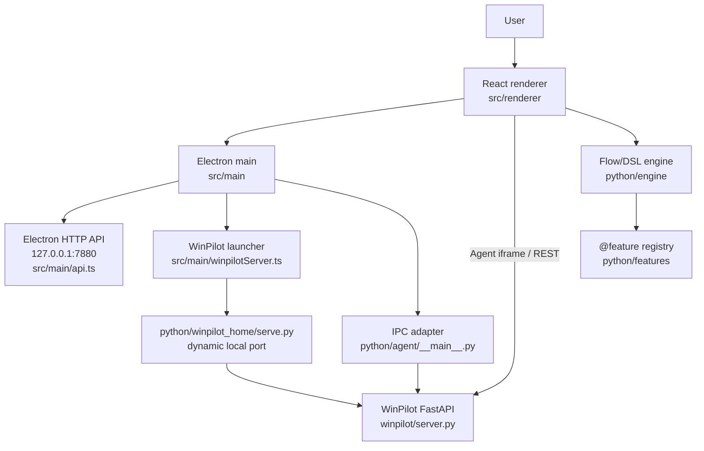
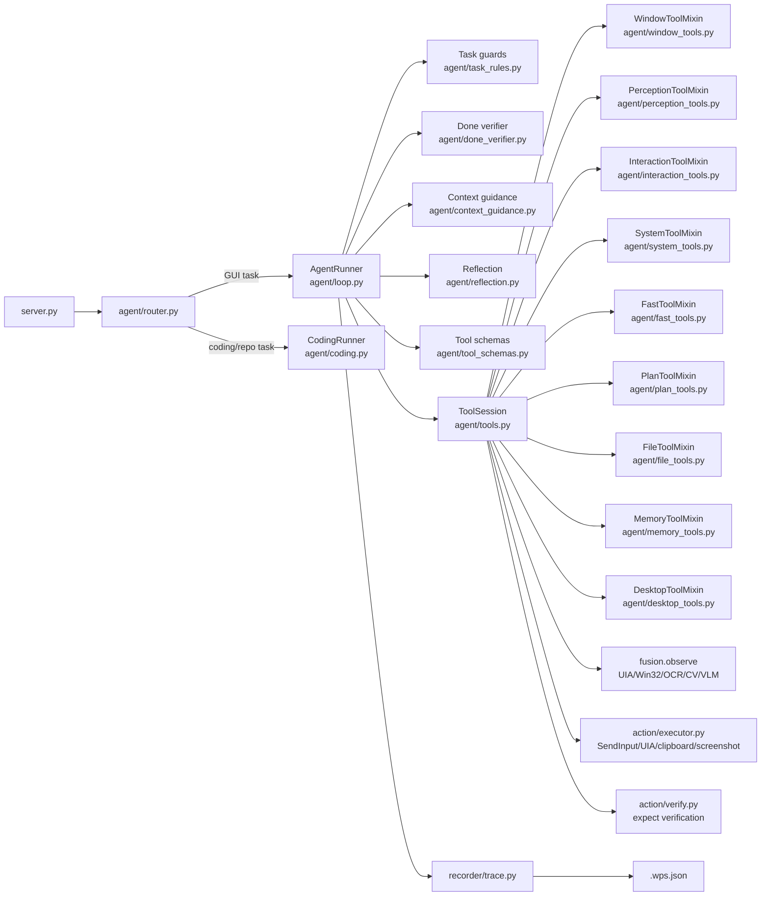
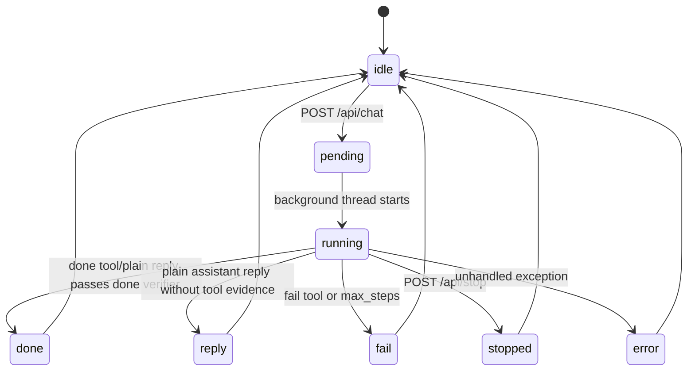
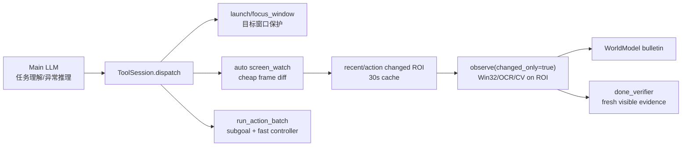

# 当前架构

项目不是一个单体 agent，而是两个系统并存。

## 两条主线

| 系统 | 路径 | 职责 | 边界 |
| --- | --- | --- | --- |
| WinPilot desktop agent | `python/winpilot_home/winpilot/` | LLM 实时操控 Windows、感知、动作、验证、录制、记忆、编程子 agent | 不直接使用 `@feature`，不直接编辑流程图 |
| 流程图/DSL 系统 | `src/renderer/`、`python/engine/`、`python/features/` | 可视化编排、DSL 执行、`@feature`、MCP/HTTP/CLI | 不等同于 WinPilot 主 agent |

## 进程和端口

`serve.py` 会设置 `WINPILOT_LAUNCHED_VIA_SERVE=1`。`server.py` 只阻止真正的 `uvicorn winpilot.server:app` 直接启动，不阻止测试导入。

## WinPilot 内部

## 运行时状态机

- `server.py` 的 `_RunState` 是服务级锁：同一时间只允许一个 agent、replay 或人工录制任务运行。
- `AgentRunner.run()` 是 GUI agent 主循环：注入任务/上下文/记忆 -> 调 LLM -> 处理 tool calls -> `ToolSession.dispatch()` -> 工具 mixin -> done gate/world/playbook/reflect。
- `ToolSession` 是每次运行的状态容器，保存最近 `Snapshot`、目标窗口 `hwnd`、world model、plan、undo stack；具体工具按窗口、感知、交互、系统、低延迟 batch、计划/终止、文件、记忆、桌面杂项拆到 mixin。
- `run_action_batch` 和 `screen_watch` 在 `agent/fast_tools.py`，内部进入 `fast/controller.py`。controller 会给 `draw_strokes/drag` 追加本地 `auto_visual_verify`；顶层 `draw_strokes/drag` 也会被 `AgentRunner` 自动包装成单动作 batch。验证充分时结果会带 `fast_path_advice`，减少额外 LLM round-trip。
- `ToolSession.dispatch()` 会给普通可见动作附加廉价 `screen_delta` 和 `action_target` 元信息。它用于定位“画面是否变化、变化时 foreground 是否仍是目标窗口”，不是语义完成证明；done 仍要看截图、目标窗口感知或外部证据。
- `launch` 的目标窗口会在发现后置前；`interaction_tools.py` 的输入动作优先使用 session target，而不是无条件使用当前 foreground；`action/verify.py` 在目标已知时会忽略无关 foreground，避免 Codex/日志/其他窗口 OCR 造成假成功。
- `agent/perception_tools.py` 在 UIA-off 绘图/画布任务上有 `canvas_fast_observe`：无 `query/full` 的 `observe` 跳过全窗口 OCR，直接提供 Win32/CV 和 `likely_canvas` 摘要；需要文字 grounding 时用 `observe(query=...)` 或 `observe(full=true)` 回到完整感知。
- BUS/WebSocket 给前端显示进度；`recorder/trace.py` 写可回放事件和截图；`agent/loop.py` 的 LLM trace 写每步真实 prompt/response，失败复盘必须优先看这些证据。

## 最近结构调整

- `src/renderer/store/index.ts` 不再复制 defaults/templates/localStorage helper；这些真实来源在 `store/defaults.ts` 和 `store/persistence.ts`。
- `agent/tool_schemas.py` 承担 GUI agent function schema，并使用短描述减少 LLM 上下文；`agent/tools.py` 保留运行态状态和 dispatch；`agent/window_tools.py`、`agent/perception_tools.py`、`agent/interaction_tools.py`、`agent/system_tools.py`、`agent/fast_tools.py`、`agent/plan_tools.py`、`agent/file_tools.py`、`agent/memory_tools.py`、`agent/desktop_tools.py` 分别承担窗口、感知、输入动作、系统/启动、低延迟 batch、计划/终止、文件、记忆复用、桌面杂项工具。
- `agent/task_rules.py` 承担 GUI task 分类、GUI-only 限制和 done gate guard 的纯规则；`agent/done_verifier.py` 承担 done 二次核验；`agent/context_guidance.py` 承担 planning/world/playbook 上下文提示；`agent/reflection.py` 承担反思检查点。
- `winpilot/utils/image_capture.py` 统一窗口截图转 JPEG base64。
- `python/engine/executor_types.py` 承担 legacy Flow/DSL executor 的共享状态、上下文和控制流异常，`executor.py` 继续作为 legacy 执行器维护。
- `python/core/screenshot.py` 保留 `capture_screen()`，兼容旧 Robot Framework keywords。
- 打包配置过滤 Python/runtime 的 pycache、测试、dist-info、运行数据；Electron 语言包限制为 `zh-CN` 和 `en-US`。

## 维护重点

- `agent/loop.py` 已拆出任务规则、done 核验、上下文提示和反思检查点，但仍承担 LLM 调用、工具循环和上下文折叠。
- `agent/tools.py` 已拆出 schema、窗口、感知、输入动作、系统/启动、低延迟 batch、计划/终止、文件、记忆、桌面杂项工具；后续新增工具优先放入对应 mixin。
- `python/engine/executor.py` 是旧 DSLExecutor，类型已拆到 `executor_types.py`；应冻结为 legacy 引擎，不继续扩张。

## 2026-07-03 低延迟 GUI 链路

- `screen_watch` 是低成本变化检测层，不做语义理解；它保留 `recent_changed_regions` 和动作归因的 `action_changed_regions`，让 LLM 慢一拍调用 `observe(changed_only=true)` 时仍能只看局部。
- `fusion.screen_watch_autostart=true` 时，ToolSession 在获得目标窗口或执行可见动作前自动启动 watcher，AgentRunner 结束时停止 watcher，避免每个任务都要求 LLM 手动启动。
- 普通可见动作的 `screen_delta` 使用动作前/动作后独立截图 diff，不直接复用后台 watcher 的 `_prev`；这是为了避免连续采样线程在动作前后抢帧。动作 ROI 新鲜时，`observe(changed_only=true)` 优先 action ROI，再退回普通 recent ROI。
- `observe(changed_only=true)` 只在最近/action ROI 上跑本地 Win32/OCR/CV；无 ROI 时明确 fallback 到普通 observe，方便 trace 排错。
- `run_action_batch` 接受 `subgoal`，结果会暴露 `controller_state`、`metrics`、`element_cache`；`click_element` 结果会暴露 `anchor_locator` 和 `resolved_element`。element cache 复用时会用当前 snapshot 重新验证文本/角色/相对位置，不跨 observe 盲信旧 `elem_id`；如果当前 snapshot 漏掉文本锚点，controller 会做一次目标 `observe(query=label)` 并重试，证据写入 `controller_auto_observe`。
- batch 内部 `type_into_element` 会把定位、点击、可选清空和输入合成一个 controller 动作；结果用 `subresults` 展开内部 click/hotkey/type 阶段，避免把输入框任务拆回多轮 LLM。
- `eval/summary.py` 的 `low_latency` 字段记录 screen capture、perception、LLM decision、action execution、post-action verify、replan/VLM/skill reuse/watch coverage；`fast_gui` 字段记录 batch subgoal、controller phase、anchor click/cache/failure，batch `metrics.auto_observe_count` 记录 controller 内部为了定位元素主动做的目标 observe，`metrics.compound_round_trips_saved` 记录组合动作节省的低层 round-trip，后续性能优化应优先看这些字段。
- URL `launch` 会直接打开 URL，并用归一化窗口标题匹配后聚焦目标窗口，避免 Codex、日志窗口或其他前景窗口遮挡造成假感知。
- `done_verifier.py` 对“确认出现某个状态/标签”的任务有确定性收束：fresh screen OCR 看见目标文本才通过，可减少完成后的额外 LLM judge。
- 最新验证 run：`20260703-025138-dcf2c6`。它通过 `/api/chat` 跑 UIA-off 网页靶场，真实截图显示 `LOCAL_COUNTER_1`，changed-only observe 使用左侧状态卡 ROI 直接识别 `LOCAL COUNTER`，done gate 以 fresh screen evidence 通过。
