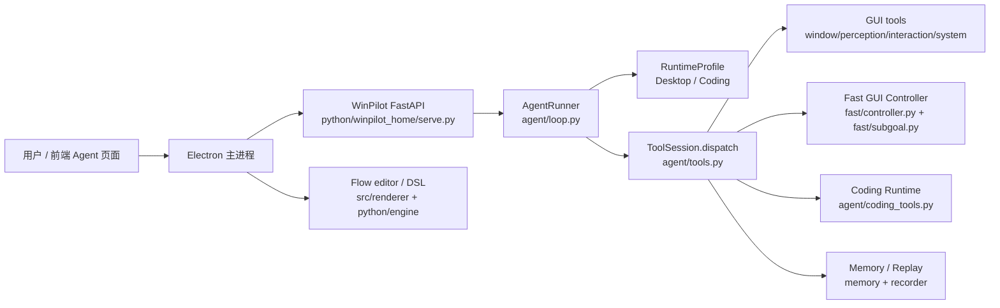
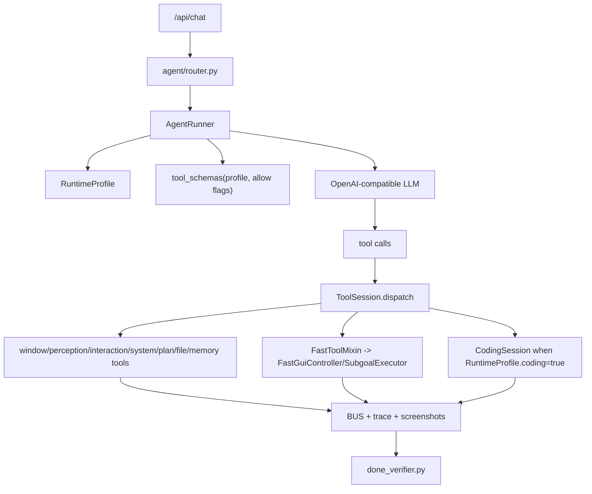

# 当前架构

本项目对用户呈现为一个 WinPilot Agent。内部由一个主 runner、多种 Runtime/Capability、低延迟 GUI controller、记忆/replay 系统和 legacy 流程图系统组成。

## 总览



## 两条主线

### WinPilot desktop agent

路径：`python/winpilot_home/winpilot/`

负责真实 Windows 桌面操作。核心约束：

- 只有一个用户可见 Agent。
- 所有任务进入 `agent/router.py -> AgentRunner`。
- GUI/Computer Use 是默认能力；Coding、Shell、File、Browser、Replay 是按任务和配置启用的 capability。
- done 前必须经过真实证据核验，不能只信模型总结。

### 流程图 / DSL 自动化

路径：`src/renderer/`、`python/engine/`、`python/features/`

负责可视化编排和 legacy 自动化。它和 WinPilot 的关系是桥接，不是共享工具池：

- FlowScript 是前端画布 JSON。
- `python/engine/` 是 legacy DSL/Flow 执行引擎。
- `python/features/` 是 `@feature` 注册表，供流程图/MCP/HTTP/CLI 使用。
- WinPilot 成功 trace 可以导出 `.wps.json`，再由 `src/renderer/utils/wpsToFlowScript.ts` 保守导入 FlowScript。

## 进程和端口

| 进程/服务 | 入口 | 说明 |
| --- | --- | --- |
| Electron HTTP API | `src/main/api.ts` | 默认 `127.0.0.1:7880`，供外部控制前端和查询状态 |
| WinPilot FastAPI | `python/winpilot_home/serve.py` | 由 Electron 托管或手动启动；不要直接跑 uvicorn |
| WinPilot Web UI | `python/winpilot_home/winpilot/webui/` | 前端 Agent 页面通过 iframe 使用 |
| Legacy IPC agent | `python/agent/__main__.py` | Electron stdin/stdout JSON-line 到 WinPilot BUS 的适配器 |
| GUI eval script | `scripts/gui_eval_run.py` | 走同一个 `/api/chat` 路径，写 compact eval 报告 |

`/api/status.runtime` 会返回 repo root、branch、commit、dirty、PID、port。排查多 worktree 或旧服务时先看它。

## Agent 内部



关键文件：

| 文件 | 职责 |
| --- | --- |
| `agent/loop.py` | LLM 主循环、上下文折叠、工具调用、usage、done gate 编排 |
| `agent/runtime_profile.py` | 判断本次 run 是否启用 Coding Runtime、workspace、max steps |
| `agent/task_rules.py` | GUI-only、coding task、可见 literal、done gate 辅助规则 |
| `agent/gui_plan_helpers.py` | GUI schema profile、绘图计划解析、纯打开窗口计划判断等无状态 helper |
| `agent/tool_schemas.py` | function-calling schema、allow flags、`standard/lean_gui/drawing_gui` profile |
| `agent/tools.py` | `ToolSession` 状态、dispatch、目标 hwnd、world、undo stack |
| `agent/*_tools.py` | 具体工具 mixin |
| `agent/done_verifier.py` | 防假成功核验 |
| `fast/subgoal.py` | controller-first routine：输入、点击、绘图、等待、验证 |
| `fast/controller.py` | 本地低延迟动作执行和 fast metrics |
| `perception/fusion.py` | UIA/Win32/OCR/CV/VLM snapshot 融合 |
| `perception/reducer.py` | 给 LLM 的 compact 感知摘要 |
| `recorder/trace.py` | trace、`.wps.json`、replay |
| `model_adapter.py` | provider、thinking 默认、usage/cache/cost 归一化 |

## 运行状态机

一次任务的状态流：

```text
queued
  -> running
  -> LLM step
  -> tool dispatch
  -> evidence written to BUS/trace
  -> done verifier if terminal
  -> done / fail / reply / stopped / error
```

注意：

- `agent_done` 只是运行结束事件，不等于真实任务成功。
- GUI 成功要看 `done_check`、截图、文件/进程/窗口状态和工具 evidence。
- replay 成功只代表脚本步骤执行完，仍需要当前证据通过 done gate。
- `screen_delta.changed=true` 只说明像素变化，不单独证明业务目标完成。

## 低延迟 GUI

当前已落地的方向：

- **LLM 下子目标，controller 执行 routine**：`execute_subgoal` 在本地完成定位、输入、点击、等待、验证。
- **批量动作**：`run_action_batch` 和自动 fast-wrap 减少 click/type 的 LLM round-trip。
- **变化触发感知**：`screen_watch`、action ROI、`observe(changed_only=true)`、query fallback。
- **只给 LLM 摘要**：`perception/reducer.py` 排序候选、疑点和建议动作；原始 snapshot 留 trace。
- **通用输入定位**：`input_locator` 组合 UIA、OCR/CV 和 synthetic candidate，避免写单软件规则。
- **窗口范围保护**：`scope_guard` 阻止 GUI mutation 跑到错误前台窗口。
- **绘图/画布优化**：`draw/draws`、通用颜色面板 opener、颜色 evidence、绘图计划自动合并。
- **schema 降噪**：strict GUI-only 绘图任务使用 `drawing_gui`，只减少模型可见 schema，不减少本地 controller 能力。

仍然没有完成：

- 常驻轻量视觉模型/YOLO 主循环。
- 真正视觉伺服控制。
- LLM 完全退出常规动作内环。
- 完整低延迟 dashboard 和稳定 skill reuse 率。

## 记忆、Replay 和 Skill

| 层 | 文件 | 事实 |
| --- | --- | --- |
| 长期经验 | `memory/experience.py` | 本机 `experience_memory.json`，recipe/note 有 conditions/evidence |
| Session memory | `agent/session.py` | 只处理“继续/刚才那个/再来一次”等指代 |
| Skill reuse | `agent/memory_tools.py` | 强匹配成功 replay 才能 0-token 复用 |
| Trace/replay | `recorder/trace.py` | `.wps.json` 是 WinPilot replay 源格式 |
| Flow 导入 | `wpsToFlowScript.ts` | 保守导入，WinPilot-only 步骤保留为 payload |

复用不是 done 证据。replay 成功后仍要观察当前屏幕/文件/进程/文本。

## 模型与成本

- 模型请求走 OpenAI-compatible chat completions。
- `model_adapter.py` 负责 provider 推断、MiMo/Reasonix thinking 默认关闭、usage/cache/cost 归一化。
- 只有 provider 有可信价格表时 UI 才显示真实成本；未知 provider 不显示假的 `¥0`。
- 强 VLM 是兜底，不应进入每步主循环。默认 VLM 关闭。
- 排查 token/cost 时看 `traces/<run_id>/NNN_llm_request.json` 的 `tools` 和 `messages` 大小。

## 维护重点

- 新能力优先拆模块，不继续扩大 `agent/loop.py`、`agent/tools.py`、`python/engine/executor.py`。
- 文档记录当前事实，不堆历史 run id；历史证据留在 trace/eval。
- GUI-only 的真实验收必须走 `/api/chat`，并人工核对截图。
- 不为特定软件硬编码规则。QQ、计算器、Paint 等只能作为测试场景。
- 更新 Flow/DSL/replay 时同步测试 `recorder/trace.py`、`wpsToFlowScript.ts`、`python/engine/dsl_flow_converter.py`。
