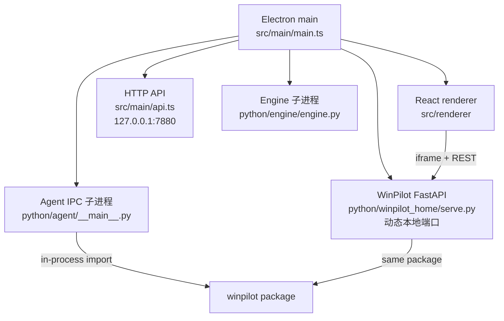
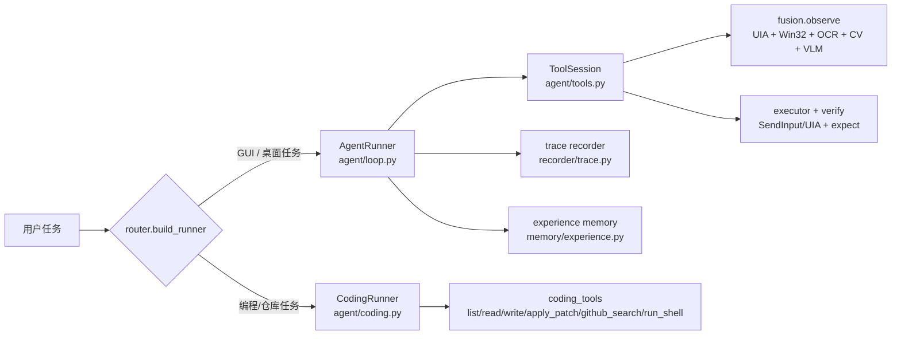
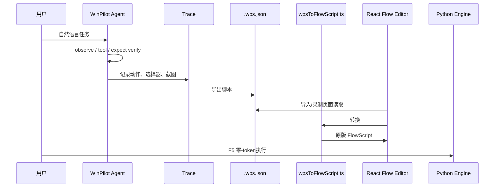

# 总体架构

本文按当前代码描述项目，不沿用历史 Agent 文档。

## 两套系统

| 系统 | 代码位置 | 职责 | 关系 |
|---|---|---|---|
| WinPilot Agent | `python/winpilot_home/winpilot/` | LLM 实时操控电脑、感知、动作验证、录制、记忆、编程子 agent | 当前 Agent 主体 |
| 流程图体系 | `src/renderer/`、`python/engine/`、`python/features/` | 可视化编辑、DSL 执行、@feature、MCP/HTTP/CLI 暴露 | 传统自动化主路径 |

这两套系统刻意解耦。WinPilot 主 agent 不加载 @feature 注册表，不接收流程图节点定义。它输出 `.wps.json` 后，前端用 `wpsToFlowScript.ts` 转成原版 FlowScript。

## 进程与服务

- `src/main/winpilotServer.ts` 启动 WinPilot FastAPI，并把 URL 暴露给前端 Agent 面板。
- `src/main/api.ts` 提供 `:7880` 外部控制接口，面向 Claude Code/curl/HTTP MCP。
- `python/agent/__main__.py` 仍叫 `agent`，但只是 WinPilot IPC adapter。
- `python/engine/engine.py` 运行 FlowScript/DSL，不等同于 WinPilot Agent。

## WinPilot 内部

关键点：

- GUI-only 任务不会被路由到 CodingRunner。
- 编程子 agent 有 `github_search`，可以搜索 GitHub 项目；它对 clone/run 类任务有“必须尝试运行或明确失败”的 gate。
- GUI agent 可用 shell，但 GUI-only 任务会限制破坏前端路径的 shell/file 快捷方式，允许只读验证。
- `agent.llm_trace=true` 时会记录每轮 LLM 输入/输出，便于复现模型每一步收到的信息。

## 录制到流程图

`WinPilot Replayer` 也可以直接离线执行 `.wps.json`，不经过流程图编辑器。

## 不再存在的旧 Agent

旧版 Agent 的监督器、多执行模式、本地视觉引擎、视觉定位经验库等不在当前 Git 跟踪代码中。若旧文档、历史测试或临时输出提到这些，它们只表示历史背景，不是当前架构。
