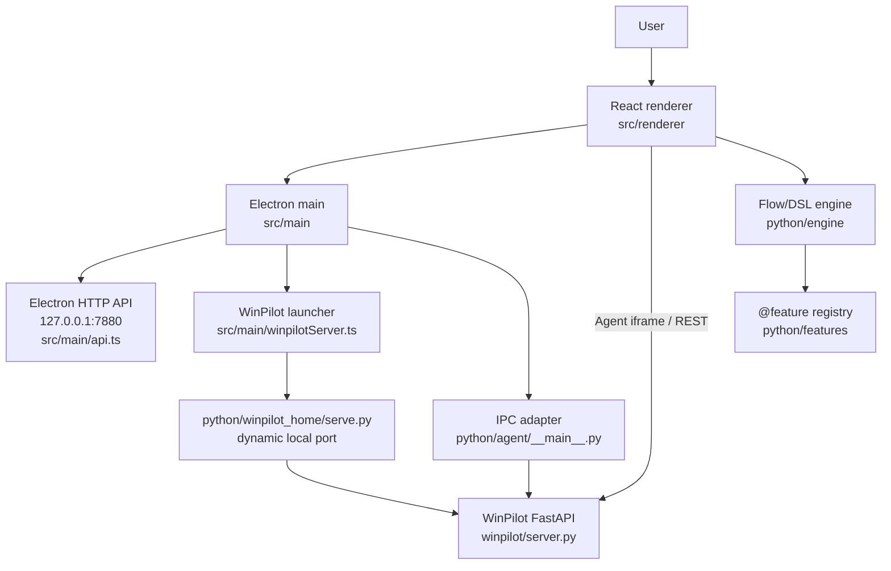
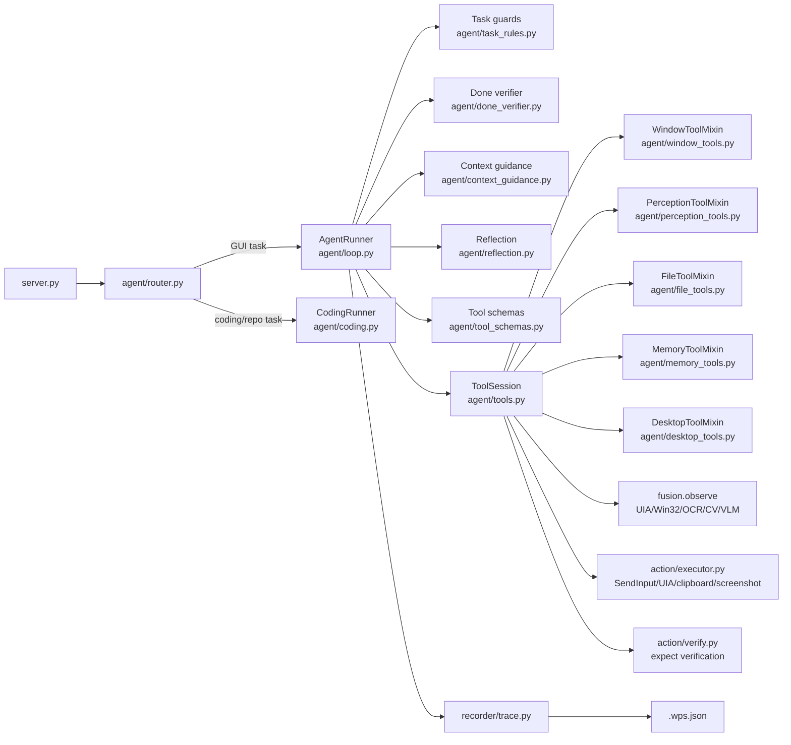

# 当前架构

项目不是一个单体 agent，而是两个系统并存。

## 两条主线

| 系统 | 路径 | 职责 | 边界 |
| --- | --- | --- | --- |
| WinPilot desktop agent | `python/winpilot_home/winpilot/` | LLM 实时操控 Windows、感知、动作、验证、录制、记忆、编程子 agent | 不直接使用 `@feature`，不直接编辑流程图 |
| 流程图/DSL 系统 | `src/renderer/`、`python/engine/`、`python/features/` | 可视化编排、DSL 执行、`@feature`、MCP/HTTP/CLI | 不等同于 WinPilot 主 agent |

## 进程和端口

`serve.py` 会设置 `WINPILOT_LAUNCHED_VIA_SERVE=1`。`server.py` 只阻止真正的 `uvicorn winpilot.server:app` 直接启动，不阻止测试导入。

## WinPilot 内部

## 最近结构调整

- `src/renderer/store/index.ts` 不再复制 defaults/templates/localStorage helper；这些真实来源在 `store/defaults.ts` 和 `store/persistence.ts`。
- `agent/tool_schemas.py` 承担 GUI agent function schema，并使用短描述减少 LLM 上下文；`agent/tools.py` 保留运行态 dispatch 和核心输入/动作 handler；`agent/window_tools.py`、`agent/perception_tools.py`、`agent/file_tools.py`、`agent/memory_tools.py`、`agent/desktop_tools.py` 分别承担窗口、感知、文件、记忆复用、桌面杂项工具。
- `agent/task_rules.py` 承担 GUI task 分类、GUI-only 限制和 done gate guard 的纯规则；`agent/done_verifier.py` 承担 done 二次核验；`agent/context_guidance.py` 承担 planning/world/playbook 上下文提示；`agent/reflection.py` 承担反思检查点。
- `winpilot/utils/image_capture.py` 统一窗口截图转 JPEG base64。
- `python/engine/executor_types.py` 承担 legacy Flow/DSL executor 的共享状态、上下文和控制流异常，`executor.py` 继续作为 legacy 执行器维护。
- `python/core/screenshot.py` 保留 `capture_screen()`，兼容旧 Robot Framework keywords。
- 打包配置过滤 Python/runtime 的 pycache、测试、dist-info、运行数据；Electron 语言包限制为 `zh-CN` 和 `en-US`。

## 维护重点

- `agent/loop.py` 已拆出任务规则、done 核验、上下文提示和反思检查点，但仍承担 LLM 调用、工具循环和上下文折叠。
- `agent/tools.py` 已拆出 schema、窗口、感知、文件、记忆、桌面杂项工具，但输入/动作 handler 仍集中，后续应继续拆。
- `python/engine/executor.py` 是旧 DSLExecutor，类型已拆到 `executor_types.py`；应冻结为 legacy 引擎，不继续扩张。
