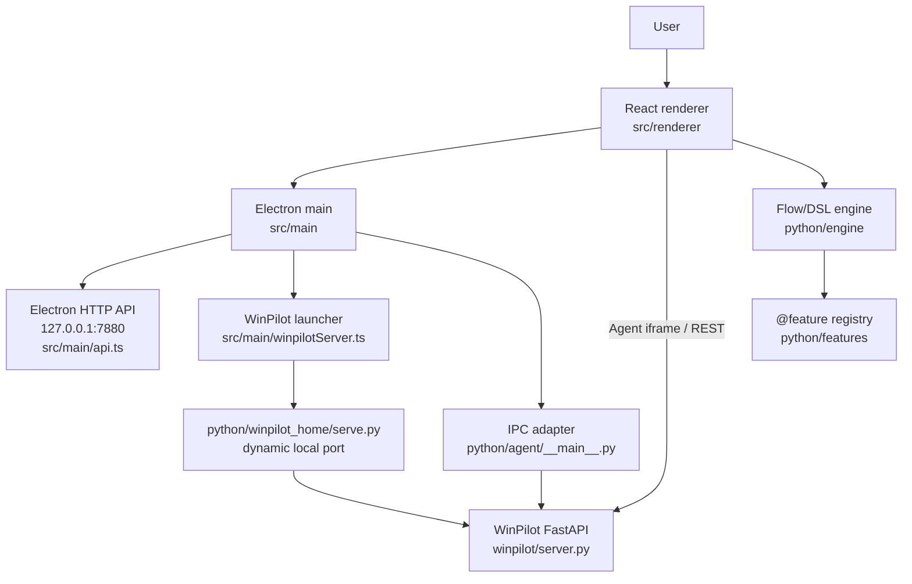
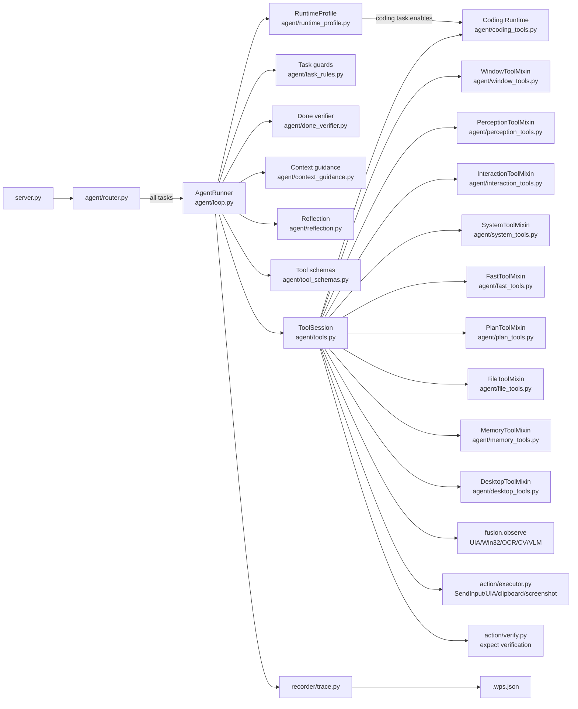
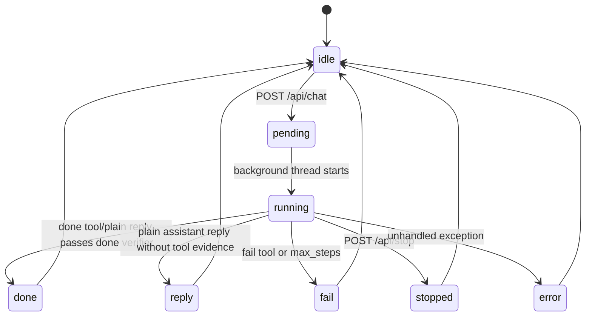
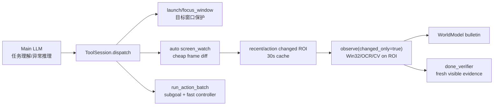

# 当前架构

项目对用户呈现为一个 WinPilot Agent，内部由一个主 runner、多个 Runtime/Capability 和流程图系统协作。

## 两条主线

| 系统 | 路径 | 职责 | 边界 |
| --- | --- | --- | --- |
| WinPilot desktop agent | `python/winpilot_home/winpilot/` | LLM 实时操控 Windows、感知、动作、验证、录制、记忆；编程/仓库能力作为 Coding Runtime 挂在统一 Agent 内 | 不直接使用 `@feature`，不直接编辑流程图 |
| 流程图/DSL 系统 | `src/renderer/`、`python/engine/`、`python/features/` | 可视化编排、DSL 执行、`@feature`、MCP/HTTP/CLI | 不等同于用户面对的 WinPilot Agent |

## 进程和端口

`serve.py` 会设置 `WINPILOT_LAUNCHED_VIA_SERVE=1`。`server.py` 只阻止真正的 `uvicorn winpilot.server:app` 直接启动，不阻止测试导入。

## WinPilot 内部

## 运行时状态机

- `server.py` 的 `_RunState` 是服务级锁：同一时间只允许一个 agent、replay 或人工录制任务运行。
- `AgentRunner.run()` 是唯一主循环：注入任务/上下文/记忆/runtime prompt -> 调 LLM -> 处理 tool calls -> `ToolSession.dispatch()` -> Runtime/工具 mixin -> done gate/world/playbook/reflect。
- `ToolSession` 是每次运行的状态容器，保存最近 `Snapshot`、目标窗口 `hwnd`、world model、plan、undo stack；当 `RuntimeProfile.coding=true` 时挂载 workspace-confined `CodingSession`，并把同名文件/shell/repo 工具委托过去；其他工具按窗口、感知、交互、系统、低延迟 batch、计划/终止、文件、记忆、桌面杂项拆到 mixin。
- `execute_subgoal`、`run_action_batch` 和 `screen_watch` 在 `agent/fast_tools.py`，内部进入 `fast/controller.py`。`execute_subgoal` 不是第二个 agent，而是同一 `ToolSession` 下的 controller-first routine：LLM 给输入/点击/验证子目标，本地 controller 完成定位、输入、点击、等待和 `evidence_packet`。controller 还会给 `draw_strokes/drag` 追加本地 `auto_visual_verify`；顶层 `click/type_text/hotkey/scroll/focus_window/draw_strokes/drag` 也会被 `AgentRunner` 自动包装成单动作 batch，让普通 GUI 动作获得 screen sync、`needs_observe`、batch metrics 和 fast-controller trace。验证充分时结果会带 `fast_path_advice`，减少额外 LLM round-trip。
- `.wps.json` 是 WinPilot trace 到离线重放的语义桥。新导出使用 `wps/2`，会收集顶层工具 replay 和 `run_action_batch` 子动作 replay；Replayer 负责文本 selector 重新定位、坐标回退和控制流执行。FlowScript 导入只发生在 `wpsToFlowScript.ts`，不代表 WinPilot 主 agent 直接理解或执行流程图。
- `ToolSession.dispatch()` 会给普通可见动作附加廉价 `screen_delta` 和 `action_target` 元信息。它用于定位“画面是否变化、变化时 foreground 是否仍是目标窗口”，不是语义完成证明；done 仍要看截图、目标窗口感知或外部证据。
- `launch` 的目标窗口会在发现后置前；`interaction_tools.py` 的输入动作优先使用 session target，而不是无条件使用当前 foreground；`action/verify.py` 在目标已知时会忽略无关 foreground，避免 Codex/日志/其他窗口 OCR 造成假成功。
- `agent/perception_tools.py` 默认给 LLM compact perception reducer：screen stage、target window、top candidates、uncertainties、recent changes 和建议 controller action；完整 raw snapshot 仍写 trace，需要时用 `observe(full=true)`。UIA-off 绘图/画布任务上有 `canvas_fast_observe`：无 `query/full` 的 `observe` 跳过全窗口 OCR，直接提供 Win32/CV 和 `likely_canvas` 摘要；需要文字 grounding 时用 `observe(query=...)` 或 `observe(full=true)` 回到完整感知。
- BUS/WebSocket 给前端显示进度；`recorder/trace.py` 写可回放事件和截图；`agent/loop.py` 的 LLM trace 写每步真实 prompt/response，失败复盘必须优先看这些证据。
- 长期经验记忆在 `memory/experience.py`，落盘到本机 `experience_memory.json`，通过 `agent/memory_tools.py` 的 `remember/forget/reuse_skill` 暴露给 GUI agent。recipe 现在显式带 `conditions` 和 `evidence`，隐式 `reuse_skill` 只允许强任务匹配；普通匹配只进入 prompt 提示，不会自动 replay，也不会因为 run 成功而被记作成功复用。失败 replay 会被记录为该 recipe 的负反馈，即使后续实时操作兜底完成。
- session memory 在 `agent/session.py`，只保存当前服务生命周期内最近任务，并且只对“再来/继续/刚才那个/previous/same/it”等指代型任务注入 prompt。普通新任务不带 session history。
- world advisory 是 `perception/world.py`、`agent/run_state.py`、`agent/context_guidance.py` 的运行态提示层：它只报告重复动作、动作后无变化、screen watcher 变化、need_observe/recovering 等信号，不主动截图，不替代 done 证据。
- 上下文折叠仍在 `agent/loop.py`：超过阈值后折叠旧大型工具结果，保留最近全量观察，并用 checkpoint 保存任务目标、关键屏幕状态、失败/恢复原因和最近工具证据。

## 最近结构调整

- `src/renderer/store/index.ts` 不再复制 defaults/templates/localStorage helper；这些真实来源在 `store/defaults.ts` 和 `store/persistence.ts`。
- `agent/tool_schemas.py` 承担统一 Agent function schema，并在 Coding Runtime 激活时动态加入 repo 工具；GUI schema 会把 `execute_subgoal` 排在低级 `click/type_text` 之前，让 routine path 成为默认选项。`agent/runtime_profile.py` 决定每次 run 的 runtime 开关；`agent/tools.py` 保留运行态状态和 dispatch，并在 GUI mutation 前执行 `scope_guard`，避免焦点偏离目标窗口后继续乱点；`agent/window_tools.py`、`agent/perception_tools.py`、`agent/interaction_tools.py`、`agent/system_tools.py`、`agent/fast_tools.py`、`agent/plan_tools.py`、`agent/file_tools.py`、`agent/memory_tools.py`、`agent/desktop_tools.py` 分别承担窗口、感知、输入动作、系统/启动、低延迟 batch、计划/终止、文件、记忆复用、桌面杂项工具。
- `agent/task_rules.py` 承担任务分类、GUI-only 限制、coding runtime 触发和 done gate guard 的纯规则；严格 GUI-only 且明确禁 shell 时，`tool_schemas.py` 不暴露 `run_shell/run_detached`；`agent/done_verifier.py` 承担 done 二次核验，并要求任务里的显著字面量 token（如 `FAST_WRAP_OK_073`、`75765`）在最终屏幕/工具证据中出现；`agent/context_guidance.py` 承担 planning/world/playbook 上下文提示；`agent/reflection.py` 承担反思检查点。
- `winpilot/utils/image_capture.py` 统一窗口截图转 JPEG base64。
- `python/engine/executor_types.py` 承担 legacy Flow/DSL executor 的共享状态、上下文和控制流异常，`executor.py` 继续作为 legacy 执行器维护。
- `python/core/screenshot.py` 保留 `capture_screen()`，兼容旧 Robot Framework keywords。
- 打包配置过滤 Python/runtime 的 pycache、测试、dist-info、运行数据；Electron 语言包限制为 `zh-CN` 和 `en-US`。

## 维护重点

- `agent/loop.py` 已拆出任务规则、done 核验、上下文提示和反思检查点，但仍承担 LLM 调用、工具循环和上下文折叠。
- `agent/tools.py` 已拆出 schema、窗口、感知、输入动作、系统/启动、低延迟 batch、计划/终止、文件、记忆、桌面杂项工具；后续新增工具优先放入对应 mixin。
- `python/engine/executor.py` 是旧 DSLExecutor，类型已拆到 `executor_types.py`；应冻结为 legacy 引擎，不继续扩张。
- 回放/DSL 节点改动要同时检查 `.wps.json` schema、`wpsToFlowScript.ts`、前端 `store/executor.ts`、`python/engine/dsl_flow_converter.py` 和 `python/engine/executor.py`；WinPilot-only `.wps.json` 步骤在 FlowScript 中必须显式占位或 fail-fast，feature 桥接返回 `success: false` / `false` 也必须让节点失败，不能静默成功。

## 2026-07-03 低延迟 GUI 链路

- `screen_watch` 是低成本变化检测层，不做语义理解；它保留 `recent_changed_regions` 和动作归因的 `action_changed_regions`，让 LLM 慢一拍调用 `observe(changed_only=true)` 时仍能只看局部。
- `fusion.screen_watch_autostart=true` 时，ToolSession 在获得目标窗口或执行可见动作前自动启动 watcher，AgentRunner 结束时停止 watcher，避免每个任务都要求 LLM 手动启动。
- 普通可见动作的 `screen_delta` 使用动作前/动作后独立截图 diff，不直接复用后台 watcher 的 `_prev`；这是为了避免连续采样线程在动作前后抢帧。动作 ROI 新鲜时，`observe(changed_only=true)` 优先 action ROI，再退回普通 recent ROI。
- `observe(changed_only=true)` 只在最近/action ROI 上跑本地 Win32/OCR/CV；无 ROI 时明确 fallback 到普通 observe，方便 trace 排错。若同时传入 `query` 且 ROI snapshot 没有命中，会标记 `Changed-only observe query fallback` 并退回全窗口 observe，避免局部 ROI 把模型带进假盲区。
- `execute_subgoal` 接受 `input`、单个 `click`、有序 `clicks` 和 `verify_texts`，结果会暴露 `actions_executed`、`controller_state`、`evidence_packet.matched_texts/missing_texts/candidate_click_labels`。它可用于输入+按钮 routine，也可用于“可见按钮 + 可验证状态”的 click-only routine；click-only 单状态验证优先走动作后的 `observe(changed_only=true, query=...)`，只理解变化 ROI，避免无条件全窗口 `read_text`。子目标只验证与该 subgoal/args 相关的 literal；全局完成条件仍交给 done gate，避免输入 routine 因后续状态还没出现而误报失败。锚点 label 失败时会把粗区域可见短文本作为 `candidate_click_labels` 返回给 LLM，要求改用语义相关的本地化/同义可见控件重试，而不是去 shell/源码里找 GUI 标签。`complete_subgoal` 可直接接受当前 `execute_subgoal:evidence_packet` 中匹配到的可见文本，避免 controller 已验证后又跑 full verify。`run_action_batch` 接受 `subgoal`，结果会暴露 `controller_state`、`metrics`、`element_cache`；`click_element` 结果会暴露 `anchor_locator` 和 `resolved_element`。element cache 复用时会用当前 snapshot 重新验证文本/角色/相对位置，不跨 observe 盲信旧 `elem_id`；如果当前 snapshot 漏掉文本锚点，controller 会做一次目标 `observe(query=label)` 并重试，证据写入 `controller_auto_observe`。
- 普通顶层 GUI 动作现在也会走 fast-controller 单动作 batch：`click/type_text/hotkey/scroll/focus_window` 默认等待稳定，`draw_strokes/drag` 保持 `sync=false` 并做局部视觉摘要。`click(label=...)` 或 `type_text(label=..., text=...)` 这类语义动作会在 controller 内自动升级为 `click_element` / `type_into_element`，避免把语义锚点参数误交给原始坐标点击。
- `/api/status` 返回 `runtime` 指纹，前端顶部显示 `runtime: branch@commit`，用于确认当前测试服务到底来自哪个 worktree、端口和 PID。严格 GUI-only、`GUI only` 或 `只用GUI` 的任务不会向模型暴露 shell schema；执行层仍保留 GUI-only guard 作为兜底。
- `action/verify.py`、`perception/ocr.py`、plan subgoal 和 done gate 都会容忍 OCR 把 `_`、空格、连字符、冒号混淆，例如 `FAST_WRAP_OK_073` 可匹配 `FAST WRAP OK 073`。done gate 仍要求显著字面量 token 出现在最终证据中，不能把“功能等价”当完成。
- batch 内部 `type_into_element` 会把定位、点击、可选清空和输入合成一个 controller 动作；结果用 `subresults` 展开内部 click/hotkey/type 阶段，避免把输入框任务拆回多轮 LLM。
- 当 `execute_subgoal` 没有可用 snapshot 且点击锚点带 `expected_region` 时，会先在目标窗口的粗区域做 targeted initial OCR/CV。只有该 ROI 里真的识别到目标 label 才使用裁剪感知；否则回退全窗口 observe。targeted snapshot 的 `region` 仍是完整目标窗口，避免 screen watcher 和后续 ROI 换算被裁剪坐标污染。
- `eval/summary.py` 的 `low_latency` 字段记录 screen capture、perception、LLM decision、action execution、post-action verify、replan/VLM/skill reuse/watch coverage；`fast_gui` 字段记录 batch subgoal、`execute_subgoal` 调用/动作/验证数、controller phase、anchor click/cache/failure，batch `metrics.auto_observe_count` 记录 controller 内部为了定位元素主动做的目标 observe，`metrics.compound_round_trips_saved` 记录组合动作节省的低层 round-trip，`subgoal_elapsed_ms/subgoal_controller_elapsed_ms/subgoal_overhead_ms` 用于区分慢在 controller 内环还是前置 observe/包装开销，后续性能优化应优先看这些字段。VLM 只有 `count>0` 或 `ms>0` 才计入强视觉调用；未配置时的 0ms 占位不会算进 `vlm_call_count`。
- URL `launch` 会直接打开 URL，并用归一化窗口标题匹配后聚焦目标窗口，避免 Codex、日志窗口或其他前景窗口遮挡造成假感知。
- `done_verifier.py` 对“确认出现某个状态/标签”的任务有确定性收束：fresh screen OCR 看见目标文本才通过，可减少完成后的额外 LLM judge。
- 最新验证 run：`20260704-005515-7f70a7`。它通过 `/api/chat` 跑严格 GUI-only 网页靶场，工具序列为 `launch -> observe -> execute_subgoal(input+apply) -> execute_subgoal(counter) -> execute_subgoal(verify) -> done`，仅 11 个工具、1 次 observe、done 一次通过；截图 `batch_after_003.jpg` 显示输入框 `SUBGOAL_OK_078` 和状态卡 `LOCAL_COUNTER_2`。对照 run `20260704-002852-1e75a4` 暴露过子目标证据作用域错误：输入 routine 把后续 `LOCAL_COUNTER` 也当作当前 missing evidence，导致绕圈；现在子目标证据只绑定当前 routine。
- 最新 click-only 验证 run：`20260704-014433-99e853`。它通过 `/api/chat` 跑“点击可见按钮直到 LOCAL_COUNTER 可见”，工具序列为 `launch -> complete_subgoal -> execute_subgoal(click+verify) -> complete_subgoal -> done`；截图 `batch_after_002.jpg` 显示 `LOCAL_COUNTER_1`，证明 click-only routine 也能进入 controller-first 内环。
- changed-only click-only 验证 run：`20260704-020133-18f863`。`execute_subgoal` 内部动作为 `click_element -> wait_stable -> observe(changed_only=true, query=LOCAL_COUNTER)`，工具耗时约 5.9s，截图 `batch_after_002.jpg` 显示 `LOCAL_COUNTER_1`。`20260704-020623-8f8903` 验证 `complete_subgoal` 已能用当前 controller evidence，计划核验耗时降到 1ms。
- targeted initial ROI 验证 run：`20260704-022217-2eeead`。模型传入 `expected_region=left`，`execute_subgoal` 的 `subgoal_overhead_ms=327`，说明没有内部全窗口 prelude；截图 `batch_after_002.jpg` 显示 `LOCAL_COUNTER_1`。该 run 仍有一次模型主动 `observe(full=true)`，后续优化应继续压缩 LLM 的习惯性全量观察。
- 本地化标签恢复验证 run：`20260704-031451-4d2852`。任务说英文 `Local Counter`，真实按钮是中文“只改局部状态”；第一次 `execute_subgoal` 在无 session hwnd 时用 foreground hwnd 做 targeted ROI，失败后返回候选标签和 controller recovery hint，第二次用中文可见标签点击并验证 `LOCAL_COUNTER_1`。该 run 的 tools schema 没有 `run_shell`，证明 `只用GUI` 已进入 strict GUI-only schema。
