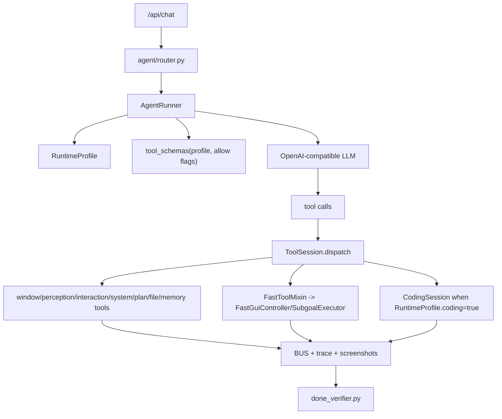

# 褰撳墠鏋舵瀯

鏈」鐩鐢ㄦ埛鍛堢幇涓轰竴涓?WinPilot Agent銆傚唴閮ㄧ敱涓€涓富 runner銆佸绉?Runtime/Capability銆佷綆寤惰繜 GUI controller銆佽蹇?replay 绯荤粺鍜?legacy 娴佺▼鍥剧郴缁熺粍鎴愩€?

## 鎬昏

```mermaid
flowchart LR
  User["鐢ㄦ埛 / 鍓嶇 Agent 椤甸潰"] --> Electron["Electron 涓昏繘绋?]
  Electron --> WinPilot["WinPilot FastAPI\npython/winpilot_home/serve.py"]
  WinPilot --> Runner["AgentRunner\nagent/loop.py"]
  Runner --> Runtime["RuntimeProfile\nDesktop / Coding"]
  Runner --> Tools["ToolSession.dispatch\nagent/tools.py"]
  Tools --> GUI["GUI tools\nwindow/perception/interaction/system"]
  Tools --> Fast["Fast GUI Controller\nfast/controller.py + fast/subgoal.py"]
  Tools --> Coding["Coding Runtime\nagent/coding_tools.py"]
  Tools --> Memory["Memory / Replay\nmemory + recorder"]
  Electron --> Flow["Flow editor / DSL\nsrc/renderer + python/engine"]
```

Memory Graph note: long-term memory now uses the SQLite Memory Graph (`memory.db`).
`memory/store.py`, `memory/runtime.py`, `memory/retriever.py`, `memory/packer.py`,
`memory/feedback.py`, and `memory/compiler.py` hold the graph runtime; `memory/experience.py`
is the compatibility facade for old recipe APIs. `experience_memory.json` is migration/compat
data only, not the primary runtime store. See `docs/memory-graph.md`.


## 涓ゆ潯涓荤嚎

### WinPilot desktop agent

璺緞锛歚python/winpilot_home/winpilot/`

璐熻矗鐪熷疄 Windows 妗岄潰鎿嶄綔銆傛牳蹇冪害鏉燂細

- 鍙湁涓€涓敤鎴峰彲瑙?Agent銆?
- 鎵€鏈変换鍔¤繘鍏?`agent/router.py -> AgentRunner`銆?
- GUI/Computer Use 鏄粯璁よ兘鍔涳紱Coding銆丼hell銆丗ile銆丅rowser銆丷eplay 鏄寜浠诲姟鍜岄厤缃惎鐢ㄧ殑 capability銆?
- done 鍓嶅繀椤荤粡杩囩湡瀹炶瘉鎹牳楠岋紝涓嶈兘鍙俊妯″瀷鎬荤粨銆?

### 娴佺▼鍥?/ DSL 鑷姩鍖?

璺緞锛歚src/renderer/`銆乣python/engine/`銆乣python/features/`

璐熻矗鍙鍖栫紪鎺掑拰 legacy 鑷姩鍖栥€傚畠鍜?WinPilot 鐨勫叧绯绘槸妗ユ帴锛屼笉鏄叡浜伐鍏锋睜锛?

- FlowScript 鏄墠绔敾甯?JSON銆?
- `python/engine/` 鏄?legacy DSL/Flow 鎵ц寮曟搸銆?
- `python/features/` 鏄?`@feature` 娉ㄥ唽琛紝渚涙祦绋嬪浘/MCP/HTTP/CLI 浣跨敤銆?
- WinPilot 鎴愬姛 trace 鍙互瀵煎嚭 `.wps.json`锛屽啀鐢?`src/renderer/utils/wpsToFlowScript.ts` 淇濆畧瀵煎叆 FlowScript銆?

## 杩涚▼鍜岀鍙?

| 杩涚▼/鏈嶅姟 | 鍏ュ彛 | 璇存槑 |
| --- | --- | --- |
| Electron HTTP API | `src/main/api.ts` | 榛樿 `127.0.0.1:7880`锛屼緵澶栭儴鎺у埗鍓嶇鍜屾煡璇㈢姸鎬?|
| WinPilot FastAPI | `python/winpilot_home/serve.py` | 鐢?Electron 鎵樼鎴栨墜鍔ㄥ惎鍔紱涓嶈鐩存帴璺?uvicorn |
| WinPilot Web UI | `python/winpilot_home/winpilot/webui/` | 鍓嶇 Agent 椤甸潰閫氳繃 iframe 浣跨敤 |
| Legacy IPC agent | `python/agent/__main__.py` | Electron stdin/stdout JSON-line 鍒?WinPilot BUS 鐨勯€傞厤鍣?|
| GUI eval script | `scripts/gui_eval_run.py` | 璧板悓涓€涓?`/api/chat` 璺緞锛屽啓 compact eval 鎶ュ憡 |

`/api/status.runtime` 浼氳繑鍥?repo root銆乥ranch銆乧ommit銆乨irty銆丳ID銆乸ort銆傛帓鏌ュ worktree 鎴栨棫鏈嶅姟鏃跺厛鐪嬪畠銆?

## Agent 鍐呴儴



鍏抽敭鏂囦欢锛?

| 鏂囦欢 | 鑱岃矗 |
| --- | --- |
| `agent/loop.py` | LLM 涓诲惊鐜€佷笂涓嬫枃鎶樺彔銆佸伐鍏疯皟鐢ㄣ€乽sage銆乨one gate 缂栨帓 |
| `agent/runtime_profile.py` | 鍒ゆ柇鏈 run 鏄惁鍚敤 Coding Runtime銆亀orkspace銆乵ax steps |
| `agent/task_rules.py` | GUI-only銆乧oding task銆佸彲瑙?literal銆乨one gate 杈呭姪瑙勫垯 |
| `agent/gui_plan_helpers.py` | GUI schema profile銆佺粯鍥捐鍒掕В鏋愩€佺函鎵撳紑绐楀彛璁″垝鍒ゆ柇绛夋棤鐘舵€?helper |
| `agent/tool_schemas.py` | function-calling schema銆乤llow flags銆乣standard/lean_gui/drawing_gui` profile |
| `agent/tools.py` | `ToolSession` 鐘舵€併€乨ispatch銆佺洰鏍?hwnd銆亀orld銆乽ndo stack |
| `agent/*_tools.py` | 鍏蜂綋宸ュ叿 mixin |
| `agent/done_verifier.py` | 闃插亣鎴愬姛鏍搁獙 |
| `fast/subgoal.py` | controller-first routine锛氳緭鍏ャ€佺偣鍑汇€佺粯鍥俱€佺瓑寰呫€侀獙璇?|
| `fast/controller.py` | 鏈湴浣庡欢杩熷姩浣滄墽琛屽拰 fast metrics |
| `perception/fusion.py` | UIA/Win32/OCR/CV/VLM snapshot 铻嶅悎 |
| `perception/reducer.py` | 缁?LLM 鐨?compact 鎰熺煡鎽樿 |
| `recorder/trace.py` | trace銆乣.wps.json`銆乺eplay |
| `model_adapter.py` | provider銆乼hinking 榛樿銆乽sage/cache/cost 褰掍竴鍖?|

## 杩愯鐘舵€佹満

涓€娆′换鍔＄殑鐘舵€佹祦锛?

```text
queued
  -> running
  -> LLM step
  -> tool dispatch
  -> evidence written to BUS/trace
  -> done verifier if terminal
  -> done / fail / reply / stopped / error
```

娉ㄦ剰锛?

- `agent_done` 鍙槸杩愯缁撴潫浜嬩欢锛屼笉绛変簬鐪熷疄浠诲姟鎴愬姛銆?
- GUI 鎴愬姛瑕佺湅 `done_check`銆佹埅鍥俱€佹枃浠?杩涚▼/绐楀彛鐘舵€佸拰宸ュ叿 evidence銆?
- replay 鎴愬姛鍙唬琛ㄨ剼鏈楠ゆ墽琛屽畬锛屼粛闇€瑕佸綋鍓嶈瘉鎹€氳繃 done gate銆?
- `screen_delta.changed=true` 鍙鏄庡儚绱犲彉鍖栵紝涓嶅崟鐙瘉鏄庝笟鍔＄洰鏍囧畬鎴愩€?

## 浣庡欢杩?GUI

褰撳墠宸茶惤鍦扮殑鏂瑰悜锛?

- **LLM 涓嬪瓙鐩爣锛宑ontroller 鎵ц routine**锛歚execute_subgoal` 鍦ㄦ湰鍦板畬鎴愬畾浣嶃€佽緭鍏ャ€佺偣鍑汇€佺瓑寰呫€侀獙璇併€?
- **鎵归噺鍔ㄤ綔**锛歚run_action_batch` 鍜岃嚜鍔?fast-wrap 鍑忓皯 click/type 鐨?LLM round-trip銆?
- **鍙樺寲瑙﹀彂鎰熺煡**锛歚screen_watch`銆乤ction ROI銆乣observe(changed_only=true)`銆乹uery fallback銆?
- **鍙粰 LLM 鎽樿**锛歚perception/reducer.py` 鎺掑簭鍊欓€夈€佺枒鐐瑰拰寤鸿鍔ㄤ綔锛涘師濮?snapshot 鐣?trace銆?
- **閫氱敤杈撳叆瀹氫綅**锛歚input_locator` 缁勫悎 UIA銆丱CR/CV 鍜?synthetic candidate锛岄伩鍏嶅啓鍗曡蒋浠惰鍒欍€?
- **绐楀彛鑼冨洿淇濇姢**锛歚scope_guard` 闃绘 GUI mutation 璺戝埌閿欒鍓嶅彴绐楀彛銆?
- **缁樺浘/鐢诲竷浼樺寲**锛歚draw/draws`銆侀€氱敤棰滆壊闈㈡澘 opener銆侀鑹?evidence銆佺粯鍥捐鍒掕嚜鍔ㄥ悎骞躲€?
- **schema 闄嶅櫔**锛歴trict GUI-only 缁樺浘浠诲姟浣跨敤 `drawing_gui`锛屽彧鍑忓皯妯″瀷鍙 schema锛屼笉鍑忓皯鏈湴 controller 鑳藉姏銆?

浠嶇劧娌℃湁瀹屾垚锛?

- 甯搁┗杞婚噺瑙嗚妯″瀷/YOLO 涓诲惊鐜€?
- 鐪熸瑙嗚浼烘湇鎺у埗銆?
- LLM 瀹屽叏閫€鍑哄父瑙勫姩浣滃唴鐜€?
- 瀹屾暣浣庡欢杩?dashboard 鍜岀ǔ瀹?skill reuse 鐜囥€?

## 璁板繂銆丷eplay 鍜?Skill

| 灞?| 鏂囦欢 | 浜嬪疄 |
| --- | --- | --- |
| 闀挎湡缁忛獙 | `memory/experience.py` | 鏈満 `experience_memory.json`锛宺ecipe/note 鏈?conditions/evidence |
| Session memory | `agent/session.py` | 鍙鐞嗏€滅户缁?鍒氭墠閭ｄ釜/鍐嶆潵涓€娆♀€濈瓑鎸囦唬 |
| Skill reuse | `agent/memory_tools.py` | 寮哄尮閰嶆垚鍔?replay 鎵嶈兘 0-token 澶嶇敤 |
| Trace/replay | `recorder/trace.py` | `.wps.json` 鏄?WinPilot replay 婧愭牸寮?|
| Flow 瀵煎叆 | `wpsToFlowScript.ts` | 淇濆畧瀵煎叆锛學inPilot-only 姝ラ淇濈暀涓?payload |

澶嶇敤涓嶆槸 done 璇佹嵁銆俽eplay 鎴愬姛鍚庝粛瑕佽瀵熷綋鍓嶅睆骞?鏂囦欢/杩涚▼/鏂囨湰銆?

## 妯″瀷涓庢垚鏈?

- 妯″瀷璇锋眰璧?OpenAI-compatible chat completions銆?
- `model_adapter.py` 璐熻矗 provider 鎺ㄦ柇銆丮iMo/Reasonix thinking 榛樿鍏抽棴銆乽sage/cache/cost 褰掍竴鍖栥€?
- 鍙湁 provider 鏈夊彲淇′环鏍艰〃鏃?UI 鎵嶆樉绀虹湡瀹炴垚鏈紱鏈煡 provider 涓嶆樉绀哄亣鐨?`楼0`銆?
- 寮?VLM 鏄厹搴曪紝涓嶅簲杩涘叆姣忔涓诲惊鐜€傞粯璁?VLM 鍏抽棴銆?
- 鎺掓煡 token/cost 鏃剁湅 `traces/<run_id>/NNN_llm_request.json` 鐨?`tools` 鍜?`messages` 澶у皬銆?

## 缁存姢閲嶇偣

- 鏂拌兘鍔涗紭鍏堟媶妯″潡锛屼笉缁х画鎵╁ぇ `agent/loop.py`銆乣agent/tools.py`銆乣python/engine/executor.py`銆?
- 鏂囨。璁板綍褰撳墠浜嬪疄锛屼笉鍫嗗巻鍙?run id锛涘巻鍙茶瘉鎹暀鍦?trace/eval銆?
- GUI-only 鐨勭湡瀹為獙鏀跺繀椤昏蛋 `/api/chat`锛屽苟浜哄伐鏍稿鎴浘銆?
- 涓嶄负鐗瑰畾杞欢纭紪鐮佽鍒欍€俀Q銆佽绠楀櫒銆丳aint 绛夊彧鑳戒綔涓烘祴璇曞満鏅€?
- 鏇存柊 Flow/DSL/replay 鏃跺悓姝ユ祴璇?`recorder/trace.py`銆乣wpsToFlowScript.ts`銆乣python/engine/dsl_flow_converter.py`銆?
