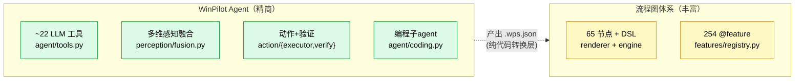
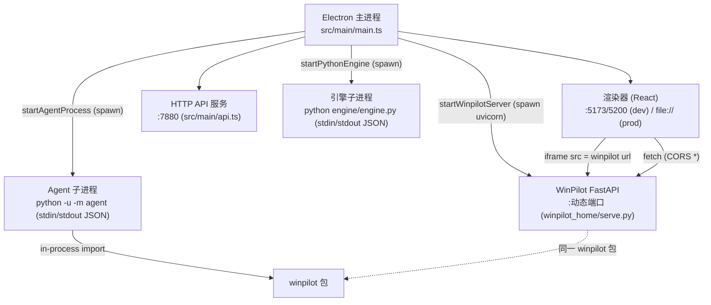
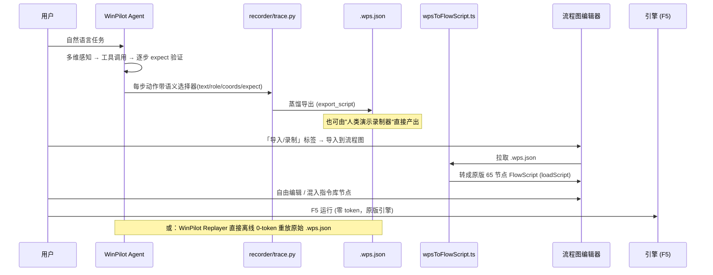
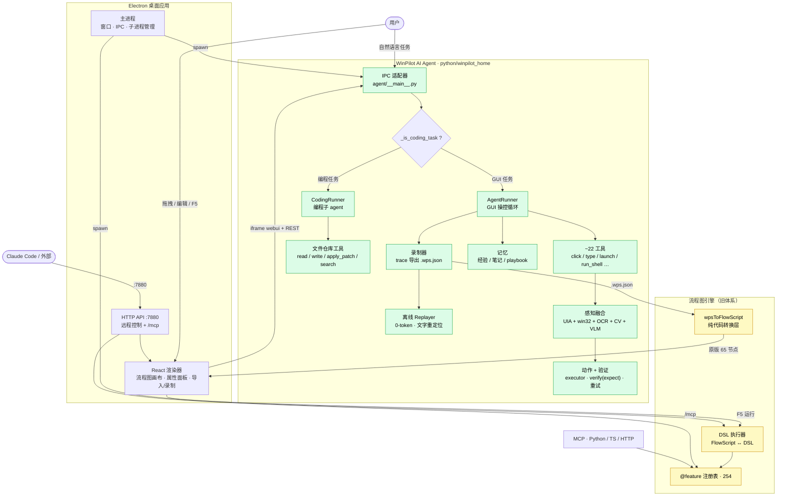

# 总体架构

> 当前架构（2026-06，分支 `feat/winpilot-agent`）。本文描述两大子系统、进程与端口、桥接关系和关键数据流。

## 1. 两大子系统

灵动脚本由两个**刻意解耦**的子系统组成：

| 子系统 | 位置 | 职责 | 执行者 |
|---|---|---|---|
| **WinPilot AI Agent** | `python/winpilot_home/` | LLM 实时操控电脑；录制/离线重放 | 自带感知/动作栈（~22 工具） |
| **流程图编辑器 + 引擎** | `src/renderer/` + `python/engine/` + `python/features/` | 可视化编排、零-token 执行、@feature/DSL/MCP | DSL 执行器 + 254 @feature |

它们通过 Electron 主进程拉起，并通过若干桥接连通（见 §3）。



> **设计铁律**：绝不把 254 @feature 或流程图知识塞进主 agent（对 agent 是"副优化"，拖垮性能）。需要新专长时，仿编程子 agent 另做**独立子 agent**（如未来的"流程图编排子 agent"）。

## 2. 进程与端口



- **渲染器**：开发 `http://localhost:5173`（或 5200），生产 `file://`。
- **HTTP API `:7880`**：主进程内置，供 Claude Code 等外部 curl 实时控制前端（`API_PORT` 可覆盖），含 `/mcp` 端点。
- **WinPilot FastAPI**：内嵌服务，端口动态分配（`winpilotServer.ts` 找空闲端口）；其 webui 以 iframe 嵌入渲染器的 Agent 面板；CORS 放开（仅绑 127.0.0.1）。
- **Agent 子进程**：`python/agent/__main__.py` 是 IPC 适配器，**在进程内** import 并驱动 WinPilot 的 `AgentRunner`/`CodingRunner`（经 `agent/router.py`），把 WinPilot 的 BUS 事件转成 stdout JSON 行。
- **引擎子进程**：执行流程图/DSL（旧体系）。

## 3. 桥接关系

| 桥接 | 方向 | 实现 |
|---|---|---|
| Agent 面板内嵌 | 渲染器 → WinPilot webui | iframe (`src/main/winpilotServer.ts` + `components/AgentView.tsx`)，**常驻不卸载**以保对话不丢 |
| 重放/录制导入 | 渲染器 → WinPilot REST | `fetch`（CORS 全开）列 trace/脚本；`utils/wpsToFlowScript.ts` 把 `.wps.json` 转成原版 FlowScript → `store.loadScript` |
| Agent IPC | 主进程 ↔ Agent 子进程 | stdin/stdout JSON（命令 start/stop/guidance/chat/status；事件 = WinPilot 原生 BUS） |
| Claude Code 远控 | 外部 → 渲染器 | HTTP API `:7880`（54+ 端点，见 [apis.md](apis.md)） |
| @feature 暴露 | 多协议 | `features/registry.py` 自动派生 MCP/CLI/HTTP/DSL |

## 4. 关键数据流：从"录制"到"零-token 重放"



两条重放路径并存：

- **导入流程图 → F5**：进原版编辑器，可编辑、混用 @feature/库节点，用原版引擎执行（OCR/坐标 + 自愈）。**用户主路径**。
- **WinPilot Replayer**：直接离线 0-token 重放原始 `.wps.json`，按文字在实时屏幕重定位 + `expect` 校验。供 agent 自身的 `reuse_skill` 与"原样重放"。

## 5. 目录速览

```
src/
  main/        Electron 主进程 (main.ts/api.ts/engine.ts/winpilotServer.ts/preload.ts)
  renderer/    React 流程图编辑器 (App.tsx/store/components/utils)
               └ utils/wpsToFlowScript.ts  ← .wps.json → 原版 FlowScript
               └ components/ReplayEditorView.tsx ← 「导入/录制」hub
python/
  winpilot_home/winpilot/   ★ 现役 WinPilot agent（见 winpilot-agent.md）
  agent/__main__.py         WinPilot 的 IPC 适配器（+ dialog/menu handler）
  engine/                   流程图/DSL 执行引擎（旧体系）
  features/                 254 @feature 注册表（旧体系）
  mcp/server.py             Python MCP 服务器
```

> 历史背景：早期 agent 是 `python/agent/` 下的 LingdongAgent（27 元动作/supervisor/5 执行模式/SoM/本地视觉引擎），已被 WinPilot 整体取代。任何提到这些的旧文档/注释都已过时。

## 6. 完整架构流程图（端到端）

> 一张图覆盖：用户输入 → 两条路径（agent / 流程图）→ WinPilot 内部（路由、感知、验证、录制、重放、记忆）→ 重放内容转成原版节点回到编辑器 → 旧引擎执行 → 外部协议。绿色=WinPilot（精简、现役），黄色=旧流程图体系。



**读图顺序**：①用户给自然语言 → IPC → 路由到 GUI/编程 agent；②GUI agent 用 ~22 工具操控，每步经感知融合定位 + 验证重试；③跑过的动作录成 `.wps.json`；④纯代码转换成原版 65 节点回到画布，可编辑、混编、F5 用旧引擎执行；⑤外部（Claude Code / MCP）可经 HTTP API 远程驱动。
