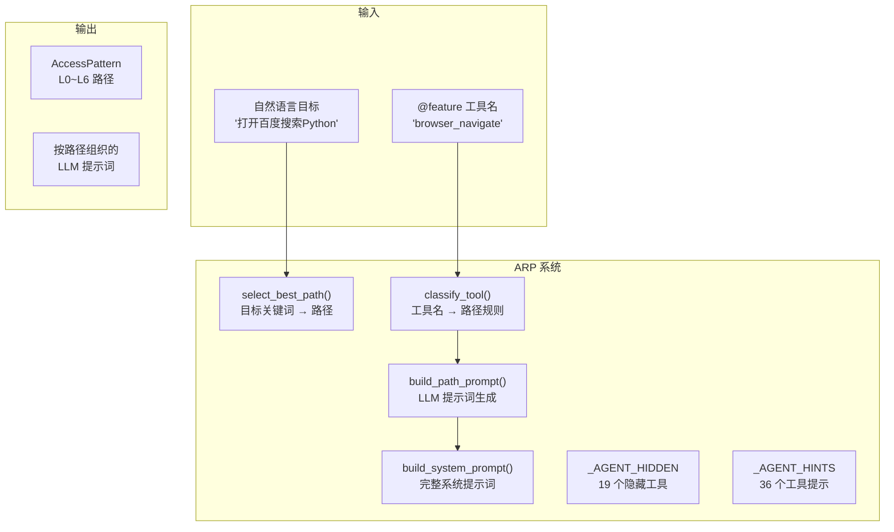
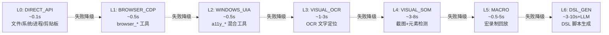
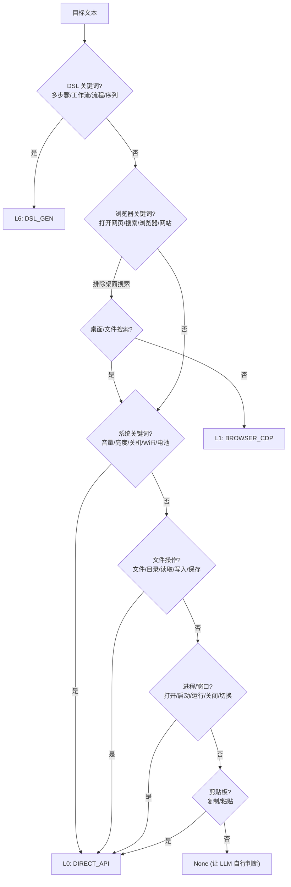
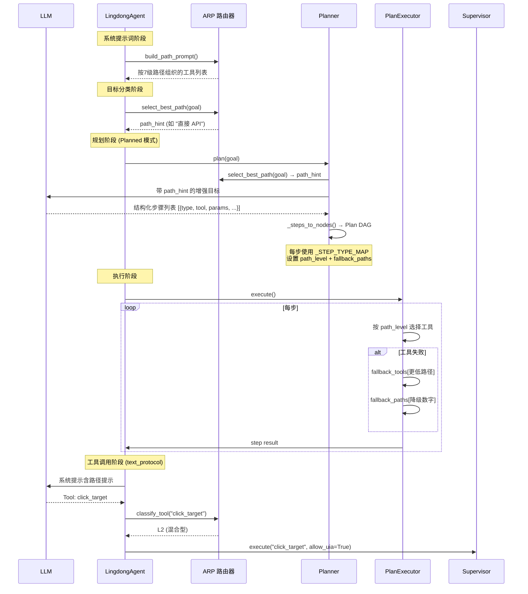
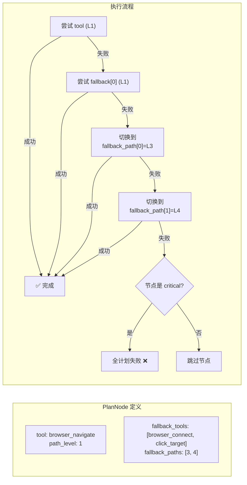
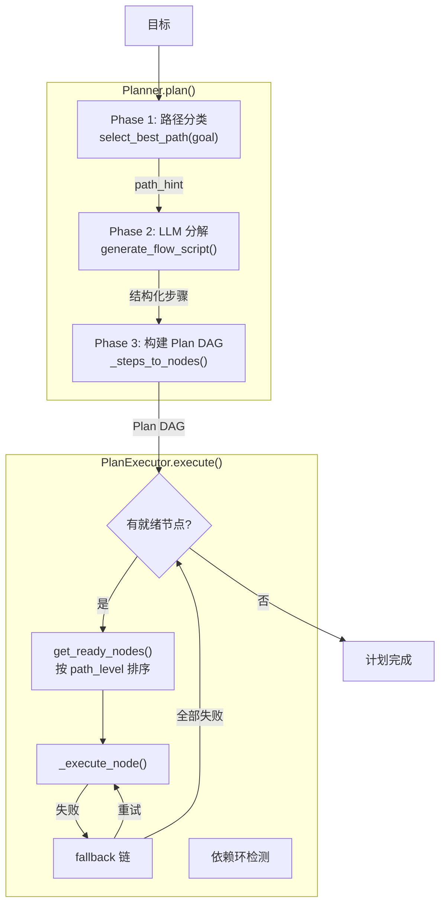

# ARP (Access Routing Protocol) 系统分析

> **文档**: `docs/arp.md`
> **核心文件**: `python/agent/tool_path_selector.py` (601行), `python/agent/planner.py` (859行)
> **前置阅读**: [system-map.md](system-map.md), [architecture.md](architecture.md)

---

## 1. ARP 架构总览

ARP = Access Routing Protocol — 工具访问路径选择协议。核心思想是**先选路径再选工具**，确保 Agent 总是使用最快、最可靠的方式完成任务。

---

## 2. 7 级路径优先级

| 级别 | 枚举值 | 模式 | 成本 | 适用场景 | 工具数 |
|------|--------|------|------|----------|--------|
| **L0** | `DIRECT_API` | 直接 API | ~0.1s, 无界面依赖 | 文件操作、系统设置、进程管理、剪贴板、条件求值 | ~80 |
| **L1** | `BROWSER_CDP` | 浏览器 CDP | ~0.5s, 仅浏览器 | 任何 `browser_*` 工具、Web 相关目标 | ~42 |
| **L2** | `WINDOWS_UIA` | Windows UIA | ~0.5s, 标准控件 | `a11y_*` 工具、混合工具（click_target 等默认） | ~10 |
| **L3** | `VISUAL_OCR` | OCR 文字定位 | ~1-3s, 需截图 | `ocr_find_text`, `ocr_extract_all`, `find_element` | ~3 |
| **L4** | `VISUAL_SOM` | SoM 视觉标号 | ~3-8s, 需截图+检测 | 截图、图像匹配、颜色检测、摄像头、场景识别 | ~18 |
| **L5** | `MACRO` | 宏回放 | ~0.5-5s, 需预录制 | `macro_*` 工具 | ~10 |
| **L6** | `DSL_GEN` | DSL 脚本生成 | ~3-10s + LLM 调用 | AI 规划、多步骤工作流、"先...然后" | ~3 |

---

## 3. 路由分类规则

### 3.1 目标路由 (`select_best_path`)

### 3.2 工具分类 (`classify_tool`)

| 规则 | 匹配条件 | 映射路径 |
|------|----------|----------|
| 浏览器 | `name.startswith("browser_")` | L1 BROWSER_CDP |
| UIA | `name.startswith("a11y_")` | L2 WINDOWS_UIA |
| 宏 | `name.startswith("macro_")` | L5 MACRO |
| AI 规划 | `category == "ai"` | L6 DSL_GEN |
| OCR | `ocr_find_text`, `ocr_extract_all`, `find_element`, `popup_close` | L3 VISUAL_OCR |
| 视觉 | `screenshot`, `find_image`, `color_check`, 等 | L4 VISUAL_SOM |
| 混合 | `click_target`, `type_text`, `hotkey`, 等 | L2 (默认, 运行时调整) |
| 系统 | `category == "system"`, 非视觉工具 | L0 DIRECT_API |
| 控制流 | `category == "control"` | L0 DIRECT_API |
| 感知 | `category == "perception"` (未匹配的) | L4 VISUAL_SOM |
| 兜底 | 以上都不匹配 | L0 DIRECT_API |

---

## 4. ARP 在 Agent 执行中的位置

---

## 5. 路径降级执行链

### _STEP_TYPE_MAP 示例

| 步骤类型 | 主工具 | path | fallback_tools | fallback_paths |
|----------|--------|------|----------------|----------------|
| `launch` | `launch_program` | 0 | `[run_command]` | `[1]` |
| `click` | `click_target` | 2 | `[a11y_click_element, image_click]` | `[3, 4]` |
| `text_click` | `click_target` | 3 | `[ocr_find_text]` | `[2, 4]` |
| `type` | `type_clipboard` | 0 | `[type_text, hotkey]` | `[2, 3]` |
| `browser_navigate` | `browser_navigate` | 1 | `[browser_connect, browser_new_tab]` | `[3, 4]` |
| `screenshot` | `screenshot` | 4 | `[]` | `[]` |

---

## 6. ARP 与 Planner 集成

