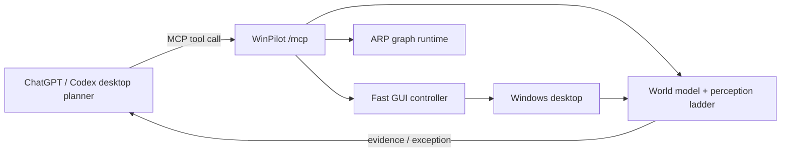

# ChatGPT / Codex desktop bridge

WinPilot can use the currently logged-in ChatGPT or Codex desktop client as the
high-level planner without reading an OpenAI API key. The supported direction is
client -> MCP -> WinPilot: the model chooses tools and sends subgoals while the
local controller observes, executes, watches screen deltas, and verifies.



The desktop client is not exposed as a reverse HTTP inference API. WinPilot
does not inspect ChatGPT cookies, account tokens, or private app protocols. This
keeps the logged-in client in control and avoids treating a ChatGPT subscription
as an API credential.

## Local connection

With WinPilot listening on `127.0.0.1:8765`, register the local Streamable HTTP
server in Codex desktop:

```powershell
codex mcp add winpilot --url http://127.0.0.1:8765/mcp
```

If the desktop client inherits an HTTP proxy, bypass it for the local bridge
before starting the client. Otherwise some Python/Node MCP clients route the
loopback request through the proxy and return `502` even though WinPilot is up:

```powershell
$env:NO_PROXY="127.0.0.1,localhost"
$env:no_proxy=$env:NO_PROXY
```

The live URL and tool count are also available from:

```text
GET http://127.0.0.1:8765/api/v2/integrations/chatgpt
```

`server_ready=true` only means the local endpoint is listening. The desktop UI
shows `MCP active` only after a client has made a request within the recent
activity window; otherwise it deliberately says `Endpoint ready`.

For the consumer ChatGPT desktop/web client, enable developer mode and connect
the same MCP server as an app. ChatGPT requires an HTTPS-reachable MCP endpoint;
keep WinPilot bound to loopback and use an authenticated/restricted tunnel rather
than exposing the whole REST server. See OpenAI's
[connection guide](https://developers.openai.com/apps-sdk/deploy/connect-chatgpt).

## Planner contract

The bridge publishes four layers of tools:

- Read state: runtime, runs, windows, low-cost UI observations, skills.
- Visual fallback: full-screen or ROI JPEG only when ordinary perception is insufficient.
- Controller inner loop: anchored subgoals and short action batches with local verification.
- Orchestration: validate/run deterministic `arp/1` graphs, inspect/cancel runs, and decide gates.

`run_arp_graph` rejects `agent_goal` nodes. In this mode the connected ChatGPT
conversation is already the main planner, so nesting the API-backed AgentRunner
would add latency and unexpectedly require a separate model credential.

## Safety

- The built-in endpoint accepts only loopback Host headers and is intended for a local client.
- Tool annotations mark desktop-changing operations as non-idempotent and destructive.
- WinPilot's single-writer guard rejects controller mutations while another Agent, replay, recording, or ARP run is active.
- `integrations.chatgpt_desktop.allow_desktop_mutation` can make the bridge read-only.
- Shell and arbitrary file tools are not exposed by this MCP surface.
