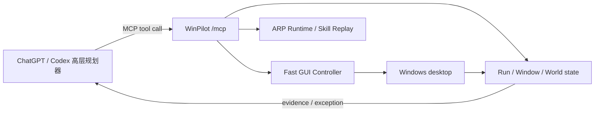

# ChatGPT / Codex 桌面桥接

WinPilot 可以把当前登录的 ChatGPT 或 Codex 桌面客户端作为高层规划器，而不把 ChatGPT 订阅、Cookie 或客户端私有 token 当成 OpenAI API 凭据。支持的方向是：

```text
ChatGPT / Codex -> Streamable HTTP MCP -> WinPilot Controller / ARP -> Windows 桌面
```

桌面模型选择工具和下达短子目标；本地 WinPilot 负责窗口作用域、感知、动作队列、屏幕变化、证据和失败保护。WinPilot 不把桌面客户端反向暴露成 HTTP 推理 API，也不读取账号 Cookie 或私有协议。



## 本地连接与鉴权

WinPilot 的 `/mcp` 与 `/api/*` 共用控制 token。`serve.py` 每次启动都会设置随机 token；Electron 托管时 token 只通过 preload 交给同一 renderer。不能把不带鉴权的

```powershell
codex mcp add winpilot --url http://127.0.0.1:8765/mcp
```

当作 Electron 托管模式的完整连接命令——受保护端点会返回 `401`。

开发环境需要让服务和 MCP 客户端共享同一个 secret。Codex CLI 支持 `--bearer-token-env-var`：

```powershell
$env:WINPILOT_MCP_TOKEN = '<随机长令牌>'
$env:WINPILOT_CONTROL_TOKEN = $env:WINPILOT_MCP_TOKEN
python python/winpilot_home/serve.py 8765 127.0.0.1
```

然后从同样能读取 `WINPILOT_MCP_TOKEN` 的环境注册并启动 Codex：

```powershell
codex mcp add winpilot `
  --url http://127.0.0.1:8765/mcp `
  --bearer-token-env-var WINPILOT_MCP_TOKEN
```

上面的第一段会持续占用终端，实际使用时可在另一个继承相同环境变量的终端启动客户端。不要把真实 token 写入仓库、截图、trace、聊天消息、命令行 URL 或文档。Electron 当前没有面向任意外部客户端导出托管随机 token 的公开配对流程；需要外部 MCP 客户端时，显式启动这个受控本地开发实例更容易审计。

如果桌面客户端继承了 HTTP 代理，还要让 loopback 绕过代理，否则本地 MCP 请求可能被代理成 `502`：

```powershell
$env:NO_PROXY = '127.0.0.1,localhost'
$env:no_proxy = $env:NO_PROXY
```

在已鉴权的请求中，可从下面接口读取实际端点、工具数和最近连接状态：

```text
GET /api/v2/integrations/chatgpt
```

`server_ready=true` 只表示本地 MCP app 已初始化；只有近期收到客户端请求时，工作台才显示“MCP 已连接”。工作台中的“端点已就绪”不能证明客户端已经连通，也不能证明某项桌面任务完成。

## ChatGPT Web / App 的当前边界

消费级 ChatGPT 连接远程 MCP 需要 HTTPS 可达端点和相应认证。当前 WinPilot 内置服务只绑定 loopback、使用本地 bearer token，且没有实现可直接给 ChatGPT 使用的 OAuth 流程，因此不是零配置的远程 App。

如果必须从 ChatGPT 连接，应在 loopback 前放置受控的 HTTPS/OAuth 适配层，并只暴露 `/mcp`，同时保留 WinPilot bearer 校验。不要把整个 WinPilot REST 服务直接暴露到公网，也不要把 token 放进 URL 查询参数。连接要求见 OpenAI 的 [MCP connection guide](https://developers.openai.com/apps-sdk/deploy/connect-chatgpt)。

## 工具契约

当前 MCP 工具分为四层：

- 状态与目标：`get_gui_agent_state`、`list_desktop_windows`、`focus_desktop_window`、`launch_app`、`reset_gui_context`。
- 感知：`observe_desktop` 走低成本 UIA/OCR/CV；`capture_visual_fallback` 只在复杂或未知像素状态下返回 JPEG。
- Controller：`execute_gui_subgoal`、`execute_action_batch` 执行短、具体、有作用域的 routine。
- 编排与复用：`validate_arp_graph`、`run_arp_graph`、`get_gui_run`、`cancel_gui_run`、`decide_human_gate`、`list_gui_skills`、`replay_gui_skill`。

这个 MCP 面刻意不暴露任意 shell/file 工具。`run_arp_graph` 拒绝包含 `agent_goal` 的图：当前 ChatGPT/Codex 会话已经是高层规划器，再嵌套 API-backed `AgentRunner` 会重复规划、增加延迟并意外要求另一套模型凭据。

在这种模式下，高层任务列表属于连接的模型会话；它可随时改变自己的计划、取消 run、重建 ARP 图或决定人工门。WinPilot 本地 Agent 的 `revise_plan` 动态 todo 只适用于真正运行 `AgentRunner` 的 `/api/chat` / 前端 `agent_goal` 路径，MCP 不伪造一份第二计划。

## 截图范围

不要假设模型拿到的图永远是全屏：

- WinPilot 原生视觉 Agent 的自动帧由 `controller.target_window_capture_enabled` 控制。只有目标窗口经过前台、可见性、几何、任务语义和收益检查后才裁剪；跨窗口、桌面全局或含糊场景回退完整虚拟桌面。“系统设置”页可关闭优化做 A/B 对照。
- MCP 的 `observe_desktop` 默认返回结构化目标窗口观察，不返回重复 JPEG。
- MCP 的 `capture_visual_fallback` 由高层规划器显式选择：不传 ROI 时当前实现捕获完整虚拟桌面，传入完整 `x/y/width/height` 时捕获该物理区域。返回 metadata 会说明实际范围；它不是常规动作内环，也不会自动猜一个裁剪。

无论哪条路径，坐标必须相对本次返回的画面/区域解释。旧图、旧窗口或未声明范围的坐标不能继续用于新动作。

## 多输入协同

`controller.multi_input_cooperation` 默认关闭。开启后，MCP 动作与前端 Agent 使用同一套人机仲裁：

- 优先不会移动系统光标或抢键盘焦点的窗口消息/UIA 动作。
- 不从另一个前台窗口强抢物理键盘焦点。
- 拖拽、绘图等长物理动作期间，如果用户移动鼠标或切换前台，用户取得控制权，当前 Agent 动作安全停止。
- Windows 仍只有一个系统光标和一个键盘焦点；该选项不是“第二鼠标/第二键盘”，真实物理输入继续 single-writer。

## 证据与安全

- 工具返回 `ok`、像素发生变化、skill replay 跑完或 ARP 到达 `end`，都不自动等于用户任务完成。高层规划器必须检查当前 run evidence、目标窗口和必要的新鲜视觉/确定性结果。
- `capture_visual_fallback` 是观察，不授权 mutation；`execute_gui_subgoal` 和 `execute_action_batch` 才能改变桌面。
- 工具 annotations 把桌面 mutation 标为非幂等/可能破坏性操作。
- `integrations.chatgpt_desktop.allow_desktop_mutation=false` 可把桥接面切成只读。
- Agent、ARP、Replay 和 MCP Controller 共享 runtime/desktop 资源保护；真实鼠标键盘保持全局单写。
- `run_arp_graph` 的人工门只能用 `decide_human_gate` 决定当前明确暂停的节点，不能批准另一条旧 run。
