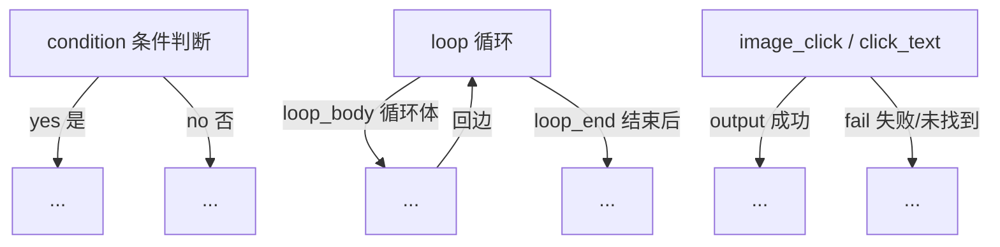
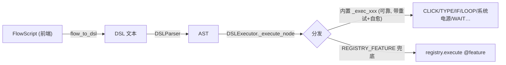
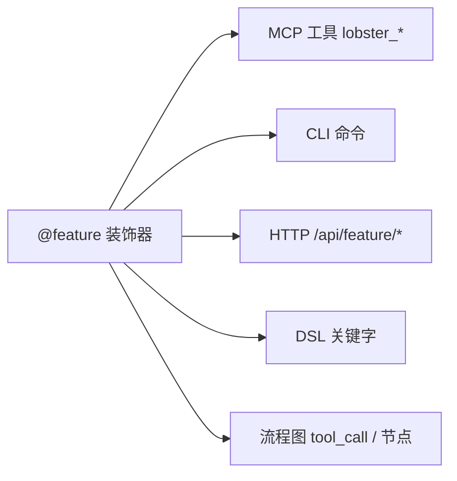

# 流程图编辑器与执行引擎

> 可视化自动化体系（旧但成熟，与 WinPilot agent 解耦）：`src/renderer/`（前端）+ `python/engine/`（执行）+ `python/features/`（254 @feature）。

## 1. 前端（React，`src/renderer/`）

| 部分 | 位置 | 职责 |
|---|---|---|
| 根组件 | `App.tsx` | 布局、标签页（画布/伪代码/Agent/导入录制/设置）、快捷键、HTN 注册 |
| 状态 | `store/`（Zustand + immer） | `useStore`；`loadScript` / `addNode` / `addEdge` / `setViewMode` / `autoLayout` / 撤销重做 |
| 画布 | `components/Canvas/` | FlowCanvas / FlowNode / EdgeLayer（按 `ports`+`from_port` 泛化渲染） |
| 属性面板 | `components/PropertyPanel/params/*.tsx` | 每种节点一个参数编辑器（区域拾取、策略选择…） |
| 工具 | `utils/` | nodeDefinitions、pseudoParser、wpsToFlowScript、macroConverter、htn*、semanticMatcher 等 |

视图模式：`canvas`（流程图）/ `pseudocode`（中文伪代码⇄DSL）/ `agent`（内嵌 WinPilot webui）/ `replay`（导入/录制 hub）/ `settings`。

## 2. 节点体系（~65 种）

节点定义在 `utils/nodeDefinitions.ts`（默认参数 + 端口），类型枚举在 `types/index.ts` 的 `NodeType`。分支靠 **`FlowEdge.from_port`**：



类别：基础交互（click/input_text/keyboard/swipe/mouse_operation…）、图像识别（image_click/click_text/screenshot/color_check…）、控制流（condition/loop/wait/sub_script）、系统操作（launch_program/kill_process/focus_window/音量/电源…）、数据（variable_set/get）、高级（web_browser/dialog_action/a11y_action/tool_call）、聚合多合一（system_power/audio_action/clipboard_action/process_action…）、特殊（start/end）。

> "聚合节点"用一个 `action`/`sub_operation` 字段内部分派多个原子操作，是"减少节点数、保留能力"的浓缩范式。

## 3. DSL 与双向转换

内置 DSL（~130 关键字：78 解析器内置 + 51 @feature 注册），大写关键字：

```
CLICK 500 400
INPUT_TEXT 300 500 "用户名"
CLICK_TEXT "登录"
IF WINDOW_EXISTS "确认"
  CLICK_TEXT "确认"
END
LOOP 5 ... END
```

转换器 `python/engine/dsl_flow_converter.py`：`dsl_to_flow` / `flow_to_dsl` 双向无损（块⇄端口）。工具 `tools/dsl_to_flow.py`。

## 4. 执行引擎（`python/engine/`）



- 入口 `engine/engine.py`：**FlowScript 先转 DSL 再执行**（真正执行单元是 DSL）。
- `executor.py` 的 `_execute_node` 大分发：约 40+ 关键字有专属 `_exec_xxx`（控制流/系统/感知，交互类带 3 次重试 + 自愈 `healing.py`）；其余带 `dsl_keyword` 的 @feature 走 `REGISTRY_FEATURE` 兜底。
- 配套：`triggers.py`（6 种触发源）、`scheduler_daemon.py`（APScheduler 守护）、`crystallizer.py`（成功 DSL 结晶为模板）、`robot_*`（Robot Framework 互转）。

## 5. @feature 注册表（254 个）

`features/registry.py` + `@feature` 装饰器，`_all.py` 懒加载 ~42 模块（50 个 .py 文件）。每个 @feature 自动派生：



7 大类（交互/感知/控制流/AI规划/宏/系统/调试），覆盖 click/OCR/图像/窗口/进程/剪贴板/文件/wifi/音量/浏览器/调度等。**注意：WinPilot agent 不使用这些 @feature**——它们只服务 MCP / HTTP / DSL / 流程图节点。

## 6. HTN 与模板

- **HTN 规划器**（前端 `utils/htn*`）：每次 AI 生成的流程自动注册为 HTN 模板，同类任务复用。
- **模板系统**：`templates/`（预置）+ 自定义 + 结晶化；语义搜索（`semanticMatcher.ts`）、模板市场/浏览器组件。
