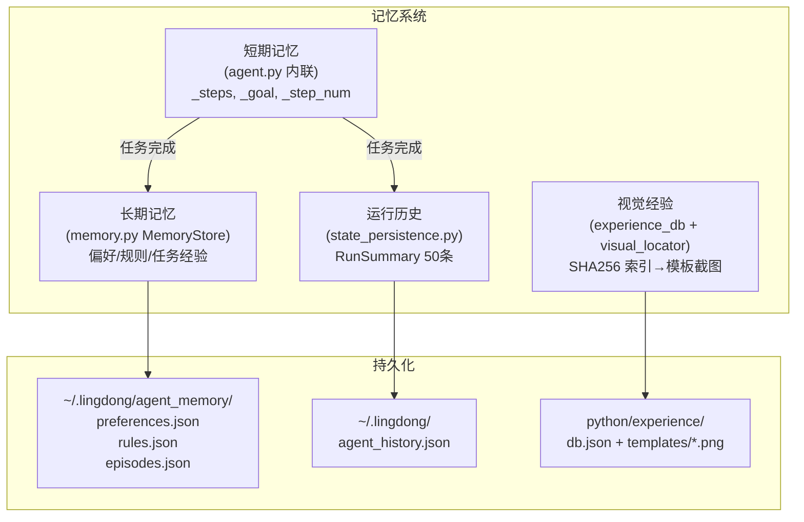
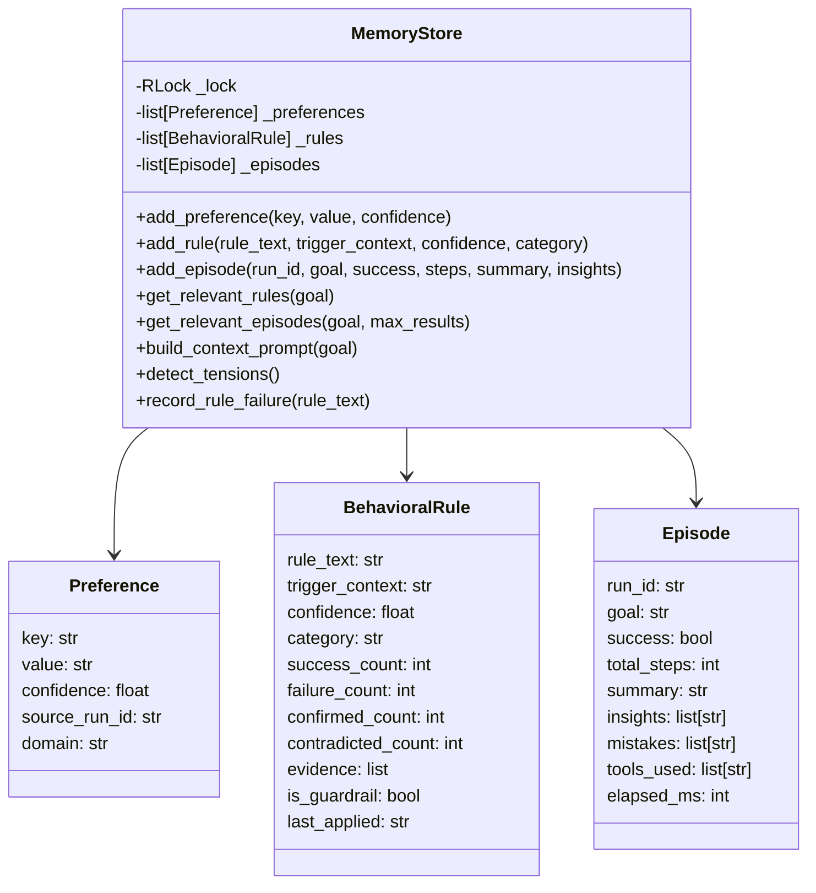
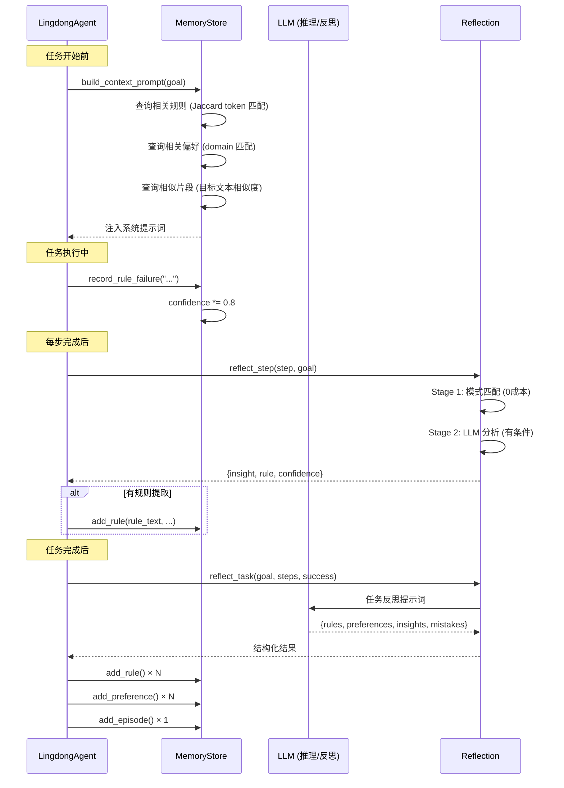
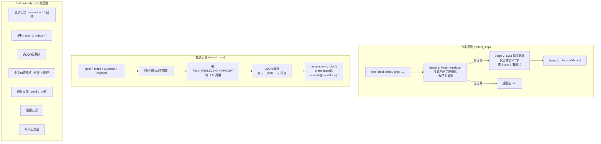
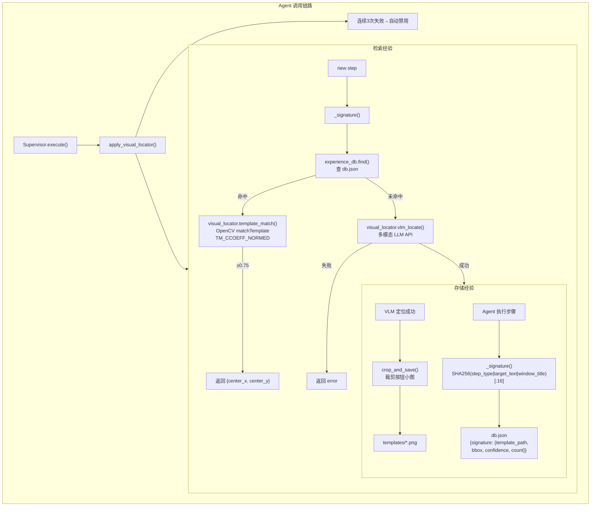
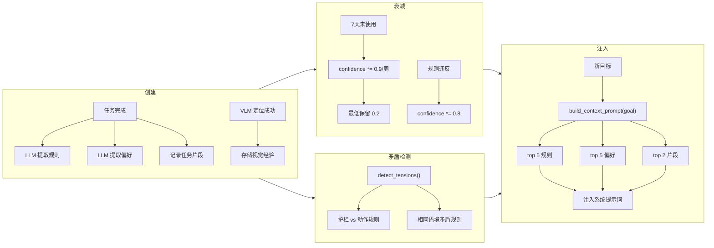

# Memory 系统深度分析

> **文档**: `docs/memory.md`
> **核心文件**: `python/agent/memory.py` (267行), `reflection.py` (242行), `visual_locator.py` (379行), `experience_db.py` (137行)
> **前置阅读**: [system-map.md](system-map.md)

---

## 1. 记忆系统总览

---

## 2. 三轨记忆体系

| 维度 | 短期记忆 | 长期记忆 | 视觉经验 |
|------|----------|----------|----------|
| **存储位置** | agent.py 实例变量 | `~/.lingdong/agent_memory/*.json` | `python/experience/db.json` + PNG |
| **生命周期** | 单次任务 | 跨会话持久 | 跨会话持久 |
| **容量** | 无限制(执行中) | 200偏好+200规则+100片段 | ~数千条目 |
| **访问方式** | 直接引用 | `build_context_prompt(goal)` | `locate() → OpenCV/VLM` |
| **更新时机** | 每步写入 | 任务完成后 | VLM 定位成功后 |
| **数据结构** | list[dict] | Preference/BehavioralRule/Episode | SHA256→{bbox,confidence,path} |

---

## 3. 长期记忆 (MemoryStore)

### 记忆注入流程

---

## 4. 反思引擎 (ReflectionEngine)

---

## 5. 视觉经验系统

---

## 6. 记忆生命周期

