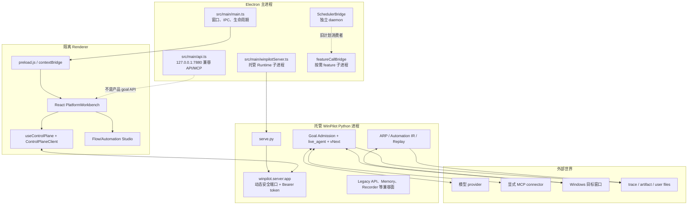
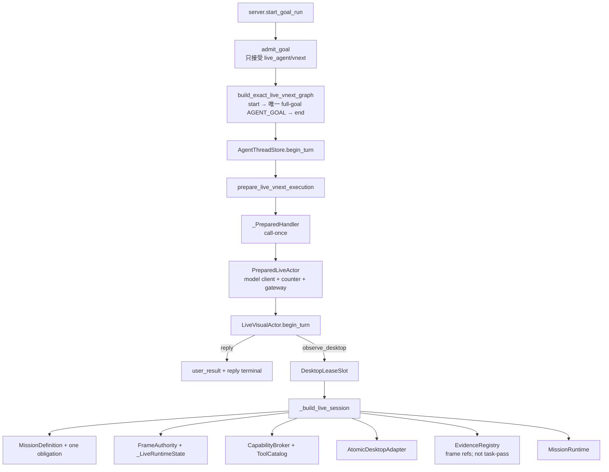
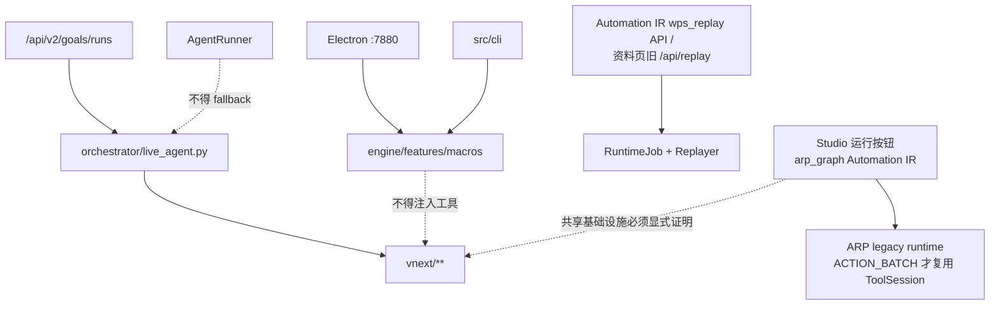

# 01. 系统架构：进程、层次与唯一 owner

> 本章回答“系统由什么组成”和“每项事实归谁所有”。逐次调用与异常分支见[运行时全流程](02-runtime-flows.md)，字段级协议见[合同、状态与接口](03-contracts-and-interfaces.md)。

## 1. 架构不变量

当前产品主链可以复杂，但复杂度只能用于保证机械事实正确，不能产生第二份语义意图。源码强制或文档约束的核心不变量如下：

1. 一个原始 goal：产品入口只接收 `goal` 和可选 `thread_id`；客户端不能替用户提交图、runtime、stage 或执行媒介。
2. 一个语义 Actor：同一个 `LiveVisualActor` 决定直接回复、只读 connector 或桌面观察；进入桌面后仍是它选择下一笔动作。
3. 一条视觉执行线：默认把当前完整真实屏幕交给模型；一笔动作后重新观察，窗口裁剪只作显式 opt-in。
4. 小而通用的工具面：当前 Runtime 只有 `click`、`double_click`、`move_mouse`、`drag`、`scroll`、`type_text`、`hotkey`、`input_sequence`、`launch_application`、`observe`、`claim_obligation_done`、`blocked`。
5. 物理层无应用语义：Broker 投影当前工具；Adapter 只做一次坐标映射，队列和 RawDevice 只负责单写入与释放清理，不知道“保存”“答题”“播放”等任务。
6. 完成由模型自验：生产 Runtime 接受同一个 Actor 基于当前真实屏幕作出的 claim。trace、运行详情和 memory 只诊断首分歧，不是 task-pass 门，也不作第二次语义裁决。
7. 无静默 Legacy fallback：`vnext.live_agent_enabled` 未开启或主链不可用时失败；不会退回 `/api/chat`、AgentRunner、FlowScript 或旧 planner。
8. 失败按首分歧修复：`model arguments → canonical arguments → physical_attempt → external state`。

## 2. 进程拓扑

开发模式下至少有四类活动单元；兼容功能被按需拉起时还会出现更多 Python 子进程。



### 2.1 Electron 主进程

`src/main/main.ts` 是桌面应用进程级入口。它负责：

- 单实例锁、窗口创建、菜单、全局 F8/F9 和退出清理；
- `contextIsolation=true`、`nodeIntegration=false` 的 BrowserWindow；
- 通过 `preload.ts` 暴露受限 IPC；
- 按需隐藏/恢复自身，从而把真实前台交给外部目标；
- 启动托管 WinPilot、旧 `:7880` API、scheduler 与按需 feature；
- 通知、文件对话框、截图、宏和旧 Flow engine IPC。

这里同时托管新旧消费者，但当前产品语义不在 Electron 中。活跃 vNext Agent 存在时，`F8`/`F9` 由主进程直接请求 Runtime cancel；没有活跃 Agent 时，`F9` 才保留旧 Flow engine 的启停语义。菜单中的 DSL、宏、feature 与 scheduler 也不能写成 vNext Actor 的隐藏工具。

### 2.2 Renderer

`src/renderer/main.tsx` 挂载 `App.tsx`，后者将应用主体交给 `PlatformWorkbench.tsx`。`PlatformWorkbench` 同时承载智能代理、Studio、运行记录、资料和系统设置。

产品入口的最短调用为：

```text
AgentCockpit.execute
  -> useControlPlane.startGoal
  -> ControlPlaneClient.startGoalRun
  -> POST /api/v2/goals/runs { goal, thread_id }
```

Renderer 保存的 run ID 列表只用于界面聚合。服务端 Thread/Turn、ARP execution、Mission projection 与当前屏幕状态仍是运行事实；它们不替 Actor 判断任务是否完成。

### 2.3 托管 Python Runtime

`src/main/winpilotServer.ts` 先选取 Chromium 可访问的高位 loopback 端口，再通过 `python/winpilot_home/serve.py` 启动 uvicorn。主进程生成或读取 `WINPILOT_CONTROL_TOKEN`，Renderer 通过 preload 获取 URL 与 token。

服务 readiness 不只检查 HTTP 200，还检查：

- runtime contract version 必须为 `3`；
- 启动时与当前 Python source stamp 必须完整且相同；
- `drifted` 必须为 false；
- 若 loaded/current Git commit 都存在，则必须相同。

如果 Python 源码在进程启动后改变，前端会降级并在没有活动任务时尝试重启，而不是继续运行不可复现的旧代码。

### 2.4 外部进程和资源

- 模型 provider 通过 `modeling` 层的 canonical request 和显式 protocol adapter 调用；
- connector 只从显式 MCP 配置发现，Gateway 重新核验 descriptor 后才调用；
- Windows GUI 通过 `FrameAuthority`、`AtomicDesktopAdapter`、`RawDeviceExecutor` 与 SendInput 类 backend 交互；
- trace、artifact、memory 与 replay 文件各有独立 owner，只用于诊断或显式离线功能，不应混成生产任务的“成功账本”。

## 3. 产品主链的组合结构

`POST /api/v2/goals/runs` 由 `winpilot/server.py:start_goal_run` 接受。它冻结配置，执行 goal admission，构造精确图，创建 Thread/Turn，再把 execution 提交给 ARP RuntimeJob。



`build_exact_live_vnext_graph` 并不是自然语言 planner。它生成严格的三节点、两边壳：`start → full-goal → end`；其中只有 `full-goal` 是规范 `AGENT_GOAL` 语义节点。它冻结“单目标、单 owner、无 fallback”入口合同，客户端无法把另一个图伪装成产品 goal。

## 4. 唯一 owner 表

| 事实或动作 | 唯一权威 owner | 其他层可以做什么 | 其他层不得做什么 |
| --- | --- | --- | --- |
| 原始用户目标 | admission 后由 `AGENT_GOAL` 与 `AgentThreadStore` 持有；桌面 lease 成功并组合 session 后再进入 `MissionDefinition` | Actor 始终读取原文；直接 reply 分支无需构造 Mission | 改写成关键词剧本或应用步骤 |
| 对话历史 | `AgentThreadStore` | Actor获得有界成功文本历史 | 把失败 Turn、执行内部状态当用户历史 |
| 初始 reply/connector/desktop 选择 | `LiveVisualActor.begin_turn` | Gateway执行已选只读工具 | 前端 task classifier 预选执行媒介 |
| 当前桌面目标 | `DesktopLeaseSlot` + 冻结 `TargetBinding` | Electron提供让出后的目标事实 | 模型或旧 router 偷换 HWND/PID |
| 当前权威帧 | `FrameAuthority` | `_LiveRuntimeState` 投影为 RuntimeFrame | 从旧截图继续执行空间动作 |
| 当前可用工具 | `CapabilityBroker` | Actor只看 projection | 根据任务关键词加/删工具 |
| 一笔语义动作 | `LiveVisualActor.propose` + `MissionRuntime` | Actor 解码 provider call；Runtime入口只做一次 typed parse；Envelope只绑定当前身份 | Controller修改目标点、重复跑 schema 或替模型重试 |
| 物理参数与输入 | `AtomicDesktopAdapter` + `RawDeviceExecutor` | trace旁路记录参数和 receipt | snap、offset、目标吸附、应用宏、前台/hit-test veto |
| Mission 状态 | `MissionReducer` | Runtime提交事件 | UI根据文字猜状态 |
| 用户任务完成 | 当前屏幕上的 `LiveVisualActor` 自验与 claim | trace/memory解释首分歧；E2E报告观察真实终态 | 独立 verifier、trace或memory反判模型 |

## 5. 数据权威关系

同一“画面”在代码里有多个表示，但它们不是可以互相替代的副本。

```mermaid
flowchart LR
  Target["TargetBinding\nbinding_id/HWND/PID/executable/title/evidence/epoch"] --> Frozen["_FrozenTarget\nprobe + physical region"]
  Frozen --> Capture["FrameObserver capture"]
  Capture --> State["FrameState\nframe_id/hash/time/region"]
  State --> Authority["FrameAuthority.current"]
  Authority --> RuntimeFrame["RuntimeFrame + EvidenceRef"]
  RuntimeFrame --> ActorInput["ActorTurnInput + JPEG"]
  ActorInput --> Envelope["ActorDecisionEnvelope\nframe identity + submitted size"]
  Envelope --> Adapter["AtomicDesktopAdapter"]
  Adapter --> Physical["physical_attempt"]
  Physical --> Receipt["RawActionReceipt"]
  Receipt --> Post["post-action frame/effect"]
  Post --> Reducer["Mission event"]
```



关键约束：

- `TargetBinding` 将目标窗口与 run、epoch 绑定；标题只是辅助，不是唯一身份；
- `FrameState` 的图片、窗口、区域、捕获时间和 hash 必须一起发布；
- Actor 坐标位于它实际收到的 submitted JPEG 像素空间；
- Envelope 不再按 submitted-image 范围或完整 schema 重验 proposal；Adapter 只确认数值有限并做一次确定性映射；
- screen-first 下物理输入去往模型所指位置，不因绑定窗口、前台或 hit-test 推断而拒绝；
- post-action frame 用于建立输入之后的因果观察，不能把任意新画面归因给旧动作；
- action effect 只说明局部画面是否改变，不知道用户任务是否语义完成。

## 6. Mission 的最小语义结构

当前 live composition 在桌面 lease 成功后构造 Mission，并强制一项 obligation。下面列出本路径显式值及 `ObligationSpec` 实际生效的默认值：

```text
mission.original_goal = 用户原始 goal
mission.source = "vnext-live-agent"
mission.experience_policy = "disabled"
obligations = [
  {
    id: "full-goal",
    desired_state: original_goal,
    acceptance_criteria: [original_goal],
    depends_on: [],
    forbidden_effects: [],
    required: true,
    required_capabilities: ["visual.interact"],
    input_artifact_refs: [],
    output_binding_names: [],
    evidence_policy: {
      required_evidence_kinds: [],
      preferred_evidence_kinds: [],
      allow_independent_visual_verifier: false,
      max_verification_attempts: 1,
      uncertain_policy: "blocked"
    },
    source_span: null
  }
]
```

`MissionRuntime._validate_minimal_scope` 还要求：

- 只有一个 obligation；
- 固定 STANDARD / `safe_default` profile；
- planner、obligation verifier、mission verifier、visual inspector、deep reasoning 均关闭；
- ToolCatalog 恰好等于十二个批准工具；
- 每个工具都由 Visual Actor route 拥有；
- GUI mutation、无输入 observation 与 outcome/control 工具类型严格对应；
- observation workspace 必须预先建立 binding；full-desktop 输入不因此限制在该窗口；
- Runtime、Reducer、Registry、Broker 和 Catalog 的共享 owner 只在 session 构造时核对一次。

这些 session 级核对不在每个 Actor proposal 上重放；每轮 binder 只附加当前 mission/frame/Broker 身份。

## 7. 模型层

### 7.1 初始文本轮

`LiveVisualActor.begin_turn` 接收原始 goal 和最多 12 条、有总字符上限的成功 Thread 文本。模型可以：

- 直接返回文本 reply；
- 调用 `observe_desktop`；
- 若显式 Gateway 可用，调用 `search_connector_tools` 或 `call_connector_tool`，得到结果后仍由同一 Actor 继续。

初始轮没有权威 JPEG，所以不能直接产生桌面坐标动作。只有 `observe_desktop` 才会申请租约并让出前台。

### 7.2 视觉轮

每个视觉轮的 system contract 很短：使用原始 goal、当前权威 JPEG、task state、上一动作和供应工具；局部只读/开发工具链之后最终产生一个 GUI、observation 或 outcome proposal，坐标使用 submitted-image pixels；可见完成时 claim，pointer held 时继续或结束 drag。

局部 shell/status/connector 依赖链可以由同一 Actor 连续完成，不再每帧强迫它切到 GUI。
当结果开始重复或模型需要重新看真实环境时，它可调用模型侧 `refresh_desktop`（Runtime
中的 `observe`）：该选择不产生物理输入或验证事件，只让外层在下一轮提供新的全桌面帧。

Actor 只保留：

- 初始 `observe_desktop` 的 provider 原生交换，供第一张图衔接；
- 最近一笔确实完成输入、且动作名匹配的视觉工具交换；
- 有界非权威 `task_state`；
- Runtime提供的安全 completed action summaries。

它不会无限堆完整截图历史，也不会增加总结模型或 verifier 角色。

### 7.3 provider 协议

canonical messages/tools 由 `modeling` 层转换。只有 `api.protocol` 或 `api.api_style` 显式选择 wire：

| 显式协议 | wire |
| --- | --- |
| `openai_compatible` / Chat aliases | Chat Completions |
| `openai_responses` / `responses` | OpenAI Responses |
| `anthropic` / `claude` | Anthropic Messages |
| `gemini` / `google` | Gemini `generateContent` |

`provider`、模型名和 `base_url` 不自动切换 wire，以免聚合器上的模型名被误送到原生接口。当前 native adapter 的真实 credential 端到端验收仍有限；协议单测通过不能扩写为真实 provider 全兼容。

## 8. Connector 边界

ConnectorGateway 不是新 Agent。它只给同一个 Actor两项通用工具：搜索已配置工具、调用一个已发现工具。

调用前后约束：

```text
搜索:
  只遍历显式配置的 MCP server
  返回有界 descriptor/ref
  不根据 goal 关键词选择服务

调用:
  用 ref 找到 descriptor
  在真正 call_tool 前重新读取并比较完整 descriptor
  只允许 readOnlyHint=true
  destructive 或未知 annotation -> fail closed
  参数、结果、deadline、cancel 均有界
  结果作为普通 tool result 回到同一个 Actor
```

当前外部 mutation 没有因为 connector 存在而获得授权。若未来接入，也必须进入同一 Actor 工具面并拥有独立可审计 receipt，不能增加一个服务专属 Agent。

## 9. 桌面执行层

### 9.1 Broker 是纯投影器

`CapabilityBroker` 只根据已接受事实投影工具：Mission 状态、profile、目标是否绑定、帧是否权威新鲜、Runtime是否可写、pointer 是否释放/被本 run 持有、capability 与授权等。

它不会：

- 看截图内容；
- 识别任务类别或应用；
- 根据一次失败自动启用 OCR/UIA；
- 判断按钮在哪里；
- 决定下一步语义动作。

### 9.2 Adapter 是一笔机械调用

`LiveVisualActor` 把 provider function call 解码成 raw proposal；`MissionRuntime` 入口对它
做唯一一次 typed parse，再取得当前快照并用 `bind_actor_decision` 附加
mission/frame/Broker 身份。格式错误的辅助 `task_state_update` 只被丢弃，不会连带否决
可执行动作。binder 不重新序列化后验证整套 Mission、Broker 或工具 schema，
`AtomicDesktopAdapter` 也不重复解析 proposal。Adapter只：

1. 在 `FrameAuthority.run_if_current` 内确认所引用帧仍是当前帧；
2. 对图片坐标做有限数检查与一次 submitted-image → 物理屏幕线性映射；
3. 通过全局 desktop action queue 调用 RawDevice 一次；若 raw 回执表明 release cleanup
   不完整，在同一个 physical lease 内做最多两轮 pointer/key 释放，禁止下一动作插队；
4. 记录供诊断的 physical attempt 与 receipt；
5. 捕获下一张权威屏幕给同一个 Actor继续判断；
6. 非持续 hold 时强制释放指针。

screen-first 路径不强制绑定窗口置前，也不以 foreground/hit-test 推断 veto 模型点击。
Controller 的 `UNKNOWN` 若显示输入可能已发生就绝不重放；Runtime把回执和新屏幕交给
Actor恢复。瞬态清理成功后只保留“输入结果未知”并交回新屏幕；只有同一 lease 内两轮
物理释放仍未完成或身份真正错乱才终止。

### 9.3 跨帧 held pointer

`drag(..., keep_holding=true)` 是唯一允许跨帧保留物理按住的当前模型入口。Broker 在 pointer held 时只投影 `drag`；lease 有过期时间，取消、异常、失焦或 close 都尝试强制 `mouse_up`。旧帧坐标不能跨帧复用，下一段路径仍由新 JPEG 决定。

### 9.4 通用窗口与画面剪贴板工具

`launch_application` 只做通用候选窗排序：普通窗优先于 `WS_EX_TOOLWINDOW`，再按可见、
隐藏和 hidden-topmost 排序；只恢复选中的一个候选，不含应用名、标题或进程配方。
`copy_current_view` 把当前模型轮已收到的同一张 JPEG 放入系统剪贴板；它不再截图、
不接受文件路径，也不替模型切窗口或粘贴。这张图会暂存为可选流程素材，用户两次会话都未提取时清理。

## 10. 完成与诊断

Actor 调用 `claim_obligation_done` 时，语义判断已经由同一个模型在当前真实屏幕上完成。
Runtime只把 claim 投影为 Mission 终态，便于状态机和 UI 展示；它不再调用另一个图像判断器、
结果 oracle 或 trace/memory gate 来决定 pass。帧引用、physical attempt、receipt 和运行日志
用于回答“哪一层先偏离”，不能推翻或补造 Actor 的完成判断。E2E harness 可以从真实应用
终态报告测试结果，但该报告不反馈生产 Actor，也不成为生产执行链的一层。Runtime在写
辅助 history 之前先缓存 claim 和最终 narration；history、completion snapshot 或诊断投影
失败时仍返回原始 `user_result`。

## 11. 当前路径与 Legacy 的物理边界



`/api/chat`、`webui/**`、`src/ai-interface/**`、`winpilot/eval/**`、
`integrations/chatgpt_mcp.py` 与 `/mcp` 旧 ChatGPT desktop MCP mount 已随旧 Agent 线
删除；图中 `agent/loop.py` 现只由 scheduler 与 Studio TASK_STAGE 兼容链可达。

依赖方向上，current live 路径应能在阻断 `winpilot.agent` 包时完成 import/admission。Legacy 可以依赖通用基础设施；vNext 不应为了复用方便重新 import 整个 Legacy owner。

## 12. 为什么“高级架构”仍会做不好简单任务

架构主要保证的是：模型看到哪张图、坐标如何映射、谁拥有指针、动作是否真正发出、结果是否可追踪。这些保证能消除“点到了别处”“旧图动作晚到”“前台被 Electron 抢回”“工具说 ok 但没发输入”等基础设施错误，却不会自动赋予模型更强的视觉定位、算术、几何规划或停止判断。

当前有效证据中，MiMo 能完成精确点击、普通拖放、滑块、动态按住和 Notepad 精确文本，却在窄 corridor 和 Calculator 上把错误目标或路径直接提交出来；canonical 与 physical 层忠实执行了它的选择。因此复杂合同不是替模型思考，而是让团队能确定“这次到底是谁错了”。

正确的改进方向是固定相同 goal、截图、工具 schema 和预算，比较可见真实终态做 provider/模型盲 A/B，或修复确实发生分歧的基础层。错误方向是把当前失败样本重新编码成 prompt 教程、坐标修正器、应用 recipe、答案器、target snapping 或第二语义角色。

## 13. 维护准入

新增一个 owner 或状态账本前，必须回答：

1. 当前哪个真实失败在什么证据层首次分歧？
2. 现有 owner 为什么结构上无法修复？
3. 新 owner 的通用输入、输出、失败语义和生命周期是什么？
4. 它替代并删除哪个旧 owner，还是会造成双写？
5. 至少两个不同任务族的可见 Electron 真实终态是否都有实质提升？
6. 是否没有增加应用关键词、测试坐标、提示教学或第二模型角色？

若这些问题没有证据答案，优先删除、归并或保持现状。
