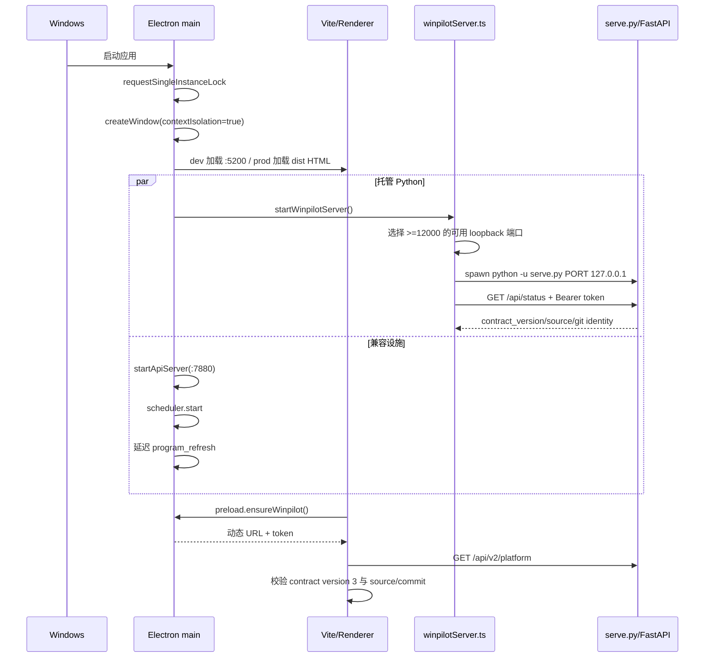
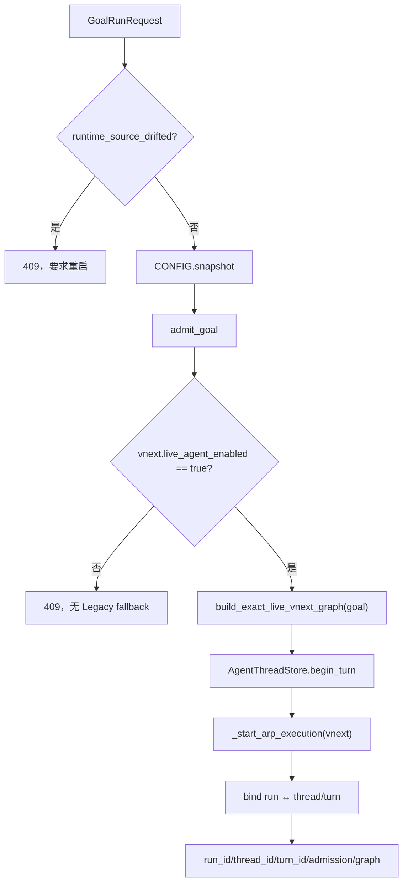
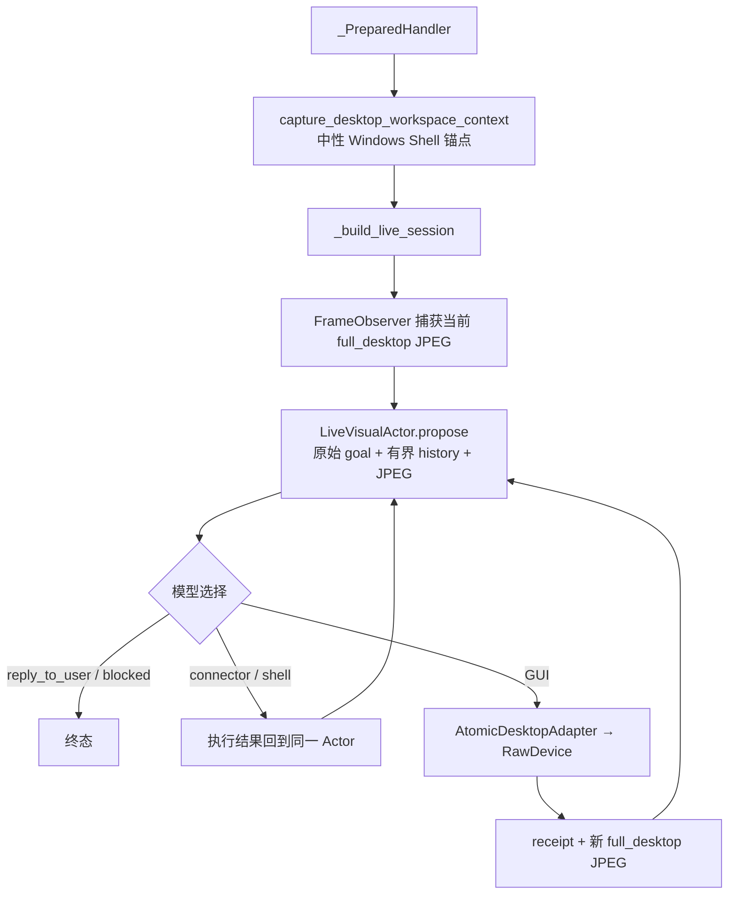
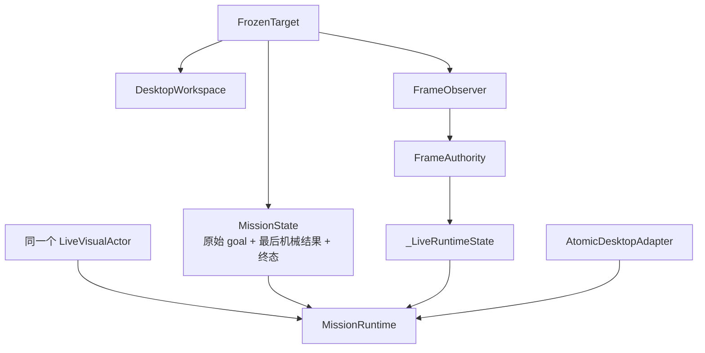
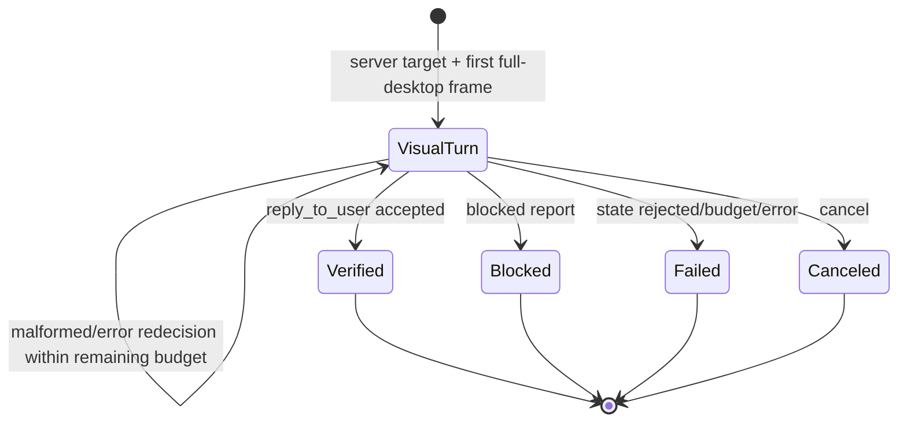
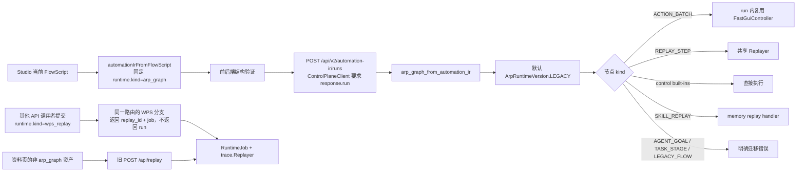
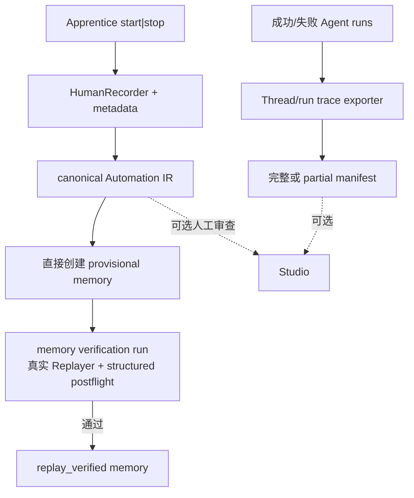

# 02. 运行时全流程：从点击发送到外部结果

> 本章沿真实调用顺序讲解当前源码。伪代码省略日志和类型样板，但保留 owner、校验顺序、失败语义与并发边界。

## 1. 应用启动



通俗伪代码：

```text
启动 Electron:
  如果已有实例:
    激活已有窗口并退出新实例

  创建隔离窗口
  后台启动 Python Runtime
  主进程最多等待约 120 秒，轮询 /api/status，直到：
    HTTP 可用
    contract_version == 3
    loaded source stamp == current source stamp
    source.drifted == false
    可比较的 Git commit 相同

  Renderer 获取动态 URL/token，并只在首次连接阶段轮询约 35 秒
  获取 platform、当前 run、最近 runs
  建立 /ws/events，并保留 5 秒 HTTP fallback poll
```

如果 readiness 超时、协议不兼容或源码漂移，UI 进入 degraded/offline；不会把任务发给旧服务。这里有一个真实恢复缺口：主进程 readiness 最多可等约 120 秒，而 Renderer 首次轮询只约 35 秒；只有首次连接成功后才安装 5 秒 fallback interval。因此 Python 若在第 35～120 秒才 ready，当前 UI 不会自动重新连接，通常要重载 Renderer。

## 2. 用户发送一条 goal

`PlatformWorkbench.tsx` 中的 Agent composer 先做 **Renderer 全局单活 gate**：只要 `plane.currentRun` 的状态不在终态集合，就会阻止另一个 Thread 提交。服务端另有较窄的 **每 Thread gate**，拒绝该 Thread 已有 `queued/running/paused` Turn。Enter 或可见发送按钮最终调用 `plane.startGoal(goal, threadId)`。

```text
execute():
  若 goal 为空或正在提交 -> 返回
  若全局 current run 是任意非终态（包括 canceling/未知非终态） -> 显示“当前任务仍在运行”
  若 runtime identity 不兼容 -> 显示错误，不发送

  POST /api/v2/goals/runs {
    goal: 原始文本 trim 后内容,
    thread_id: 当前服务端 Thread ID 或空串
  }

  保存返回 run_id 到 UI 的 Thread run 列表（最多 40）
  清空已发送输入框
```

前端不会在这里：

- 捕获桌面；
- 选择 GUI、connector、CLI 或模型；
- 编译 Task Contract；
- 提交 ARP 图；
- 注入应用类型、坐标、目标窗口或执行策略。

## 3. Goal Admission 与 Thread/Turn

服务端的顺序很重要：



`AgentThreadStore.begin_turn` 的行为：

```text
如果 thread_id 非空但不存在 -> 拒绝
如果该 Thread 有 queued/running/paused Turn -> 拒绝
否则：
  读取最多最近 6 个有用户可见结果的 Turn
  每个 Turn 展开为 user goal + assistant result
  总计最多 12 条消息、16384 字符；从最旧 pair 开始裁剪
  新建 queued Turn
  单 Thread 最多 40 个 Turn；全局最多 100 个 Thread
```

Actor 请求层还会二次执行 `_bounded_thread_messages`：把“用户可见历史 + 当前 goal”共同限制在 16384 字符内，并继续按完整 user/assistant pair 丢弃最旧历史。因此 ThreadStore 的 16384 是历史自身上限，不保证一个接近上限的新 goal 能与全部历史同时发送。

当前 `arp_run_done` 状态为 `done` 或 `reply` 且存在非空 `user_result` 的 Turn 才进入下一轮
历史和 continuation checkpoint。Actor blocked 或仅因 turn/model/time 预算耗尽时，handler
把 scratchpad/remaining items 组成 `agent-continuation/1` 并返回 `reply`，所以已完成进度能随
同一 `thread_id` 进入下一轮；真正失败、取消和空结果不会污染对话。

## 4. 精确三节点壳与唯一语义节点

产品图不是模型计划。它严格固定为 `start → full-goal → end` 三个节点、两条边；只有 `full-goal` 是 `AGENT_GOAL` 语义节点。policy 只保留单次 node visit 与 fail fast；模型能力不再由图上的装饰性安全开关表达。图 ID 由完整 goal 确定性绑定。

```text
build_exact_live_vnext_graph(goal):
  assert goal 是非空原文
  nodes = [START(id="start"), AGENT_GOAL(id="full-goal", goal=goal), END(id="end")]
  edges = [start -> full-goal, full-goal -> end]
  policy = {
    max_node_visits: 1,
    fail_fast: true
  }
  graph = Graph(nodes, edges, policy)
  assert len(graph.nodes) == 3 and len(graph.edges) == 2
  return graph
```

`prepare_live_vnext_execution` 再次完整校验图，而不是相信调用者；初始 inputs 必须为空，禁止预绑定桌面。

## 5. 第一次 Actor 调用就是视觉调用

`_PreparedHandler` 是 call-once ARP node handler。它先捕获服务端桌面 workspace、构造
live session，再让 `MissionRuntime` 驱动同一个 `LiveVisualActor.propose`。



不存在无图文本路由。第一次调用就同时提供回复、显式 connector、shell 与 GUI 工具；
独立的本地工具可以批量执行，空间动作或终态工具结束当前 Runtime turn。

## 6. 服务端桌面锚点与完整桌面帧

`capture_desktop_workspace_context()` 返回一个 `desktop-target/1` Windows Shell 锚点。
`_freeze_prebound_target` 把它转为 `_FrozenTarget`，再建立 `TargetBinding`、
`DesktopWorkspace` 和通用窗口 probe。该锚点只保持帧与窗口生命周期连续，不提名某个
应用为任务 owner。

默认观察始终以 `scope=full_desktop` 捕获完整虚拟桌面；模型点击屏幕上哪个可见位置，
物理输入就去哪里，不因锚点、前台窗口或 hit-test 推断而拒绝。Electron 不再隐藏、最小化
或通过独立 API 交付 target。

## 7. 构造 live session

`_build_live_session` 建立一条共享执行线：



组合时只建立 Actor、MissionState、FrameAuthority、workspace 与 Atomic adapter 的共享 owner；
binder 不在每轮 proposal 上重放工具 schema 或语义验证。

## 8. 回复、本地工具与 GUI 的统一分支

- `reply_to_user`：写入用户结果并终止；纯聊天不会产生 `physical_attempt`。
- connector/shell/window text：结果作为 provider tool message 回到同一个 Actor，不创建第二个 Agent。
- GUI：一笔 proposal 进入 `MissionRuntime` 和 `AtomicDesktopAdapter`，动作后用新帧继续。
- malformed/provider error：在剩余模型与 turn 预算内把真实错误回给同一 Actor；不执行隐藏恢复链。

## 9. 每个视觉 Turn 的完整算法

`MissionRuntime.run_one_turn` 用非阻塞锁保证同一 Runtime 只有一个 turn 获得 admission。

```text
run_one_turn(turn_index):
  若另一个 turn 持锁 -> BUSY
  若 Mission 已 VERIFIED/CANCELED/BLOCKED/FAILED -> 返回对应终态
  若收到 cancel -> 写 mission_canceled

  snapshot = state.observe()
  确认当前 mission 仍 running，frame 权威且 pointer 状态可执行

  turn = project_actor_turn_input(
    MissionState.card（原始 goal + 最后机械结果）,
    current frame facts,
    fixed Actor tool schemas,
    bounded task_state,
    previous action + budget facts
  )

  raw_decision = actor.propose(turn, current full-desktop JPEG, exact submitted_size):
    同时暴露固定 action/terminal tools 与两个 connector 元工具
    若选择 connector -> Gateway 执行调用并把 tool result 交回同一 Actor
    本地工具链（shell/connector/window_text）只受剩余 model-call budget 约束
    模型可调用 refresh_desktop 主动结束局部工具链换取新整屏，最终提交一笔 action / claim / blocked
  尝试应用有界 task_state_update（它不是权威 Mission 状态；格式错误只忽略该更新）
  在 MissionRuntime 入口把 raw proposal 做唯一一次 typed parse

  bind ActorDecisionEnvelope 到：
    mission/run/revision
    frame/target/submitted image
    pointer disposition / lease

  如果是 desktop action -> 执行一笔机械调用
  如果是 refresh_desktop -> 下一普通 turn 捕获新整屏
  如果是 reply_to_user -> MissionState.complete
  如果是 blocked -> MissionState.block
```

Actor 每次都收到原始 goal，而不是仅收到局部计划。每个视觉 Turn 的 `propose` 都可在当前
JPEG 和固定通用工具旁调用 connector，只受剩余 model-call 预算
约束；同一个 Actor 在同一 Turn 最终提交恰好一笔 Runtime action、claim 或 blocked。
`task_state` 与紧邻一笔 provider 原生 exchange 只帮助短期连续性；它们不是 Runtime 计划或完成判据。

## 10. 模型响应的单次边界解析

视觉轮由 `LiveVisualActor` 解码 provider 返回的一笔 function call，确认工具名、JSON object
与该动作必需的 provider 形状，并输出 raw proposal。`MissionRuntime` 入口随后只调用一次
`parse_actor_proposal()` 得到 typed proposal；Envelope binder 和 `AtomicDesktopAdapter` 不再
各跑一次完整工具 schema。模型附带的无关提示字段不会让一笔本可执行的桌面动作假失败；
格式错误的辅助 `task_state_update` 只被忽略，物理 adapter 只读取动作真正需要的字段。

malformed、零调用、多调用或未知工具仍作为可纠正的 `INVALID_PROPOSAL` 回到同一个模型；
这只是格式恢复，不修改模型坐标，不按应用套配方，也不在物理动作后重放。

## 11. 坐标映射

Actor坐标的唯一语义是“它收到的 JPEG 像素”。映射关系为：

```text
submitted image point (sx, sy)
  按 submitted_width/height 与 authoritative frame width/height 做一次比例映射
  加 authoritative frame region 的物理左上角
  得到 virtual desktop physical point (px, py)
```

Envelope 不按 submitted image 的宽高拒绝模型坐标。Adapter只要求数值有限，按同一线性关系
映射一次；RawDevice 在最终 SendInput 边界处理操作系统可表示范围。默认 full-desktop 路径
不强制目标窗口置前，也不以 foreground 或 hit-test 推断否决模型指向的屏幕位置。

Runtime 不做最近按钮吸附、DPI 猜测 offset、OCR重瞄或按应用校正。若 raw point、canonical point 与 physical point 的确定性映射一致，错误目标属于模型选择层。

## 12. 一笔物理动作事务

```mermaid
sequenceDiagram
  participant MR as MissionRuntime
  participant AD as AtomicDesktopAdapter
  participant FA as FrameAuthority
  participant Q as DesktopActionQueue
  participant RD as RawDevice
  participant FO as FrameObserver

  MR->>AD: execute(bound envelope)
  AD->>FA: run_if_current(frame identity)
  FA-->>AD: pinned before frame
  AD->>AD: finite numbers + one canonical→physical mapping
  AD->>Q: queue one physical action
  Q->>AD: invoke callback at queue head
  AD->>RD: click/drag/scroll/type/hotkey once
  RD-->>AD: RawActionReceipt
  alt release cleanup incomplete
    AD->>AD: 同一 queue lease 内最多两轮 pointer/key UP cleanup
  end
  AD->>FO: capture post-action frame
  FO-->>AD: next authoritative screen
  AD-->>MR: ControllerTransition
  MR->>MR: append mission event; trace observes alongside
```

### 12.1 Controller outcome 语义

| Outcome | `input_completed` | Runtime 行为 |
| --- | --- | --- |
| `COMPLETED` | `true` | 写 transition event，下一 Turn 让同一个 Actor 观察新屏幕 |
| `REJECTED` | `false` | 若是明确可恢复的陈旧/目标变化原因，返回 `STALE_DISCARDED`；绝不自动重放 |
| `UNKNOWN` | `true` | 写 `transition_recorded`、返回 `ACTION_RECORDED`；下一帧恢复，不重复输入 |
| `UNKNOWN` | `false` 或 `null` | identity 一致且释放清理完成时返回 `STALE_DISCARDED`，在新屏幕上交给 Actor 恢复；不重放 |
| 异常 | 未知 | 视为 mutation 后不确定，fail closed，禁止重复调用 |

任何路径都不能把同一个 proposal 执行两次。

## 13. 六种 GUI 动作

### 13.1 click / double_click

输入一个 submitted-image 点；Adapter映射并执行一次单击或系统双击事务。`double_click` 不是两个独立 Actor Turn，因此不会在两击间重新观察。

### 13.2 drag

输入起点、终点、最多 32 个有序中间 `image_points` 和 `keep_holding`。空中间点表示直线。路径只表达通用连续指针，不携带“画图”“滑块”或“走廊”语义。

### 13.3 scroll

输入点和非零整数 amount，范围 `-1200..1200`；负值向下、正值向上。点位仍需命中当前目标。

### 13.4 type_text

输入 1..4096 个 Unicode 码点；RawDevice 在目标/前台/final guard 成立后向当前目标的焦点发送 OS 输入。它不检测焦点控件是否可编辑，因此 receipt 可以显示输入已完成但文本没有落入期望输入框；通常需要前一 Turn 先正确聚焦。

### 13.5 hotkey / provider 名 `press_key`

输入唯一 canonical key 数组。单独一个 modifier 合法；多键组合必须按 `ctrl → alt → shift → win` 的 canonical modifier 顺序，最后恰好一个主键，长度最多“修饰键数 + 1”。模型面为避免特定 provider/tool 语义冲突使用 `press_key` 名，解析后回到 Runtime `hotkey`。

### 13.6 held pointer

当 drag 设 `keep_holding=true` 且物理输入完成，Adapter 保留一个 run-owned lease。下一帧
Runtime 只接受后续 drag/释放语义；新 drag 可以继续移动并再次保持，或释放。超时、异常、
取消、close 都会做有界 `mouse_up` 清理。

### 13.7 launch 与复制当前画面

`launch_application` 发现已运行进程时稳定合并可见/隐藏候选，优先普通窗而不是
`WS_EX_TOOLWINDOW`，只恢复排序后的一个候选；没有应用 recipe。`copy_current_view` 把该模型轮已看到的
JPEG 直接放进剪贴板，不重抓画面、不产生或查找图片路径。后续的窗口切换和 `Ctrl+V` 仍由 Actor 选择普通动作。

## 14. 动作后的新屏幕

完成一笔输入后，Runtime只确认 ControllerTransition 回指同一 action，并把 receipt 与下一张
权威屏幕交给同一个 Actor。trace 可以旁路记录 model arguments、physical attempt 和 receipt
以定位首分歧，但不再有独立 reconcile/verification 层据此判 task pass。外层
`_PreparedHandler` 在 `ACTION_RECORDED` 或 `STALE_DISCARDED` 后继续下一 Turn。

## 15. reply、blocked 与终止

### 15.1 reply_to_user

```text
Actor: reply_to_user(concise_claim)
Runtime:
  接受同一个 Actor 基于当前真实屏幕作出的完成判断
  缓存最终 narration
  MissionState.complete()
  保存 concise_claim 为 user_result
```

这里没有第二个视觉模型、deterministic pass verifier、trace gate 或 memory gate。辅助
trace 或诊断投影失败不能推翻已缓存的结果，也不能丢失
`user_result`。E2E harness仍可观察真实应用终态来衡量产品完成率，但不会把测试判定反馈
进生产执行线。

### 15.2 blocked

Actor提交规范 `blocker_kind` 与去重的 `observed_facts`，Runtime调用
`MissionState.block()` 并终止。它适用于当前可见事实确实无法用供应动作推进，不应被用作
模型不愿尝试的普通退出。

### 15.3 预算耗尽

默认 `max_turns=200`、`max_runtime_s=7200`、`max_model_calls=400`。配置只要求三项都是正整数，不再用派生上限拒绝更长任务；预算仍在 run 开始冻结，耗尽返回 `STATE_REJECTED`。

## 16. Pause、resume、cancel

- pause 只在安全边界等待；暂停耗时会补回 deadline；
- 如果 pause 在 Actor admission 前到达，当前 `UNAVAILABLE` 可投影为安全的 stale boundary；
- cancel 设置 run stop event；Actor、connector、shell、queue 和外层 deadline 都观察它；
- 全局 `F8`/`F9` 的 Agent 停止由 Electron 主进程直连当前 Runtime run，不依赖 Renderer 的 `currentRun` 快照；
- 若输入尚未开始，明确 canceled/rejected；
- 若输入已开始或结果未知，先记录真实 receipt，再进入保守终态；
- close 时无论任务结果如何都必须清理 held pointer 与模型资源。

## 17. Runtime 状态循环



## 18. WebSocket 与 UI 刷新

`/ws/events` 发布 BUS 事件。Renderer：

- `agent_start` / `arp_run_start` 标记真实 live start；
- 非 ping 事件保留最近 200 条 UI 列表；
- 活动事件在约 80ms 后只刷新 current run；
- 终态事件刷新 platform/current/recent runs；
- 每 5 秒做一次 fallback 全刷新；
- 终态刷新任务列表并触发普通任务栏通知，不控制桌面目标或窗口恢复。

UI 事件流只是投影；HTTP 快照可恢复 run 状态。视觉帧、target 与物理输入仍由 Python
live session 持有，不从 Renderer 事件反推。

## 19. Studio / Automation IR 流程

Studio 与产品 Agent 共用 Electron 和部分 Python基础设施，但入口、输入与成功语义不同。



通俗伪代码：

```text
点击 Studio 的运行按钮:
  Renderer 将当前图导出为 canonical Automation IR
  导出器固定 runtime.kind = arp_graph
  前后端都做结构验证
  POST automation-ir/runs，并要求响应包含 ARP run
  编译为 ARP graph；未显式 runtime_version 时使用 legacy ARP runtime
  对每条控制流路径检查 spatial action 前已有 target
  control built-ins 直接执行
  ACTION_BATCH 在 run 内复用 FastGuiController，直接执行 canonical action
  REPLAY_STEP 用共享 Replayer；SKILL_REPLAY 用 memory handler
  AGENT_GOAL / TASK_STAGE / LEGACY_FLOW -> 明确迁移错误，禁止 fallback
  每节点都记录 history 并发布 arp_node_done
  只有 NodeResult.evidence 非空才追加/发布 evidence
  End 按 graph policy / contract 检查已有 evidence

若其他调用者向 automation-ir/runs 提交 wps_replay:
  服务端直接启动 RuntimeJob + Replayer
  响应是 replay_id/job，不是 Studio client 期待的 run

若资料页重放非 arp_graph 资产:
  走旧 /api/replay，不经过 Studio startAutomation
```

无模型确定性节点的 run 应有 `model_calls=0`。历史 `agent.goal` / `TASK_STAGE` 节点没有当前
handler，validation 必须给出迁移错误；不能因为路由带 `/api/v2/` 就称它为产品 Visual Actor。

## 20. Human Apprentice、导出和 replay

这三条相关但不等价：



- Apprentice recording 生成 WPS/IR、追加 metadata，并在 stop 时创建 provisional memory；
- Human recording 证明“录下的人类动作可否规范化并忠实重放”；
- Thread export 证明“已有 Agent trace 中哪些普通动作可提取”；跨 decision held gesture 当前
  降级为各段落点 click，不能声称忠实恢复连续拖拽；
- Memory verification 证明某个 recipe 在当前条件下重放通过；不证明冷启动 Actor 能自主完成任务；
- replay 忠实复制错误动作时，重放链可能通过忠实性检查，但原 Agent目标仍失败。

## 21. 服务重启与 Thread continuation

有用户可见结果的 Thread 最小 checkpoint 写入 traces 下的私有 continuation 文件，采用临时文件、flush、fsync、`os.replace` 原子替换。启动时只加载格式、大小、ID、时间、状态和上限均合法的 `done`/`reply` Turn。

它保存的只是最近原始 `goal/result` 文本；可续跑 reply 的 result 已含模型公开的进度与剩余项。
checkpoint 不保存模型隐藏状态、截图、工具内部计划或失败 Turn。因此服务重启后的上下文是
有界对话连续性，不是长期 memory，也没有后台恢复执行器。

## 22. 退出清理

Electron `window-all-closed` / `before-quit` 会停止旧 engine、feature 子进程、托管 WinPilot、兼容 API 和全局快捷键。Python session 的 finally 块关闭：

- held pointer；
- 模型/connector 资源；
- controller、模型与 connector 资源；
- BUS terminal event。

释放清理不完整是物理边界错误，必须 fail closed；非语义 trace/telemetry 失败不得改写模型已经在真实屏幕上判断的任务结果。
