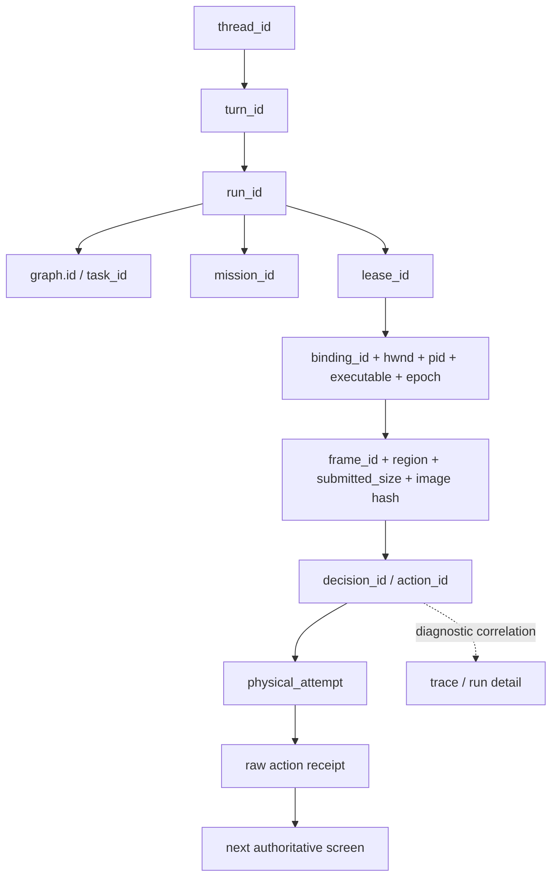

# 03. 合同、状态与接口参考

> 本章把跨层“说同一件事”的字段放在一起。真实定义仍以对应 dataclass/Pydantic/TypeScript interface 和生成索引中的 SHA 为准。

## 1. 合同版本与信任边界

| 合同 | 当前标识 | 定义 owner | 用途 |
| --- | --- | --- | --- |
| 托管 Runtime 身份 | `contract_version = 3` | `runtime_info.py`、TS client/server lifecycle | 防止 Renderer 与旧 Python 进程通信 |
| Goal admission | `goal-admission/1` | `orchestrator/goal_admission.py` | 证明产品只选择 live vNext 且无 fallback |
| Client execution context | `execution-context/1` | Renderer构造、Python严格绑定 | 描述 Electron 让出后的目标捕获 |
| Desktop lease | `desktop-lease/1` | `DesktopLeaseSlot` | run/thread/turn/lease 的交付状态 |
| ARP graph | `arp/1` | `orchestrator/contracts.py` | 图、节点、边和 policy |
| Mission definition | vNext mission format 常量 | `vnext/mission/contracts.py` | 原始 goal 与 obligation 声明 |
| Runtime frame | `runtime-frame/0` | `vnext/runtime/contracts.py` | JPEG、帧身份和 evidence |
| Runtime snapshot | `runtime-snapshot/0` | 同上 | Broker state + frame + target 原子视图 |
| Actor turn | `runtime-actor-turn/0` | 同上 | 给 Visual Actor 的有界事实 |
| Controller transition | `controller-transition/0` | 同上 | 一笔输入的三态结果和后帧 |
| Runtime result | `mission-runtime-result/0` | 同上 | 一轮 Runtime 的 typed status |
| Agent Thread | `agent-thread/1` | `agent_threads.py` | UI读取的服务端 Thread/Turn 快照 |
| Thread continuation | `agent-thread-continuation/1` | 同上 | 重启后恢复最近成功文本轮 |
| Automation IR | 由 `automation_ir.py` 常量/validator 定义 | Automation IR owner | Studio、导出、确定性执行中间表示 |
| WPS | `wps/2` | `recorder/trace.py` | 录制与 replay 脚本 |

版本号低不表示不严格；许多 `*/0` 合同仍要求精确字段、canonical JSON、无额外键和内容 hash。

## 2. 身份层级



这些 ID 不可按“看起来是同一任务”模糊匹配。每层只接受自己声明的上游身份：

- Thread 可包含多个串行 Turn；
- 一个产品 Turn绑定一个 run；
- run绑定一个 server-owned graph；
- live graph构造一个 Mission；
- desktop lease只为该 run交付一次 target；
- frame同时绑定 target HWND/epoch；
- decision绑定 Mission revision、obligation、Broker projection、frame与evidence scope；
- physical attempt 和 receipt 必须回指同一 decision。

## 3. 产品入口请求

### 3.1 `GoalRunRequest`

```json
{
  "goal": "用户完整原始目标",
  "thread_id": "可选；空串表示新 Thread"
}
```

Pydantic `extra="forbid"`。`goal` 至少一个字符，admission 再 trim 并拒绝空白；`thread_id` 最长 128。没有以下字段：`graph`、`runtime_version`、`task_id`、`target_window`、`execution_medium`、`model_role`。

典型响应包含：

| 字段 | 含义 |
| --- | --- |
| `ok` | 请求已创建 execution，不表示用户目标完成 |
| `run_id` | 后续查询、取消、租约和 UI 绑定的 run |
| `thread_id` / `turn_id` | 服务端对话身份 |
| `runtime_version` | 当前应为 `vnext` |
| `admission` | `goal-admission/1` 审计对象 |
| `run` | 初始 ARP execution snapshot |
| `graph` | 服务端实际生成的精确图，供审计而非客户端修改 |

### 3.2 Admission 审计

精确字段：

```json
{
  "format": "goal-admission/1",
  "goal": "原始目标",
  "route": "live_agent",
  "runtime_version": "vnext",
  "reason": "single_semantic_agent",
  "no_legacy_fallback": true
}
```

`_PreparedHandler` 在执行时再次检查这六个字段恰好存在且值一致。

## 4. Desktop execution context

Renderer 交付的顶层字段必须恰好为：

```json
{
  "format": "execution-context/1",
  "entrypoint": "native_agent_cockpit",
  "submitted_at": 0,
  "desktop_handoff": {
    "required": true,
    "strategy": "foreground_after_control_surface_yield",
    "yielded": true,
    "control_surface_pid": 123,
    "prepared_at": 0,
    "reason": ""
  },
  "target_window": {
    "...": "capture_foreground_window_context 返回的目标事实"
  }
}
```

Python `bind_client_execution_context` 只接受这五个顶层键，再附加 server-owned `task_id`。Web workbench 没有 native bridge 时会形成 `yielded=false`，当前需要桌面的产品 run会因无法建立真实 handoff 而失败。

Lease bind请求：

```json
{
  "lease_id": "lease-...",
  "execution_context": { "...": "上面的精确对象" }
}
```

失败请求只允许 `lease_id` 和 1..1024 字符的 `reason`。

## 5. Target、Frame 与 Commit Identity

### 5.1 `TargetBinding`

| 字段 | 类型/约束 | 含义 |
| --- | --- | --- |
| `binding_id` | 非空 canonical ID | target绑定身份 |
| `hwnd` | 正整数 | Windows窗口句柄 |
| `process_id` | 正整数 | 目标进程 |
| `executable_identity` | 非空字符串 | 可执行文件身份；公开 trace 可只暴露 hash |
| `title_snapshot` | 可空字符串 | 绑定时标题快照，不作为唯一身份 |
| `established_by_evidence_ref` | 非空 ID | 建立绑定的证据 |
| `epoch` | 非负整数 | target/frame 世代 |

### 5.2 `RuntimeFrameIdentity`

| 字段 | 约束 |
| --- | --- |
| `frame_id` | 正整数 |
| `epoch` | 非负，且与 target 相同 |
| `hwnd` | 正整数，且与 target 相同 |
| `region` | `[left, top, positive width, positive height]` |
| `scope` | 默认 `full_desktop`；窗口裁剪只在显式 opt-in 时为 `target_window` |
| `submitted_size` | 两个正整数；Actor所见 JPEG 尺寸 |
| `image_sha256` | 小写 64 位 SHA-256；在 RuntimeFrame 中标识 Base64 字符串内容 |
| `media_type` | 当前只允许 `image/jpeg` |

`RuntimeCommitIdentity` 是 frame + target identity，要求 HWND、epoch、scope 一致；fingerprint
供 binder 关联当前快照和 trace 诊断。它不触发每动作许可握手，也不让 Envelope/Adapter
重放整套 Mission/Broker 验证。

### 5.3 `RuntimeFrame`

除 identity 字段外还含：

- 非空 ASCII `image_b64`；其 SHA 必须等于 `image_sha256`；
- 至少一个、排序且唯一的 frame 引用，用来关联当前图像与运行诊断；这些引用不参与
  task pass，也不替模型解释画面。

## 6. Actor Turn

`ActorTurnInput` 发给模型的 JSON不暴露 HWND/PID 等不必要身份，主要结构是：

```json
{
  "format": "runtime-actor-turn/0",
  "mission": {
    "original_goal": "...",
    "active_obligation": { "...": "完整目标 obligation" },
    "verified_facts": [],
    "failure": null,
    "no_progress_streak": 0
  },
  "frame": {
    "image_available": true,
    "authoritative": true,
    "fresh": true,
    "coordinate_space": "submitted_image_pixels"
  },
  "task_state": { "...": "有界模型笔记" },
  "tools": [],
  "completed_action_summaries": [],
  "previous_action": null,
  "pointer_held": false,
  "submitted_size": [1120, 700]
}
```

`submitted_size` 是模型请求层在序列化 context 后附加的字段；JPEG作为同一 user message 的 `image_url` 内容发送。

### 6.1 Task state 与 action history

- `task_state_update` 是可选的有界更新，缺省为 `{"scratchpad": null}`；
- task state 是 in-memory、非权威提示，不进入 Mission truth；
- 初始 observe、视觉动作或 Runtime apply 遇到格式错误的 task state 时只忽略该更新，
  不得因此拒绝同一响应里的有效动作或完成 claim；
- 视觉上下文只保留紧邻一笔 provider 原生 `user image → assistant tool call → tool result`；
- 被拒 proposal 不进入原生历史，避免旧屏幕和旧动作污染当前帧；
- task state 只是同一个 Actor 的短期 scratchpad，不是 Runtime planner，也不是完成判据。

## 7. 当前十二个工具的精确参数

每个语义工具可携带可选 `task_state_update` scratchpad。Provider schema 只帮助模型形成
简洁调用；Actor 解码 provider call，`MissionRuntime` 入口只做一次 typed proposal parse，
binder 与 Atomic 不再重复完整 schema。
与物理动作无关的附加提示不会让该动作假失败，Adapter会忽略它不消费的字段。

下表只列各工具自己的参数：

| Runtime 工具 | 模型名 | 参数 | 关键约束 |
| --- | --- | --- | --- |
| `click` | `click` | `image_x`, `image_y`, optional button/duration | 坐标须为有限数；不在 Envelope 做 submitted bounds veto |
| `double_click` | `double_click` | `image_x`, `image_y`, optional button/duration | 同上 |
| `move_mouse` | `move_mouse` | `image_x`, `image_y`, `duration_ms` | 坐标须为有限数；duration 为 `0..30000` |
| `drag` | `drag` | `points`, `keep_holding`, `button`, `held_keys`, `duration_ms` | 模型面是 `x1,y1 x2,y2 ...` 字符串；边界只解析一次为有序点列 |
| `scroll` | `scroll` | `image_x`, `image_y`, `amount` | 坐标须为有限数；amount 为整数、`-1200..1200` 且非零 |
| `type_text` | `type_text` | `text` | 1..16384 个 Unicode code points |
| `hotkey` | `press_key` | `keys`, `repeat` | 唯一 canonical key；单独 modifier 合法；多键必须按 `ctrl/alt/shift/win` 顺序后接恰好一个 primary；repeat 为 `1..100` |
| `input_sequence` | `input_sequence` | `sequence` | 1..32768 字符的一条原子鼠标/键盘时间线 |
| `launch_application` | `launch_application` | `app`, `arguments` | app 为 1..512 字符；arguments 最多 4096 字符 |
| `observe` | `refresh_desktop` | `question` | 1..16384 且非空白；只请求下一张全桌面帧，不产生物理输入 |
| `claim_obligation_done` | 同名 | `concise_claim` | 1..16384，至少一个非空白字符 |
| `blocked` | 同名 | `blocker_kind`, `observed_facts` | kind为小写规范标识、最多64字符；facts最多64条且唯一 |

`drag` 的可选字段在这次唯一 typed parse 中补默认值；直线只需两个点。Envelope不再按本轮
`submitted_size` 重验坐标，Atomic只对有限数做一次线性映射，最终 OS 表示范围由
RawDevice 的 SendInput 边界处理。

视觉轮还可由同一个 Actor 调用 `capture_screen`、`list_windows` 与
`paste_image_file` 等通用 owned tool。`capture_screen.path` 可以是相对路径；vNext原样
交给物理 backend，由 backend按 Runtime cwd 和图片格式处理，不在上层重复做绝对路径、
扩展名或文件存在性验证。

## 8. Actor Decision Envelope

模型 function call 先由 Actor 解码为 raw proposal，再在 `MissionRuntime` 入口完成唯一一次
typed 结构解析；`bind_actor_decision` 只把结果绑定为 envelope，核心内容包括：

- deterministic `decision_id`；
- `mission_id`、`run_id`、Mission revision、obligation ID；
- execution profile 与 Broker projection identity；
- proposal的 kind/action/arguments；
- frame region、submitted image size 与 image SHA；
- target binding；
- pointer lease identity；
- tool catalog/schema identity。

Envelope fingerprint只用于跨层关联和 trace 诊断。binder不重新序列化后跑完整 schema，
不重复验证 submitted-image bounds，也不在每轮重放 Mission/Broker admission；
`AtomicDesktopAdapter` 直接消费这笔 bound proposal的必要物理字段。

## 9. Raw action 与 ControllerTransition

### 9.1 参数三列

| 列 | 示例 | owner |
| --- | --- | --- |
| submitted/model | `image_x=420,image_y=300` | Actor proposal |
| canonical | MissionRuntime入口唯一一次 typed parse 后的动作参数 | proposal parser / envelope binder |
| physical | full-desktop region 中一次线性映射后的桌面点 | AtomicDesktopAdapter |

trace 可以旁路保存 submitted arguments 与 physical arguments；它只帮助定位首分歧，
不参与 task pass，也不允许用最终鼠标位置反推或改写上游模型参数。

### 9.2 输入完成三态

`ControllerTransition.input_completed` 是 `true | false | null`：

- `true`：输入确定到达 OS；即使效果未知也不得重放；
- `false`：确定未开始，可在新帧重新决策；
- `null`：无法证明时绝不重放；identity 一致且释放清理正常则在新屏幕上交回 Actor，释放清理未确认或 identity 错乱才终止。

`outcome` 为 `completed | rejected | unknown`，与三态共同解释，不能只看 outcome 字符串。
若 raw action 报告释放清理不完整，该动作与 pointer/key UP cleanup 始终占用同一个
physical queue lease；cleanup 最多执行两轮，期间不能插入下一笔物理输入。

### 9.3 Action effect

`ActionEffectSummary` 绑定：action ID、before/after frame ID与evidence、两帧payload hash、target binding是否有效、帧是否可比、局部变化类别与ratio、reason、comparator version、effect evidence。

`semantic_completion` 在机械比较中固定为 `unknown`。局部像素变化不能证明“文件已保存”或“题已答对”。

## 10. Mission、Obligation 与 Reducer

当前 live composition 从原始 goal 构造：

| 层 | 核心字段 |
| --- | --- |
| `MissionDefinition` | format、mission/run ID、original goal、goal revision、source、metadata、obligations、拓扑序、experience policy |
| `ObligationSpec` | ID、desired state、acceptance criteria、required capabilities、dependencies、artifact refs/bindings、evidence policy、required |
| `MissionProjection` | revision、status、active obligation、target binding、evidence refs、events派生状态 |
| `MissionEvent` | event ID/kind、mission/run、base revision、payload、evidence refs |

Reducer采用乐观 revision：事件的 `base_revision` 必须等于当前 projection revision。陈旧事件会被拒绝，避免模型思考期间的旧结果覆盖新状态。

当前 live的 obligation必须：required、desired state 等于原始 goal、无依赖/输入工件/输出绑定、required capability仅 `visual.interact`，且禁用独立视觉 verifier。

Actor 的 completion claim 会在写入辅助 Mission history、completion snapshot 或诊断投影之前
缓存为最终 narration 与 `user_result`。这些旁路记录即使失败，也不能撤销
`MISSION_VERIFIED`，不能丢失已缓存的 `user_result`。

## 11. Runtime statuses

| 状态 | 含义 | 外层是否继续 |
| --- | --- | --- |
| `ACTION_RECORDED` | 输入与对应事件已记录 | 是，新帧下一 Turn |
| `STALE_DISCARDED` | 明确未执行，或 identity 一致但结果不明且释放清理正常；均不重放 | 是 |
| `VERIFICATION_RECORDED` | 中间验证事件已接受 | 是 |
| `VERIFICATION_REQUIRED` | enum 保留值；当前生产 `MissionRuntime` 没有返回它的路径 | 当前不应观测到 |
| `MISSION_VERIFIED` | Actor完成 claim 的状态投影 | 终态成功 |
| `INVALID_PROPOSAL` | 模型结构/参数非法 | 是，在剩余预算内持续重决策 |
| `ACTOR_ERROR` | 模型调用或角色执行异常 | 是，在剩余预算内持续重决策 |
| `STATE_REJECTED` | 身份、证据、合同或预算无法证明 | 终态失败 |
| `UNAVAILABLE` | 当前 route/tool不成立 | 通常失败；pause边界有特殊投影 |
| `BLOCKED` | Actor/Mission 主动报告不可推进，或 controller 异常、identity 错乱、释放清理未确认 | 终态 |
| `CANCELED` | stop被接受 | 终态 |
| `BUSY` | 同一 Runtime已有 Turn持锁 | 调用错误/不可并发 |

ARP对外状态另有 `queued/running/paused/reply/done/failed/canceled`。不要把这两个枚举混用。

## 12. ARP 图合同

### 12.1 节点 kind

`start`、`end`、`agent_goal`、`action_batch`、`replay_step`、`skill_replay`、`task_stage`、`condition`、`delay`、`set_variable`、`evidence_gate`、`human_gate`、`legacy_flow`。

`legacy_flow` 只为识别历史数据保留；当前 validator 对可执行图明确报迁移错误。

### 12.2 图结构

```text
ArpGraph:
  format = "arp/1"
  id, name, description
  nodes: ArpNode[]
  edges: ArpEdge[]
  variables: JSON object
  policy: ArpPolicy
  metadata: JSON object
```

通用 validator 检查入口、可达性、重复 ID、边端点、node config、空间动作 target 前置、retry/timeout、证据门等。产品 goal 还要通过更严格的 exact graph 校验：总图恰为 `start → full-goal AGENT_GOAL → end` 三节点、两边，只有一个语义节点。

### 12.3 Runtime version

`ArpRunRequest` 允许 Studio/开发调用者显式提交 `graph`、`inputs`、`runtime_version`，默认仍是 `legacy`。这就是为什么 `/api/v2/arp/runs` 不是产品 goal入口；只有 `/api/v2/goals/runs` 才由服务端选择 current vNext。

## 13. HTTP 安全

FastAPI只监听 loopback。CORS只允许：

- `null`（打包 Electron file origin）；
- `http://localhost:5200`；
- `http://127.0.0.1:5200`。

除 `/api/ping` 外，所有 `/api/*` 和 `/mcp` 在配置 token 时都要求 constant-time 比较通过。普通 HTTP middleware 的 token 来源可为：

- `Authorization: Bearer ...`；
- `X-WinPilot-Token`；
- query `token`（主要用于无法自定义 header 的 URL）。

`/ws/events` 自己实现认证，只读取 Bearer 或 query `token`，**不读取** `X-WinPilot-Token`；因此不能把 HTTP middleware 的三种来源原样套到 WebSocket。

OPTIONS交给 CORS middleware，真实请求仍要 token。API文档端点被关闭。

## 14. FastAPI 路由总表

### 14.1 健康、Legacy Agent 与平台

| 方法 | 路径 | 当前用途 |
| --- | --- | --- |
| GET | `/api/ping` | 无认证轻量存活探针 |
| GET | `/api/status` | Runtime身份、当前服务状态；托管 readiness 使用 |
| GET | `/api/v2/platform` | Renderer总览、runtime/model/capabilities投影 |
| GET | `/api/v2/integrations/chatgpt` | 恒报告旧 ChatGPT desktop bridge 已删除（供设置面板显示真实状态） |

`/api/chat`、`/api/stop`、`/api/interject`、`/api/v2/capabilities`、`/api/session`、`/`、`/static/*`
与 `/mcp`（旧 ChatGPT desktop MCP mount）已随旧 Agent 线删除。

### 14.2 Run、Job 与 artifact

| 方法 | 路径 | 用途 |
| --- | --- | --- |
| GET | `/api/v2/runs` | 最近 run projections |
| GET | `/api/v2/runs/current` | 当前 run + ARP snapshot |
| GET | `/api/v2/runs/{run_id}` | 精确 run |
| POST | `/api/v2/runs/{run_id}/cancel` | 取消 |
| POST | `/api/v2/runs/{run_id}/pause` | 安全边界暂停 |
| POST | `/api/v2/runs/{run_id}/resume` | 恢复 |
| GET | `/api/v2/runs/{run_id}/artifacts/{artifact_id}` | 受控读取 run artifact |
| GET | `/api/v2/jobs` | RuntimeJob列表 |
| GET | `/api/v2/jobs/{job_id}` | 异步job状态/结果 |
| POST | `/api/v2/jobs/{job_id}/cancel` | 取消job |

### 14.3 产品 goal、Thread 与 lease

| 方法 | 路径 | 用途 |
| --- | --- | --- |
| POST | `/api/v2/goals/runs` | 唯一产品自然语言 goal入口 |
| GET | `/api/v2/threads/{thread_id}` | 服务端 Thread/Turn快照 |
| GET | `/api/v2/desktop-context` | Electron让出后捕获当前外部目标 |
| POST | `/api/v2/goals/runs/{run_id}/desktop-lease` | 精确交付 execution context |
| POST | `/api/v2/goals/runs/{run_id}/desktop-lease/fail` | 明确关闭未交付lease |

### 14.4 ARP、Automation IR 与生成辅助

| 方法 | 路径 | 用途 |
| --- | --- | --- |
| POST | `/api/v2/arp/validate` | 校验 ARP graph |
| POST | `/api/v2/automation-ir/validate` | 校验 Automation IR |
| POST | `/api/v2/flow-fragments/proposals` | 异步生成惰性编辑器片段；无执行权 |
| POST | `/api/v2/arp/runs` | Studio/开发直接启动显式graph/runtime |
| POST | `/api/v2/automation-ir/runs` | 按 IR `runtime.kind` 分支：`arp_graph` 返回 `run`；`wps_replay` 返回 `replay_id/job`。当前 Studio 运行按钮只生成前者 |
| GET | `/api/v2/arp/runs/{run_id}` | ARP execution快照 |
| POST | `/api/v2/arp/runs/{run_id}/cancel` | ARP取消 |
| POST | `/api/v2/arp/runs/{run_id}/gate` | human gate决策 |

`POST /api/v2/task-contracts/compile`（Task Contract 编译）已随旧任务契约链删除。

### 14.5 配置与系统

| 方法 | 路径 | 用途 |
| --- | --- | --- |
| GET/PATCH | `/api/config` | 读/写允许的本地配置 |

`/api/agent-schedules`（Legacy Agent 定时任务）已随旧 Agent 线删除。

### 14.6 Trace、导出与脚本

| 方法 | 路径 | 用途 |
| --- | --- | --- |
| GET | `/api/traces` | trace列表 |
| GET | `/api/trace/{run_id}` | 完整trace投影 |
| GET | `/api/trace/{run_id}/shot/{name}` | trace截图 |
| POST | `/api/export/thread/{thread_id}/ir` | 对话run导出 Automation IR |
| POST | `/api/export/{run_id}` | 单run导出脚本 |
| POST | `/api/export/{run_id}/ir` | 单run导出IR |
| GET | `/api/scripts` | 脚本/验证状态列表 |
| GET | `/api/script/{file}` | 读取脚本 |
| GET | `/api/script/{file}/ir` | 脚本转IR |
| GET | `/api/automation-ir/{file}` | 读取IR |
| PUT | `/api/script/{file}` | 保存脚本 |

### 14.7 Human recording、replay、memory 与 session

| 方法 | 路径 | 用途 |
| --- | --- | --- |
| POST | `/api/human/start` | 开始普通人类录制 |
| POST | `/api/human/stop` | 停止并生成脚本/IR |
| GET | `/api/human/status` | 录制状态 |
| POST | `/api/v2/replay/apprentice/start` | 开始示教录制 |
| POST | `/api/v2/replay/apprentice/stop` | 停止示教 |
| GET | `/api/v2/replay/apprentice/status` | 示教状态 |
| POST | `/api/replay` | 创建 replay RuntimeJob |
| GET | `/api/replay/{replay_id}` | replay状态 |
| POST | `/api/replay/{replay_id}/cancel` | 取消replay |
| GET/POST | `/api/memory` | 列出/新增 memory recipe |
| DELETE | `/api/memory` | 清空允许删除的memory |
| POST | `/api/memory/search` | 检索memory |
| PUT/DELETE | `/api/memory/{recipe_id}` | 更新/删除recipe |
| GET | `/api/memory/{recipe_id}/lineage` | lineage |
| GET | `/api/memory/{recipe_id}/related` | related nodes |
| POST | `/api/memory/{recipe_id}/retire` | 退役recipe |
| POST | `/api/memory/{recipe_id}/verification-runs` | 启动验证replay |
| GET | `/api/memory/{recipe_id}/verification-runs/{replay_id}` | 查询验证run |
| POST | `/api/memory/{recipe_id}/verify` | 接受指定验证结果 |

`GET/DELETE /api/session`（Legacy Agent 会话记忆）已随旧 Agent 线删除。

### 14.8 事件

| 类型 | 路径 | 说明 |
| --- | --- | --- |
| WebSocket | `/ws/events?token=...` | 广播已认证 BUS 事件；大多数 run 投影可由 HTTP 快照刷新，但 handoff release 有终态后重载缺口，见运行时第 6.2 节 |

### 14.9 挂载应用

| 类型 | 路径 | 说明 |
| --- | --- | --- |
| Streamable HTTP MCP | `/mcp` | 挂载的 ChatGPT connector MCP 应用；受控制 token middleware 保护，不是 Electron `:7880` 的兼容 MCP 服务 |

## 15. Electron IPC 总表

`preload.ts` 是唯一 Renderer → Node桥。主要 invoke/send channel：

| 组 | Channel |
| --- | --- |
| 原生窗口 | `window:set-titlebar-theme`, `window:minimize`, `window:toggle-maximize`, `window:close` |
| 桌面交接 | `window:prepare-desktop-handoff`, `window:bind-desktop-handoff`, `window:release-desktop-handoff` |
| 文件 | `dialog:openFile`, `dialog:saveFile`, `file:read`, `file:write` |
| 旧 Flow engine | `engine:start`, `engine:stop`, `engine:pause`, `engine:resume`, `engine:status` |
| 托管 Runtime | `winpilot:url`, `winpilot:connection`, `winpilot:ensure`, `winpilot:restart` |
| 模型兼容调用 | `ai:generate` |
| 截图/选择 | `screenshot:capture`, `screenshot:selectRegion`, `screenshot:saveBase64Image` |
| 感知/交互 | `ocr:recognizeRegion`, `interaction:wheelSelect` |
| DSL/feature | `dsl:toFlow`, `features:list`, `feature:call` |
| 宏 | `macro:start`, `macro:stop`, `macro:list`, `macro:play`, `macro:delete`, `macro:get-events`, `macro:recording-status` |
| 设置 | `settings:get-auto-start`, `settings:set-auto-start`, `settings:set-vision-backend` |
| 调度 | `schedule:list`, `schedule:create`, `schedule:update`, `schedule:delete` |
| 通知 | `notification:show`, `taskbar:notify` |
| Renderer 单向 send | `state:response` |

主进程到 Renderer 的订阅还包括 `engine-message`、`engine-log`、`menu-action`、`api-command`、`macro-message`。Preload listener 都应在 React effect cleanup 时移除，避免热重载重复订阅。主进程虽然还注册了 `ipcMain.on('user-activity')` 与 `ipcMain.on('menu-action')` 接收器，但隔离 Renderer 的 preload 公共 API 没有暴露对应 send；它们是残留接收 channel，不能列作当前 Renderer 能调用的桥。

注意：这些 IPC中的 engine/feature/macro/schedule 仍有UI消费者，但不属于当前 Visual Actor ToolCatalog。

## 16. 两个本地 HTTP 服务不要混淆

| 服务 | 端口 | owner | 认证 | 当前角色 |
| --- | --- | --- | --- | --- |
| WinPilot FastAPI | Electron动态选择 `>=12000`；手工serve默认8765 | Python `winpilot.server` | 每进程 token | 产品goal、Studio、run、trace、memory等控制平面 |
| Electron兼容API/MCP | 默认 `127.0.0.1:7880` | `src/main/api.ts` | `LINGDONG_CONTROL_TOKEN`或随机token | 编辑器/宏/feature/外部Claude兼容接口 |

Renderer的 `ControlPlaneClient` 连接前者。把 `:7880` 的成功当成 `/api/v2/goals/runs` 成功是错误的交接结论。

## 17. 配置所有权

默认配置在 `winpilot/config.py`；可提交示例在 `python/winpilot_home/config.example.json`；真实本机密钥位于被忽略的 `config.json` 或环境变量，文档和trace不得复制。

当前 live真正读取的关键项：

```text
api.base_url / api.api_key / api.model
api.protocol 或 api.api_style（显式wire）
api.request_timeout_s / api.request_total_timeout_s
vnext.live_agent_enabled
vnext.max_turns / max_runtime_s / max_model_calls
controller 与捕获相关的通用机械配置
显式 MCP 配置路径
```

大量 `agent.*`、fusion、playbook、legacy controller 配置只服务旧路径或辅助设施；字段仍出现在设置页不表示 vNext会读取。

## 18. 模型 wire 合同

Canonical模型层支持文本、Base64 JPEG、function tools和后续工具回合所需的provider原生reasoning/signature sidecar。当前不支持音频、视频、任意文件或provider built-in tools。

显式wire选择原则：

```text
if api.protocol/api_style explicitly says native protocol:
  use matching adapter
else:
  use OpenAI-compatible Chat Completions

never infer wire from:
  provider metadata
  model name
  base_url hostname
```

模型 attempt 记录调用角色、purpose、时间、状态、错误和usage；API key、完整敏感正文和connector credential不应进入公开trace。

## 19. 诊断分层

| 层 | 代表记录 | 能证明 | 不能证明 |
| --- | --- | --- | --- |
| 模型 | response/tool call/raw args | 模型实际选择 | 参数已执行 |
| Bound proposal | envelope/frame correlation | 这笔已解析 proposal 对应哪张屏幕 | OS收到输入 |
| Physical | physical args/raw route/receipt | 实际尝试内容及输入完成三态 | 用户目标满足 |
| Next screen | 新权威屏幕 | 动作后的真实可见状态 | 应该怎样解释该状态 |
| Mission | reducer events/Actor claim | 模型何时判断完成 | 独立语义复核 |
| E2E report | 真实应用终态与测试事件 | 当前测试样本结果 | 替代生产 Actor 的完成判断 |

这些层只用于从结果反向定位同一 decision 的首个分歧。trace、报告和 memory 都不加入
生产 pass 路径，也不能把不同 run 的截图、日志和终态拼成一次“成功”。

## 20. 文件与持久化

| 数据 | 典型位置/owner | 是否提交 |
| --- | --- | --- |
| 本机模型配置 | `python/winpilot_home/config.json` | 否 |
| Thread continuation | `traces/.agent-thread-continuation.json` | 否 |
| run trace/evidence/artifact | `python/winpilot_home/traces/` | 否 |
| E2E报告 | `output/` | 否 |
| Memory DB/experience | WinPilot root下本机文件 | 否 |
| 受版本控制fixture | `eval_targets/`, `templates/`, 测试JSON | 是 |
| 全项目讲解索引 | `docs/project-guide/generated-file-inventory.md` | 是（本次新增） |

所有保存路径都应在对应 owner 内做范围、格式、大小和原子写入检查。测试清理不得泛化为删除整个 workspace。
