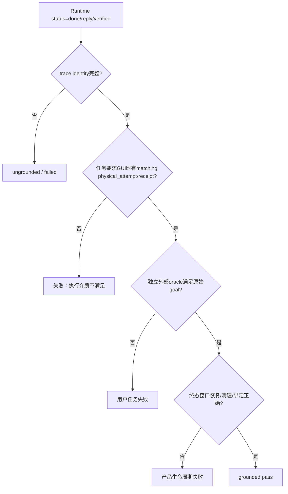
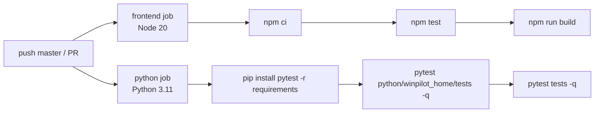
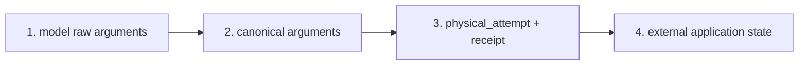

# 04. 测试、真实 E2E 与故障定位

> 本章定义“通过”的证据等级，并给出不靠堆 prompt/规则的改进方法。当前源码的测试文件逐项说明见三卷文件参考。

## 1. 最重要的结论

一个高级 Runtime 可以把错误动作执行得非常精确。它能证明模型看的是当前帧、坐标没有漂移、输入只发了一次、目标窗口没被偷换，却不能替模型做视觉识别、算术、受约束路径规划和停止判断。

因此必须把两种问题分开：

- 基础设施能力：正确观察、绑定、映射、输入、回执、取消、清理和持久化；
- 模型任务能力：从画面理解目标、选择动作参数、根据反馈纠错、在真正完成时停止。

测试设计若只检查前者，就会得到“架构很好、所有单测都绿，但真实简单任务很差”的表面矛盾。

## 2. 证据等级

| 等级 | 典型入口 | 能证明 | 不能证明 |
| --- | --- | --- | --- |
| 静态检查 | TypeScript、Python AST、schema、import boundary | 类型、结构、依赖禁区 | 运行行为 |
| 单元测试 | 直接函数/类 | 局部算法、合同、边界和失败语义 | 真实进程/窗口/输入 |
| 组件测试 | React Testing Library、FastAPI TestClient | UI状态、HTTP协议、序列化 | Electron前台与Windows输入 |
| Runtime集成 | 直接 `/api/v2/arp/runs` 或构造Runtime | owner协作、事件、evidence、回执 | 用户通过可见客户端提交 |
| Controller靶场 | 真实受控窗口 + RawDevice | 坐标、点击、拖拽、按住、物理事件 | 未知应用语义泛化 |
| 可见客户端受控E2E | 真实 Electron + 随机网页/Tk oracle | 用户入口、lease、视觉闭环、外部状态 | 消费软件长任务成功率 |
| 可见客户端真实应用E2E | Electron + Calculator/Notepad/QQ等 | 当前机器/版本的端到端结果 | 跨机器统计泛化 |

只有最后两层能回答用户最关心的“真实端到端任务是否完成”。即使最后一层通过一次，也只能证明该样本，不是通用成功率。

## 3. 真假完成判定



以下都不能单独作为通过：

- 模型输出“已完成”；
- `claim_obligation_done`；
- tool返回 `ok=true`；
- 鼠标确实移动或像素改变；
- Mission verified；
- 截图看起来大概对；
- 测试 harness 在终态后主动恢复窗口；
- 直接 API调用成功；
- 历史提交或另一个分支曾通过。

## 4. GitHub CI 与本地回归

当前 `.github/workflows/ci.yml` 只在 Windows运行两项 job：



CI不启动真实可见 Electron，也不操作消费软件，所以绿色CI只是合并门，不是产品能力证明。

常用本地回归：

```powershell
npm test
npm run typecheck
npm run build
npm run build:all
python -m pytest python/winpilot_home/tests -q
python -m pytest tests -q
```

变更只涉及文档/索引时，最小额外检查为：

```powershell
python -m py_compile scripts/generate_project_guide.py
python scripts/generate_project_guide.py --check
git diff --check
```

## 5. 真实 Electron E2E 的必要条件

一次 case 要称为客户端 E2E，应全部满足：

1. 锁定当前 workspace启动的 Electron PID、HWND、可执行路径和命令行；
2. 保持客户端可见；用操作系统键盘向可见输入框输入完整原始 goal；
3. UIA只能定位控件和只读核对，不可用 ValuePattern/Invoke替代被测输入或发送；
4. 用真实鼠标点击可见“发送消息”；
5. 绑定这次点击产生的准确 thread/turn/run/lease/trace；
6. 需要桌面时证明先 yield、后 capture、再 bind，首帧和物理动作晚于bind；
7. 被测动作由当前产品 Runtime执行，不用shell、DOM、DevTools、UIA写入或测试专属宏代替；
8. 保存提交前、handoff后、动作证据和终态；
9. 用目标外部 oracle读取最终结果；
10. 在 harness恢复前先记录产品自己的 terminal窗口状态；
11. 只清理本次启动且身份已核验的进程/文件。

伪代码：

```text
run_client_case(case):
  electron = verify_workspace_electron_identity()
  target = setup_random_or_real_target()
  baseline = external_oracle.read()

  type_goal_with_os_keyboard(electron, case.goal)
  assert read_back_full_visible_text() == case.goal
  click_send_with_real_mouse()

  run = wait_for_new_exact_run()
  collect(run admission, lease, frame, decisions, attempts, receipts)
  terminal = wait_for_terminal_or_timeout()

  product_window_state = read_before_harness_restore()
  observed = external_oracle.read()
  passed = (
    observed satisfies original goal
    and required physical medium exists
    and identities all match
    and product lifecycle restored/cleaned correctly
  )

  write_report(passed, evidence, first_divergence)
  cleanup_only_verified_case_resources()
```

## 6. 当前客户端套件

### 6.1 受控视觉矩阵

`scripts/client_visual_e2e_run.py` 使用一句不含交互配方的任务，让规则只存在于随机可见页面中。

| Case | 能力压力 | 独立 oracle |
| --- | --- | --- |
| `answer-all-questions` | 视觉读题、算术/选择、完整提交 | 浏览器表单提交 + server判分 |
| `precise-click` | 小目标精确点击 | 可信浏览器pointer事件 |
| `ordered-clicks` | 跨帧短序列记忆 | 有序事件日志 |
| `drag-fit` | 普通拖放 | 页面最终位置/命中 |
| `slider` | 连续指针与数值位置 | 页面状态 |
| `dynamic-hold` | 按下后目标出现、跨帧hold | pointer生命周期与最终命中 |
| `corridor-v0` | 受约束路径variant 0 | 全路径事件与通道几何 |
| `corridor-v1` | 镜像/反向variant 1 | 同上 |
| `game-drag-v2` | variant 2 | 同上 |
| `corridor-v3` | variant 3 | 同上 |

Suite：`smoke`、`goal-admission`、`exam`、`all`。

```powershell
python scripts/client_visual_e2e_run.py --suite all --timeout 600
```

### 6.2 原始真实任务探针

`scripts/client_e2e_run.py` 定义11项原始自然语言任务，覆盖 QQ空间点赞、画板、截图发送、直接聊天、网易云、抖音、OneNote→Word、Krita、能力展示、Wireshark和持续QQ命令。它们是黑盒探针，不是生产task taxonomy。

Mixed suite进一步组合：媒体分析、绘图交接、办公/演示和11项长链。

```powershell
python scripts/client_e2e_run.py --suite original
python scripts/client_e2e_run.py --suite mixed
```

这些任务可能依赖本机软件、登录态、网络和人工可读结果。报告必须把 `infrastructure_unavailable`、`not_run`、`ungrounded`、`failed` 和 `passed` 分开。

### 6.3 `gui_eval_run.py`

该脚本覆盖 calculator、notepad、桌面拖放、Paint和受控target等旧/集成场景。它的注释和部分路径称“frontend-equivalent ARP entrypoint”，但直接HTTP或构造图的 case仍是 Runtime integration，不得自动升级为可见 Electron E2E。

## 7. 外部 oracle 类型

| 目标类型 | 优先oracle | 为什么独立 |
| --- | --- | --- |
| 文本保存 | 文件内容、长度、编码、SHA | 不依赖模型或Runtime自述 |
| Calculator | 应用可见display的只读值 | 直接验证算术终态 |
| 浏览器交互靶场 | server端事件、nonce、顺序、pointer类型 | 页面外部记录真实事件 |
| Tk/原生表单 | 窗口标题、控件只读值、独立进程日志 | 与被测进程分离 |
| 截图 | 独立 `mss` 同物理区域重抓并逐像素比较 | 验证区域、DPI和artifact一致 |
| 音乐播放 | 曲名、播放状态、音量等应用状态 | 不能只看“点击了第一行” |
| 绘画 | 像素统计 + 人工/独立视觉标准，明确范围 | 单纯非空画布不足以证明内容 |
| 消息发送 | 接收端/服务端/可信UI读回 | 发送按钮变化不代表对方收到 |
| 网络分析 | 固定pcap/抓包事实与输出比对 | 模型摘要可能流畅但错误 |

Oracle设置可以用命令行，但若原始 goal要求GUI，命令行只能搭建/读取测试环境，不能代替被测动作。

## 8. 当前 HEAD 的真实证据快照

以 `CLAUDE.md` 最后更新章节为准。2026-08-19 当前回归为：

| 场景 | 结果 | 首分歧/结论 |
| --- | ---: | --- |
| 受控视觉全套 | `18/18` | click/type/scroll、精确与有序点击、拖放、slider、hold/chord、draw，以及4个 corridor 全部由外部浏览器状态判定通过 |
| 安全真实应用随机探针 | `5/5` | Notepad、Calculator、聊天后继续 Notepad、缺失文件的诚实回答、Paint 画线均由应用外 oracle 判定 |
| Studio 可见流程 | `2/2` | click fixture 与 clipboard/condition/screenshot fixture；模型调用均为0，节点、外部状态和 trace 一致 |
| 物理动作与 trace | `133/133` | 受控矩阵99次、真实应用34次；attempt/receipt逐一对应，全部 `applied/input_completed`，无丢失、孤儿或写失败 |
| 释放清理 | `43/43` | 全部需要 cleanup 的动作都记录 release，终态无按键/指针残留 |
| 静态与构建 | 通过 | Python `2508 passed`、renderer `327 passed`、typecheck、project-guide check、`build` 与 `build:all` 全通过 |

尚未覆盖的明确缺口是“从可见 Electron Stop 按钮中断正在按住的输入”这一整条 UI E2E；
cancel/release 的单元与集成覆盖不能冒充该项。更早的 `6/10`、`3/4`、`0/4` corridor、
Calculator 失败和 `3613 passed` 等数字都是历史快照，不代表当前基线。

## 9. 历史 MiMo 样本说明了什么

根据当前证据，准确说法不是“完全不会”，也不是“Runtime已经足够所以模型必然能做”：

- 它能在同一小工具面下完成多种点击、普通拖放、滑块、动态按住和精确文本；
- 它在窄通道几何规划、清晰计算器按钮识别/序列、错误后的自我纠正和完成停止上明显不稳定；
- 四个corridor的模型原始路径已错误，后续层忠实执行；
- 单次通过和单次失败都不能估计稳定成功率，需要同配置重复随机样本；
- 当前最有价值的实验是换一个真实支持图像与多轮tool call的provider做盲A/B，而不是继续修改Runtime或提示词。

因此可把当前 MiMo描述为“具备基础 GUI 操作能力，但不足以稳定担任强通用桌面 Agent”。

## 10. 四层首分歧诊断



### 10.1 判定矩阵

| 比较结果 | 首分歧层 | 应检查 | 不应做 |
| --- | --- | --- | --- |
| raw就选错工具/点/文本/路径 | 模型 | JPEG质量、模型协议、模型本身、tool schema是否正确呈现 | offset、snap、应用配方、答案纠正 |
| raw合法但canonical改变/拒绝异常 | schema/adapter | 解析、strict projection、provider tool naming | 调整物理坐标 |
| canonical正确但physical不符合约定的确定性映射 | Adapter | submitted size、region、DPI、一次映射、队列重验 | 改prompt教坐标 |
| physical正确但receipt未完成 | RawDevice/OS | foreground、hit-test、SendInput backend、权限、取消 | 让模型重复点击 |
| receipt完成但外部状态错误 | 应用交互或模型语义 | 点位是否本就错、控件状态、焦点、post frame | 用像素变化宣布完成 |
| 外部目标已成立但run不停 | 模型停止/claim | 当前帧、上下文、模型终止选择 | 生产答案探测器/第二verifier |
| run终态正确但Electron未恢复 | 产品生命周期 | matching run/lease、WS/HTTP竞态、taskbar通知 | harness先恢复再算通过 |

### 10.2 每个动作的核对表

#### Click

```text
raw image point 是否落在模型所见目标？
submitted_size 是否等于实际JPEG？
canonical 是否保持同点？
physical映射是否只做一次？
queue后target/hit-test是否仍一致？
目标是否收到可信pointer事件？
点击后的应用状态是否满足局部意图？
```

#### Drag/path

```text
raw起点是否在source？
raw每个中间点和线段是否都在可行区域？
keep_holding语义是否正确？
canonical点序和physical点序是否一一对应，且每点都符合唯一映射（数值不要求相等）？
OS是否保持同一个press直到release？
外部oracle是否记录完整路径，而非只看终点？
```

#### Type text

```text
输入前焦点是否在正确控件？
raw文本码点是否精确？
canonical是否未转义/截断/替换？
physical backend是否完成？
应用最终文本、编码、长度、hash是否匹配？
```

#### Hotkey

```text
模型是否选择正确canonical keys？
数组是否唯一且顺序合理？
焦点/目标是否仍绑定？
修饰键是否保证释放？
应用状态是否产生预期结果？
```

#### Claim

```text
claim前当前JPEG是否真的显示目标成立？
current frame evidence是否属于同run？
模型concise_claim是否只是描述而非证据？
外部oracle是否同意？
```

## 11. 最少规则的改进实验

目标是测模型硬能力，不让Runtime替模型做题。

### 11.1 固定实验合同

```text
for provider in [current MiMo, candidate]:
  使用完全相同的：
    原始goal
    初始截图与动态靶场seed
    八工具schema
    system contract
    turn/model-call/runtime budget
    temperature与非流式设置
    外部oracle
  每个case重复N次
  记录：
    raw args
    canonical args
    physical attempt/receipt
    external terminal
    stop/restore
    latency与token usage
```

最小A/B必须同时包含：

- Calculator或另一原生标准控件任务；
- 一个窄corridor；
- 一个当前稳定通过族（如Notepad/普通click），用于防止回退。

### 11.2 统计方式

不要只比较总分。至少报告：

| 指标 | 定义 |
| --- | --- |
| grounded success rate | 外部oracle通过次数 / 有效运行次数 |
| first-action accuracy | 第一笔raw参数就命中正确局部意图的比例 |
| recovery rate | 首次动作错误后最终外部通过的比例 |
| false-claim rate | claim但外部oracle失败的比例 |
| overrun rate | 外部已成立但继续动作/超时的比例 |
| invalid proposal rate | schema/未批准工具失败比例 |
| infrastructure invalid rate | target、frame、transport或测试干扰导致不可计样本 |
| p50/p95 latency | 初始reply/每视觉turn/整任务 |
| token/cache usage | provider真实返回的usage，不推测 |

按seed与case保留明细，不能用平均分隐藏某一任务族完全退化。

### 11.3 只在对应层改动

可接受改动示例：

- JPEG实际模糊/缩放错误：修捕获或submitted size；
- Anthropic strict schema丢失：修provider adapter；
- canonical→physical多缩放一次：修Adapter并加跨DPI测试；
- queue后目标变化仍输入：修重新验证；
- connector descriptor在调用前未复核：修Gateway；
- candidate模型在固定盲测中跨任务显著提升：保留最小provider adapter。

不可接受的样例补丁：

- “看到计算器先按Ctrl+A”；
- “窄通道转角要加几个安全点”；
- OCR找到按钮后把模型点吸过去；
- 点击失败时自动偏移8像素；
- 模型答案错时本地重新计算；
- 加一个verifier模型看图并重写动作；
- 根据QQ/网易云/画板关键词换Agent或工具集；
- 把11条测试任务写进prompt或memory。

## 12. 测试污染和无效样本

必须单独标记以下情况：

- 输入法/编码把原始中文变成 `?`；
- 测试为了截图先把Electron恢复到前台；
- 同时跑重型全量测试导致 `/api/status` 超时；
- 目标应用版本、登录态或网络未准备；
- 模型credential缺失、401或provider在响应前失败；
- run ID绑定到前一任务；
- target seed/nonce 与oracle读取不一致；
- 测试脚本用UIA/DOM完成了本应由Agent完成的动作；
- 本机不具备多显示器等所需基础设施。

这些不是通过，也不一定是模型失败。报告应使用 `infrastructure_invalid`/`unavailable`，保留原因并重跑干净样本。

## 13. 回归选择

| 改动范围 | 最小必要检查 |
| --- | --- |
| 文档/生成器 | py_compile、生成器 `--check`、链接/覆盖、`git diff --check` |
| Renderer纯UI | 相关Vitest + typecheck + build；若改变真实入口/lease/终态则可见Electron E2E |
| FastAPI合同 | 相关Python测试 + Renderer contract测试 |
| 模型adapter | provider protocol/model runtime测试 + 固定真实credential smoke |
| Frame/坐标/Adapter/RawDevice | 单元/集成 + 可见Electron受控矩阵至少两个动作族 |
| Goal/Thread/lease | API测试 + chat→GUI→chat可见客户端生命周期 |
| Studio节点/replay | validator/Runtime测试 + 可见Studio零模型run + 独立DUT oracle |
| 生产prompt/tool surface | 全套相关回归 + 随机跨任务E2E；一般应先证明结构必要性 |

Runtime改动没有可见Electron和独立结果证据，不能交接为“已修复”。

## 14. 新失败的标准记录模板

```text
Case/seed:
源码SHA与本地dirty状态:
Electron/Python PID、HWND、source stamp:
原始goal读回:
run/thread/turn/lease/target IDs:
模型/provider/protocol/temperature/budget:

每一Turn:
  frame ID / submitted size / image hash
  raw tool + arguments
  canonical tool + arguments
  physical arguments
  receipt input_completed/error_kind
  post frame/effect

Terminal:
  Runtime/ARP状态
  model claim/result
  Electron handoff恢复状态
  external oracle expected/actual

First divergence:
  model | canonical | physical | application | lifecycle | infrastructure

允许的修复层:
不允许的样例特判:
```

这份模板强迫团队用同一条证据链说话，也使模型A/B和基础设施回归可以真正比较。

## 15. 文档覆盖验证

本套讲解自身也有测试：

```text
tracked paths = git ls-files -z
extra paths = 本次新增的讲解Markdown + 生成器
for every path:
  读取真实bytes
  计算SHA/行数/语言/分类
  Python用AST提取顶层定义/import/route
  TS/JS提取声明/import/IPC
  JSON解析顶层key/scripts/dependencies/node kinds
  写一个唯一PROJECT-FILE marker

assert every code/test/config path has exactly one marker
assert rerendered output == committed generated inventory
```

这不能替代人工理解，但可以防止“大而全”的文档在新增一个文件后悄悄漏掉它。
