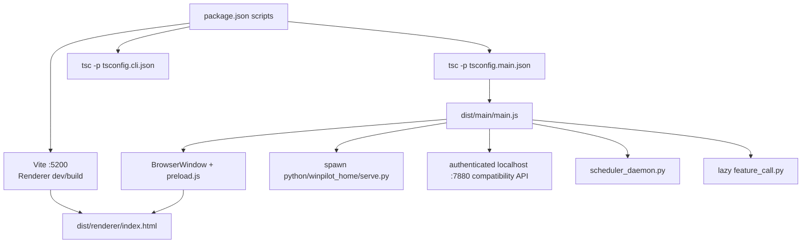
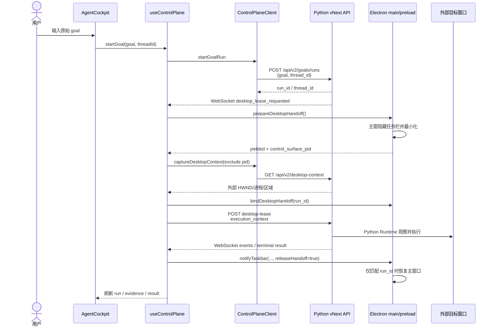
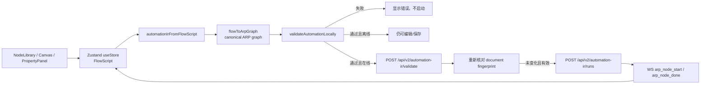
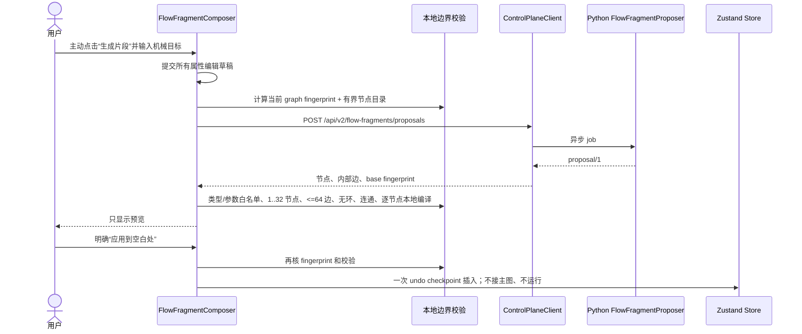
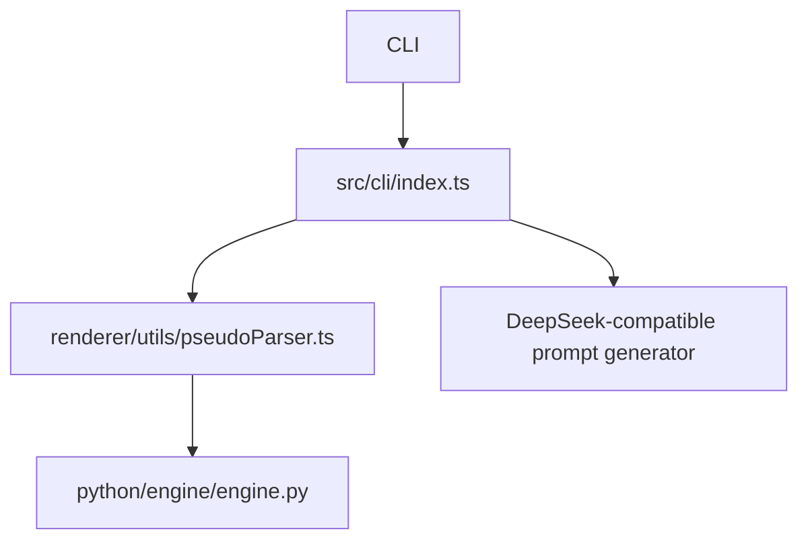
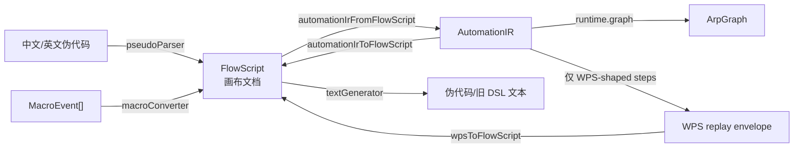

# 05. TypeScript / Electron 逐文件精确讲解

> 审计基线：当前 `master` 的 tracked 文件；清单由 `git ls-files -z` 生成，避免空格、中文或特殊文件名遗漏。
> 本卷范围：`src/**`、`package.json`、`vite.config.mts`、`tsconfig*.json`，以及直接服务 Node/Electron 的 `scripts/clean-artifacts.cjs`、`scripts/setup-claude-code.js`。
> 覆盖：130/130 个文件（`src/ai-interface` 11 文件与 `tsconfig.ai.json` 已删除）。
> 其中根配置 5、根 Node 脚本 2、`src/cli` 7、`src/main` 12、`src/renderer` 102、`src/shared` 1。
> 定位：本卷解释 TypeScript/Electron 源码，不改产品代码。它以当前源码为准；历史设计只在解释兼容面时出现。

## 1. 先说结论：代码里同时存在三条线

| 代码线 | 真正入口 | 执行 owner | 当前定位 |
| --- | --- | --- | --- |
| 产品主链 | Electron `main.ts` 启动托管 WinPilot；Renderer `AgentCockpit` 调用 `POST /api/v2/goals/runs` | Python vNext 的单一 `LiveVisualActor`；TS 只负责客户端、前台交接和展示 | 当前默认产品路径 |
| Studio 确定性链 | `Studio` 把 `FlowScript` 编译成 `AutomationIR`，本地与后端验证后调用 `POST /api/v2/automation-ir/runs` | Python ARP/Replayer；不需要模型的节点应为零模型调用 | 当前正式编辑、验证、离线重放路径 |
| 兼容/开发链 | `src/cli`、`:7880` API、`engine:start`、Renderer `store/executor.ts` | 旧 `python/engine/engine.py`、feature 子进程或浏览器预览执行器 | 仍有消费者或诊断价值，但不得回落成产品 vNext（`src/ai-interface` 已删除） |

关键事实：TS 代码不实现 `/api/v2/*` 服务端路由。`ControlPlaneClient` 是这些路由的消费者；真正服务端位于 Python。另一方面，Electron 主进程的 `startApiServer()` 在本机 `127.0.0.1:7880` 暴露的是另一套旧编辑器/宏/feature/MCP 兼容 API，不能把两者混成同一服务。

## 2. 构建和启动入口



通俗伪代码：

```text
开发启动:
  清理占用 5200 的旧监听进程
  并行启动 Vite
  等 Vite 可访问
  编译 Electron 主进程
  启动 Electron

Electron ready:
  只允许单实例
  创建 900×580、contextIsolation=true、nodeIntegration=false 的窗口
  开发时加载 http://localhost:5200，打包时加载 dist/renderer/index.html
  后台启动托管 WinPilot 服务，等待 runtime contract version 3
  启动带 token 的 :7880 兼容 API
  启动 scheduler daemon
  延迟刷新旧 feature 注册表
  注册 F9（只控制旧 Flow engine）
```

## 3. 当前产品主链：聊天、按需桌面租约、物理前台交接



主链伪代码：

```text
发送消息(goal):
  如果当前 run 仍活跃 -> 保留草稿，拒绝并发提交
  如果 runtime identity 不兼容 -> fail closed，不启动任务
  POST 仅包含 goal 与可选 thread_id
  保存返回的 run_id 到最多 40 个的前端会话投影

收到 desktop_lease_requested(run_id, lease_id):
  去重同一 lease
  Electron 先让出前台
  后端捕获排除 Electron PID 后的真实目标窗口
  Electron 本地绑定 run_id
  后端绑定 lease 与 execution_context
  如果响应丢失 -> 精确查询该 run，只有服务端已 delivered 才保持让出状态
  如果明确未交付 -> 关闭 lease，并安全恢复 Electron

收到终态:
  分类 success / error / stopped
  用任务栏通知一次
  只有终态 run_id 与已绑定 handoff run_id 相同才恢复控制面
  失败结果保留原文；“再次编辑”只恢复 goal，不自动重试
```

### 3.1 前端状态所有权

| 状态 | owner | 持久化 | 说明 |
| --- | --- | --- | --- |
| 当前控制平面快照、能力、runs、events | `useControlPlane` React hook | 否；HTTP/WS 重新水合 | WS 触发 80ms 合并刷新，另有 5s fallback poll |
| 当前聊天 Thread 的 run ID 投影 | `AgentCockpit` | `localStorage: arp-agent-thread-run-ids`，最多 40 | 服务端仍是 Thread/Turn 权威；这里只为 UI 聚合 |
| 未发送 goal 草稿 | `AgentCockpit` | `localStorage: arp-last-goal` | 成功提交或新对话时清除；失败时保留 |
| 可编辑流程、UI、undo/redo、兼容执行状态 | Zustand `useStore` | 当前流程写入 `lingdong-script-data` | Studio 运行使用启动时 IR 快照，之后画布编辑只影响下次运行 |
| 运行终态判定 | `src/shared/taskOutcome.ts` | 否 | Electron 通知和 Renderer 复用同一机械分类器 |
| 托管 Runtime URL/token/进程 | Electron `winpilotServer.ts` | 进程内 | token 只经 preload 送给本机 Renderer，不写入普通 UI 状态 |

## 4. Studio：可编辑 FlowScript 到 canonical Automation IR



Studio 运行伪代码：

```text
点击“运行工作流”:
  把当前 FlowScript 包成 AutomationIR
  取 runtime.graph
  本地检查格式、边、可达性、参数、证据门和空间动作前的 focus_window
  若离线或 runtime identity 有问题 -> 不运行
  请求后端再次验证
  比较验证前后的流程 fingerprint
  如果用户在等待期间改了图 -> 丢弃旧验证结果
  否则提交同一 AutomationIR 快照
  用 runtime 事件更新画布节点 running/success/error 状态
```

### 4.1 当前本地可编译节点边界

`RUNNABLE_FLOW_NODE_TYPES` 有 20 个编辑节点；`start/end` 是图边界节点，不计入这 20 个。运行时目录是否实际暴露能力仍由后端 capability 决定。

| 编译结果 | Flow 节点 |
| --- | --- |
| 原生 ARP kind | `agent_goal`、`action_batch`、`replay_step`、`skill_replay`、`evidence_gate`、`human_gate` |
| `action_batch` | `click`、`click_text`、`input_text`、`keyboard`、`swipe`、`launch_program`、`focus_window`、`screenshot`、`clipboard_set`、受支持的 `mouse_operation`；窗口型 `wait` 也生成 action batch |
| 其他原生机械 kind | 时间型 `wait → delay`，`variable_set → set_variable`，支持的变量条件 `condition → condition`，`clipboard_get → replay_step` |
| 历史可读但执行 fail closed | 其他 `NodeType` 会在投影中成为 `legacy_flow`；本地/后端验证拒绝，不得静默改义执行 |

几个容易误读的细节：

- `input_text` 新建节点的显式默认值是 `click_before=false`；若显式设为 `true`，或旧文档缺失该字段而 compiler 按兼容默认需要点击，就必须同时提供 `x/y`。可选先 `Ctrl+A` 再输入。
- `keyboard` 会把 modifier 与每个非 modifier key 组合成一组或多组 `hotkey`。
- `screenshot` 只接受受管理全屏工件，或整数物理屏幕区域；旧 `save_path/output_path/format` 分支拒绝。
- `mouse_operation` 只开放坐标/文字点击、上下滚动、移动、悬停；图片模式等未精确编译分支拒绝。
- `flowToArpGraph` 仍能为历史节点构造 `legacy_flow` 以便读取和显示，但当前运行验证明确报迁移错误，默认 handler 已不存在。

## 5. 一句话生成流程片段：隔离的编辑辅助，不是第二 Agent



模型只看到确定性目录和文档计数/类型/fingerprint，不看桌面、不读 Thread、不拿 connector 或执行权限。取消会中止 job；文档变化会使旧提案失效。

## 6. IPC、HTTP 与 WebSocket 边界

### 6.1 Renderer ↔ Electron preload IPC

| 通道族 | Renderer 入口 | 主进程 owner | 当前用途 |
| --- | --- | --- | --- |
| 文件 | `openFileDialog/readFile/writeFile` | `dialog:*`、`file:*` | Studio 打开/保存 canonical Automation IR |
| 托管 WinPilot | `getWinpilotConnection/ensureWinpilot/restartWinpilot` | `winpilotServer.ts` | 产品控制平面发现、token、协议身份恢复 |
| 桌面 handoff | `prepare/bind/releaseDesktopHandoff` | `main.ts` | 产品主链按需让出与恢复前台 |
| 截图/选区/OCR | `captureScreenshot/selectRegion/ocrRecognizeRegion` | `main.ts` + Python helpers | 属性编辑器选区及兼容功能；正式 screenshot 节点仍由 ARP 执行 |
| Engine | `engineStart/Stop/Pause/Resume/Status` | `engine.ts` | 旧 Flow 执行兼容面；不是 Studio 当前 Run 按钮路径 |
| Feature/macro/schedule | 对应 preload 方法 | `featureCallBridge`、宏进程、`SchedulerBridge` | 旧节点、工具面和计划兼容 |
| 通知/窗口 | `notifyTaskbar`、窗口按钮 | `main.ts` | 当前产品 UI 与终态恢复 |
| `api-command`/state | store 模块级 listeners | `api.ts` | 本机 :7880 对 Renderer 图编辑的兼容桥 |

### 6.2 Renderer ↔ Python vNext

```text
HTTP：查询 platform/capabilities/current run/runs/config/assets；提交 goal、Automation IR、gate、pause/resume/cancel、lease。
WebSocket：ws/events?token=...，承载 run 生命周期、node 事件、desktop lease request 和通知事件。
认证：Electron 托管时使用随机 CONTROL_TOKEN；fetch Authorization Bearer，WS 用 token query。
一致性：Renderer 与 Electron 启动探针都要求 runtime contract_version=3，源码 stamp 未漂移，loaded/current commit 不冲突。
```

### 6.3 Electron 本地 :7880 兼容 API

`src/main/api.ts` 绑定 `127.0.0.1`，除 `/api/ping` 外需要 constant-time token 校验，并限制 Origin。它可转发图编辑命令、读 Renderer 缓存状态、管理宏/feature/模板/marks、截图/OCR，并在 `/mcp` 代理旧 Python `@feature` 注册表。旧 DSL/旧 engine 直接写图或执行端点返回 HTTP 410；开发态 JS eval 还需 `LINGDONG_ENABLE_UNSAFE_EVAL=1`。

## 7. CLI 兼容链



这条链包含独立长系统提示、自然语言→伪代码→旧 engine。源码仍能单独构建/调用，但它不是 `AgentCockpit` 的一个 `LiveVisualActor` 主链，也不应作为 vNext 失败时的 fallback。原 `src/ai-interface`（stdio MCP + HTTP 工具面）已删除。

兼容链伪代码：

```text
lingdong ask "目标":
  用独立 DeepSeek 风格 system prompt 生成中文伪代码 JSON
  若 --dry 只打印
  否则 pseudoParser -> FlowScript -> python/engine/engine.py
```

## 8. 数据转换关系



权威保存格式是 Automation IR。`FlowScript` 是编辑投影，坐标、节点状态和 UI 元数据会被规范化；临时节点执行状态不能被误当成运行语义。WPS 只有在保留 WPS-shaped steps 时才可回转，普通 Flow 来源不能假装成 WPS。

---

## 9. 逐文件精确目录

下表每一行都对应一个 tracked 文件。“调用者”只列直接生产调用者或测试入口；“阶段”说明该文件何时参与。

### 9.1 根配置与 Node 脚本（8/8）

| 文件 | 职责与关键符号 | 直接依赖 / 调用者 | 运行阶段 |
| --- | --- | --- | --- |
| `package.json` | 包名、`dist/main/main.js` Electron 入口、`lingdong` bin、npm dev/typecheck/test/build/CLI/AI/E2E 命令，以及 electron-builder 的 Python/runtime/tools/templates 打包清单；6 项生产依赖为 React、React DOM、Zustand、Immer、Nanoid、Lucide React。 | npm、Electron、Vite、TypeScript、electron-builder 读取；所有 JS/TS 构建的根。 | 安装、开发、测试、构建、打包、启动。 |
| `vite.config.mts` | `defineConfig` 设置 Renderer root、React 插件、`@` alias、5200 严格端口、`dist/renderer` 输出、jsdom/Vitest；`removeCrossOrigin()` 为 Electron `file://` 删除模块标签的 `crossorigin`。 | `npm run dev:renderer`、`build:renderer`、`test`。 | Renderer 开发服务器、打包和测试发现。 |
| `tsconfig.json` | Renderer 严格类型检查：ES2021/DOM、bundler resolution、React JSX、`noEmit`、unused/fallthrough 检查。 | `npm run typecheck` 第一段；范围 `src/renderer`。 | 静态检查。 |
| `tsconfig.main.json` | Electron 主进程 CommonJS 编译到 `dist`，范围 `src/main` 与 `src/shared`，生成 source map。 | `dev:electron`、`build:electron`、`typecheck`。 | 主进程/preload 构建。 |
| `tsconfig.cli.json` | CLI CommonJS 编译到 `dist/cli`；额外纳入 Renderer types/utils，因为 CLI 复用 `pseudoParser`。 | `build:cli`、`typecheck`。 | 兼容 CLI 构建。 |
| `scripts/clean-artifacts.cjs` | 安全清理已知生成目录并递归清 Python `__pycache__`；`insideRoot()` 拒绝工作区外目标，`--runtime` 才删除 ignored `python-runtime`，统计释放字节。 | `npm run clean`、`clean:runtime`。 | 手工维护/构建前清理；不参与应用运行。 |
| `scripts/setup-claude-code.js` | 旧 AI interface MCP 配置助手；`src/ai-interface` 已删除，该脚本目标 `dist/ai-interface/index.js` 不再可构建，属待清理的兼容脚本。 | 用户手工运行。 | 外部 Claude/MCP 兼容配置，不是产品主链启动。 |

### 9.2 `src/ai-interface`（已删除）

`src/ai-interface/`（11 文件：index、prompt、http/mcp server、run/list/create/ask/screen-capture
工具、registry、types）与 `tsconfig.ai.json`、npm `ai`/`ai:mcp`/`ai:http`/`build:ai`
scripts 已随旧 Agent 线删除。该目录是旧"第二模型→伪代码→旧 engine"兼容链，
CLAUDE.md 明令不得接回。

### 9.3 `src/cli`（7/7，独立兼容面）

| 文件 | 职责与关键符号 | 直接依赖 / 调用者 | 运行阶段 |
| --- | --- | --- | --- |
| `src/cli/index.ts` | `lingdong` bin 入口；解析 `run/list/create/ask/serve`、`-c`、`--dry`、`--pretty`、`--port`，普通输出采用 JSONL，错误后退出非零。 | `package.json.bin` 与 `npm run cli`；分发到 commands。 | CLI 进程入口。 |
| `src/cli/commands/ask.ts` | `askCommand()` 调 `callDeepSeek`，打印 plan/pseudocode；dry 只结束，否则交 `runCommandInline()`。 | CLI index；依赖 `deepseek.ts` 与 `commands/run.ts`。 | 旧自然语言 CLI 路径。 |
| `src/cli/commands/create.ts` | `createCommand()` 从参数或 stdin 读伪代码，经 Renderer parser 校验后以 `.flow` 写磁盘；拒绝空内容和覆盖已有文件。 | CLI index；依赖 fs/path 与 `pseudoParser`。 | CLI 脚本创建。 |
| `src/cli/commands/list.ts` | `listCommand()` 扫目录、解析伪代码/JSON FlowScript、按名称排序，以 human pretty 或 JSON 输出元数据。 | CLI index；依赖 fs/path 与 `pseudoParser`。 | CLI 脚本发现。 |
| `src/cli/commands/run.ts` | `runCommand/runCommandInline` 解析脚本，`spawnEngine()` 启旧 `python/engine/engine.py`、转发 JSONL/stdout/stderr 并发 execute 消息。 | CLI index 与 `ask.ts`；依赖 `pseudoParser`。 | CLI 旧执行链。 |
| `src/cli/commands/serve.ts` | `serveCommand()` 提供 token+Origin 限制的 `127.0.0.1` `/health`、`/run` 流式 JSONL、`/list`；每次 run 启动旧 engine.py。 | CLI index 的 `serve`。 | 独立 CLI HTTP 兼容服务。 |
| `src/cli/deepseek.ts` | 独立 `SYSTEM_PROMPT` 与 `callDeepSeek()`；从 `LLM_API_KEY/DEEPSEEK_API_KEY` 取凭据，调用 Chat Completions 并解析 `{pseudocode, explanation}`。 | `commands/ask.ts`。 | 旧 CLI 生成模型调用；不进入 vNext Actor。 |

### 9.4 `src/main`（12/12，Electron 主进程与 preload）

| 文件 | 职责与关键符号 | 直接依赖 / 调用者 | 运行阶段 |
| --- | --- | --- | --- |
| `src/main/main.ts` | Electron 真入口：单实例、窗口/菜单、桌面 handoff、截图选区/OCR、宏、schedule、通知、全部 IPC、托管 WinPilot、`:7880` API、F9 旧 engine、退出清理；关键 owner 为 `createWindow()`、`releaseDesktopHandoff()`、`notifyTaskbarAttention()` 与 app lifecycle。 | Electron 直接执行；依赖其余 main 模块和 `state.ts`。 | 整个桌面应用生命周期。 |
| `src/main/preload.ts` | 唯一 `contextBridge.exposeInMainWorld('electronAPI', …)`；把文件、旧 engine、WinPilot connection/handoff、截图、AI/DSL、feature、宏、schedule、通知和事件订阅收敛成 Renderer 安全桥。 | BrowserWindow preload；类型由 `renderer/types/electron.d.ts` 镜像，Renderer 全局调用。 | 每个 Renderer context 创建时。 |
| `src/main/winpilotServer.ts` | 管理 `serve.py` 子进程和随机 `WINPILOT_CONTROL_TOKEN`；安全高端口分配、`/api/status` readiness、contract v3/source/git 身份检查、幂等 ensure/restart/stop；保留 stderr tail。 | `main.ts` 启停并经 IPC 暴露；`renderer/platform/client.ts` 间接消费。 | 应用启动、连接恢复、退出；产品主链基础设施。 |
| `src/main/api.ts` | `startApiServer(ApiDeps)` 实现 `127.0.0.1:7880` 兼容 REST/MCP：constant-time token、Origin 限制、Renderer `api-command`、宏/feature/模板/marks/截图；旧 DSL/engine 写图端点返回 410。 | `main.ts` 构造依赖并启动；依赖 engine、feature bridge、mcp handler、macro path。 | 应用常驻的本机兼容控制面。 |
| `src/main/engine.ts` | Python 启动公共层：bundled/system Python 选择、UTF-8/VLM env、one-shot Python 子进程并发上限 3，超出者进入无固定长度上限的 FIFO 队列，并收集 stdout；`start/stopPythonEngine` 管旧长驻 Flow engine，`callLLM` 是旧 Chat Completions 桥。 | `main.ts`、`api.ts`、`featureCallBridge.ts`、`winpilotServer.ts`、`mcp-handler.ts`。 | Python 子进程生命周期与旧执行/AI兼容调用。 |
| `src/main/env.ts` | `isDev` 根据 `app.isPackaged/--dev`；`getBaseDir()` 在开发指仓库根、打包指 resources。 | 多数 main 子模块。 | 主进程路径解析。 |
| `src/main/state.ts` | 模块级共享引用及 setter：`mainWindow`、旧 `pythonProcess/engineRunning/lastScript`、尚保留的 voice server 状态。 | `main.ts` 与 `engine.ts`。 | Electron 进程内状态；无持久化。 |
| `src/main/featureCallBridge.ts` | 延迟启动长驻 `python/tools/feature_call.py`，stdin/stdout JSON 行协议；ready 前排队，按 FIFO `_pending` 配对响应，退出时把 pending 解析为错误。 | `main.ts`、`api.ts`；Renderer 经 preload `callFeature` 间接调用。 | 旧 feature 节点/工具第一次调用至退出。 |
| `src/main/mcp-handler.ts` | 在 :7880 `/mcp` 上实现 HTTP/SSE MCP：检查 Python、缓存 `feature_list.py` 工具目录、用 one-shot `feature_call.py` 执行，支持 initialize/tools list/call。 | `api.ts`；依赖 engine/env。 | 外部 MCP 兼容请求。 |
| `src/main/schedulerBridge.ts` | `SchedulerBridge extends EventEmitter` 管 `scheduler_daemon.py` JSONL：init/reload/ping/fire response、意外退出 2 秒重启、优雅停机；提供脚本/Python 路径。 | `main.ts` 构造并监听 fire/pre_fire。 | 应用常驻 schedule 兼容基础设施。 |
| `src/main/macroPaths.ts` | `resolveMacroPath()` 规范化 `.json` 宏名，拒绝 NUL、目录、绝对/穿越路径，确保结果直属 macros 根。 | `main.ts`、`api.ts`；`macroPaths.test.ts`。 | 宏读取/删除前的安全边界。 |
| `src/main/cronMatcher.ts` | 私有 `matchField/matchCron` 支持 5 段 cron 的列表、步长、范围和 Sunday 0/7；当前没有 export，也没有生产调用者，真实调度由 Python daemon 负责。 | 无直接调用者。 | 当前休眠/遗留源码，只参与 TypeScript 编译。 |

### 9.5 Renderer 入口、控制平面与共享状态（19/19）

| 文件 | 职责与关键符号 | 直接依赖 / 调用者 | 运行阶段 |
| --- | --- | --- | --- |
| `src/renderer/index.html` | `zh-CN` HTML 壳，提供 `#root`、icon 与 `main.tsx` module script；注释说明为打包 `file://` 兼容未设置 CSP。 | Vite 入口；Electron `loadFile` 或 dev server 返回。 | Renderer 文档加载。 |
| `src/renderer/main.tsx` | `ReactDOM.createRoot` 在 StrictMode 中挂载 `App`，加载全局 CSS。 | `index.html`。 | Renderer bootstrap。 |
| `src/renderer/App.tsx` | Renderer 根：主题/标题栏同步、canonical 文件打开/保存/新建、全局快捷键、native menu action、dirty/draft beforeunload；最终包裹 `AppErrorBoundary → PlatformWorkbench`。 | `main.tsx`；依赖 store、Automation IR reader、draft registry。 | Renderer 全生命周期。 |
| `src/renderer/platform/contracts.ts` | 830 行纯类型合同：ARP graph/node/capability、run projection/snapshot/timeline/metrics、TaskContract 与 interaction runtime、artifact/evidence/completion、runtime identity/status、WS event/schedule 等。 | client、hook、PlatformWorkbench、Automation IR 和测试广泛导入；字段镜像 Python JSON。 | 编译期跨进程协议；运行时用于对象形状约定。 |
| `src/renderer/platform/client.ts` | `ControlPlaneClient` 统一带 token fetch、错误/timeout、所有 Python HTTP endpoint、artifact/shot URL 和 WS 重连；`resolveControlPlaneConnection()` 优先轮询 Electron 托管服务，`runtimeCompatibilityError()` fail closed。 | `useControlPlane.ts` 主调用；PlatformWorkbench 通过 hook 获得 client。 | Renderer 连接建立及每个控制平面请求。 |
| `src/renderer/platform/useControlPlane.ts` | 核心 React hook：维护 overview/capabilities/current/runs/events/connection；WS+fallback polling；terminal taskbar；runtime 漂移空闲时重启；封装 goal/Automation/gate/control；`fulfillDesktopLease()` 实现精确 handoff 竞态处理。 | `PlatformWorkbench` 唯一生产调用；依赖 client、executionContext、taskbar helper。 | 产品主链与 Studio 运行的 Renderer owner。 |
| `src/renderer/platform/executionContext.ts` | `buildClientExecutionContext()` 调 preload 让出 Electron 前台，再用注入 capture 函数获取排除控制面 PID 后的真实目标；Web 模式明确记录未让出原因。 | `useControlPlane.fulfillDesktopLease`；executionContext tests。 | 收到 desktop lease 后、服务端 bind 前。 |
| `src/renderer/platform/flowToArpGraph.ts` | 当前 Flow→ARP 编译器：20 个 `RUNNABLE_FLOW_NODE_TYPES`、`controllerActions()` 参数精确映射、retry/edge branch、policy/compilation metadata；不支持节点只投影 `legacy_flow` 供验证拒绝。 | Automation IR、NodeLibrary/Canvas、fragment 边界、测试。 | Studio 文档变化时编译；验证/保存/运行前。 |
| `src/renderer/platform/taskOutcome.ts` | `taskOutcomeForRun()` 调共享分类器；仅明确 vNext/no-legacy 且无 error 的 direct reply 字符串按普通内容处理，避免把 JSON 文本猜成失败协议。 | AgentConversationTurn、taskbar helper。 | Renderer 终态展示。 |
| `src/renderer/platform/taskbarNotification.ts` | `taskbarNotificationForTransition()` 只对观察到的活跃→终态、新 terminal run 或 live-start run 发一次通知，并输出 success/error/info 与正文。 | `useControlPlane`；taskbar tests。 | run 投影变化时。 |
| `src/renderer/store/defaults.ts` | `DEFAULT_SETTINGS/UI_STATE`、localStorage keys、50 步 history 上限、preset template factory 与 metadata；默认 `arp-quickstart` 生成正式 Studio 起始图。 | store 初始化、模板 registry。 | Renderer 模块加载和新建流程。 |
| `src/renderer/store/index.ts` | 1647 行 Zustand+Immer 单一编辑器 store：FlowScript/UI/selection/history/clipboard/subflow/旧 execution/features/macros/memory/triggers；保护唯一 start/end、canonical save、一次 checkpoint fragment、HMR-safe IPC listeners 与 localStorage。 | 几乎全部 Renderer 组件；App 与 Studio 直接调用。 | 编辑器常驻状态 owner；兼容 IPC/engine 事件也在此收口。 |
| `src/renderer/store/executor.ts` | `createFlowExecutor()` 是旧浏览器预览/FlowScript 解释器，支持分支/循环/子流程/断点/变量；需要真实副作用时经 feature bridge，`require_real_features` 下拒绝模拟成功，返回 `ExecutionController`。 | 仅 store 的兼容 `startExecution()`；executor tests。 | 非 Electron 兼容预览或旧执行路径；不是 Studio 正式 run。 |
| `src/renderer/store/persistence.ts` | localStorage CRUD：template shortcuts、custom templates、agent history；JSON 解析失败回空值。 | store 初始化与动作。 | Renderer 本地兼容资料持久化。 |
| `src/shared/taskOutcome.ts` | 有界递归（深 8、最多 500 节点）检查显式失败信号、终态集合，导出 `classifyTaskOutcome/isTerminalTaskStatus/taskResultText`。 | Renderer task outcome/notification 与 Electron `main.ts` 导入。 | 跨主进程/Renderer 的机械终态分类。 |
| `src/renderer/types/electron.d.ts` | `ElectronAPI` 当前镜像 50/51 个 preload 方法及 listener cleanup 签名，并扩展 `Window.electronAPI` 与少量注入全局；它遗漏了 `preload.ts` 已暴露的 `setVisionBackend`，是明确的类型镜像漂移，不能称完整。 | App、store、platform hook/components 编译时使用；应与 `preload.ts` 同步。 | 类型检查。 |
| `src/renderer/types/index.ts` | 953 行 Flow 编辑域模型：60 个 `NodeType`、每类 params union、FlowNode/Edge/Script、execution/UI/feature/macro/trigger/schedule/learned target 等。 | Renderer 组件、store、utils、CLI/AI parser 广泛导入。 | 编译期编辑器/兼容 Flow 合同。 |
| `src/renderer/vite-env.d.ts` | 单行 `/// <reference types="vite/client" />` 三斜线类型引用，没有额外自定义声明。 | tsconfig 包含。 | 为 Renderer 类型检查引入 Vite client 声明。 |
| `src/renderer/components/platform/PlatformWorkbench.tsx` | 3190 行主 UI 编排：`AgentCockpit`、`Studio`、`RunsView`、Assets/System/抽屉/命令面板、interaction/runtime audit；直接消费 `useControlPlane`，聚合聊天 Thread、导出对话 IR、流程验证/运行和历史证据。 | `App.tsx` 唯一顶层调用；内部使用 Canvas/Library/Property/Fragment 与大量 contract helpers。 | 当前产品 Renderer UI 全生命周期。 |

### 9.6 Renderer 组件（其余 35/35）

| 文件 | 职责与关键符号 | 直接依赖 / 调用者 | 运行阶段 |
| --- | --- | --- | --- |
| `src/renderer/components/Canvas/CanvasControls.tsx` | `CanvasControls` 提供缩放/适应按钮，`MiniMap` 按节点边界投影视口，`ContextMenu` 只列本地可编译节点并调用 store add/paste/select。 | `FlowCanvas`；依赖 store、node definitions、dimensions、`isRunnableFlowNodeType`。 | Studio 画布交互。 |
| `src/renderer/components/Canvas/EdgeLayer.tsx` | 用 `getPortNodePos/bezierPath` 计算 SVG 贝塞尔线；显示分支颜色、连接预览、hover/selection，并把边点击写入 store。 | `FlowCanvas`；依赖 nodes/definitions/store。 | 每次画布边/transform/连接状态渲染。 |
| `src/renderer/components/Canvas/FlowCanvas.tsx` | 画布容器 owner：pan/zoom、框选、多选拖动、端口连线、drag/drop 新节点、context menu、MiniMap、自动适应和子流程 breadcrumb。 | `Studio`；组合 FlowNode、EdgeLayer、CanvasControls。 | Studio 主编辑区。 |
| `src/renderer/components/Canvas/FlowNode.tsx` | 单节点视觉与交互：`getNodeSummary()` 为各类型生成摘要，显示 icon/status/error/disabled/breakpoint；实现 selected group 相对拖动和端口 mouse down/up。 | `FlowCanvas`；依赖 store、node definitions/icons/dimensions。 | 每个可见节点渲染和拖拽。 |
| `src/renderer/components/Canvas/SubFlowBreadcrumb.tsx` | 根据 `subFlowNav.stack` 显示层级和返回按钮。 | `FlowCanvas`；依赖 store navigation。 | 编辑子流程时。 |
| `src/renderer/components/FlowFragment/FlowFragmentComposer.tsx` | opt-in 片段弹窗：提交 draft、构造有界 context、AbortController 取消 job、normalize+local validate+fingerprint 防陈旧、预览后显式一次性插入并居中；Esc 只关闭弹窗。 | `Studio`；依赖 store、draft registry、flow fragment helpers、plane proposer。 | 用户主动生成流程片段时。 |
| `src/renderer/components/NodeLibrary/NodeLibrary.tsx` | 可搜索/分类/拖拽节点库；只展示本地可编译目录，分开标记运行时 capability 与 model requirement；也整合模板精确/统一搜索、recent 类型和 item marks。 | `Studio`；依赖 definitions、unifiedSearch、store、capability contracts。 | Studio 左侧资源抽屉。 |
| `src/renderer/components/PropertyPanel/PropertyPanel.tsx` | 属性面板路由器：选中单节点时按全部 `NodeType` 分发专用 editor 或内联系统/聚合节点表单；另编辑 label、disabled、description 等并在 blur 建 history checkpoint。 | `Studio`；调用下列所有 params 组件与 store。 | Studio 右侧属性抽屉。 |
| `src/renderer/components/PropertyPanel/controls/WheelSelectControl.tsx` | 原生 select 加可选全屏滚轮选择按钮；调用 preload `wheelSelect` 并回写 `selected`。 | `PopupCloseParams`。 | 旧 popup 策略编辑。 |
| `src/renderer/components/PropertyPanel/params/ArpNodeParams.tsx` | 正式 ARP 节点 editor：goal/成功标准、action JSON、WPS replay step+target/session/shell、skill、结构化 evidence、human gate 和 retry；JSON 草稿注册 commit，解析错误阻断保存/替换。 | `PropertyPanel`；依赖 `editorDrafts`。 | 编辑原生 ARP 节点。 |
| `src/renderer/components/PropertyPanel/params/CameraCaptureParams.tsx` | 编辑抓拍的 camera id、输出路径、尺寸、PNG/JPG、稳定等待和说明。 | `PropertyPanel`。 | 历史 camera_capture 节点编辑；当前不在 20 节点正式目录。 |
| `src/renderer/components/PropertyPanel/params/CameraRecordParams.tsx` | 编辑录像 camera id、输出路径、fps、duration、尺寸和说明。 | `PropertyPanel`。 | 历史 camera_record 节点编辑。 |
| `src/renderer/components/PropertyPanel/params/ClickParams.tsx` | 坐标拾取、x/y、单/双/右/中/三击、delay 和说明；选点经 preload region selector。 | `PropertyPanel`。 | 正式 click 节点编辑。 |
| `src/renderer/components/PropertyPanel/params/ClickTextParams.tsx` | 编辑语义/OCR 文本、fallback 文本列表、点击方式、delay 和说明。 | `PropertyPanel`。 | 正式 click_text 节点编辑。 |
| `src/renderer/components/PropertyPanel/params/ColorCheckParams.tsx` | 框选 x/y/w/h，编辑 RGB 期望值、容差与说明。 | `PropertyPanel`。 | 历史 color_check 编辑；当前执行 fail closed。 |
| `src/renderer/components/PropertyPanel/params/CommonNodeSettings.tsx` | 通用节点 label 与 disabled 开关，调用 `updateNode`。 | `PropertyPanel`。 | 任意选中节点的“通用”属性。 |
| `src/renderer/components/PropertyPanel/params/ConditionParams.tsx` | 编辑 condition type；当前表单为变量名/比较值/说明，类型选项含 always_true 与变量比较。 | `PropertyPanel`。 | 正式可编译条件分支编辑。 |
| `src/renderer/components/PropertyPanel/params/ImageClickParams.tsx` | 多模板目标的上传/截图、路径、offset、排序/删除；相似度、timeout、multi-scale、match-all、点击方式、限定 region 与说明。 | `PropertyPanel`；调用 preload capture/save/selectRegion。 | 历史 image_click 编辑；当前正式目录不开放。 |
| `src/renderer/components/PropertyPanel/params/InputTextParams.tsx` | 编辑 text、可选 x/y 点击位置、click_before、clear_before、delay、说明；可选取坐标。 | `PropertyPanel`。 | 正式 input_text 节点编辑。 |
| `src/renderer/components/PropertyPanel/params/KeyboardParams.tsx` | common key 与 modifier chips、顺序 keys、delay、说明；避免把 modifier 重复放入普通 keys。 | `PropertyPanel`。 | 正式 keyboard 节点编辑。 |
| `src/renderer/components/PropertyPanel/params/LoopParams.tsx` | 编辑 count/condition/infinite loop type、次数和说明。 | `PropertyPanel`。 | 历史 Flow 控制节点编辑；当前正式运行不开放 loop。 |
| `src/renderer/components/PropertyPanel/params/PopupCloseParams.tsx` | 用 `WheelSelectControl` 选关闭策略，编辑 timeout/delay/说明。 | `PropertyPanel`。 | 历史 popup_close 编辑。 |
| `src/renderer/components/PropertyPanel/params/ProgressWaitParams.tsx` | 框选 region，编辑 fill/empty/change、timeout、poll interval 与说明。 | `PropertyPanel`。 | 历史 progress_wait 编辑。 |
| `src/renderer/components/PropertyPanel/params/RegionWaitParams.tsx` | 框选/编辑 x/y/w/h，选择 stable/change，配置 timeout/poll interval 与说明。 | `PropertyPanel`。 | 历史 region_wait 编辑。 |
| `src/renderer/components/PropertyPanel/params/SceneConditionParams.tsx` | 编辑 scene name、similarity、说明。 | `PropertyPanel`。 | 历史 scene_condition 编辑。 |
| `src/renderer/components/PropertyPanel/params/ScreenshotParams.tsx` | 正式 screenshot editor：无 region 表示 managed full screen；框选保存物理像素整数区域；取消保持旧值；四个坐标可单独编辑并在 commit 时形成一次 history。 | `PropertyPanel`；调用 preload `selectRegion`。 | 正式 screenshot 节点编辑。 |
| `src/renderer/components/PropertyPanel/params/SubScriptParams.tsx` | 通过 `ScriptBrowser` 选择已注册子流程，亦可手填 id、打开子流程、编辑说明。 | `PropertyPanel`；依赖 store 与 ScriptBrowser。 | 历史 sub_script 编辑/navigation。 |
| `src/renderer/components/PropertyPanel/params/SwipeParams.tsx` | 分别拾取起终点，编辑 start/end 坐标、duration、delay 和说明。 | `PropertyPanel`。 | 正式 swipe/drag 节点编辑。 |
| `src/renderer/components/PropertyPanel/params/ToolCallParams.tsx` | 从 store `featureList` 按 category 排序/过滤，选择 feature 后动态渲染 schema 参数并清空旧 params。 | `PropertyPanel`；依赖旧 feature registry。 | 历史 tool_call 节点编辑。 |
| `src/renderer/components/PropertyPanel/params/VariableParams.tsx` | set/get 两模式编辑变量名、set 值与说明。 | `PropertyPanel`。 | `variable_set` 正式编辑；`variable_get` 历史编辑。 |
| `src/renderer/components/PropertyPanel/params/WaitParams.tsx` | 接受历史 Wait 参数形状，但当前只编辑 time/window：提供 duration，或 window title + ≤120s timeout；历史 `image` 类型显示“不受 ARP 支持”并要求迁移。 | `PropertyPanel`。 | 正式 time/window wait 分支编辑；image fail closed。 |
| `src/renderer/components/PropertyPanel/params/WebBrowserParams.tsx` | `ACTIONS` 驱动浏览器动作表单，按动作编辑 url/selector/text/script/wait 等对应字段。 | `PropertyPanel`。 | 历史 web_browser/feature 路径编辑。 |
| `src/renderer/components/common/AppErrorBoundary.tsx` | React class error boundary；捕获 render 错误后展示可恢复界面、错误文本和 reload 按钮，避免空白根节点。 | `App.tsx`；对应 appErrorBoundary test。 | Renderer 崩溃兜底。 |
| `src/renderer/components/common/ScriptBrowser.tsx` | 模板/脚本选择对话框：合并 templateRegistry 与 store scripts，统一搜索，选择后返回 id/name；可切 `UnifiedSearchDialog`。 | `SubScriptParams`。 | 选择子流程时。 |
| `src/renderer/components/common/UnifiedSearchDialog.tsx` | 带 all/template/tested filter、debounced unified search、标记/来源/得分展示、键盘 Escape 的通用搜索弹窗。 | `ScriptBrowser`；依赖 store、unifiedSearch、itemMarker、display labels。 | 旧模板/节点资源搜索。 |

### 9.7 Renderer 工具与样式（18/18）

| 文件 | 职责与关键符号 | 直接依赖 / 调用者 | 运行阶段 |
| --- | --- | --- | --- |
| `src/renderer/utils/automationIR.ts` | Automation IR 权威 adapter：WPS/Flow→IR、稳定 SHA-256 projection fingerprint、runtime graph 提取、本地结构/参数/空间 target/evidence 检查、IR→WPS/Flow、导入归一化与格式验证。 | App、Studio、store、fragment helpers；automationIR/platform tests。 | 打开、保存、验证、运行与 fragment 校验。 |
| `src/renderer/utils/constants.ts` | 节点尺寸、画布 zoom/grid、默认 flow/wait/similarity/LLM 元数据、storage key 与旧类别常量；`getNodeDimensions()` 区分 start/end/subflow。 | Canvas、store、definitions/tests。 | 编辑器布局和默认值。 |
| `src/renderer/utils/displayLabels.ts` | 把搜索 token、来源、reason 机器字符串映射成人类中文；未知值原样保留。 | NodeLibrary、ScriptBrowser、UnifiedSearchDialog。 | 搜索结果渲染。 |
| `src/renderer/utils/editorDrafts.ts` | 全局 `Set` 注册/注销 draft committer；`commitEditorDrafts()` 依次提交，首个错误立即返回。 | App、store save/replace、ARP JSON editor、FragmentComposer。 | 保存、打开、新建、关闭或 fragment 前。 |
| `src/renderer/utils/flowFragmentProposal.ts` | 定义 proposal/1 与 13 类机械节点白名单；构造有界 request、规范化类型/参数/边、无环连通检查、逐节点 local validate、计算空白插入点和物化真实 IDs。 | FlowFragmentComposer、store；fragment tests。 | 在线片段生成的请求/响应/应用边界。 |
| `src/renderer/utils/itemMarker.ts` | `ItemMarker` 管 localStorage marks：mark/unmark/toggle/isMarked/getAll，按 id/type 记录 label/tags/note/时间。 | NodeLibrary、UnifiedSearchDialog、unifiedSearch。 | 本地资源标记。 |
| `src/renderer/utils/macroConverter.ts` | `macroEventsToFlow()` 把 recorder click/key 序列转成 start→动作→end；≥300ms gap 插 wait，特殊键变 keyboard，普通字符变 input_text。 | store `convertMacroToFlow`；macroConverter tests。 | 用户把旧录制宏导入编辑器时。 |
| `src/renderer/utils/nodeDefinitions.ts` | `NODE_DEFINITIONS` 为全部 60 个 NodeType 提供 label/description/icon/category/defaultParams/ports；`Record<NodeType, NodeDefinition>` 在类型层要求穷尽；另导出分类、按类型与分类查询。 | Canvas、Library、Property、store、compiler/fragment/parser 等。 | Renderer 模块加载与所有节点创建/渲染。 |
| `src/renderer/utils/nodeIconMap.ts` | 静态 icon name→LucideIcon 映射，未知图标回退 `Circle`。 | FlowNode、NodeLibrary、PropertyPanel。 | 节点 UI 渲染。 |
| `src/renderer/utils/pseudoParser.ts` | 1179 行旧中英伪代码 parser：缩进 AST、指令/条件解析、默认 params、构造含分支/循环的 FlowScript/edges；入口 `parsePseudoToFlow()`。 | CLI；只被测试覆盖，当前 Renderer 产品 UI 不直接调用。 | 兼容脚本创建/执行。 |
| `src/renderer/utils/templateMatcher.ts` | `matchExact()` 去常见中文动词前缀，依次 exact name/alias/keyword 与 fuzzy 查 templateRegistry，返回命中方式。 | store `loadTemplateByExactMatch`；templateMatcher tests。 | 旧模板快捷加载。 |
| `src/renderer/utils/templateRegistry.ts` | 内存 `TemplateRegistry`：register/unregister/clear/get、exact/fuzzy/scored search、AI context；单例由 store 在模块加载时填 preset/custom。 | store、ScriptBrowser、unifiedSearch、template tests。 | Renderer 模块初始化与模板查询。 |
| `src/renderer/utils/textGenerator.ts` | 从 FlowScript 图遍历并生成旧 DSL 或中文伪代码；处理 convergence、条件/循环、disabled/unknown 与大量节点 generator；`_setFeatureKeywordMap` 为 feature 名称映射。 | 当前无生产 import，只有 textGenerator tests；保留作兼容导出能力。 | 休眠/库式兼容转换。 |
| `src/renderer/utils/unifiedSearch.ts` | `UnifiedSearchEngine` 合并 templates 与 runnable node definitions，规范化查询、评分、标记/测试过滤和结果 reason；导出单例。 | NodeLibrary、ScriptBrowser、UnifiedSearchDialog。 | 编辑资源搜索。 |
| `src/renderer/utils/wpsToFlowScript.ts` | 精确把 WPS 顶层 step 一对一包为 `replay_step`，复制稳定 target/session，首步 preflight、末步 postflight，顺序连接 start/end 并保留 source metadata。 | Automation IR、PlatformWorkbench 导入路径；wps tests。 | 人类示教/记忆/trace replay 导入 Studio。 |
| `src/renderer/styles/globals.css` | 3343 行旧/共享编辑器 CSS：tokens/dark、canvas/node/edge/property/form/log/modal/template/macro 等完整 Flow 编辑视觉基础。 | `App.tsx` 与 `main.tsx` 加载；所有传统 editor class。 | Renderer 全局样式。 |
| `src/renderer/styles/platform.css` | ARP 平台/Studio/Runs/contract/evidence 视觉体系，含状态色、audit grid、toolbar、响应式 drawer；部分早期 `.arp-*` Agent 控件仍留作兼容样式。 | `App.tsx`；PlatformWorkbench 与 Studio class。 | 平台详情与流程工作台样式。 |
| `src/renderer/styles/floating.css` | 2950 行当前悬浮产品壳 `.ld-*`：透明 Electron frame、标题栏、composer、长会话、mini run、资源/工作台/flow drawer、command palette、dark/尺寸响应式。 | `App.tsx`；PlatformWorkbench 当前主表面。 | 当前产品 UI 样式。 |

### 9.8 Renderer 测试文件（31/31）

这些文件不是附属清单：它们明确了代码当前承诺的行为边界。下表中的“覆盖对象”是根据实际 import、fixture 与断言归纳，不把仅有文件名相似当作覆盖。

| 文件 | 真实断言重点 | 主要覆盖对象 / 风险边界 |
| --- | --- | --- |
| `src/renderer/test/appErrorBoundary.test.tsx` | 人为触发子树 render 异常，断言根界面不会空白，而出现可恢复错误 UI。 | `components/common/AppErrorBoundary.tsx`、`App.tsx` 的最外层兜底。 |
| `src/renderer/test/appFileOpen.test.tsx` | 覆盖 dirty/draft 的 `beforeunload`；取消或无效文件选择不应弹确认；只有已得到有效替换内容时才紧邻替换动作确认。 | `App.tsx` 文件打开/新建/替换时序、`editorDrafts.ts`。 |
| `src/renderer/test/apprenticeUx.test.tsx` | 覆盖宏录制 start/stop 结果不确定时的 reconcile、默认窗口宽度布局、runtime job 轮询丢失/错误上限，以及校验期间 graph snapshot 是否变化。 | `PlatformWorkbench.tsx` 的 Studio/学徒式交互与轮询容错。 |
| `src/renderer/test/automationIR.test.ts` | WPS 与 Flow 的 IR 包装/往返、metadata 保真、transient state 处理、坏输入归一化、runtime graph 必需性、fingerprint、悬空边、本地验证、空间动作必须先有 focus target、非法参数拒绝。 | `utils/automationIR.ts`、`platform/flowToArpGraph.ts`、`utils/wpsToFlowScript.ts`。 |
| `src/renderer/test/canvasControlsNodeBoundary.test.tsx` | 右键菜单只暴露本地 compiler 支持节点，并通过 store 的受保护 add 路径创建。 | `CanvasControls.tsx`、`flowToArpGraph.ts`、`store/index.ts`。 |
| `src/renderer/test/constants.test.ts` | 核对节点尺寸和默认名称等基础常量。 | `utils/constants.ts`。 |
| `src/renderer/test/executionContext.test.ts` | Electron native 路径必须先 yield 前台再 capture；web 路径记录上下文；未成功 yield 时 fail closed。 | `platform/executionContext.ts`、preload 的 foreground/capture 合同。 |
| `src/renderer/test/executor.test.ts` | 跨大量旧节点验证真实 feature bridge、变量/分支/浏览器预览及 camera/system/web/window 等副作用；缺桥或未知节点必须失败，不能模拟成功。 | `store/executor.ts` 的兼容解释器边界。 |
| `src/renderer/test/flowFragmentComposer.test.tsx` | Esc 只关闭 composer；应用片段后按当前 canvas viewport 居中。 | `FlowFragmentComposer.tsx`、store 的一次性 fragment apply。 |
| `src/renderer/test/flowFragmentProposal.test.ts` | bounded deterministic catalog、稳定 fingerprint、陈旧/双目标拒绝、本地验证与单次 undo；opaque params、环、model 节点、断连图均拒绝。 | `utils/flowFragmentProposal.ts`、`store/index.ts`、`flowToArpGraph.ts`。 |
| `src/renderer/test/flowNodeDrag.test.tsx` | 多选节点保持相对位置移动，并只形成一个 undo checkpoint。 | `Canvas/FlowNode.tsx`、`store/index.ts`。 |
| `src/renderer/test/goalRunEntry.test.tsx` | 当前目标入口的大型行为规格：活动态、`replay=false`、failure/job owner；目标/线程必须先于 lease；lease 排序/竞争；无策略控件；IME；失败草稿恢复；部分导出确认；共享 composer；成功/回复/失败/中断/长内容。 | `PlatformWorkbench.tsx`、`useControlPlane.ts`、`client.ts`、`taskOutcome.ts`；当前产品最关键 Renderer 回归集。 |
| `src/renderer/test/interactionRuntimeView.test.tsx` | 渲染 target/region/turn/actions/verification/wait/failure；等待参与者；从 stages/events 推导；只认最后已验证 mutation；不得编造 session；合并 audit 数据并规范化失败。 | `PlatformWorkbench.tsx` 的 interaction runtime 与审计投影。 |
| `src/renderer/test/macroConverter.test.ts` | 空宏、click、事件间 wait、特殊键/字符键、混合事件以及边顺序。 | `utils/macroConverter.ts`。 |
| `src/renderer/test/macroPaths.test.ts` | 允许合法宏文件路径，拒绝目录穿越和绝对路径。 | `main/macroPaths.ts` 与 preload/IPC 的文件边界。 |
| `src/renderer/test/nodeDefinitions.test.ts` | 所有 definition/category/default type/port 完整且互相一致。 | `utils/nodeDefinitions.ts`、`renderer/types/index.ts`。 |
| `src/renderer/test/nodeLibraryCapabilities.test.tsx` | 区分“本地可编辑且离线可编译”与“runtime 暴露能力/需要模型”，避免 capability 列表反向扩张编辑器目录。 | `NodeLibrary.tsx`、`flowToArpGraph.ts`。 |
| `src/renderer/test/platformContracts.test.ts` | 大型跨边界契约集：client URL/route/token/capture/managed wait/WS reconnect、Automation IR、job lifecycle/status；20 个正式 runnable 节点不输出 legacy，而不支持的参数/节点明确投影为 `legacy_flow` 并由验证 fail closed；另覆盖 native 参数、证据、retry/delay/clipboard/region/replay/shell/controller batch/mouse/key/window wait 与别名。 | `platform/client.ts`、`contracts.ts`、`flowToArpGraph.ts`、`automationIR.ts`、主进程 API 合同。 |
| `src/renderer/test/propertyPanelHistory.test.tsx` | screenshot 框选一次 undo/取消不变、image preview capture、blur checkpoint、坏 JSON 阻止保存/替换、replay target draft 提交、结构化 evidence 保真。 | `PropertyPanel.tsx`、`ArpNodeParams.tsx`、`ScreenshotParams.tsx`、`editorDrafts.ts`、store history。 |
| `src/renderer/test/pseudoParser.test.ts` | 中英文 click/type/key/wait/screenshot/loop/if/swipe/image/click_text/popup/launch/focus、混合指令、边和注释。 | `utils/pseudoParser.ts` 的兼容 DSL 解析。 |
| `src/renderer/test/runsView.test.tsx` | 不完整 legacy intent 也能稳健渲染；选中详情；恢复 stage/capability/completion audit。 | `PlatformWorkbench.tsx` 的 RunsView 与 `contracts.ts`。 |
| `src/renderer/test/setup.ts` | 导入 `@testing-library/jest-dom`，扩展 Vitest DOM matcher。 | `vite.config.mts` 指定的全体 Renderer 测试 setup。 |
| `src/renderer/test/store.test.ts` | store 的恢复/初始化/增删、start/end 边界、唯一节点、新建/dirty 确认、load/save 异步竞态、参数/边更新、compiler alias、selection、learned targets。 | `store/index.ts`、`defaults.ts`、`persistence.ts`。 |
| `src/renderer/test/studioResponsive.test.ts` | 默认 Electron 窗口宽度下抽屉和工作台布局仍可用。 | `styles/platform.css`、`styles/floating.css` 与 Studio DOM class。 |
| `src/renderer/test/taskbarNotification.test.ts` | 活跃到终态通知；failure/stopped/new terminal/live-start；序列化/嵌套信号；vNext JSON reply；显式 failure 覆盖 done；初始与实时状态区别。 | `platform/taskbarNotification.ts`、`shared/taskOutcome.ts`、`useControlPlane.ts`。 |
| `src/renderer/test/templateMatcher.test.ts` | 空输入、精确、alias、动词前缀、模糊、大小写和无匹配。 | `utils/templateMatcher.ts`。 |
| `src/renderer/test/templateRegistry.test.ts` | CRUD、exact/fuzzy/scoring、AI context 和迭代。 | `utils/templateRegistry.ts`。 |
| `src/renderer/test/textGenerator.test.ts` | 各类节点/流程/未知/disabled/condition/loop/system 的 DSL 与中文伪代码输出。 | `utils/textGenerator.ts`；当前为 test-only 兼容能力。 |
| `src/renderer/test/visualInteractionTarget.test.ts` | 在 JSDOM fixture 中直接调用 success/failure helper，验证两种反馈都会执行 `scrollIntoView`。它不执行真实目标点击，也不证明反馈发生在动作之后。 | 视觉靶场反馈滚动的最小 DOM 回归；不替代真实 Electron E2E。 |
| `src/renderer/test/winpilotServer.test.ts` | 安全端口/候选、中文兼容错误、readiness probe，且不重复 retry。 | `main/winpilotServer.ts`、主进程托管服务启动。 |
| `src/renderer/test/wpsToFlowScript.test.ts` | 顶层步骤逐项保真、嵌套控制、session/target hint、legacy condition hint、pre/postflight 与 offline envelope。 | `utils/wpsToFlowScript.ts`、`automationIR.ts`。 |

### 9.9 生产文件与测试关联索引

| 生产区域 | 直接或最接近的自动测试 | 当前未被这些测试证明的部分 |
| --- | --- | --- |
| 当前目标入口、lease、会话与终态 | `goalRunEntry`、`executionContext`、`interactionRuntimeView`、`taskbarNotification`、`platformContracts` | Electron 主进程 + Python + 真桌面的完整外部结果仍必须由可见 E2E 证明。 |
| Studio IR/compiler/store | `automationIR`、`platformContracts`、`store`、`canvasControlsNodeBoundary`、`flowFragment*`、`propertyPanelHistory` | 每个参数表单的视觉布局与所有 20 节点在真实桌面上的物理效果未逐个由 Vitest 证明。 |
| 主进程托管与安全边界 | `winpilotServer`、`macroPaths`、`executionContext`、`platformContracts` | `main.ts` 的完整 IPC 生命周期、窗口/托盘/快捷键、真实 PowerShell 截图没有独立细粒度单测。 |
| 旧 Flow 兼容层 | `executor`、`pseudoParser`、`textGenerator`、`macroConverter`、template 两组测试 | 这些通过不表示它们属于当前产品 fallback；它们仍是显式兼容/开发能力。 |
| CLI | 主要由 TypeScript 构建以及 parser/compiler 的间接测试约束 | `src/cli/**` 没有同目录直接测试；真实 socket/API 交互需单独集成验证。 |
| 视觉与响应式 | `appErrorBoundary`、`studioResponsive`、`visualInteractionTarget` 及 React 测试 | CSS 像素级结果、透明窗口、焦点让渡、OS 层通知只能靠可见 Electron E2E/人工外部 oracle。 |

明确的覆盖空洞：`src/main/cronMatcher.ts` 当前无生产调用者或直接测试；`utils/textGenerator.ts` 当前仅由自身测试导入；历史 PropertyPanel editors 多数能被类型检查但不在正式 20 节点 runtime 目录中。它们都不应被误写成当前产品执行链。
