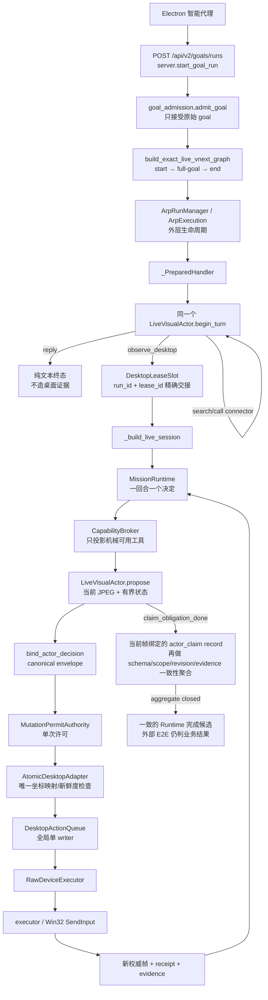
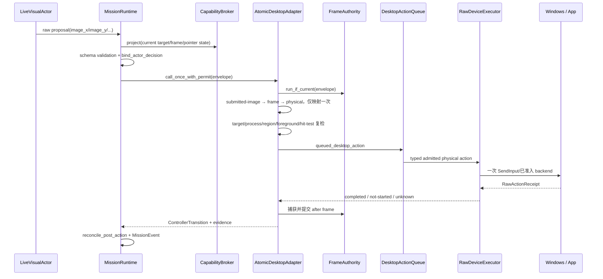
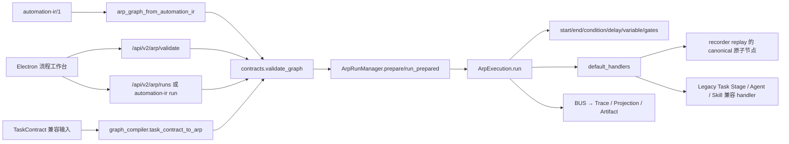
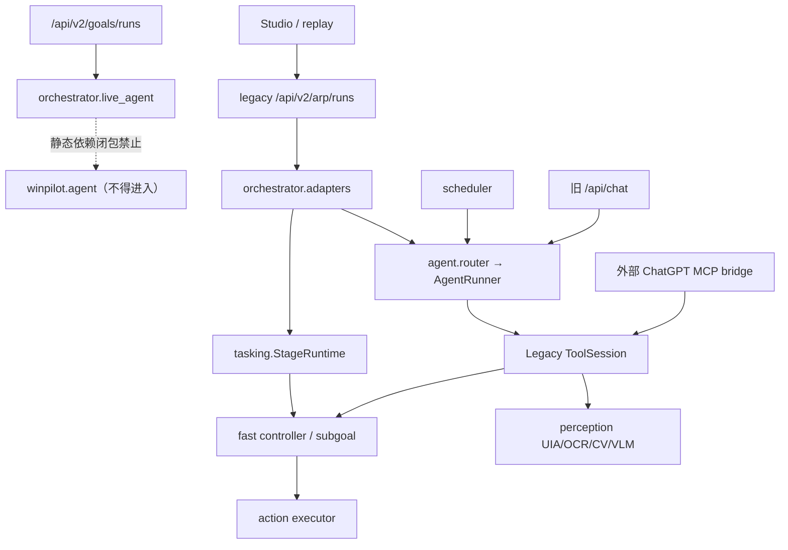

# 06. WinPilot Python 核心逐文件精确讲解

> 审计快照：`master` / `e54d0a97f6cf332daf012c98bf3b8947f8ed9714`，2026-08-02。
> 本文只描述这个提交中真实存在的代码，不把路线图、历史实验或模型声明写成已实现能力。

## 1. 范围、计数和阅读约定

本章的硬覆盖口径是：

```powershell
$files = git ls-files -z -- 'python/winpilot_home/winpilot/**' |
  ForEach-Object { $_ -split "`0" } |
  Where-Object { $_ }
$files.Count # 209 = 206 Python + baseline JSON + 2 bundled Everything files
git ls-files -- 'python/winpilot_home/serve.py' # 1
```

因此正文逐一解释 **206 个 `winpilot/**.py` 文件**，并额外解释评测历史快照、Bundled
Everything CLI/许可证，以及唯一受支持的 Python 启动器 `serve.py`，合计 **210 个文件**
（其中 207 个 Python 文件）。`CON` 不在 Git 中，也没有被读取或
触碰。逐文件的行数、字节数、SHA-256、完整 AST 顶层符号和机械静态 import 另见
[`generated-file-inventory.md`](generated-file-inventory.md)；本文负责机械索引无法回答的
职责、调用关系、主链/兼容边界和通俗流程。

每个文件条目遵循相同格式：

- **归属**：`主链` 是当前 Electron「智能代理」的 live vNext 路径；`共享` 是主链与其他
  路径共同使用的机械基础；`Studio/ARP` 是流程编辑、确定性运行或兼容图入口；`Legacy`
  是仍可被旧 API、scheduler、MCP 或测试调用但禁止回接主链的实现；`测试支撑` 是评测工具。
- **入口**：列出主要类/函数，不声称列出的就是文件内全部私有 helper；完整符号在机械索引。
- **依赖 → 调用者**：依赖列优先列直接 project-local import，并标出关键第三方/OS 边界；
  调用者列写直接产品消费者或明确的动态入口。测试调用者不在每一条重复展开。

## 2. 先理解四条真实边界

### 2.1 当前唯一产品主链



关键事实：`ArpExecution` 没有替模型规划桌面动作；它只执行三节点规范图并管理状态、暂停、
取消与 trace。真正的语义决定始终在同一个 `LiveVisualActor`；真正的物理输入始终经过
`AtomicDesktopAdapter → DesktopActionQueue → RawDeviceExecutor → executor`。

### 2.2 一笔视觉动作如何落到物理桌面



这里故意没有 OCR snapping、控件中心吸附、全局 offset 或答案修正。模型参数、canonical
参数、`physical_attempt` 和外部应用状态可逐层比较；第一处分歧在哪一层，只改哪一层。

### 2.3 Studio / ARP 确定性流程



Studio 保存的是图或 Automation IR；它不会因为“打开文件”就自动运行。当前
`ArpNodeKind.LEGACY_FLOW` 仅用于读旧数据，`validate_graph` 对它 fail closed；已经没有
`legacy.flow` capability、默认 handler 或六类隐式 action 翻译。

### 2.4 Legacy 边界，不是第二条产品 fallback



`agent/`、`fast/`、大部分 `perception/`、`tasking/` 并非“没有用”，而是仍有明确兼容消费者；
但它们不能被描述成当前 live vNext 的视觉决策链，也不能在 vNext 失败时静默接管。

## 3. 通俗伪代码

### 3.1 用户提交一个目标

```text
function start_goal_run(goal, optional_thread_id):
    if Python 源码在服务启动后变化: 拒绝并要求重启
    config = 冻结当前配置快照
    admission = admit_goal(goal, live_vnext_enabled)
    graph = 精确构造 [start, full-goal, end]
    thread_id, turn_id, successful_history = AgentThreadStore.begin_turn(...)
    execution = prepare_live_vnext_execution(graph, empty_inputs, config, history)
    把 execution 放进唯一交互资源队列
    return run_id + thread_id + turn_id + admission audit
```

### 3.2 同一个 Actor 决定是否需要桌面

```text
actor = 创建一次受预算约束的 LiveVisualActor
first = actor.begin_turn(original_goal, successful_history)

if first 是纯文本 reply:
    返回原始文本；不创建 target/frame/physical evidence
else if actor 调用只读 connector:
    把不可信 connector result 返回给同一个 actor，继续决定
else if actor 调用 observe_desktop:
    创建 run-bound desktop lease
    等 Electron 用相同 run_id + lease_id 交付精确窗口
    构造 MissionRuntime 并进入视觉循环
else:
    fail closed
```

### 3.3 MissionRuntime 的一回合

```text
snapshot = state.observe(current_mission, turn_index)
确认 snapshot 的 mission、run、frame、target 都仍匹配
projection = CapabilityBroker.project(snapshot)
turn = project_actor_turn_input(goal, current JPEG, bounded state, recent exchange)
raw = LiveVisualActor.propose(turn)
proposal = parse_actor_proposal(raw)
再次确认权威状态没有在模型思考期间变化
校验 proposal 所选工具在 Broker 投影中且参数满足严格 schema
envelope = bind_actor_decision(proposal + frame/target/mission identities)

if proposal 是 desktop_action:
    用单次 permit 调 AtomicDesktopAdapter；绝不在这里重放输入
    校验 Raw receipt，捕获 after frame，写 evidence，归并 MissionEvent
else if proposal 是 claim_obligation_done:
    将 claim 绑定当前帧 evidence，直接形成 verifier_kind=actor_claim 的 obligation record
    再机械聚合 schema、scope、revision 和 evidence 引用；闭合后进入 VERIFIED
else if proposal 是 blocked:
    写入明确 blocker 并终止
else:
    拒绝
```

当前最小 Runtime 明确禁止配置独立 obligation/mission verifier；上述聚合不重新判断业务语义，
语义 owner 仍是 Actor claim。只有外部 E2E oracle 能判断用户任务是否真的完成。

### 3.4 AtomicDesktopAdapter 的一笔动作

```text
严格解析动作参数
若有图片坐标:
    submitted-image 坐标 -> 当前 frame 坐标 -> 物理屏幕坐标（唯一一次映射）
确认 envelope 仍绑定同一 target、frame、epoch 和 pointer lease
在 FrameAuthority 锁定当前帧
复检 hwnd/process/region/foreground/hit-test
消费一次 MutationPermit
先记录 canonical admission 和 physical_attempt
通过 DesktopActionQueue 调一次 RawDeviceExecutor
记录不可改写的 raw receipt
若输入已执行，等待稳定并捕获 after frame
生成 action-effect evidence；不把像素变化当用户目标完成
任何“可能已执行但无法证明”的情况返回 UNKNOWN，并关闭继续 mutation 的安全边界
```

### 3.5 通用 ARP 图执行

```text
validate_graph(graph)
current = 唯一 start 节点
while current:
    响应 cancel / pause
    检查节点访问次数
    builtin 节点直接执行；其他节点查 handler
    按节点 retry 合同运行（物理副作用是否可重试由更底层 receipt 决定）
    保存 output、规范化 evidence、发布 node_done
    按 result.branch 选下一条边
    到 end 时：TaskContract 图做完整 completion gate；普通图做 evidence gate
    没有合法边或 handler 失败则整 run FAILED
finally:
    清理 action session / communication adapter，发布 arp_run_done
```

## 4. 逐文件目录

以下 210 条是人工语义索引；顺序按目录和职责排列。

### 4.1 根模块、受支持启动器与 bundled 搜索工具（11）

- [`python/winpilot_home/serve.py`](../../python/winpilot_home/serve.py) — **共享/启动**。
  唯一受支持的 Python 启动器；`main()` 设置路径、控制 token 和托管标志后调用
  `uvicorn.run("winpilot.server:app", ...)`。直接依赖 `uvicorn/os/secrets/sys`；由 Electron
  sidecar、开发脚本或人工启动调用，禁止用裸 `uvicorn winpilot.server:app` 替代它。
- [`winpilot/__init__.py`](../../python/winpilot_home/winpilot/__init__.py) — **共享**。
  导入包时调用 `ensure_process_dpi_awareness()`，导出同名函数；直接依赖
  `utils.dpi`，被 server、memory 和 legacy system tools 等所有 `import winpilot` 消费者触发。
- [`winpilot/automation_ir.py`](../../python/winpilot_home/winpilot/automation_ir.py) —
  **Studio/ARP**。`automation_ir_from_wps`、`wps_from_automation_ir`、
  `validate_automation_ir`、`arp_graph_from_automation_ir` 在 `wps/2`、规范
  `automation-ir/1` 与可执行 ARP 图之间做纯转换，并计算 projection fingerprint；仅依赖
  stdlib `copy/hashlib/json/time/uuid`，由 `server` 的 Automation IR API 与
  `recorder.trace` 导出器调用。
- [`winpilot/config.py`](../../python/winpilot_home/winpilot/config.py) — **共享**。
  `Config` 是线程安全的 `config.json` load/save/snapshot/update owner；
  `_canonicalize_live_agent_config` 拒绝 retired selector 冲突。只依赖 stdlib；几乎所有
  runtime、legacy perception/action 和 server 读取它，主链在 admission 前冻结 snapshot。
- [`winpilot/model_adapter.py`](../../python/winpilot_home/winpilot/model_adapter.py) — **共享**。
  定义 provider/model 元数据、OpenAI-compatible facade、vision 能力判断、usage/cost
  归一化；主要入口为 `native_provider_protocol`、`build_model_adapter`、
  `accumulate_usage`。只依赖 stdlib；`orchestrator.live_agent`、legacy Agent/VLM 和
  Tasking 辅助模型调用它。
- [`winpilot/runtime_info.py`](../../python/winpilot_home/winpilot/runtime_info.py) — **共享**。
  `runtime_fingerprint()` 汇总 Git/source/config/module 状态，`runtime_source_drifted()` 阻止
  热改代码后继续接新 run；依赖 `config` 与 `git/importlib/pathlib`，由 `server` 和 Legacy
  `AgentRunner` 调用。
- [`winpilot/runtime_jobs.py`](../../python/winpilot_home/winpilot/runtime_jobs.py) — **共享**。
  `RuntimeJob` 与 `RuntimeJobManager` 提供异步 job、取消和显式 resource lease；依赖
  `utils.log`，由 `server` 承载 ARP、flow fragment、评测和其他后台作业。
- [`winpilot/scheduler.py`](../../python/winpilot_home/winpilot/scheduler.py) — **Legacy**。
  JSON 持久化计划任务的 CRUD、到期扫描和 started/skipped/finished 状态；依赖 `config`
  和 stdlib，由 `server` 以 `from . import scheduler` 动态消费，不属于 live vNext 选择链。
- [`winpilot/server.py`](../../python/winpilot_home/winpilot/server.py) — **主链控制平面 + 兼容面**。
  FastAPI/WS/static UI composition root。主入口 `start_goal_run`、
  `bind_goal_desktop_lease`、`_start_arp_execution`；Studio 入口包含 ARP validate/run、
  Automation IR、Task Contract compile；还保留 `/api/chat`、scheduler、recorder、MCP 等
  Legacy API。直接依赖 `orchestrator.*`、`runtime_jobs`、`tasking`、`recorder`、`action`
  等；由 `serve.py`/Electron 启动并由 Renderer HTTP 调用。
- [`winpilot/bin/ES-LICENSE.txt`](../../python/winpilot_home/winpilot/bin/ES-LICENSE.txt) —
  **第三方许可证资产**。随 bundled Everything `es.exe` 分发的 voidtools ES MIT 许可文本；运行时不解析它，
  但发布包必须保留它以维持第三方归属与再分发合规。
- [`winpilot/bin/es.exe`](../../python/winpilot_home/winpilot/bin/es.exe) — **共享 bundled 二进制**。
  Voidtools Everything 的命令行搜索客户端；`perception/search.py` 优先调用它获取已索引
  文件结果，不可用时才退回有界 `os.scandir`。它不是 Agent planner，也不执行 GUI 动作。

### 4.2 `action/`：物理输入与旧验证（8）

- [`action/__init__.py`](../../python/winpilot_home/winpilot/action/__init__.py) — **共享命名空间**。
  空文件，无定义或 import；大量 Legacy 模块以 `from winpilot import action` 后访问已加载
  子模块，不能把它当 API 实现。
- [`action/desktop_queue.py`](../../python/winpilot_home/winpilot/action/desktop_queue.py) — **主链共享**。
  `DesktopActionQueue` 和 `queued_desktop_action` 实现物理桌面资源的全局单 writer、冲突
  队列、取消、等待和嵌套 action 合并。直接依赖 `utils.log`；被 `action.executor`、
  `fast.controller`、`server` 与 `vnext.desktop_adapter.atomic` 调用。
- [`action/executor.py`](../../python/winpilot_home/winpilot/action/executor.py) — **主链共享 + Legacy
  公共底座**。Win32 `SendInput`、窗口 focus/launch/close、剪贴板、截图和底层 mouse/key
  实现；主链只注入 `execute_admitted_physical_click/drag/scroll/type_text/hotkey` 五组 backend，
  旧调用面还使用 `click/drag/type_text/press_keys` 等。直接依赖 `desktop_queue`、
  `raw_device`、`config`、`utils.log` 及 `ctypes/pywin32`；主链由 `live_agent` 组合，Legacy
  tools/fast 经 `action` 包调用。
- [`action/raw_device.py`](../../python/winpilot_home/winpilot/action/raw_device.py) — **主链**。
  定义 `RawActionContext/Receipt`、typed backend protocols 与 `RawDeviceExecutor`；每个
  `scroll/click/drag/type_text/hotkey` 只执行已准入的物理 payload，并维护 held-drag owner。
  直接依赖 `replay_policy`、`visual_runtime.keyboard_contracts`；被 `executor`、
  `live_agent` 和 `AtomicDesktopAdapter` 调用。
- [`action/replay_policy.py`](../../python/winpilot_home/winpilot/action/replay_policy.py) — **共享合同/待接线策略**。
  `MutationOutcome` 被 `RawDeviceExecutor` 与 `AtomicDesktopAdapter` 共享；
  `decide_action_replay()` 将 `completed/not_started/unknown` 映射为
  `return_success/retry/reject/stop_uncertain`，但当前只有测试直接调用它，尚无生产消费者。
- [`action/safety.py`](../../python/winpilot_home/winpilot/action/safety.py) — **Legacy**。
  `evaluate/guard` 按 shell 命令破坏性和 `approve_mode` 做旧安全门；依赖 `config/log`，当前
  live vNext 没有 shell 工具，静态产品调用者为空。
- [`action/shell.py`](../../python/winpilot_home/winpilot/action/shell.py) — **Legacy**。
  `run`、`run_detached` 管理 cmd/PowerShell 子进程、超时、截断和进程树清理；依赖
  `action`（安全检查）、`config/log`，通过 Legacy ToolSession 的动态路径消费，主链不导入。
- [`action/verify.py`](../../python/winpilot_home/winpilot/action/verify.py) — **Legacy**。
  `check`、`post_state_summary`、`run_with_verify` 是旧 Action→Verify→Retry 引擎，组合
  OCR/UIA/window/color/stability/groundtruth probe；依赖 `config/perception/screenshot/log`。完整
  verify engine 由 `agent.interaction_tools`、`agent.system_tools` 与 `recorder.trace` 调用；
  `agent.desktop_tools`、`fast.subgoal` 只复用私有 `_match_visible_text` helper。它不能冒充
  vNext mission completion。

### 4.3 `modeling/`：唯一模型 transport/retry owner（6）

- [`modeling/__init__.py`](../../python/winpilot_home/winpilot/modeling/__init__.py) — **主链共享 API**。
  重导出 request contracts、OpenAI client、native provider adapter、`ModelCallRuntime` 与
  `invoke_chat_completion`；直接依赖本包其余五个模块，被 live Visual Actor 及 Legacy
  planner/VLM/tasking 辅助调用。
- [`modeling/chat.py`](../../python/winpilot_home/winpilot/modeling/chat.py) — **共享**。
  `invoke_chat_completion()` 把 OpenAI-compatible 调用封装成 `ModelRequestEnvelope` 并交给
  `ModelCallRuntime`；直接依赖 `contracts/runtime`，经 `modeling` 门面被调用。
- [`modeling/contracts.py`](../../python/winpilot_home/winpilot/modeling/contracts.py) — **主链共享**。
  `ModelRetryPolicy`、`ModelRequestEnvelope`、`ModelAttempt`、`classify_followup` 定义版本化
  请求 fingerprint、retry/poll/redecision 合同；无项目内依赖，被 `chat/runtime/live_agent`
  和门面导入。
- [`modeling/openai_transport.py`](../../python/winpilot_home/winpilot/modeling/openai_transport.py) —
  **主链共享**。`create_openai_client()` 构造 SDK retry=0 的 OpenAI-compatible client；由
  `modeling` 门面与 `live_agent._build_actor_resources` 调用。
- [`modeling/provider_protocols.py`](../../python/winpilot_home/winpilot/modeling/provider_protocols.py) —
  **主链 provisional**。`ProviderProtocolAdapter`、`build_provider_request`、
  `normalize_provider_response` 显式转换 Responses、Anthropic Messages、Gemini
  generateContent wire 和原生 tool/signature sidecar；无项目内依赖，由 `live_agent` 在
  明确 `api.protocol/api_style` 时创建，三条 native wire 尚无真实 credential E2E。
- [`modeling/runtime.py`](../../python/winpilot_home/winpilot/modeling/runtime.py) — **主链共享**。
  `ModelCallRuntime.execute()` 是唯一 transport retry loop，产出 `ModelCallOutcome/Error` 和
  per-attempt telemetry；直接依赖 `contracts`，由 `chat`、`live_agent` 和门面调用。

### 4.4 `orchestrator/`：Goal、ARP 和产品组合（11）

- [`orchestrator/__init__.py`](../../python/winpilot_home/winpilot/orchestrator/__init__.py) — **共享门面**。
  重导出 `ArpGraph/Node/Edge`、全局 `ARP_RUNS`、`RUN_PROJECTIONS` 和 `NodeResult`；直接依赖
  `contracts/runtime/projection`，由 server 与集成测试消费。
- [`orchestrator/adapters.py`](../../python/winpilot_home/winpilot/orchestrator/adapters.py) —
  **Studio/ARP + Legacy**。`default_handlers()` 把 `AGENT_GOAL/TASK_STAGE/ACTION_BATCH/
  REPLAY_STEP/SKILL_REPLAY` 映射到旧 Runner、StageRuntime、ToolSession、Recorder/Memory；
  `finalize_memory_feedback` 收尾经验反馈。直接依赖 `agent.*`、`tasking.stage_runtime`（函数内
  lazy import）、`recorder/memory`；仅由 `server` 的 Legacy ARP 分支动态调用，vNext 不用它。
- [`orchestrator/agent_threads.py`](../../python/winpilot_home/winpilot/orchestrator/agent_threads.py) —
  **主链**。`AgentThreadStore` 管理一个 Thread 只能有一个活动 Turn、run 绑定、成功消息的
  12 条/16 KiB 投影和最多 100 Thread 的原子 checkpoint；依赖 `utils.log`，由 `server`
  admission、event 回调和 thread 查询 API 调用。
- [`orchestrator/catalog.py`](../../python/winpilot_home/winpilot/orchestrator/catalog.py) —
  **Studio/ARP**。`capability_catalog()` 返回编辑器可见的 typed 节点目录；直接依赖
  `contracts.CapabilitySpec`，由 server 的 platform/capabilities API 调用。已不广告
  `legacy.flow`。
- [`orchestrator/contracts.py`](../../python/winpilot_home/winpilot/orchestrator/contracts.py) —
  **共享合同**。定义 `ArpNodeKind/RunStatus/RuntimeVersion`、Pydantic graph/request/evidence
  模型和 `validate_graph()`；直接依赖 `fast.action_contract` 以校验 batch action。被 server、
  ARP runtime/catalog/evidence/compiler/live_agent、Tasking 和 MCP bridge 广泛调用；
  `LEGACY_FLOW` 只可反序列化，验证时明确迁移失败。
- [`orchestrator/evidence.py`](../../python/winpilot_home/winpilot/orchestrator/evidence.py) —
  **Studio/ARP**。`normalize_evidence`、`parse_requirement`、`evidence_matches`、
  `has_verified_evidence` 处理通用图 evidence gate；依赖 `contracts`，由 `ArpExecution` 调用。
- [`orchestrator/goal_admission.py`](../../python/winpilot_home/winpilot/orchestrator/goal_admission.py) —
  **主链**。`GoalRunRequest` 只含 goal/optional thread；`admit_goal()` 固定选择
  `LIVE_AGENT + VNEXT` 并写 no-legacy audit，`bind_client_execution_context` 在生成图后才
  绑定桌面上下文。依赖 `contracts`，由 `server` 的 goal/lease API 调用。
- [`orchestrator/graph_compiler.py`](../../python/winpilot_home/winpilot/orchestrator/graph_compiler.py) —
  **Studio/ARP + Legacy**。`task_contract_to_arp()` 将 typed stages 投影为 `TASK_STAGE` 图，
  `legacy_goal_graph_task()` 识别旧单 AGENT_GOAL 图以重编译；依赖
  `contracts/tasking.contracts`，由 server 的 compile 与 Legacy ARP admission 调用。
- [`orchestrator/live_agent.py`](../../python/winpilot_home/winpilot/orchestrator/live_agent.py) —
  **当前产品 composition root**。主要入口 `build_exact_live_vnext_graph`、
  `prepare_live_vnext_execution`、`DesktopLeaseSlot`、`propose_live_flow_fragment`；内部
  `_PreparedHandler` 先让同一 Actor reply/connector/observe，再按需构造
  MissionRuntime、FrameAuthority、Broker、Atomic adapter、RawDevice 和 durable evidence。
  直接依赖 `action.executor/raw_device`、`modeling`、`connector_gateway`、`visual_runtime`、
  `vnext.*`、`orchestrator.runtime`；由 server 通过函数内 lazy import 调用。其内部依赖闭包
  禁止任何 `winpilot.agent` 边。
- [`orchestrator/projection.py`](../../python/winpilot_home/winpilot/orchestrator/projection.py) —
  **共享可观测性**。`RunProjectionStore` 订阅 event bus，把 Agent/controller/replay/ARP
  事件压成有界 current/list/detail 投影并可从 trace 目录水合；依赖 `utils.log`，由
  `orchestrator` 门面、server 和 MCP bridge 调用。
- [`orchestrator/runtime.py`](../../python/winpilot_home/winpilot/orchestrator/runtime.py) —
  **主链外壳 + Studio/ARP**。`ArpExecution.run()` 执行图、retry、branch、暂停/取消、人类门、
  evidence/TaskContract completion gate；`ArpRunManager` 注册和驱动 run。直接依赖
  `contracts/evidence/log`，由 server、live_agent、adapters、Tasking 及门面调用。主链只给
  精确 `AGENT_GOAL` 注入 `_PreparedHandler`，不会使用通用 Legacy handler 表。

### 4.5 `visual_runtime/`：新旧共享的帧与坐标机械 owner（6）

- [`visual_runtime/__init__.py`](../../python/winpilot_home/winpilot/visual_runtime/__init__.py) —
  **主链共享门面**。重导出 `FrameObserver` 和两种 coordinate mapper；直接依赖
  `frame_observer/normalized_frame_coordinates/submitted_image_coordinates`，被 vNext adapter
  与测试消费。
- [`visual_runtime/frame_authority.py`](../../python/winpilot_home/winpilot/visual_runtime/frame_authority.py) —
  **主链共享**。`FrameState` 绑定 id/hwnd/region/epoch/payload hash；`FrameAuthority` 原子
  `commit/current/run_if_current/matches`，让动作只能基于同一权威帧。无项目内依赖；被
  `frame_observer`、`live_agent`、`AtomicDesktopAdapter` 和冻结 Legacy `AgentRunner` 使用。
- [`visual_runtime/frame_observer.py`](../../python/winpilot_home/winpilot/visual_runtime/frame_observer.py) —
  **主链共享**。`FrameObserver.capture/commit` 调 capture callback，生成 `FrameCapture` 并
  发布给 `FrameAuthority`；依赖 `utils.image_capture/screenshot` 与 `frame_authority`，被
  live_agent、Atomic adapter 和 Legacy Agent 调用。
- [`visual_runtime/keyboard_contracts.py`](../../python/winpilot_home/winpilot/visual_runtime/keyboard_contracts.py) —
  **主链共享**。不可变 `HotkeyChord` 校验并规范化键名/修饰键；无项目内依赖，由
  `action.raw_device` 与 vNext schema/测试使用。
- [`visual_runtime/normalized_frame_coordinates.py`](../../python/winpilot_home/winpilot/visual_runtime/normalized_frame_coordinates.py) —
  **主链共享**。`NormalizedFrameCoordinateMapper.map_point()` 把 frame-local 数值映到物理
  capture region；无项目内依赖，由 Atomic adapter 和 Legacy Agent 调用。
- [`visual_runtime/submitted_image_coordinates.py`](../../python/winpilot_home/winpilot/visual_runtime/submitted_image_coordinates.py) —
  **主链共享**。`SubmittedImageCoordinateMapper` 校验 submitted JPEG 尺寸，并把 click、drag、
  strokes、constraint region 从模型看到的图片坐标映到 frame 坐标；无项目内依赖，由
  Atomic adapter 和 Legacy Agent 调用。

### 4.6 `vnext/`：当前 live 内核（44）

- [`vnext/__init__.py`](../../python/winpilot_home/winpilot/vnext/__init__.py) — **主链命名空间**。
  只有“pure, product-unwired kernel”说明和空 `__all__`；没有自动组合副作用，真正产品 wiring
  全在 `orchestrator.live_agent`。

#### `vnext/actor/`（3）

- [`vnext/actor/__init__.py`](../../python/winpilot_home/winpilot/vnext/actor/__init__.py) — **主链门面**。
  汇总重导出 `proposals` 与 `envelope` 的严格合同；直接依赖这两文件，被 model role、runtime、
  adapter 和测试调用。
- [`vnext/actor/envelope.py`](../../python/winpilot_home/winpilot/vnext/actor/envelope.py) — **主链**。
  `ActorDecisionEnvelope` 与 `bind_actor_decision()` 把 identity-free proposal 绑定到 mission/run/
  revision/target/frame/pointer/profile/Broker projection，并 canonicalize 坐标与参数；依赖
  `actor.proposals`、`capabilities`、`mission`、`profiling`、`json_contract`，由 Actor 门面和
  Atomic adapter 使用。
- [`vnext/actor/proposals.py`](../../python/winpilot_home/winpilot/vnext/actor/proposals.py) — **主链**。
  定义 identity-free `DesktopActionProposal`、`ClaimObligationDone`、`BlockedReport` 以及当前
  未开放的 observe/capability/inspection/replan 类型；`parse_actor_proposal()` 做 exact wire
  shape、越权字段和 bounded JSON 校验。依赖 `capability_names/json_contract`，由
  `envelope` 和门面调用。

#### `vnext/capabilities/` 与名称（6）

- [`vnext/capabilities/__init__.py`](../../python/winpilot_home/winpilot/vnext/capabilities/__init__.py) —
  **主链门面**。重导出 catalog/grant/state/argument validator 与 `CapabilityBroker`；被
  live_agent、MissionRuntime、Atomic adapter 和 runtime contracts 使用。
- [`vnext/capabilities/argument_validation.py`](../../python/winpilot_home/winpilot/vnext/capabilities/argument_validation.py) —
  **主链**。`ToolArgumentValidator.validate()` 针对 Broker catalog 的 JSON schema 做确定性、
  fail-closed 参数验证并拒绝非本地引用；依赖 `contracts/json_contract`，由 actor envelope 和
  capabilities 门面调用，MissionRuntime 经门面使用。
- [`vnext/capabilities/broker.py`](../../python/winpilot_home/winpilot/vnext/capabilities/broker.py) —
  **主链**。`CapabilityBroker.project()` 只按 catalog、profile、target/frame/pointer/artifact
  机械状态生成 `BrokerProjection` 和 grants；不读取 goal、截图语义或应用名。依赖本包
  contracts/state、`capability_names/mission/profiling`，由门面进 MissionRuntime。
- [`vnext/capabilities/contracts.py`](../../python/winpilot_home/winpilot/vnext/capabilities/contracts.py) —
  **主链合同**。定义 `ToolSpec/ToolCatalog/CapabilityGrant` 与 `ToolRoute/ExecutionRoute/
  ExecutionMedium/MutationKind/PointerDisposition`，含 canonical fingerprint/serialization；
  依赖 `capability_names/json_contract`，被 validator、broker、state 和门面调用。
- [`vnext/capabilities/state.py`](../../python/winpilot_home/winpilot/vnext/capabilities/state.py) —
  **主链合同**。不可变 `TargetState/AuthoritativeFrameState/PointerLeaseState/ArtifactState/
  ExecutorOffer/BrokerRuntimeState/BrokerProjection` 及稳定 projection id；依赖 `contracts`，
  由 broker、门面和 Actor/runtime 测试调用。
- [`vnext/capability_names.py`](../../python/winpilot_home/winpilot/vnext/capability_names.py) — **主链共享**。
  `canonical_capability/canonical_capabilities` 是无重量的能力名唯一 owner；只依赖 `re`，被
  actor、broker/contracts、profiling 和 evidence contracts 调用。

#### `vnext/desktop_adapter/`（3）

- [`vnext/desktop_adapter/__init__.py`](../../python/winpilot_home/winpilot/vnext/desktop_adapter/__init__.py) —
  **主链门面**。重导出 `AtomicDesktopAdapter`、target/workspace protocols 与
  `DesktopWorkspace`；直接依赖 `atomic/workspace`，由 `live_agent` 组合。
- [`vnext/desktop_adapter/atomic.py`](../../python/winpilot_home/winpilot/vnext/desktop_adapter/atomic.py) —
  **主链物理桥**。`AtomicDesktopAdapter.execute()` 对一个 bound envelope 做 exact schema、
  target/frame/pointer 新鲜度、唯一坐标映射、permit admission、queued RawDevice 调用、
  before/after frame、raw receipt 与 action-effect evidence；异常时释放 held pointer，绝不
  自动重放输入。直接依赖 `action.desktop_queue/raw_device/replay_policy`、`visual_runtime.*`、
  `vnext.actor/capabilities/evidence_plane/mission/runtime/verification`；由门面和 workspace 引用，
  实例由 `live_agent._build_live_session` 创建。
- [`vnext/desktop_adapter/workspace.py`](../../python/winpilot_home/winpilot/vnext/desktop_adapter/workspace.py) —
  **主链**。`DesktopWorkspace` 在动作间维护同一进程 owner window、modal/popup/消失后回 owner
  的机械 surface 状态；`observe/validate/discard/adopt/finish_action` 不解释界面内容。依赖
  `atomic` protocols 与 `mission.TargetBinding`，由 `live_agent` 创建并同时作为 state/target
  probe 注入 adapter。

#### `vnext/evidence/`（2）

- [`vnext/evidence/__init__.py`](../../python/winpilot_home/winpilot/vnext/evidence/__init__.py) —
  **主链门面**。只重导出 run-scoped `EvidenceRegistry` 及异常；被 live_agent、MissionRuntime
  和 post-action reconcile 调用。
- [`vnext/evidence/registry.py`](../../python/winpilot_home/winpilot/vnext/evidence/registry.py) —
  **主链**。线程安全 `EvidenceRegistry.append/append_many/snapshot/close` 只存已经构造并通过
  scope 校验的 `mission.EvidenceRef`，拒绝错 mission/run 和重复 id；依赖 `mission.contracts`，
  由 evidence 门面消费。

#### `vnext/evidence_plane/`（5）

- [`vnext/evidence_plane/__init__.py`](../../python/winpilot_home/winpilot/vnext/evidence_plane/__init__.py) —
  **主链门面**。汇总 canonical records、frame artifact、journal 与 plane；被 live_agent、
  MissionRuntime 和 Atomic adapter 使用。
- [`vnext/evidence_plane/artifacts.py`](../../python/winpilot_home/winpilot/vnext/evidence_plane/artifacts.py) —
  **主链证据持久化**。`FrameArtifactWriter` 在一个 run 目录中原子写入/只读重放 JPEG，校验
  role、frame identity、URI、SHA 和目录安全；只依赖 stdlib filesystem/hash/base64，由
  evidence plane 与持久化测试调用。
- [`vnext/evidence_plane/contracts.py`](../../python/winpilot_home/winpilot/vnext/evidence_plane/contracts.py) —
  **主链证据合同**。定义 `ActorDecisionRecord/AdmissionRecord/PhysicalAttemptRecord/
  ActionExecutionBinding/FrameArtifactReference/RuntimeEvidenceReport`，并严格 canonicalize raw
  receipt 与 controller transition、拒绝推理字段；依赖 `capability_names/json_contract/mission`，
  由 `plane` 和门面调用。
- [`vnext/evidence_plane/journal.py`](../../python/winpilot_home/winpilot/vnext/evidence_plane/journal.py) —
  **主链 durable journal**。`RuntimeEvidenceJournal` 用 canonical JSONL 和前一事件 hash 构成
  append-only hash chain，支持 create/open_read_only/replay/close 并 poison 写失败实例；依赖
  `json_contract` 与 stdlib fs/hash，供 `plane/live_agent` 使用。
- [`vnext/evidence_plane/plane.py`](../../python/winpilot_home/winpilot/vnext/evidence_plane/plane.py) —
  **主链证据状态机**。`RuntimeEvidencePlane` 顺序绑定 actor decision → admission → reserved
  physical attempt → raw receipt → controller transition → seal/report，强制每个 id/sha/run
  一致；依赖本包 artifacts/contracts/journal，由门面、live_agent 和 Atomic adapter 调用。

- [`vnext/json_contract.py`](../../python/winpilot_home/winpilot/vnext/json_contract.py) — **主链共享**。
  `bounded_json_copy/freeze_bounded_json` 对 canonical JSON 做深度、项数、字符串、数值和总预算
  限制，并冻结为不可变结构；无项目内依赖，几乎被所有 vNext wire/mission/runtime/
  verification contracts 复用。

#### `vnext/mission/`（3）

- [`vnext/mission/__init__.py`](../../python/winpilot_home/winpilot/vnext/mission/__init__.py) —
  **主链门面**。重导出 mission contracts、`MissionReducer/reduce_projection/replay`；被
  live_agent、broker、runtime、adapter、evidence plane 和 verification 使用。
- [`vnext/mission/contracts.py`](../../python/winpilot_home/winpilot/vnext/mission/contracts.py) —
  **主链状态合同**。定义 `MissionDefinition/Event/Projection/Card`、obligation/status、
  `EvidenceRef/ArtifactRef/TargetBinding/VerifiedFact/ActionEffectSummary` 及严格事件 payload/
  topological order 规则；依赖 `json_contract`，由 reducer、registry 和门面调用。
- [`vnext/mission/reducer.py`](../../python/winpilot_home/winpilot/vnext/mission/reducer.py) — **主链**。
  `reduce_projection()`/`MissionReducer.apply` 是纯 event-sourced reducer，校验 revision、依赖、
  evidence scope、claim fingerprint、verification 和合法状态转换；只依赖 mission contracts，
  由门面进 `live_agent/MissionRuntime`。

#### `vnext/model_roles/`（3）

- [`vnext/model_roles/__init__.py`](../../python/winpilot_home/winpilot/vnext/model_roles/__init__.py) —
  **主链门面**。导出 `LiveVisualActor`、短命 `FlowFragmentProposer`、视觉 45-word system
  contract 与预算常量；依赖 `common/visual_actor`，由 live_agent 创建。
- [`vnext/model_roles/common.py`](../../python/winpilot_home/winpilot/vnext/model_roles/common.py) —
  **主链共享**。`require_text/positive_timeout/jpeg`、`strict_json_object`、`response_message` 等
  fail-closed parsing helper 和模型上限；无项目内依赖，被 visual actor 与门面调用。
- [`vnext/model_roles/visual_actor.py`](../../python/winpilot_home/winpilot/vnext/model_roles/visual_actor.py) —
  **主链语义 owner**。`LiveVisualActor.begin_turn` 在零系统提示文本首轮处理 reply、显式
  connector search/call 或 `observe_desktop`；`propose` 在视觉轮把当前 JPEG、有界 mission
  state、最近原生 exchange 送给同一模型并返回严格 proposal。`FlowFragmentProposer` 是隔离、
  无桌面/Thread/connector/执行权的单次 Studio 辅助。依赖 `modeling`、`actor`、`common`、
  `runtime.contracts`；由 model_roles 门面进 live_agent。

#### `vnext/profiling/`（3）

- [`vnext/profiling/__init__.py`](../../python/winpilot_home/winpilot/vnext/profiling/__init__.py) —
  **主链合同门面**。导出 profile proposal/contracts 与 `ExecutionPolicy`；被 live_agent、broker、
  Actor envelope 和 MissionRuntime 使用。当前主链采用 `safe_default`，没有第二 profiler 模型。
- [`vnext/profiling/contracts.py`](../../python/winpilot_home/winpilot/vnext/profiling/contracts.py) —
  **主链合同**。定义 `TaskDimensions/CognitiveServices/ProfileTrigger/TaskProfileProposal/
  ExecutionProfile`、depth 和结构 fingerprint，并拒绝 forbidden/unsupported capability；依赖
  `capability_names/json_contract`，由 policy 和门面调用。
- [`vnext/profiling/policy.py`](../../python/winpilot_home/winpilot/vnext/profiling/policy.py) — **主链**。
  `ExecutionPolicy.safe_default/evaluate/validate_proposal` 只接受明确 available capabilities 和
  mission identity；依赖 profiling contracts、capability names、json contract。live_agent 用
  它构造仅含 `visual.interact` 的 profile，不按任务分类。

#### `vnext/runtime/`（8）

- [`vnext/runtime/__init__.py`](../../python/winpilot_home/winpilot/vnext/runtime/__init__.py) —
  **主链门面**。汇总 runtime contracts、ports、mutation permits/call-once、reconcile 与
  `MissionRuntime`；被 live_agent 和 Atomic adapter 使用。
- [`vnext/runtime/contracts.py`](../../python/winpilot_home/winpilot/vnext/runtime/contracts.py) —
  **主链合同**。定义 frame/target/commit identity、`RuntimeFrame/Snapshot`、Actor 视图和
  `ActorTurnInput`、`ControllerTransition/Outcome`、`RuntimeStatus/Result`；
  `project_actor_turn_input` 生成给模型的有界视图。依赖 `capabilities/json_contract/mission/
  task_state`，被 MissionRuntime、ports、model role 和 reconcile 调用。
- [`vnext/runtime/mission_runtime.py`](../../python/winpilot_home/winpilot/vnext/runtime/mission_runtime.py) —
  **主链循环 owner**。`MissionRuntime.run_one_turn()` 顺序执行 observe → Broker → Actor →
  proposal parse/schema → envelope → action/claim/blocked；`_run_action` 通过 single-use permit
  call-once 调 controller，按 receipt 做 stale/unknown/completed 处理并写 mission events；
  不编译任务步骤或纠正模型。直接依赖 actor/capabilities/evidence/evidence_plane/mission/
  profiling/runtime helpers/verification 和 `utils.log`；由 runtime 门面进 live_agent。
- [`vnext/runtime/mutation_attempt.py`](../../python/winpilot_home/winpilot/vnext/runtime/mutation_attempt.py) —
  **主链机械壳**。`call_once_with_permit()` 最多调用一次 controller，并返回调用次数、异常、
  pending permit 是否撤销、active admission 是否关闭；依赖 actor、runtime contracts、
  mutation_permits，由 MissionRuntime 调用。
- [`vnext/runtime/mutation_permits.py`](../../python/winpilot_home/winpilot/vnext/runtime/mutation_permits.py) —
  **主链**。`MutationPermitAuthority` 按 run/mission/decision/turn/commit identity 发行、开始、
  重验、完成、撤销单次 permit，并在 unknown outcome 后关闭 mutation authority；依赖 actor
  envelope 和 runtime contracts，由 MissionRuntime、Atomic adapter、call-once helper 使用。
- [`vnext/runtime/ports.py`](../../python/winpilot_home/winpilot/vnext/runtime/ports.py) — **主链接口**。
  Protocol `ActorPort.propose`、`RuntimeStatePort.observe/current`、`ControllerPort.execute`
  定义依赖注入边界；依赖 actor/mission/runtime contracts/task_state，由 MissionRuntime 门面使用。
- [`vnext/runtime/post_action_reconcile.py`](../../python/winpilot_home/winpilot/vnext/runtime/post_action_reconcile.py) —
  **主链**。`validate_controller_evidence_scope` 和 `reconcile_post_action` 检查 controller
  transition 的 mission/run/obligation/action/frame/evidence/pointer-hold 一致性；依赖
  capabilities/evidence/mission/runtime contracts，由 MissionRuntime 调用。
- [`vnext/runtime/task_state.py`](../../python/winpilot_home/winpilot/vnext/runtime/task_state.py) —
  **主链**。不可变 `ActorTaskState`、严格 `ActorTaskStateUpdate` 与 `ActorTurnDecision` 提供
  单 Visual Actor 的小型 scratchpad；无项目内依赖，被 runtime contracts/ports/MissionRuntime
  使用，不是长期 memory 或第二 planner。

#### `vnext/verification/`（6）

- [`vnext/verification/__init__.py`](../../python/winpilot_home/winpilot/vnext/verification/__init__.py) —
  **主链验证门面**。汇总 action effect、obligation/mission contracts、dispatcher 和 ports；
  被 MissionRuntime 与 Atomic adapter 使用。
- [`vnext/verification/action_effect.py`](../../python/winpilot_home/winpilot/vnext/verification/action_effect.py) —
  **主链局部证据**。`DeterministicActionEffectVerifier.verify()` 解码同目标 before/after frame，
  校验身份后用 OpenCV/Numpy 生成 `ActionEffectSummary` 和 evidence；它只证明局部视觉变化，
  不证明用户任务完成。依赖 `mission` 与 `cv2/numpy`，由 verification 门面进 Atomic adapter。
- [`vnext/verification/contracts.py`](../../python/winpilot_home/winpilot/vnext/verification/contracts.py) —
  **主链合同**。`ObligationVerificationRequest/Result`、`VerifierAssessment` 和 condition coverage/
  consistency/forbidden-effect 规则；依赖 `json_contract/mission`，由 dispatcher、mission
  completion、ports 和门面调用。
- [`vnext/verification/dispatcher.py`](../../python/winpilot_home/winpilot/vnext/verification/dispatcher.py) —
  **vNext 支撑，当前无独立模型角色**。`DeterministicFirstVerifier` 注册 read-only
  `EvidenceEvaluator`，按顺序返回确定结果或明确 missing/inconclusive；只依赖 verification
  contracts，由门面/测试消费，live composition 没有新增 verifier 模型。
- [`vnext/verification/mission_completion.py`](../../python/winpilot_home/winpilot/vnext/verification/mission_completion.py) —
  **主链完成门**。`DeterministicMissionCompletionVerifier` 聚合已接受 obligation verification，
  `MissionCompletionVerificationResult.bind()` 绑定 mission revision/evidence 并生成事件；依赖
  `json_contract/mission/verification.contracts`，由门面进 MissionRuntime。
- [`vnext/verification/ports.py`](../../python/winpilot_home/winpilot/vnext/verification/ports.py) —
  **vNext 接口**。Protocol `ObligationVerifierPort.verify()` 只允许 read-only、可取消的 typed
  verification；依赖 verification contracts，由门面/测试消费。

### 4.7 `integrations/`：外部控制面与 connector（4）

- [`integrations/__init__.py`](../../python/winpilot_home/winpilot/integrations/__init__.py) —
  **共享命名空间**。仅包说明；`connector_gateway` 用相对包 import 取得 `mcp_client`，没有
  自动连接外部服务。
- [`integrations/chatgpt_mcp.py`](../../python/winpilot_home/winpilot/integrations/chatgpt_mcp.py) —
  **Legacy 外部桥**。`ChatGPTDesktopBridge` 与 `build_chatgpt_mcp()` 暴露观察、ToolSession
  dispatch、ARP validate/start、录制/replay/skill 等 MCP 工具，并压缩 UI/controller payload；
  依赖 `action/fast/orchestrator/recorder/tasking/utils` 与 MCP SDK，server 仅在真正创建外部 MCP
  session 时 lazy import。它不是 live Actor 的 connector owner。
- [`integrations/connector_gateway.py`](../../python/winpilot_home/winpilot/integrations/connector_gateway.py) —
  **主链 connector owner**。`ConnectorGateway.available/search/call` 做显式配置、目录有界化、
  opaque ref、readOnly/destructive annotation、descriptor fingerprint 二次核对、result hash/
  receipt；依赖 `mcp_client`，由 `live_agent` 注入同一 `LiveVisualActor`。
- [`integrations/mcp_client.py`](../../python/winpilot_home/winpilot/integrations/mcp_client.py) —
  **主链共享 + Legacy 底层**。解析显式 MCP 配置，建立 stdio/streamable HTTP 连接，
  `discover/call` 在同一物理连接内重检 tool descriptor/annotations；依赖 `config` 和 MCP SDK
  （函数内 import），被 `ConnectorGateway` 及 Legacy `agent.mcp_tools` 调用。

### 4.8 `utils/`：跨路径机械工具（6）

- [`utils/__init__.py`](../../python/winpilot_home/winpilot/utils/__init__.py) — **共享空命名空间**。
  无定义/import；部分旧代码把具体 helper 运行时挂在 `utils` 包上，不应误认为统一门面。
- [`utils/dpi.py`](../../python/winpilot_home/winpilot/utils/dpi.py) — **主链共享**。
  `ensure_process_dpi_awareness()` 进程级、幂等选择 Windows DPI awareness；依赖 `ctypes`，由
  根 `winpilot/__init__` 和 screenshot 模块调用。
- [`utils/image_capture.py`](../../python/winpilot_home/winpilot/utils/image_capture.py) — **主链共享**。
  `VisualCaptureScope`、窗口 client region、目标 JPEG、detail crop、ROI diff/color helper；
  依赖 `config/perception.surface_binding/utils` 与 `cv2/numpy/win32gui`。主链由
  `FrameObserver/live_agent` 使用，Legacy Agent/MCP 也复用。
- [`utils/log.py`](../../python/winpilot_home/winpilot/utils/log.py) — **共享可观测性**。
  `EventBus.subscribe/add_sink/publish` 是进程内事件总线和中央 logger；只依赖 stdlib，几乎
  所有 action/agent/fast/perception/orchestrator/server/runtime 模块发布事件，Trace、Projection、
  AgentThreadStore 等订阅。
- [`utils/screenshot.py`](../../python/winpilot_home/winpilot/utils/screenshot.py) — **主链共享**。
  `Region/DesktopGeometry`、virtual/monitor/primary geometry 和基于 `mss` 的 full/window capture；
  依赖 `utils.dpi`、`mss/numpy/ctypes`，被 FrameObserver、Atomic adapter、live_agent 以及
  Legacy perception/action/recorder 广泛调用。
- [`utils/trace_payload.py`](../../python/winpilot_home/winpilot/utils/trace_payload.py) — **共享证据卫生**。
  `sanitize_trace_payload()` 把 base64 图片替换为 frame metadata/hash，并递归限制诊断 payload；
  无项目内依赖，由 Legacy Agent loop 与 `recorder.trace` 写 trace 前调用。

### 4.9 `recorder/`：示教、trace、IR 与零 token replay（5）

- [`recorder/__init__.py`](../../python/winpilot_home/winpilot/recorder/__init__.py) — **Studio/ARP
  命名空间**。空文件；server、MCP bridge、eval、adapters 和本包通过 `recorder.<submodule>`
  访问具体实现。
- [`recorder/apprentice.py`](../../python/winpilot_home/winpilot/recorder/apprentice.py) — **Legacy/Studio**。
  `ApprenticeManager.start/status/stop` 在 human recorder 上包一层 run 生命周期，并可交给
  memory promotion；依赖 `config/memory/recorder`，由 server 的 apprentice API 动态使用。
- [`recorder/human.py`](../../python/winpilot_home/winpilot/recorder/human.py) — **Studio/ARP**。
  `HumanRecorder` 与 `StepBuilder` 监听真实鼠标键盘，把按键聚合成文本、拖动聚合成路径并保存
  带 semantic selector/target window 的 `.wps.json`；依赖 `config/log` 和系统 hook 库，供
  server、apprentice 与集成测试调用。
- [`recorder/replay_control.py`](../../python/winpilot_home/winpilot/recorder/replay_control.py) —
  **Studio/ARP 兼容**。`interpolate/interpolate_step/exec_if/exec_loop/count_leaves` 实现旧 WPS
  控制流和变量展开；无项目内依赖，由 `recorder.trace` 的 replay 路径经包访问。
- [`recorder/trace.py`](../../python/winpilot_home/winpilot/recorder/trace.py) — **共享 trace + Studio/ARP**。
  `TraceRecorder` 持久化事件/证据图；`build_script/build_thread_script` 同时解析 Legacy trace 和
  vNext evidence journal 的 `physical_attempt/raw_receipt`，导出 WPS/Automation IR；后半文件
  校验脚本并执行 0-token replay。直接依赖 `action/automation_ir/fast.visual_servo/memory/
  perception/recorder/utils`，由 server、adapters、MCP、eval 调用。

### 4.10 `eval/`：旧 Agent 级评测工具与历史数据（6）

- [`eval/__init__.py`](../../python/winpilot_home/winpilot/eval/__init__.py) — **测试支撑**。
  仅包说明；被 `eval.__main__` 与 server 评测 API 引用。
- [`eval/__main__.py`](../../python/winpilot_home/winpilot/eval/__main__.py) — **测试支撑 CLI**。
  `main()` 解析 `smoke|full --tasks --save-baseline` 并调 `winpilot.eval.run`；直接依赖包门面，
  由 `python -m winpilot.eval` 调用。
- [`eval/baseline.json`](../../python/winpilot_home/winpilot/eval/baseline.json) — **历史测试数据**。
  保存旧 Agent 评测曾产生的 scorecard：一个早期 3 项摘要，以及以 7 个任务 ID 组成的
  signature 为键的完整结果、run ID、步数、成本和耗时。`eval/runner.py` 通过
  `BASELINE_PATH`、`_load_baselines()` 和 `_compare_baseline()` 读取它，只有显式传入
  `--save-baseline` 才会更新。它是 Legacy 评测的历史比较快照，不是当前 Electron E2E 成功率，
  也不能作为现行产品能力证据。
- [`eval/runner.py`](../../python/winpilot_home/winpilot/eval/runner.py) — **Legacy 测试支撑**。
  `_run_once/run_task/run` 在进程内创建旧 `AgentRunner`、记录 trace、调用 task ground truth、
  比较 baseline 并打印 scorecard；依赖 `agent.loop/config/eval.tasks/recorder`，由 eval CLI/包
  动态调用，不等于 Electron 主链 E2E。
- [`eval/summary.py`](../../python/winpilot_home/winpilot/eval/summary.py) — **测试支撑**。
  `summarize_events/trace/eval_report` 与 `aggregate_reports` 统计延迟、perception dimension、
  fast GUI 和成功率；依赖 `config` 与 stdlib，由 server/eval 工具按需调用。
- [`eval/tasks.py`](../../python/winpilot_home/winpilot/eval/tasks.py) — **测试支撑**。
  `EvalTask`、`suite/by_ids` 以及文件、进程、计算器、timer、clone/compute 的程序化 check 和
  cleanup；依赖 `perception` 与 stdlib，由 `eval.runner` 使用。它的有限任务不能进入生产路由。

### 4.11 `memory/`：Legacy Memory Graph 与 replay 信任（13）

- [`memory/__init__.py`](../../python/winpilot_home/winpilot/memory/__init__.py) — **Legacy 命名空间**。
  空文件；Legacy Agent/tools、recorder、orchestrator adapter 以子模块属性访问。live vNext
  明确 `experience_policy=disabled`，短 Thread history 不在这里。
- [`memory/applicability.py`](../../python/winpilot_home/winpilot/memory/applicability.py) — **Legacy**。
  `build_applicability/runtime_context/evaluate` 和 `task_intent_matches` 比较任务、应用、窗口、
  parameters 与上下文，输出 `ApplicabilityDecision`；无项目内依赖，被 compiler/experience/
  retriever 调用。
- [`memory/compiler.py`](../../python/winpilot_home/winpilot/memory/compiler.py) — **Legacy**。
  `ingest_run()` 从已验证 run 清理步骤、conditions/evidence 并写 Memory Graph；依赖
  `applicability/experience/migration/retriever/store` 与根包/log；冻结的 Legacy `agent.loop`
  静态导入它并在 run 收尾直接调用 `compiler.ingest_run(self)`。当前 vNext 依赖闭包不进入它。
- [`memory/experience.py`](../../python/winpilot_home/winpilot/memory/experience.py) — **Legacy 兼容门面**。
  SQLite Memory Graph 上的 recipe CRUD、hints、feedback、script trust、reusable skill 查找与
  replay 后 promotion；依赖本包 applicability/migration/retriever/runtime/store/types 和根包，
  被 compiler、Legacy Agent/recorder/adapters 经 `memory` 包调用。
- [`memory/feedback.py`](../../python/winpilot_home/winpilot/memory/feedback.py) — **Legacy**。
  `apply_feedback_to_ids/apply_run_feedback` 根据 run payload 调整 Memory node 分数；依赖
  `store/types`，由 experience/adapters 的动态路径使用。
- [`memory/migration.py`](../../python/winpilot_home/winpilot/memory/migration.py) — **Legacy 数据兼容**。
  `migrate_json_if_needed()` 将旧 `experience_memory.json` 变成 graph nodes，保留 conditions、
  evidence、anchors；依赖根包、store/log，被 compiler/experience/runtime 调用。
- [`memory/packer.py`](../../python/winpilot_home/winpilot/memory/packer.py) — **Legacy**。
  `pack()` 把候选 node/steps/script/warning 压成给旧 LLM 的 `MemoryPack`；依赖 `store/types`，
  仅由 memory.runtime 调用。
- [`memory/replay_anchors.py`](../../python/winpilot_home/winpilot/memory/replay_anchors.py) —
  **Studio/ARP 支撑**。按 script SHA/profile 保存、加载本地视觉 anchor cache 和模板名；依赖
  `memory` 包与 stdlib，由 recorder/replay 路径动态调用及测试消费。
- [`memory/retriever.py`](../../python/winpilot_home/winpilot/memory/retriever.py) — **Legacy**。
  `parse_task_frame/recall/expand_graph/top_reusable_skill` 做 hard filters、volatile-state 判断、
  task/window bigram score；依赖 `applicability/store/types`，由 compiler/experience/runtime 调用。
- [`memory/runtime.py`](../../python/winpilot_home/winpilot/memory/runtime.py) — **Legacy**。
  `prepare_run_memory()` 是 migration → parse/recall → pack 的入口；依赖根包和本包
  migration/packer/retriever/store/types，由 `experience`/旧 Agent 经门面调用。
- [`memory/safety.py`](../../python/winpilot_home/winpilot/memory/safety.py) — **Legacy 共享**。
  `sanitize_memory_text/sanitize_payload` 删除已知环境 secrets 和 token-like 内容；无项目内依赖，
  由 `MemoryStore` 所有持久化入口调用。
- [`memory/store.py`](../../python/winpilot_home/winpilot/memory/store.py) — **Legacy 持久化**。
  `MemoryStore` 是线程安全 SQLite schema/meta/node/edge/feedback CRUD owner；依赖根包、
  `memory.safety/types`、log，被 memory compiler/experience/feedback/migration/packer/retriever/
  runtime 调用。
- [`memory/types.py`](../../python/winpilot_home/winpilot/memory/types.py) — **Legacy 合同**。
  dataclass `TaskFrame/MemoryCandidate/MemoryPack`；无项目内依赖，被 store/retriever/packer/
  runtime/experience/feedback 使用。

### 4.12 `agent/`：冻结的统一 AgentRunner 兼容线（35）

这一包仍服务旧 `/api/chat`、scheduler、Legacy ARP、外部 ChatGPT MCP 和部分 Task Stage。
当前 `orchestrator.live_agent` 的静态依赖闭包禁止进入整个包。

- [`agent/__init__.py`](../../python/winpilot_home/winpilot/agent/__init__.py) — **Legacy 空命名空间**。
  无定义/import；loop/tools/mixins 以相对包方式访问子模块。
- [`agent/coding.py`](../../python/winpilot_home/winpilot/agent/coding.py) — **Legacy compatibility shim**。
  `workspace_dir` 与 `CodingRunner` 把已删除 coding sub-agent 兼容为同一个 `AgentRunner` +
  coding runtime profile；依赖 `agent.loop/runtime_profile`，无当前静态产品调用者。
- [`agent/coding_tools.py`](../../python/winpilot_home/winpilot/agent/coding_tools.py) — **Legacy**。
  `coding_tool_schemas`、`CodingSession.dispatch` 提供有界 filesystem/repo/read/fetch 工具；依赖
  `utils.log` 与 pathlib/urllib，由 `agent.tools` 组合。
- [`agent/context_guidance.py`](../../python/winpilot_home/winpilot/agent/context_guidance.py) — **Legacy**。
  `ContextGuidanceMixin` 为旧 Runner 注入 planning/world-model/playbook guidance；依赖
  `gui_plan_helpers/planner/config/log`，由 `AgentRunner` 继承。
- [`agent/desktop_tools.py`](../../python/winpilot_home/winpilot/agent/desktop_tools.py) — **Legacy**。
  `DesktopToolMixin` 处理截图、等待、视觉 probe、剪贴板/图像粘贴等通用桌面工具；依赖
  `action/verify/interaction_tools/tool_result/perception/screenshot`，由 `ToolSession` 继承。
- [`agent/done_verifier.py`](../../python/winpilot_home/winpilot/agent/done_verifier.py) — **Legacy**。
  `DoneVerifierMixin` 组合可见状态、VLM 和 docx/xlsx/file 结构证据来审查旧 Runner 的 done；
  依赖 `task_rules/config/model_adapter/modeling/perception/image_capture/log`，由 `AgentRunner`
  继承。它不是 vNext 的第二 verifier。
- [`agent/failure_classifier.py`](../../python/winpilot_home/winpilot/agent/failure_classifier.py) —
  **Legacy**。`FailureType/FailureClassification` 与 `classify_failure` 从 ToolResult JSON 中提取
  not-started/unknown/target/focus/no-effect 等事实；无项目内依赖，由 `failure_recovery` 调用。
- [`agent/failure_recovery.py`](../../python/winpilot_home/winpilot/agent/failure_recovery.py) —
  **Legacy**。`FailureRecoveryLayer.handle_tool_result` 按 classifier 结果决定旧 loop 的继续、
  reobserve、blocked 等 metadata；依赖 `failure_classifier`，由 `AgentRunner` 使用。
- [`agent/fast_tools.py`](../../python/winpilot_home/winpilot/agent/fast_tools.py) — **Legacy**。
  `FastToolMixin` 把 `action_batch/execute_subgoal` 路由到 FastGuiController、PerceptionDaemon 和
  SubgoalExecutor，并做旧 target/window guard；依赖 `fast.*`、perception/reducer、tool_result，
  由 `ToolSession` 继承。
- [`agent/file_tools.py`](../../python/winpilot_home/winpilot/agent/file_tools.py) — **Legacy**。
  `FileToolMixin` 提供 find/read/list 等本地文件工具和 ToolResult；依赖 `tool_result/log`，由
  `ToolSession` 继承。
- [`agent/graphical_affordances.py`](../../python/winpilot_home/winpilot/agent/graphical_affordances.py) —
  **Legacy**。`detect_graphical_affordances()` 用 OpenCV/Numpy 在图片中提出小型无文字控件
  hypothesis；无项目内依赖，由旧 `AgentRunner` 调用。
- [`agent/gui_plan_helpers.py`](../../python/winpilot_home/winpilot/agent/gui_plan_helpers.py) —
  **Legacy**。一组 `_looks_like_*` / schema profile / pure-open-goal helper，依赖
  `task_rules/config/perception.app_aliases`，由 context guidance 与 loop 调用；这些关键词规则
  禁止回接 live vNext。
- [`agent/interaction_tools.py`](../../python/winpilot_home/winpilot/agent/interaction_tools.py) —
  **Legacy**。`InteractionToolMixin` 实现 click/double-click/type/hotkey/scroll/drag/strokes/
  mouse hold 等 ToolSession handler，并有旧输入元素与剪贴板启发式；依赖 `action/perception/
  tool_result/config/screenshot` 和 pywin32，由 ToolSession、desktop/system mixin 调用。
- [`agent/loop.py`](../../python/winpilot_home/winpilot/agent/loop.py) — **Legacy 巨型 loop owner**。
  `AgentRunner.run()` 组合旧 prompts、planner、ToolSession、Memory、RunState、failure recovery、
  scene coverage、FrameAuthority/Observer 和 model calls；还含 submitted/native coordinate
  canonicalization。直接依赖几乎全部 `agent.*`、`fast.action_contract`、`memory/modeling/
  perception/visual_runtime`；由旧 router、coding shim、eval 调用，主链禁止依赖。
- [`agent/mcp_tools.py`](../../python/winpilot_home/winpilot/agent/mcp_tools.py) — **Legacy 重复 owner**。
  `McpToolMixin` 直接 lazy 调 `integrations.mcp_client.discover/call`；只静态依赖 `tool_result`，
  由 ToolSession 继承。它绕过当前 ConnectorGateway，不能作为产品 connector 路径。
- [`agent/memory_tools.py`](../../python/winpilot_home/winpilot/agent/memory_tools.py) — **Legacy**。
  `MemoryToolMixin` 提供 memory search/add/update/delete/feedback/promotion handler；依赖
  `memory/tool_result/log`，由 ToolSession 继承。
- [`agent/perception_tools.py`](../../python/winpilot_home/winpilot/agent/perception_tools.py) —
  **Legacy**。`PerceptionToolMixin` 处理 observe、OCR/UIA/CV/VLM inspect 和 visual advisory，
  并压制旧 nonblocking notice；依赖 `task_rules/config/perception/model/ocr_lines/image_capture/
  screenshot`，由 ToolSession 继承。
- [`agent/plan_tools.py`](../../python/winpilot_home/winpilot/agent/plan_tools.py) — **Legacy**。
  `PlanToolMixin` 实现 todo/status/done/blocked、visible/file completion check，并含 form/submit/
  schedule 等旧启发式；依赖 `action/task_rules/tool_result/log`，由 ToolSession 继承。
- [`agent/planner.py`](../../python/winpilot_home/winpilot/agent/planner.py) — **Legacy**。
  `make_plan` 与 `Plan` 为长任务生成/维护 todo，含状态 token 和 visible-check 清洗；依赖
  `config/modeling/log`，由 context guidance 和 `AgentRunner` 调用。live vNext 不使用第二 planner。
- [`agent/playbooks.py`](../../python/winpilot_home/winpilot/agent/playbooks.py) — **Legacy**。
  `load_all/for_task/for_window_title/render_*` 从 JSON 加载 app/situation tactics；依赖
  `config/log`，由旧 prompt/context 路径动态使用，禁止作为新主链应用配方。
- [`agent/prompts.py`](../../python/winpilot_home/winpilot/agent/prompts.py) — **Legacy**。
  `system_prompt()` 生成旧 AgentRunner 长系统提示，引用 screen geometry 和日期；依赖
  `utils.screenshot`，由 loop 动态使用。当前 live Visual Actor 的 45-word prompt 不在此文件。
- [`agent/reflection.py`](../../python/winpilot_home/winpilot/agent/reflection.py) — **Legacy**。
  `ReflectionMixin` 在旧 Runner checkpoint 调模型反思/调整；依赖 `config/log`，由 loop 继承，
  vNext 不创建该角色。
- [`agent/router.py`](../../python/winpilot_home/winpilot/agent/router.py) — **Legacy construction**。
  `build_runner()` 按 runtime profile 创建唯一旧 `AgentRunner` 并发布 log；依赖
  `loop/runtime_profile/log`，由 Legacy orchestrator adapter、Task Stage、旧 server/scheduler 调用。
- [`agent/run_state.py`](../../python/winpilot_home/winpilot/agent/run_state.py) — **Legacy**。
  `RunStateMachine.before_tool/after_tool/accept_verification/terminal_rejected` 维护旧 task progress、
  pending actions、no-progress、batch facts；依赖 `fast.action_contract`，由 loop 使用。
- [`agent/runtime_profile.py`](../../python/winpilot_home/winpilot/agent/runtime_profile.py) — **Legacy**。
  `RuntimeProfile` 与 `build_runtime_profile` 决定旧 ToolSession capability/coding workspace；依赖
  `task_rules/config`，被 router、loop、tools、adapters 和 Tasking 使用。
- [`agent/scene_coverage.py`](../../python/winpilot_home/winpilot/agent/scene_coverage.py) — **Legacy**。
  `SceneCoverageLedger` 用 frame hash/OpenCV 记录场景、frontier 和边缘重复 loop；无项目内依赖，
  由旧 AgentRunner 使用。
- [`agent/scope_guard.py`](../../python/winpilot_home/winpilot/agent/scope_guard.py) — **Legacy**。
  `ensure_scope/take_scope_recovery` 在旧 GUI mutation 前确认 target/foreground/point hit，并记录
  focus transition；依赖 `action/fast.action_contract/perception/tool_result/config` 与 win32gui，
  由旧 tools 的动态 guard 路径调用。
- [`agent/session.py`](../../python/winpilot_home/winpilot/agent/session.py) — **Legacy session**。
  `SessionMemory` 与 `render_context` 是进程内跨任务 entry 列表；无项目内依赖，由旧 server/
  Runner 动态使用。不要与主链 `AgentThreadStore` 的有界成功消息 checkpoint 混淆。
- [`agent/system_tools.py`](../../python/winpilot_home/winpilot/agent/system_tools.py) — **Legacy**。
  `SystemToolMixin` 处理 app/process/window/tray/shell/open URL/undo 等 ToolSession handler；依赖
  根包、`action/perception/interaction_tools/tool_result/config/log` 和 pywin32，由 ToolSession
  继承。live vNext 当前没有 shell/launch 宏工具。
- [`agent/task_rules.py`](../../python/winpilot_home/winpilot/agent/task_rules.py) — **Legacy 规则债务**。
  GUI-only/coding/communication/research/task intent/payload 的 `_looks_like_*` 分类与 guard；无
  项目内依赖，被旧 loop、planner、tools、runtime profile、subgoal 使用，禁止进入 Goal Admission。
- [`agent/tool_result.py`](../../python/winpilot_home/winpilot/agent/tool_result.py) — **Legacy 合同**。
  `ToolResult` 封装 text + optional meta；无依赖，被所有旧 Tool mixin、Fast controller/subgoal
  和 MCP bridge 使用。
- [`agent/tool_schemas.py`](../../python/winpilot_home/winpilot/agent/tool_schemas.py) — **Legacy**。
  `tool_schemas()` 生成旧统一 Agent 的 OpenAI function schemas，含 batch/frame/expect/memory/
  perception 等大动作面；依赖 `action/fast.action_contract/memory/perception`，由 `ToolSession`
  组合。它不是当前 Visual Actor 的 `_tool_catalog()`。
- [`agent/tools.py`](../../python/winpilot_home/winpilot/agent/tools.py) — **Legacy dispatch owner**。
  `ToolSession` 多重继承 coding/desktop/fast/file/interaction/MCP/memory/perception/plan/system/
  window/working-set mixins，管理 per-run cache/target/action session，并按工具名 dispatch；依赖
  上述 mixins、fast/perception/config/screenshot。被 old loop、adapters、Tasking 和 MCP bridge
  调用，live vNext 不创建它。
- [`agent/window_tools.py`](../../python/winpilot_home/winpilot/agent/window_tools.py) — **Legacy**。
  `WindowToolMixin` list/scan/focus 窗口并返回 ToolResult；依赖 `action/perception/config` 和
  pywin32，由 ToolSession 继承。
- [`agent/working_set_tools.py`](../../python/winpilot_home/winpilot/agent/working_set_tools.py) —
  **Legacy**。`WorkingSetToolMixin` 在 run 内收集结构化 facts，供跨应用旧 workflow 使用；
  依赖 `tool_result/log`，由 ToolSession 继承。

### 4.13 `fast/`：旧低延迟 Controller 与 watcher（13）

- [`fast/__init__.py`](../../python/winpilot_home/winpilot/fast/__init__.py) — **Legacy 命名空间**。
  只有 package docstring；明确“existing agent loop remains high-level planner”，无 import/export。
- [`fast/action_contract.py`](../../python/winpilot_home/winpilot/fast/action_contract.py) —
  **Legacy + ARP 校验共享**。定义 `ActionTarget/Policy/Envelope/AtomicAction`，并提供 batch
  canonicalization、iter、supported/validate；无项目内依赖，被 old Agent/Controller、MCP
  bridge 和 `orchestrator.contracts` 校验 ACTION_BATCH 使用。
- [`fast/controller.py`](../../python/winpilot_home/winpilot/fast/controller.py) — **Legacy**。
  `FastGuiController.execute()` 执行短 grounded batch，组合 element/input locator、input mode、
  visual servo、watcher、verify 和大量旧文本/控件启发式；依赖 `action/desktop_queue`、
  `agent.tool_result`、本包其余模块、perception/screenshot 与 cv2/pywin32。由 `agent.fast_tools`
  和 `fast.subgoal` 调用，非 vNext controller。
- [`fast/element_cache.py`](../../python/winpilot_home/winpilot/fast/element_cache.py) — **Legacy**。
  `ElementCache`、`LocateResult` 保存 visual anchor，按 text/role/region/relative distance 找重复
  控件并报告 ambiguity；依赖 `fast.types/perception.fusion/model/screenshot`，由 controller 和
  perception daemon 使用。
- [`fast/input_locator.py`](../../python/winpilot_home/winpilot/fast/input_locator.py) — **Legacy**。
  `locate_input()` 从 UIA/OCR elements、label adjacency、caret 和 chat composer 等候选定位输入框；
  依赖 `perception.fusion/model/screenshot`，由 FastGuiController 调用。
- [`fast/input_mode.py`](../../python/winpilot_home/winpilot/fast/input_mode.py) — **Legacy**。
  `InputModeSpec/Registry` 与 `inspect_input_mode()` 检查输入模式 alias/incompatibility；无项目内
  依赖，由 FastGuiController 使用。
- [`fast/legacy_session_actions.py`](../../python/winpilot_home/winpilot/fast/legacy_session_actions.py) —
  **Legacy migration shim**。`LegacyToolSessionActionAdapter.supports/execute` 用反射调用旧
  ToolSession action；依赖 `agent.tool_result`，仅 FastGuiController 使用。
- [`fast/perception_daemon.py`](../../python/winpilot_home/winpilot/fast/perception_daemon.py) —
  **Legacy 服务支撑**。`PerceptionDaemon` 按 target hwnd 共享 watcher、incremental analysis、
  snapshot/cache/lease；依赖 `config/element_cache/types/watcher/perception.fusion/incremental`，
  由 agent.fast_tools 与 server 状态/预热使用。
- [`fast/subgoal.py`](../../python/winpilot_home/winpilot/fast/subgoal.py) — **Legacy 大型执行器**。
  `SubgoalRequest/parse_subgoal_request` 与后续 helper/执行逻辑把旧子目标转为 Controller batch、
  keyboard/file-dialog/open-app/drawing fallback 并验证；依赖 `action.verify/agent.task_rules/
  tool_result/config/controller/perception`。由 `agent.fast_tools` 调用，包含大量待删除任务规则。
- [`fast/types.py`](../../python/winpilot_home/winpilot/fast/types.py) — **Legacy 合同**。
  `ScreenDelta/VisualAnchor/BatchMetrics` dataclass；依赖 `utils.screenshot.Region`，被 controller、
  cache、daemon、vision、watcher 使用。
- [`fast/vision.py`](../../python/winpilot_home/winpilot/fast/vision.py) — **Legacy**。
  ROI 坐标、region inflate/merge、`changed_regions/capture_delta`；依赖 `fast.types/screenshot` 和
  cv2/numpy，被 watcher 与旧 ToolSession 使用。
- [`fast/visual_servo.py`](../../python/winpilot_home/winpilot/fast/visual_servo.py) — **Legacy/Replay**。
  `ServoConfig` 与 `track_visual_target` 用 template/OCR 在限定 region 跟踪移动目标；依赖
  `perception.model/screenshot`、cv2/numpy，由 FastGuiController 和 recorder replay 调用。
- [`fast/watcher.py`](../../python/winpilot_home/winpilot/fast/watcher.py) — **Legacy**。
  `ScreenWatcher` 定时 capture delta，发布 `ScreenBulletin` 和 change listeners；依赖
  `fast.types/vision/log/screenshot`，由 controller、daemon 和 Legacy InteractionStageEngine 使用。

### 4.14 `perception/`：结构化感知兼容能力（20）

当前 live vNext 默认直接把权威 JPEG 给模型；以下 UIA/OCR/CV/VLM/fusion 不会在失败后自动
接管主链。它们仍被旧 Agent、Fast controller、Tasking 和测试明确调用。

- [`perception/__init__.py`](../../python/winpilot_home/winpilot/perception/__init__.py) — **Legacy
  空命名空间**。无 import/定义；旧代码通过已加载子模块属性访问具体 provider。
- [`perception/app_aliases.py`](../../python/winpilot_home/winpilot/perception/app_aliases.py) —
  **Legacy discovery helper**。`expand()` 只规范化字面应用名和 alias，不决定应用身份/流程；
  无项目内依赖，被 gui_plan_helpers、ToolSession、StageRuntime 调用。
- [`perception/apps.py`](../../python/winpilot_home/winpilot/perception/apps.py) — **Legacy 通用发现**。
  `resolve/launch_target` 聚合已运行项、Start Menu、Get-StartApps/UWP、App Paths、快捷方式和
  executable metadata 后打分；依赖 `utils.log` 与 subprocess/pathlib，由旧 system tools 经
  perception 包动态调用。
- [`perception/fusion.py`](../../python/winpilot_home/winpilot/perception/fusion.py) — **Legacy**。
  `Snapshot` 与 `observe/observe_screen` 按配置运行 UIA/OCR，处理 modal、rich UIA skip、空结果
  escalation 并 merge elements；依赖 `config/perception.model/log/screenshot`，由 cache、locator、
  daemon、subgoal、incremental/reducer 调用。
- [`perception/groundtruth.py`](../../python/winpilot_home/winpilot/perception/groundtruth.py) —
  **测试/Legacy verify**。`check()` 分派 file_exists/format/contains、process、shell_true 等确定性
  oracle；依赖 `utils.log` 与 filesystem/subprocess，由 `action.verify` 经 perception 包使用。
- [`perception/incremental.py`](../../python/winpilot_home/winpilot/perception/incremental.py) —
  **Legacy**。对 screen-delta ROI 做 union/dedupe，并按配置调用 scoped OCR/fusion，返回增量
  elements；依赖 `fusion/model/ocr_lines/screenshot/config/log`，由 PerceptionDaemon 调用。
- [`perception/intent.py`](../../python/winpilot_home/winpilot/perception/intent.py) — **Legacy**。
  `perception_mode/vision_priority_task` 从 runtime intent 选旧感知策略；无项目内依赖，主要通过
  perception 包动态消费，不可进入 live Goal Admission。
- [`perception/model.py`](../../python/winpilot_home/winpilot/perception/model.py) — **Legacy 共享合同**。
  `UIElement` 统一 id/source/role/name/value/rect/confidence/state/provenance，并提供 bbox/iou/line/
  dict；无项目内依赖，供所有 structured perception、fast、recorder、Tasking 使用。
- [`perception/ocr.py`](../../python/winpilot_home/winpilot/perception/ocr.py) — **Legacy optional**。
  RapidOCR/ONNX DirectML engine 生命周期、scope/priority slot、`recognize/collect/find_text/
  locate_control_text`；依赖 `config/model/log/screenshot` 与 cv2/numpy/onnxruntime，由 fusion/
  Agent 通过 perception 包按配置调用。
- [`perception/ocr_lines.py`](../../python/winpilot_home/winpilot/perception/ocr_lines.py) — **Legacy**。
  `merge_line_elements()` 按几何把 OCR token 合成行；依赖 `perception.model`，被 incremental 和
  Agent perception tools 调用。
- [`perception/reducer.py`](../../python/winpilot_home/winpilot/perception/reducer.py) — **Legacy**。
  `reduce_snapshot/render_reduced_snapshot` 给 elements 按 task terms、stage、chat/notice context
  打分并产生有界 LLM 文本；依赖 `fusion/model/screenshot`，由 `agent.loop`、
  `agent.perception_tools` 与 `fast.subgoal` 调用；`agent.fast_tools` 只复用 notice-context helper。
- [`perception/search.py`](../../python/winpilot_home/winpilot/perception/search.py) — **Legacy**。
  `search()` 优先 Everything `es.exe`，否则做有界 scandir，支持扩展名过滤和 async warm；依赖
  `config/log` 与 filesystem/subprocess，由旧 file/system tools 经包调用。
- [`perception/surface_binding.py`](../../python/winpilot_home/winpilot/perception/surface_binding.py) —
  **Legacy Tasking 共享**。`InteractionRegion`、`SurfaceBinding.update/declare_action_roi` 维护
  visual-interaction surface anchor/generation/action ROI；无项目内依赖，被 Tasking interaction/
  controller/stage 和 `utils.image_capture` 调用。
- [`perception/tray.py`](../../python/winpilot_home/winpilot/perception/tray.py) — **Legacy**。
  `list_tray_icons/click_tray_icon` 枚举 taskbar/overflow UIA button 并做 hit-test 点击；依赖
  `model/log`、uiautomation/win32gui，由旧 system tools 经包调用。
- [`perception/uia.py`](../../python/winpilot_home/winpilot/perception/uia.py) — **Legacy optional**。
  UI Automation 初始化、tree walk、Chromium legacy tree 抑制、element conversion 和 text/
  automation-id 查找；依赖 `model/log` 与 uiautomation，由 fusion/Agent 经包调用。
- [`perception/vision_cv.py`](../../python/winpilot_home/winpilot/perception/vision_cv.py) — **Legacy optional**。
  control/icon candidate、template CRUD/match、color/diff/stability/animation/ink/canvas work-surface
  helpers；依赖 `config/model/log/screenshot` 与 cv2/numpy，由旧 Agent/verify/Tasking 经包调用。
- [`perception/vlm.py`](../../python/winpilot_home/winpilot/perception/vlm.py) — **Legacy optional**。
  配置检查、图片 encode、`describe/structured_json/verify/collect`，通过 shared modeling runtime
  调可选 VLM 并严格解析 grounding item；依赖 `config/model_adapter/modeling/model/log/
  screenshot`。它不是当前 `LiveVisualActor`；兼容消费者除 fusion/Agent 外，还包括
  `fast.controller`、`tasking.interaction`、`tasking.capability` 与 server 诊断/评测入口。
- [`perception/web_search.py`](../../python/winpilot_home/winpilot/perception/web_search.py) — **Legacy**。
  `search()` 选择 Serper、DuckDuckGo Lite 或 Bing RSS，统一有界结果；依赖 `config/log` 与
  urllib/XML/HTML parser，由旧 system/research tools 经包调用。
- [`perception/win32.py`](../../python/winpilot_home/winpilot/perception/win32.py) — **Legacy 通用事实源**。
  window enumeration/find app、classic `WM_GETTEXT`、process identity、Explorer items 并产出
  `UIElement`；依赖 `model/log/screenshot` 与 ctypes/pywin32，由 fusion/Agent 经包调用。
- [`perception/world.py`](../../python/winpilot_home/winpilot/perception/world.py) — **Legacy**。
  `WorldModel` 记录 action/outcome/snapshot/bulletin/facts，用 hash 做最小 stuck/跨步状态；无
  项目内依赖，由旧 Agent/ToolSession 动态使用，非 vNext mission reducer。

### 4.15 `tasking/`：Task Contract / StageRuntime 兼容链（22）

这套代码服务 Studio、`/api/v2/task-contracts/compile` 和 Legacy ARP `TASK_STAGE`。当前产品
Goal Admission 不先解析 intent，也不把完整目标编译成 stages。

- [`tasking/__init__.py`](../../python/winpilot_home/winpilot/tasking/__init__.py) — **Studio/ARP 门面**。
  重导出 `TaskContractCompiler`、`TaskIntentParser` 与核心 contracts；直接依赖
  `compiler/contracts/intent`，被 MCP bridge 和兼容调用消费。
- [`tasking/adapters.py`](../../python/winpilot_home/winpilot/tasking/adapters.py) — **Legacy**。
  Protocol `CommunicationAdapter` 规定 open conversation、resolve composer、paste/attach、send、
  verify outbound；`DomainAdapterRegistry` 注册 channel 组件。依赖 `artifacts/evidence`，由
  `StageRuntime` 使用，含可选 communication provider 边界。
- [`tasking/artifacts.py`](../../python/winpilot_home/winpilot/tasking/artifacts.py) — **Studio/ARP 共享**。
  `Artifact` 与 run-scoped `ArtifactStore` 区分 managed user artifact 和 transient observation，
  支持 capture/import/get/resolve_sendable/latest 与 SHA/mime/manifest；依赖 `config/perception/
  screenshot` 及 PIL/pathlib。由 server artifact API、Stage/Interaction runtime、completion 和
  communication adapter 使用。
- [`tasking/capability.py`](../../python/winpilot_home/winpilot/tasking/capability.py) — **Studio/ARP**。
  `CapabilityPlanner.plan_stage/plan_contract/assert_*satisfiable` 把 TaskStage capability 选到
  runtime component，并生成 provider/missing report；`tools_for_capabilities` 投影旧 tools。
  依赖 `tasking.contracts`，由 compiler、StageRuntime 和 server compile/status 调用。
- [`tasking/compiler.py`](../../python/winpilot_home/winpilot/tasking/compiler.py) — **Studio/ARP**。
  `TaskContractCompiler.compile()` 用 `TaskIntentParser` 生成 typed contract，`compile_graph()`
  再调 capability planning 并转 ARP；依赖 `capability/contracts/intent`，由 server 与 tasking
  门面调用。它不是主 Agent 前置 planner。
- [`tasking/completion.py`](../../python/winpilot_home/winpilot/tasking/completion.py) — **Studio/ARP**。
  `CompletionContractVerifier.verify()` 逐 obligation 检查 exact stage/provider/predicate/value、
  artifact ref 与 final conditions，fail closed 产出 verdict；依赖 `artifacts/contracts/evidence`，
  由 StageRuntime 和 `ArpExecution` 的 TaskContract END gate 使用。
- [`tasking/contracts.py`](../../python/winpilot_home/winpilot/tasking/contracts.py) — **Studio/ARP 合同**。
  Pydantic `TaskIntent/Requirement/Stage/Contract`、`InteractionSessionContract`、artifact/evidence/
  obligation/capability selection 及 compile request/response；无项目内依赖，被 server、compiler、
  graph_compiler、Stage/Interaction runtime 和 completion 广泛调用。
- [`tasking/conversation.py`](../../python/winpilot_home/winpilot/tasking/conversation.py) — **Legacy**。
  `generate_conversation_response()` 对 CONVERSATION stage 做单轮 shared modeling 调用并返回
  `ConversationResponse`；依赖 `config/model_adapter/modeling`，由 StageRuntime 调用，不进入
  GUI loop。
- [`tasking/evidence.py`](../../python/winpilot_home/winpilot/tasking/evidence.py) — **Studio/ARP**。
  旧 typed `EvidenceRegistry.record/records/find/snapshot` 按 run 保存 dict evidence；无项目内依赖，
  被 adapters/completion/Stage/Interaction runtime 使用。不要与 vNext EvidenceRegistry 混淆。
- [`tasking/execution_context.py`](../../python/winpilot_home/winpilot/tasking/execution_context.py) —
  **共享 handoff 兼容**。`normalize_execution_context`、`capture_foreground_window_context`、
  `validated_handoff_target`、`foreground_handoff_conflict` 校验客户端交付 hwnd/pid/title/rect/
  capture timestamp；只依赖 ctypes/time，被 server、Stage/Interaction runtime 调用。主链 lease
  先经过 `goal_admission.bind_client_execution_context` 再由 live_agent 冻结更严格 target。
- [`tasking/intent.py`](../../python/winpilot_home/winpilot/tasking/intent.py) — **Legacy 规则链**。
  `TaskIntentParser.parse()` 以 regex 提取 application、communication recipient/message、drawing、
  launch、actor assignment 和 primary modality；依赖 `tasking.contracts`，由 compiler/门面调用，
  禁止回接当前原始 Goal Admission。
- [`tasking/interaction.py`](../../python/winpilot_home/winpilot/tasking/interaction.py) — **Legacy typed
  visual planner**。定义 `InteractionStroke/Action/Decision/ExpectedEffect/ResolutionRequirement`，
  `plan_interaction()` 调模型并 canonicalize/validate region/path/affordance；`controller_actions`
  及 verify helpers 把决定转旧 controller。依赖 `perception/surface_binding/visual_appearance/
  visual_regions` 与 Pydantic，供 InteractionStageEngine、geometry/effects/controller 使用。
- [`tasking/interaction_controller.py`](../../python/winpilot_home/winpilot/tasking/interaction_controller.py) —
  **Legacy**。`controller_preparation_actions/controller_actions` 把 typed interaction 的 normalized
  point/region 映到旧 Fast controller action；依赖 `surface_binding/interaction`，由
  InteractionStageEngine 调用。
- [`tasking/interaction_stage_runtime.py`](../../python/winpilot_home/winpilot/tasking/interaction_stage_runtime.py) —
  **Legacy 大型阶段引擎**。`InteractionStageEngine.execute/recover_failure` 串联目标 handoff、
  Perception/Frame、typed plan、geometry/path refinement、Fast Controller、watcher、artifact/evidence、
  deferred/held gesture 和局部 effect/no-effect checks；依赖 old `agent.tools/runtime_profile`、
  `fast.watcher`、`orchestrator.runtime`、perception、Tasking visual modules、utils/cv2/numpy。只由
  `StageRuntime` 使用，不是 current MissionRuntime。
- [`tasking/message_content.py`](../../python/winpilot_home/winpilot/tasking/message_content.py) —
  **Legacy**。`generate_message_content()` 用 shared model 产 `MessageDraft`，
  `authorize_message_content()` 做 deterministic draft/user payload authorization；依赖
  `config/model_adapter/modeling`，由 StageRuntime communication stage 调用。
- [`tasking/recovery.py`](../../python/winpilot_home/winpilot/tasking/recovery.py) — **Legacy**。
  `RecoveryPolicy.decide()` 把 stage failure class 变成 retry/replan/stop 的 `RecoveryDecision`；
  无项目内依赖，由 StageRuntime 调用。
- [`tasking/stage_runtime.py`](../../python/winpilot_home/winpilot/tasking/stage_runtime.py) —
  **Legacy Task Stage owner**。`StageRuntime.execute()` 做 capability preflight、artifact/evidence
  registry、execution context、conversation/interaction/communication/runner stage 分派、recovery
  与 completion；`task_stage_handler()` 适配 ARP `TASK_STAGE`。依赖 `agent.router/tools/profile`、
  `orchestrator`、perception、Tasking 其余模块/log；由 `orchestrator.adapters.default_handlers`
  函数内 lazy import，current vNext 不使用。
- [`tasking/visual_appearance.py`](../../python/winpilot_home/winpilot/tasking/visual_appearance.py) —
  **Legacy visual helper**。`inventory_frame_appearance/match_role_colours` 用 cv2/numpy 统计当前帧
  颜色族、组件 topology；依赖 `utils`，由 typed interaction planner 使用。
- [`tasking/visual_effects.py`](../../python/winpilot_home/winpilot/tasking/visual_effects.py) — **Legacy**。
  `verify_pointer_paths_in_frames`、direct manipulation、gesture realization/freehand completion 等
  基于 pre/post 图和路径做局部 causal proof；依赖 `perception/interaction` 与 cv2/numpy，由
  InteractionStageEngine 使用。
- [`tasking/visual_geometry.py`](../../python/winpilot_home/winpilot/tasking/visual_geometry.py) —
  **Legacy**。`refine_interaction_geometry()` 以 masks、IoU、circle/region/partition policy 将 typed
  plan 锚到像素，并可调用 guided path；依赖 `interaction/visual_path/visual_regions` 与 cv2/numpy，
  由 InteractionStageEngine 使用。
- [`tasking/visual_path.py`](../../python/winpilot_home/winpilot/tasking/visual_path.py) — **Legacy**。
  `refine_guided_drag_path()` 通过 surface colour、障碍 mask、A*、safe simplification 和 minimum
  clearance 生成受约束拖拽路径；无项目内依赖，供 visual_geometry 与测试使用。它没有接入
  current Atomic adapter，不能用来暗中修 MiMo corridor 参数。
- [`tasking/visual_regions.py`](../../python/winpilot_home/winpilot/tasking/visual_regions.py) — **Legacy**。
  `inventory/resolve_visible_bounded_region` 与 partition/index/subregion resolver 从像素边界、线族、
  anchor 推断通用 region；无项目内依赖，供 interaction/visual_geometry 使用。

## 5. 最容易混淆的同名 owner

| 名称 | 当前主链 owner | 兼容/其他同名实现 | 判断方法 |
| --- | --- | --- | --- |
| Agent | `vnext.model_roles.LiveVisualActor` | `agent.loop.AgentRunner` | `/api/v2/goals/runs` 只能进入前者；旧 `/api/chat`/scheduler 才进后者 |
| Runtime | `vnext.runtime.MissionRuntime` | `orchestrator.ArpExecution` 是外壳；`tasking.StageRuntime` 是旧 stage owner | 看谁决定“下一笔 GUI 动作”：只有 MissionRuntime 驱动当前 Visual Actor |
| Controller | `vnext.desktop_adapter.AtomicDesktopAdapter` | `fast.controller.FastGuiController` | live composition 直接构造 Atomic adapter；Fast 只在旧 tools/stage |
| Evidence registry | `vnext.evidence.EvidenceRegistry` | `tasking.evidence.EvidenceRegistry` | 前者存 typed `mission.EvidenceRef`；后者存 Task Contract dict records |
| Completion | vNext obligation + deterministic mission completion | `agent.done_verifier`、`tasking.completion` | 主链 claim 走 MissionRuntime；旧 done/stage END 走另两者 |
| Connector | `integrations.ConnectorGateway` | `agent.mcp_tools` 直调 `mcp_client` | 同一 Live Actor 只看到 Gateway 的两个 generic read-only 工具 |
| Session | `orchestrator.AgentThreadStore` | `agent.session.SessionMemory`、Memory Graph | 主链只恢复 bounded successful native messages，不做长期摘要 |
| Coordinates | `SubmittedImageCoordinateMapper` + `NormalizedFrameCoordinateMapper` | Legacy loop 也复用 mapper；Tasking visual geometry 是另一条旧线 | current action 只在 Atomic adapter 内映射一次 |

## 6. 覆盖验算

| 目录 | 条目数 |
| --- | ---: |
| `serve.py` + `winpilot/*.py` + `winpilot/bin/*` | 11 |
| `action/` | 8 |
| `agent/` | 35 |
| `eval/` | 6 |
| `fast/` | 13 |
| `integrations/` | 4 |
| `memory/` | 13 |
| `modeling/` | 6 |
| `orchestrator/` | 11 |
| `perception/` | 20 |
| `recorder/` | 5 |
| `tasking/` | 22 |
| `utils/` | 6 |
| `visual_runtime/` | 6 |
| `vnext/` | 44 |
| **总计** | **210** |

本次机器集合比对结果：`scope=210`、`document entries=210`、`unique=210`、
`missing=0`、`extra=0`、`duplicates=0`。复核命令如下：

```powershell
$scope = @(git ls-files -- 'python/winpilot_home/winpilot/**') + @(
  'python/winpilot_home/serve.py'
)

$text = Get-Content -Raw -Encoding UTF8 docs/project-guide/06-file-reference-winpilot-python.md
$matches = [regex]::Matches(
  $text,
  '\(\.\./\.\./(python/winpilot_home/(?:winpilot/(?:[^)]+\.py|eval/baseline\.json|bin/(?:ES-LICENSE\.txt|es\.exe))|serve\.py))\)'
)
$documented = @($matches | ForEach-Object { $_.Groups[1].Value })

$scope.Count
$documented.Count
($documented | Sort-Object -Unique).Count
Compare-Object $documented $scope
```

## 7. 交接结论

从 Python 真实依赖关系看，仓库并不是“所有高级模块都串在一次桌面任务上”。当前产品链已经
收敛为：server-owned admission/Thread → 一个 LiveVisualActor → MissionRuntime → Broker →
AtomicDesktopAdapter → DesktopActionQueue → RawDevice → SendInput，并用 frame/target/permit/
receipt/evidence 把机械执行绑定起来。其余大体积代码主要属于仍有消费者的 Studio/ARP、旧
AgentRunner/Fast/Tasking、感知和 Memory 兼容面。

这也解释了为什么架构看起来很大、简单真实任务仍可能失败：多数行数在维护历史能力、编辑器、
证据和 fail-closed 边界，既不会也不应该替当前模型做视觉语义、几何定位、自纠错或停止判断。
后续删除必须沿“先迁移/删除消费者，再删除 provider”的顺序；不能把 Legacy 大包重新接到
live vNext 当 fallback，也不能因为旧 `visual_path`、OCR 或 Fast controller 已存在，就在模型
失败样本上静默改写其原始参数。
