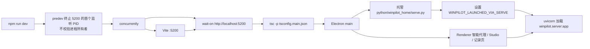
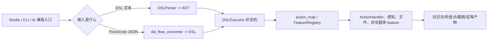
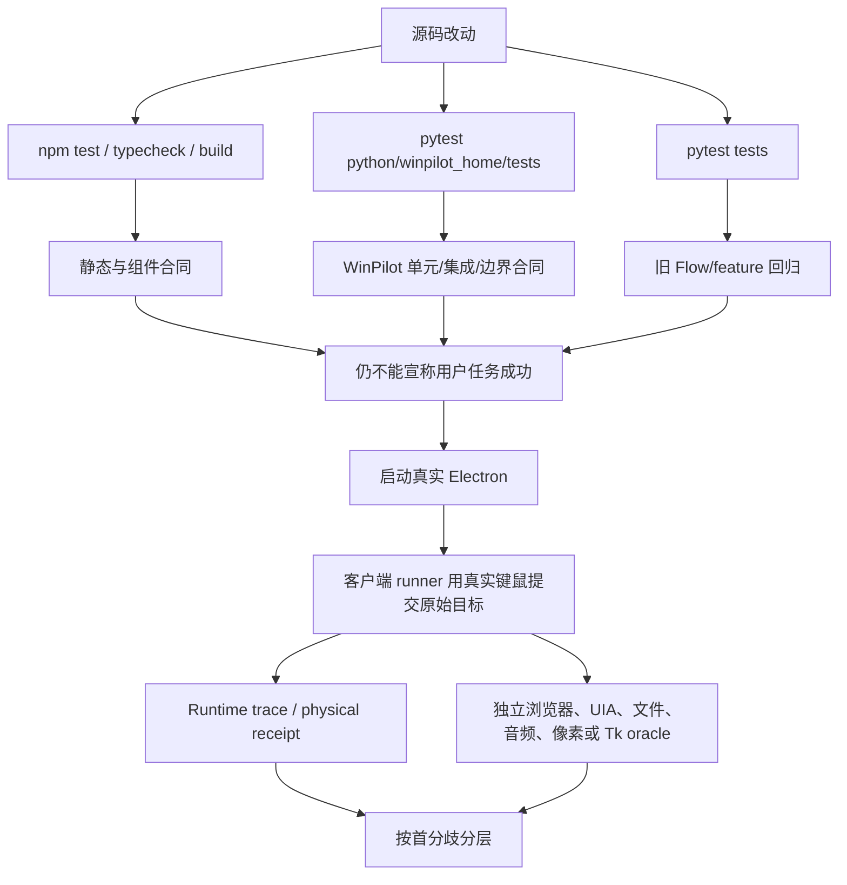
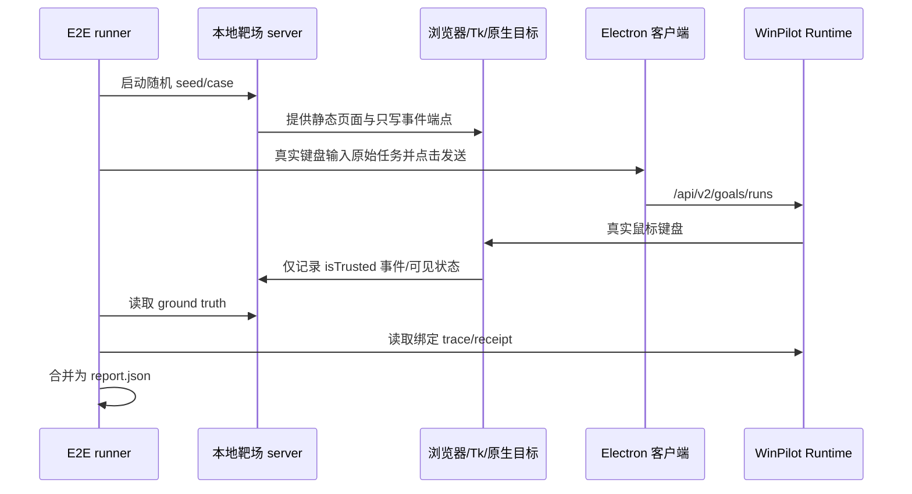
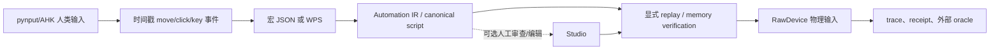
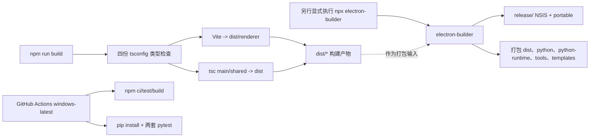

# 07. 支撑代码、测试、脚本与配置逐文件精确讲解

> 审计快照：`master` / `e54d0a97f6cf332daf012c98bf3b8947f8ed9714`，2026-08-02。
> 本卷只覆盖根目录支撑文件、`python/` 中 `winpilot` 产品包之外的代码、两套测试、脚本、靶场、样例、模板和构建配置；`src/**` 与 `python/winpilot_home/winpilot/**` 由另外两卷解释。
> 路径基线来自 `git ls-files -z`：原范围为 363 个跟踪文件；本次文档新增的 `scripts/generate_project_guide.py` 也属于当前代码，因此本卷最终解释 364 个文件。`CON` 未读取、未改动。

## 1. 先分清三条线

仓库里同时存在三种东西，名字相似但责任不同：

| 线 | 当前地位 | 真实入口 | 本章涉及的支撑文件 |
| --- | --- | --- | --- |
| 产品 vNext | 当前唯一用户任务主链：一个 goal、一个 `LiveVisualActor`、一条视觉执行线 | Electron 托管 `python/winpilot_home/serve.py` | `serve.py`、`config.example.json`、可见客户端 E2E、独立 oracle |
| Studio/Flow/兼容线 | 仍有真实消费者，用于流程编辑、确定性 replay、CLI 和本地 feature API；不得冒充产品 vNext | Electron 的 feature/DSL/scheduler bridge、CLI 兼容入口 | `python/engine/**`、`python/features/**`、`python/tools/**`、Flow/DSL 模板 |
| 测试与历史材料 | 验证合同、重现旧行为或提供独立靶场；不是生产推理策略 | pytest、Vitest、E2E runner、静态 HTML/Tk/Java 靶场 | `tests/**`、`python/winpilot_home/tests/**`、`scripts/**`、`eval_targets/**`、`examples/**` |

关键判断：`python/winpilot_home/playbooks/*.json` 虽然被代码读取，但默认 `playbooks_enabled=false`；其中的应用配方不是当前 vNext 行为。根 `demo_complex.flow` 等文件是旧 DSL 示例；`python/server.py` 是旧 Flask/Socket.IO 后端；`python/winpilot_home/webui/**`（旧 FastAPI 根路径兼容/诊断 UI）已删除。它们都不能写成 Electron“智能代理”的主链。

## 2. 启动、执行、测试与发布全景

### 2.1 当前开发启动



通俗伪代码：

```text
开发启动():
  predev 若发现 5200 的监听 PID，就终止首个 PID；它不验证所有者
  concurrently 同时启动 Vite 与 dev:electron 命令链
  dev:electron 先 wait-on，确认 Vite 可访问
  然后编译 Electron main，编译成功后才启动 Electron
  Electron 用唯一支持的 serve.py 启动 Python Runtime
  Renderer 通过动态本地端口与 Runtime 通信
```

### 2.2 旧 Flow/feature 兼容执行



```text
运行旧流程(input):
  如果 input 是 Flow 图:
    严格转换为旧 DSL
  解析 DSL 为 AST
  从 start 开始执行顺序、分支、循环和动作节点
  动作名经 action_map 找到注册的 feature
  每个动作返回明确结果；失败应停止或走配置的错误边
  成功后可由 crystallizer 保存为模板
```

注意：`ArpNodeKind.LEGACY_FLOW` 的 Runtime handler 已删除并 fail closed；上述兼容线指仍有明确消费者的旧 DSL/feature 设施，不表示 vNext 又会回退到 `legacy_flow`。

### 2.3 两层 pytest 与真实 E2E



```text
真实 E2E(case):
  启动或复用当前源码的 Electron
  独立创建目标应用/网页，并先记录基线
  用操作系统键盘把原始 goal 输入 Electron，再用真实鼠标发送
  等待 admitted run，不给 Agent 泄漏答案或目标坐标
  收集 raw model args -> canonical args -> physical_attempt
  用目标外部的 oracle 读取最终状态
  只有外部状态满足任务才算 pass
  报告写入被忽略的 output/，不能把 runtime done 当 pass
```

```text
回归测试():
  先跑 renderer 单元测试和四个 TypeScript 配置的类型检查
  再跑 WinPilot pytest（当前产品合同）
  再跑根 pytest（旧 Flow/feature 合同）
  任一失败都回到具体 SUT，不用旧快照覆盖当前输出
  单元测试全绿只说明合同没回归；若 Runtime 变了，继续跑可见 Electron E2E
```

### 2.4 靶场与 oracle



```text
独立靶场(case, seed):
  server 用 seed 生成目标几何和隐藏答案
  页面只接受浏览器标记为 trusted 的真实输入事件
  每次事件把坐标、按键、可见状态发给 server
  server 依据几何/顺序/最终状态判 pass 或 fail
  Agent 只看页面，不读取 /state 或答案
  runner 在任务结束后才读取 /state 作为外部 oracle
```

### 2.5 记录、转换与回放



```text
记录并回放():
  recorder 监听真实键鼠，把连续字符合成 type_text，把按键和拖拽保留为有序事件
  给每一步附上当时的 target_window 身份
  转成 WPS，再严格编译为 Automation IR
  若需要人工编辑，可在 Studio 中查看、补参数并确认；这不是 Apprentice 入库的必经步骤
  只有显式 replay 或 memory verification 才开始执行
  Replayer 顺序提交 canonical action 给唯一 Desktop Action Queue
  RawDevice 回执和外部应用状态共同决定是否成功
```

### 2.6 构建与发布



```text
构建与发布():
  npm ci                         # 按 lockfile 安装
  npm test                       # Renderer/Vitest
  npm run build                  # typecheck + renderer + Electron main
  若要 CLI/旧 AI interface，再显式 npm run build:all
  若要安装器，再显式运行 electron-builder
  builder 只装入白名单 dist/python/python-runtime/tools/templates
  输出到 release/，不要把 release/ 提交到 Git
```

`package.json` 当前没有直接的 `dist`/publish npm script；`electron-builder` 配置定义了安装器与 portable 目标，实际发布命令需要显式调用 builder 或由发布流程补充，不能把 `npm run build` 写成已生成安装包。

## 3. 根目录与构建配置：逐文件

| 文件 | 用途、入口/依赖、产物与地位 |
| --- | --- |
| `.gitattributes` | Git 文本自动识别，仅有 `* text=auto`；影响换行归一化，不是运行时输入。 |
| `.gitignore` | 排除 `node_modules/dist/release/output/python-runtime`、本地密钥配置、trace、缓存和生成 Flow；显式重新纳入图标和 `es.exe`/许可证。 |
| `.mcp.example.json` | 只读 GitHub MCP 示例，凭据引用 `${env:GITHUB_PAT_TOKEN}`；复制为本地配置后才生效，不含真实 token。 |
| `.rgignore` | 为 `rg` 排除依赖、构建、Runtime 数据和大二进制目录；只影响开发检索。 |
| `.github/workflows/ci.yml` | `master` push/所有 PR 触发。Windows Node 20 跑 `npm ci -> npm test -> npm run build`；Python 3.11 跑依赖安装及两套 pytest。concurrency 会取消同 ref 的旧 run。 |
| `package.json` | npm 权威入口、依赖、Electron Builder 配置。主入口 `dist/main/main.js`，CLI bin `dist/cli/cli/index.js`；开发端口 5200；打包 appId `com.lingdong.script`，产物目录 `release/`。 |
| `package-lock.json` | npm lockfile v3，锁定 `package.json` 的完整依赖树；由 npm 生成，`npm ci`/CI 消费，不手工维护。 |
| `pytest.ini` | 根测试默认只收集 `tests/`；声明 `real` 与 `slow` 标记。WinPilot 测试必须显式给路径。 |
| `requirements.txt` | Python 单一依赖清单：CV/OCR、Windows UIA/Win32、输入、调度、FastAPI/Uvicorn、OpenAI、MCP、Pydantic。当前 vNext 物理执行线不依赖 `pyautogui`；旧 `ActionHandler` 只把它作为截图 fallback，但 `perception/app_adapter.py`、`rpa_keywords/desktop_actions.py`、`features/system_control_features.py` 等兼容模块仍用它注入真实输入。 |
| `tsconfig.json` | Renderer 严格 no-emit 检查，ES2021/DOM/bundler/React JSX，含 `src/renderer`。 |
| `tsconfig.main.json` | Electron main/shared 编译到 `dist/`，CommonJS/ES2020，并生成 source map。 |
| `tsconfig.cli.json` | CLI 与共享 renderer types/utils 编译到 `dist/cli`，CommonJS。 |
| `tsconfig.ai.json` | 历史 AI-interface 与共享类型编译到 `dist/`；仍由 `build:ai` 消费，但不是产品 vNext 主链。 |
| `vite.config.mts` | Renderer root、assets publicDir、`@` alias、5200 strict port、Vitest jsdom。自定义插件去掉 HTML `crossorigin`，使 Electron `file://` 可载入。 |
| `start-dev.ps1` | 旧便捷脚本：强杀所有 Electron 与命令行含 vite 的 Node，硬编码仓库路径，等待后直接启 Vite/Electron；会扩大进程影响面，权威开发入口仍是 `npm run dev`。 |
| `kill-electron.ps1` | 强制终止系统中全部 Electron 后报告剩余数；开发清理脚本，不做仓库范围 PID 绑定。 |
| `lobster.bat` | 把参数转给不存在于当前跟踪树的 `cli/lobster.py`；历史/失效入口，当前 CLI 是 npm bin。 |
| `lobster.ps1` | 同上，调用缺失的 `cli/lobster.py`；不能作为当前启动说明。 |
| `_e2e_harness.py` | 临时真实桌面单任务 harness：直接导入旧 `winpilot.agent.loop`，并行排空事件、保存截图；是开发诊断入口，不是严格客户端 E2E。 |
| `run_mimo_demo.py` | 旧 MiMo 实操演示，导入当前树中不存在的 `agent.mimo_agent`；意图是逐步截屏与裁模板，当前不可作为有效入口。 |
| `demo_complex.flow` | 文本 DSL 演示：Win+D/Win+R/记事本、循环、条件说明、变量、截图；包含示范性固定坐标/文本，历史样例。 |
| `test_complex.flow` | 最小旧 DSL：点击、等待、输入、回车、截图；手工 smoke fixture。 |
| `桌面图标监控.flow` | 旧 DSL 无限循环，按优先级尝试三个图像点击；其图像目标为空时不能直接运行。 |
| `桌面图标监控.json` | 与上项对应的旧 Flow 图（start/loop/3 个 image_click 与 fail 边）；编辑器 fixture/样例，不是 vNext recipe。 |

## 4. 开发、评测与 E2E 脚本：逐文件

| 文件 | 用途、入口/fixture、依赖、产物与地位 |
| --- | --- |
| `scripts/clean-artifacts.cjs` | `npm run clean` 入口。只删除仓库内白名单构建/缓存/E2E 目录与递归 `__pycache__`；`--runtime` 才删忽略的 `python-runtime/`，不删 `node_modules`。输出释放字节数。 |
| `scripts/setup-claude-code.js` | 历史 Claude Code/desktop MCP 配置助手；打印或用 `--apply`/`--project` 写配置，目标为已构建的 `dist/ai-interface/index.js`。会产生用户目录或 `.claude/settings.json`，不是启动必需步骤。 |
| `scripts/generate_project_guide.py` | 本套文档的零遗漏生成/校验器。用 `git ls-files -z` 安全读取特殊路径，并纳入脚本自身及尚未跟踪的顶层讲解文档；逐文件计算 SHA-256、行数、类型和静态结构，Python 用 AST，TS/JS、IPC、route 用保守正则，JSON/Markdown/HTML/PNG 用格式专用解析。生成 `generated-file-inventory.md`；`--check` 同时比较全文、验证每个代码/配置路径恰有一个 `PROJECT-FILE` 标记，并要求它也出现在三卷人工语义索引之一。生成物自身被排除以避免自引用 hash。 |
| `scripts/client_e2e_run.py` | 通用真实 Electron 客户端 runner（2,234 行）。`ElectronClientDriver` 用 UIA 定位、真实键鼠提交，按 run/goal/trace/desktop queue 绑定证据；`--suite original|mixed|all`。产出 case/suite JSON 和截图到输出目录。 |
| `scripts/client_visual_e2e_run.py` | 可见客户端通用手势矩阵。启动 `visual_interaction_server.py` 与真实浏览器，覆盖 drag、precise click、ordered clicks、slider、corridor、dynamic hold；从 `/state` 取外部判定并复制绑定 trace。 |
| `scripts/client_netease_music_e2e_run.py` | 网易云原生任务 runner。只读 UIA/窗口状态与 CoreAudio endpoint，核对结果标题、播放态及目标音量；产出脱敏 report、截图、trace 副本。 |
| `scripts/client_paint_game_e2e_run.py` | Microsoft Paint 井字棋 runner。`BoardOracle` 用当前窗口 DPI 把逻辑棋盘映射到物理像素，以红色/中性掩码判定棋盘；产出前后帧和 report。 |
| `scripts/client_qq_groups_e2e_run.py` | QQ 跨群摘要 runner。UIA/窗口快照只在 runner 内解析群列表、切换/滚动覆盖，并做 trace 隐私审计；对外报告做清洗，避免泄漏聊天正文。 |
| `scripts/client_thread_connector_e2e_run.py` | 单一真实 Thread 的聊天、只读 connector、Notepad、重启/草稿/history-depth 组合 runner。临时生成 MCP fixture 环境和目标文件，以磁盘 SHA、历史投影、usage 与 trace 判断。 |
| `scripts/client_vnext_canary_e2e_run.py` | 4,514 行的 fail-closed 可见 canary 驱动器。固定源码/配置/模型/目标身份，管理 Electron、浏览器、被动输入 hook 和成对样本；所有中间工件密封后生成 campaign report。名称保留 paired legacy/vNext 历史，但当前使用必须看 manifest 的精确 arm。 |
| `scripts/connector_e2e_fixture.py` | 测试专用单工具 stdio MCP server；从环境变量读取 fixture/token/oracle 路径，暴露一次只读 exact-read，并追加不可混淆调用记录。 |
| `scripts/connector_e2e_sitecustomize.py` | 测试 sidecar；借 Python `sitecustomize` 在不改生产包的前提下给 connector 调用追加 hash/时间/线程证据。仅在 runner 注入的 `PYTHONPATH` 生效。 |
| `scripts/gui_eval_run.py` | 单任务/套件 GUI eval 主 runner（2,226 行）。收集 Git/模型/屏幕 provenance，提交任务，检查 trace/UIA/policy/预算，必要时请求视觉 judge，写 compact evidence report。直接 API/视觉 judge 只能辅助，外部 oracle 仍优先。 |
| `scripts/eval_summary.py` | `npm run eval:summary` 入口，读取近期 `winpilot.eval` 报告并打印 usage、费用与状态摘要；只读，不产生新的任务证据。 |
| `scripts/vnext_canary_campaign.py` | canary 的纯数据/持久化核心（4,963 行）：canonical JSON、内容 hash、独占写、manifest/journal 状态机、样本矩阵、artifact 身份、动作 reconciliation、最终 seal/validate。产物是不可变 manifest、JSONL journal、artifact 与 report。 |
| `scripts/vnext_canary_input_hook.py` | Windows 低级键鼠被动 hook。`PassiveInputHook` 记录 raw mouse/keyboard event、时间与窗口上下文，不注入输入；用于将 Runtime 动作与 OS 观测对账。 |

## 5. 根 `tests/`：逐文件

这组由根 `pytest.ini` 默认收集，主要保护旧 Flow/feature/视觉工具。`real`/`slow` 用 marker 控制；其中两个 `.json`、一个 `.txt` 是 fixture/历史快照，一个 `.ts` 是未被当前 Vitest 配置收集的独立历史脚本。

| 文件 | 精确职责与入口/fixture |
| --- | --- |
| `tests/conftest.py` | 增加 `--real`；未指定时跳过 `@pytest.mark.real`，并注册 `real/slow`。 |
| `tests/test_browser_features.py` | 2 个 pytest：mock Playwright，确保 set-value/storage 把文本作为 JS 参数而非拼接脚本，防注入/转义错误。 |
| `tests/test_browser_real_ops.py` | 可直接 `__main__` 运行的真实网站浏览器操作脚本；调用 feature registry，产生真实网络/浏览器副作用，属 `real` 诊断。 |
| `tests/test_compare_som_vs_direct.py` | 历史 SoM 文本观察与完整截图对照脚本；当前导入已经不存在的 `agent.agent` 与 `agent.config`，因此直接运行会失败，必须恢复已删除模块或迁移入口后才能实验，更不是 CI 的稳定业务 oracle。 |
| `tests/test_dialog_features.py` | 6 个测试类，mock `dialog_handler`，核对 feature metadata、handle/list/take-action/save 路由及 executor 集成。 |
| `tests/test_dialog_handler.py` | 1,370 行旧 Windows 对话框单元/压力测试；`FakeHWND`、mock UIA/Win32，覆盖分类、按钮优先级、保存/覆盖/未知对话框与 monitor。 |
| `tests/test_dsl_executor_replay_nodes.py` | spy `ActionHandler`，验证 `input_text` 先点坐标再输入，`click_text`/`click_image` 分派到正确动作。 |
| `tests/test_features_comprehensive.py` | 遍历注册表，检查全部 feature 的 metadata、参数与可调用一致性；执行型测试受平台/依赖保护。 |
| `tests/test_flow_converter.py` | DSL↔FlowScript 双向转换、类型映射与注册表覆盖；消费下述 JSON fixture。 |
| `tests/test_flow_full.json` | 参数补全 fixture：start→click→input_text→screenshot→image_click→end，节点参数故意为空。 |
| `tests/test_flow_utf8.json` | 与 full fixture 同构的 UTF-8 中文副本，用来防编码回归。 |
| `tests/test_init_output.txt` | 明确标注为历史测试输出快照；列出当前应实跑的命令，不能引用为当前通过证据。 |
| `tests/test_interfaces.py` | core dataclass/protocol、EventBus 与 StructuredLogger 的序列化、状态和订阅合同。 |
| `tests/test_legacy_executor_fail_closed.py` | 16 个 fail-closed 合同：显式/嵌套失败、None/ambiguous、并行传播、自愈回放、非幂等动作不喷 offset、失败不 crystallize。 |
| `tests/test_macro_path_security.py` | 宏名必须解析在 macro 目录内；拒绝 `..` 与绝对路径。 |
| `tests/test_nlp_schedule_parser.py` | 规则式中文调度解析：意图、时间、动作抽取、风险等级；不调用 LLM。 |
| `tests/test_param_prompt.ts` | 自包含复制版参数补全逻辑，手写 assert 并 `process.exit(1)`；当前 Vite root 为 `src/renderer`，因此它不是 `npm test` 收集项，属历史快速验证。 |
| `tests/test_providers.py` | mock HTTP/OpenAI client，验证旧 DeepSeek/OpenAI provider、usage/错误和抽象协议。 |
| `tests/test_secure_store.py` | Windows-only DPAPI/SQLite vault 迁移测试：旧明文读后加密保存并可解密。 |
| `tests/test_vision.py` | unittest 风格验证根 `vision/` 与 `utils/image.py`：图像工具、HSV 颜色、进度条、变化检测。 |

## 6. 旧 Python Flow/feature 支撑栈：逐文件

### 6.1 包入口、core 与 Windows 对话框

| 文件 | 精确职责、依赖和地位 |
| --- | --- |
| `python/__init__.py` | 空包标记。 |
| `python/agent/__init__.py` | 旧 agent 命名空间说明；当前仅跟踪两个 Windows handler，不是 `winpilot.agent`。 |
| `python/agent/dialog_handler.py` | 1,363 行 UIA+Win32 对话框处理器；`DialogInfo` 扫描/分类，按按钮关键字优先级处理 Notepad 保存、覆盖、确认、错误、Electron、文件保存及后台 monitor。依赖 pywin32/pythoncom；可直接运行 dump。 |
| `python/agent/menu_handler.py` | `MenuHandler` 与便捷函数，用 Win32 菜单 API 展开菜单路径、读取结构并点击；供 `menu_features` 包装。 |
| `python/core/__init__.py` | 重导出 typed interfaces、events、logging。 |
| `python/core/interfaces.py` | 旧平台共享 dataclass/protocol：`ToolResult`、`Observation`、`StepRecord`、`TaskState`、`Tool`、`LLMProvider`。 |
| `python/core/events.py` | 线程安全 typed pub/sub：`Event` 与 `EventBus`，支持 subscribe/unsubscribe/publish/history。 |
| `python/core/logging.py` | `StructuredLogger` 把事件与 step 序列化到内存/JSONL，并经 EventBus 广播；是旧 replay/调试日志。 |
| `python/core/screenshot.py` | `ScreenshotManager` 缓存全屏/区域截图、hash 和 OpenCV 数组；`capture_screen` 兼容函数，`pyautogui` 是 fallback。 |

### 6.2 DSL、调度、持久化与旧执行器

| 文件 | 精确职责、入口/产物 |
| --- | --- |
| `python/engine/__init__.py` | 重导出 DSL parser、executor、scheduler。 |
| `python/engine/dsl_parser.py` | `DSLParser` 将文本 DSL 词法/缩进解析成 `ASTNode`/`NodeType`，抛 `DSLParseError`；自带命令行 parse smoke。 |
| `python/engine/dsl_flow_converter.py` | 1,451 行双向转换器：节点类型映射、默认参数、布局、条件/循环边和错误 Flow；`roundtrip_verify` 检查语义往返。 |
| `python/engine/unified_entry.py` | 旧统一 facade：识别 DSL 文本或 Flow JSON，调用 converter+`DSLExecutor`；提供 `run` 与 `quick_validate`。 |
| `python/engine/executor_types.py` | `ExecutorState`、`ExecutionContext`、控制流异常与结果失败判定；避免 executor/healing 循环依赖。 |
| `python/engine/executor.py` | 1,906 行旧状态机执行器。遍历 AST 的顺序/分支/循环/并行/动作节点，管理 pause/stop/context/变量/重试，并通过 action map/handler 执行动作。 |
| `python/engine/engine.py` | Electron/CLI 子进程入口；stdin 接收 Flow/DSL JSON，stdout 逐行 emit 状态，成功可调用 crystallizer，异常输出结构化失败。 |
| `python/engine/condition_evaluator.py` | 可注册条件表；统一评估 always/window/process/date/time/image/text/color/scene，供 scheduler guard 和 DSL IF/WHILE。 |
| `python/engine/healing.py` | `HealingPipeline` 的旧失败恢复链与统计；只对允许的策略生成 `HealAttempt/HealResult`，非幂等动作受测试约束。 |
| `python/engine/optimizer.py` | `TelemetryAnalyzer` 从历史耗时/成功率提出 DSL 优化建议；不直接改生产流程。 |
| `python/engine/planner.py` | 旧第二规划器：把目标交给 provider 生成 `PlanStep` 并执行/记录；当前 vNext 明确不使用，不得恢复为主链。 |
| `python/engine/crystallizer.py` | 把成功旧流程保存为 `templates/*.flow/.dsl` 并更新 `skill_tree.json`；会创建持久化模板产物。 |
| `python/engine/store.py` | SQLite `ExecutionStore`：checkpoint、telemetry、learned target、vault；路径由环境/默认目录决定，线程锁保护，vault 使用 secure_store。 |
| `python/engine/secure_store.py` | Windows DPAPI protect/unprotect，并用带前缀的 base64 判别密文；非 Windows fail closed。 |
| `python/engine/scheduler.py` | 进程内 `TaskScheduler`（APScheduler BackgroundScheduler、priority、submit/cancel/status）。 |
| `python/engine/scheduler_daemon.py` | Electron 长驻 JSON-line 子进程；加载 schedule、创建 cron/interval/date trigger、执行旧 Flow，stdout 发事件。 |
| `python/engine/trigger_bridge.py` | 将 `TriggerEngine` 事件转为 stdout JSON，供 Electron 监听。 |
| `python/engine/triggers.py` | 线程式 reactive engine；注册 file/process/window/clipboard/network/timer watcher，生成 `TriggerSpec/Instance` 并回调。 |
| `python/engine/nlp_schedule_parser.py` | 无 LLM 的中文规则解析器：中文数字、周期、星期/时刻、动作、risk；返回 schedule draft。 |
| `python/engine/robot_converter.py` | 旧 DSL→Robot Framework `.robot`，将动作转换为 `RPA.Windows` 关键字；命令行输入 DSL 文件、输出 `.robot`。 |
| `python/engine/robot_runner.py` | 临时生成 `.robot`、调用 Robot Framework、解析 `output.xml`，返回成功/失败与产物路径；需额外 Robot/RPA 依赖，requirements 未列全。 |

### 6.3 `@feature` 注册表与全部功能模块

共同模式：模块在函数上使用 `@feature(...)` 声明名称、类别、参数、端口与风险；`features/_all.py` 只登记延迟模块，`FeatureRegistry` 首次查询/调用时导入；Electron 的 `feature_list.py`/`feature_call.py` 是真实兼容消费者。返回值通常是结构化 dict，不等同于 vNext 的物理动作证据。

| 文件 | 注册内容、依赖、产物与地位 |
| --- | --- |
| `python/features/__init__.py` | 包入口，重导出 registry API。 |
| `python/features/_all.py` | 单一模块目录，向 registry 声明所有 feature 模块的延迟加载路径；导入本文件不应立即导入重型 CV/UI 依赖。 |
| `python/features/_feature_template.py` | 新 feature 示例，声明 simple/perception/macro 三种模板函数；开发脚手架，不是业务入口。 |
| `python/features/_utils.py` | feature 公共参数工具：解析 region、解析坐标、模拟延迟。 |
| `python/features/registry.py` | 核心 `FeatureRegistry` 与 `FeatureSpec/ParamSpec/PortDef/VisualMeta/TestCase`；装饰器注册、模块发现、类型转换、调用与 schema 导出。 |
| `python/features/state.py` | 旧 feature 进程内共享日志与变量字典；提供 push/get log、set/get/list/clear vars。 |
| `python/features/action_map.py` | 旧 DSL 动作名→feature 名映射和 handler factory；未知动作/条件需显式失败，`_rpa_handler` 连接 Robot 关键字。 |
| `python/features/action_features.py` | 注册 click/type/scroll/swipe/drag/hotkey/clipboard typing；依赖 `interaction.actions`、`input_features` 与坐标工具，直接产生桌面副作用。 |
| `python/features/input_features.py` | 注册 right/middle/triple click、hover/move、select text、cursor read；先解析文字/图像/坐标目标，再调用旧动作层。 |
| `python/features/a11y_features.py` | 从前台 UIA root 遍历可见控件，注册 tree/find/click；输出 name/role/bounds 等结构。 |
| `python/features/aggregate_features.py` | 聚合式 `wait_condition`，通过 action 参数代理到相关等待实现，减少旧工具表数量。 |
| `python/features/ai_debug_features.py` | 旧 AI/调试/模板工具集：生成 DSL、DSL/graph/Flow 转换、验证/测试/系统信息、模板搜索导入导出。会读写模板与流程文件。 |
| `python/features/ai_plan_features.py` | 包装旧 `engine.planner` 的 plan-and-execute/history；是遗留第二 planner 接口，非 vNext。 |
| `python/features/browser_features.py` | 1,756 行 Playwright/CDP 浏览器 feature：发现/启动 Chrome、tab/navigation/form/query/screenshot/JS/cookie/storage/download/state snapshot；维护模块级 browser/page 连接。 |
| `python/features/web_features.py` | 较小的旧 Playwright browser execute facade，维护 browser 生命周期；功能与 browser_features 部分重叠。 |
| `python/features/call_feature.py` | one-shot CLI：argv 给 feature 名和 JSON 参数，加载 `_all` 后调用并向 stdout 输出 JSON。 |
| `python/features/list_features.py` | one-shot CLI：加载全部 registry 并把 feature 数组写 stdout；Electron 现在主要调用 `python/tools/feature_list.py`。 |
| `python/features/camera_features.py` | OpenCV 摄像头枚举、单帧 base64/文件 capture、后台录像 start/stop、运动检测；会占用真实摄像头并写媒体。 |
| `python/features/canvas_features.py` | 截屏后以亮度/轮廓寻找白色画布区域，注册 `find_canvas`；输出 bbox/confidence。 |
| `python/features/claude_code_features.py` | 检测 `claude` CLI 并在临时 prompt/工作目录中委托子进程；外部编码副作用，非 vNext Actor。 |
| `python/features/clipboard_features.py` | Windows 剪贴板文本、图片、文件列表读取，clear/set text；图片返回 base64。 |
| `python/features/dialog_features.py` | 把 `agent/dialog_handler.py` 包装为 handle/list/take_action/fill_save feature。 |
| `python/features/menu_features.py` | 把 `agent/menu_handler.py` 包装为 menu click/structure feature。 |
| `python/features/dsl_features.py` | 注册 DSL 异步/同步执行、Robot 执行、脚本文件执行和 telemetry 优化分析。 |
| `python/features/file_features.py` | 直接文件 read/write/append/delete/list/exists/copy/move/edit；有真实文件副作用，路径保护由调用者/实现负责。 |
| `python/features/filedialog_features.py` | UIA/键盘驱动 Windows Open/Save/Folder 对话框：定位文件名编辑框、输入绝对路径、确认覆盖；`select_images` 支持多图。 |
| `python/features/flow_features.py` | 旧自然语言→FlowScript 生成器，构造长 DSL reference/prompt、调模型、转 DSL/伪代码；当前主链禁止恢复这种第二生成模型。 |
| `python/features/fusion_features.py` | `find_element`/`wait_element` 包装 `LocalFusionEngine`，按 UIA→OCR→template 找目标。 |
| `python/features/healing_features.py` | 暴露旧 healing 的 reliability/history/reset 统计，不执行新的语义验证。 |
| `python/features/image_click_features.py` | 对多个模板按优先级匹配并点击；支持相似度、offset、multi-scale/match-all，属于旧显式图像节点。 |
| `python/features/image_search_features.py` | 本地文件名自然语言搜索；提取关键词、模糊打分并返回图片路径，不做视觉内容向量搜索。 |
| `python/features/macro_features.py` | 宏 list/play/start/stop/delete/events/convert-to-flow；使用 pynput 或独立 recorder，产物写 `python/macros/*.json`。`_macro_path` 防目录穿越。 |
| `python/features/multimedia_features.py` | CoreAudio 音量读取、区域截图、ffmpeg screen record start/stop；录像写时间戳文件并维护进程句柄。 |
| `python/features/network_features.py` | 基于 `netsh` 的 network status、Wi-Fi list/connect/disconnect；会改变真实网络连接。 |
| `python/features/notification_features.py` | Windows toast/PowerShell fallback 通知；结果仅表示提交尝试，不是用户阅读证明。 |
| `python/features/perception_features.py` | 旧感知 feature 总表：区域框选、多截屏、OCR、模板、颜色、进度、popup、区域变化/稳定和 scene；依赖 `perception/**`、根 `vision/**`。 |
| `python/features/persistence_features.py` | 包装 `ExecutionStore`：checkpoint/telemetry/vault/learned target 的 CRUD 与记录；产物是 SQLite。 |
| `python/features/plugin_features.py` | 旧 registry 插件 load/list/unload；动态导入第三方 Python 文件，非当前 Codex plugin 系统。 |
| `python/features/program_registry.py` | `ProgramRegistry` 从 PATH、Start Menu、卸载表等发现 Windows 程序名→exe，并持久化 alias；注册 refresh/resolve/list/add_alias。 |
| `python/features/scheduler_features.py` | 对 `agent_schedules.json` 做 list/get/create/update/delete，列 condition/trigger 类型和 quick_schedule；Electron daemon 消费。 |
| `python/features/software_features.py` | 通过固定 `127.0.0.1:5877` HTTP 控制旧“灵动脚本”本体的新建/加节点/连边/加载/布局/保存/运行；端口与当前托管 Runtime 不同，属旧本地控制面。 |
| `python/features/system_control_features.py` | Windows 音量/静音/亮度/锁屏/电源/进程/壁纸/显示器/桌面；shutdown/reboot 等不可逆 feature 有真实系统副作用。 |
| `python/features/system_features.py` | DPI awareness、进程/窗口发现与聚焦、程序启动、命令执行；`launch_program` 复用 program registry。 |
| `python/features/test_flow_features.py` | 把流程保存到 `tests/flows/`，列出并执行；开发回归辅助，会生成测试 Flow 文件。 |
| `python/features/timer_features.py` | 轮询等待文件/进程/网络/时刻、普通 wait/countdown；统一超时和 poll。 |
| `python/features/trigger_features.py` | 管理 TriggerEngine（类型/list/get/stop）并读取 crystallized 模板/skill tree。 |
| `python/features/variable_features.py` | 对 `features.state` 注册 set/get variable。 |
| `python/features/vlm_features.py` | 旧截图→VLM analyze 包装，选择 `providers.vlm`，对未配置/异常返回结构化错误。 |
| `python/features/window_features.py` | Windows 窗口 minimize/maximize/restore/resize/snap/close；按标题/句柄找 HWND。 |

### 6.4 动作、感知、provider、MCP 与工具进程

| 文件 | 精确职责、依赖、产物与地位 |
| --- | --- |
| `python/interaction/__init__.py` | 重导出 wheel selector 与 ActionHandler。 |
| `python/interaction/actions.py` | 787 行旧 `ActionHandler`：延迟加载 Win32/UIA/pyautogui，实现 click/type/key/scroll/drag/screenshot/image/text 等 DSL 回调；可切 UIA 和 scale。 |
| `python/interaction/wheel_selector.py` | 全屏 Tk overlay，滚轮/方向键选择、Enter 确认，stdin/stdout JSON IPC；可直接作为子进程运行。 |
| `python/perception/__init__.py` | 重导出旧 vision/OCR。 |
| `python/perception/vision.py` | `mss`+OpenCV/PIL：ScreenCapture、template multi-scale、change/color/scene；返回像素/匹配 bbox。 |
| `python/perception/ocr.py` | Umi OCR、Windows WinRT OCR 与 MultiBackendOCR；预处理、坐标映射、模糊文本匹配。 |
| `python/perception/fusion.py` | `LocalFusionEngine` 依次 UIA→OCR→template，返回带 method/confidence/bounds 的 `FusionResult`。 |
| `python/perception/app_adapter.py` | `AppAdapter` 抽象基类与 `AdapterWindowInfo`，封装启动/窗口/截图/动作/验证生命周期；当前没有跟踪具体 app adapter 子类。 |
| `python/providers/__init__.py` | 重导出旧 provider abstractions。 |
| `python/providers/base.py` | 旧 `LLMProvider` ABC：complete/chat/available/name 等接口。 |
| `python/providers/deepseek.py` | `requests` 调 DeepSeek chat completions，失败时最多 3 次退避重试；只剥 Markdown JSON code fence，返回 `content/raw_response/model`，不做显式 reasoning 清洗或 usage/latency 聚合。它不是 vNext 的统一 ProviderProtocolAdapter。 |
| `python/providers/openai.py` | OpenAI SDK provider，读取 API key/model，支持 chat completion；旧 planner/flow 生成消费。 |
| `python/providers/vlm.py` | VLM ABC、GPT-4o-mini compatible 与 local endpoint；把 screenshot 编成 base64，支持 analyze/grounding、cost estimate。 |
| `python/rpa_keywords/__init__.py` | Robot Framework 关键字包说明。 |
| `python/rpa_keywords/desktop_actions.py` | `@library` 类包装 RPA.Windows/pywinauto 的 open/click/type/key/screenshot/window 等关键字；供 robot_converter 产物调用。 |
| `python/server.py` | 旧 Flask+CORS+Socket.IO 后端 v2，暴露 health/registry/feature/DSL/log/pause/resume/stop WebSocket；不是 `serve.py` 启动的 FastAPI WinPilot server。 |
| `python/test_browser_comprehensive.py` | 旧 browser_features/web_features 的深度操作清单与结果汇总，依赖真实 Playwright/浏览器；文件名虽在 `python/`，属于手工/集成测试。 |
| `python/tools/__init__.py` | 重导出旧 typed Tool wrapper/registry。 |
| `python/tools/base.py` | `ToolWrapper` 把 `FeatureSpec` 适配成 `core.interfaces.Tool`，转换 schema 和 `ToolResult`。 |
| `python/tools/registry.py` | `ToolRegistry` 从 FeatureRegistry 发现、缓存、查询和执行 typed tools。 |
| `python/tools/feature_list.py` | Electron IPC/MCP 消费的 one-shot stdout JSON feature catalog；加载 `_all` 后列出 registry。 |
| `python/tools/feature_call.py` | Electron `featureCallBridge` 的持久 JSON-line 子进程；每行解析 `{id,name,args}`，在线程中调用 feature 并回同 id 结果。 |
| `python/tools/run_dsl.py` | spawnPython 使用的单次 stdin JSON/DSL 执行桥，调用 `DSLExecutor` 后 stdout JSON。 |
| `python/tools/macro_recorder.py` | 独立 pynput recorder；stdin 接 start/stop，回传事件并写时间戳 macro JSON。 |
| `python/tools/macro_play_cli.py` | 命令行加载宏名并调用 `macro_playback`，stdout JSON。 |
| `python/tools/ahk_manager.py` | 检测或下载 AHK v2 portable，启动/停止 `ahk_recorder.ahk` 并读状态；会联网和写工具目录。 |
| `python/tools/ahk_recorder.ahk` | AHK v2 录制器脚本；捕捉鼠标/键盘并与 Python manager 约定 JSON/文件 IPC。 |
| `python/tools/template_market.py` | 自托管旧模板市场 CLI：fetch index/search/install/list/publish；下载或写入模板目录，source URL 可配置。 |
| `python/utils/__init__.py` | 旧 python 包标记。 |
| `python/utils/bezier.py` | 不依赖 NumPy的 `BezierCurve`，生成随机控制点和人类化鼠标路径；与根 `utils/bezier.py` 是重复实现。 |

## 7. `python/winpilot_home/tests/`：140 个文件逐一说明

共同入口为 `python -m pytest python/winpilot_home/tests -q`。`conftest.py` 在相关模块缺失时为 Win32/mss 等提供最小 import stub（常见于非 Windows CI，但判断条件是依赖缺失），并提供隔离配置 fixture；绝大多数测试用 `monkeypatch`/`tmp_path`，正常不产生持久产物。带真实 Windows/浏览器的测试会显式 skip/marker。下表“数量”是源码中 `test_*` 函数定义数，参数化后的 pytest case 数可能更多。

### 7.1 测试文件 1–48（部分已删除）

| 文件 | 数量 | 被测合同/主要 fixture |
| --- | ---: | --- |
| `python/winpilot_home/tests/conftest.py` | fixture | 构造 WinDLL/Win32/mss no-op stub；`isolated_config` 把配置路径与 singleton 隔离到临时目录。 |
| `python/winpilot_home/tests/test_admitted_public_action_telemetry.py` | 10 | admitted action 公共摘要字段组合、未知字段拒绝、真实 scroll 只发布固定脱敏摘要；mock RawDevice/trace。 |
| `python/winpilot_home/tests/test_agent_threads.py` | 9 | Thread 只收成功用户可见 turn、active turn 不被容量淘汰、continuation checkpoint 精确往返/并发。 |
| `python/winpilot_home/tests/test_app_resolution.py` | 14 | app alias 只做字面归一化、通用发现源、虚构 display name 解析、缓存/路径；mock Windows registry/process。 |
| `python/winpilot_home/tests/test_apprentice_mode.py` | 8 | 人类 lesson→可编辑 script/provisional skill、必须命名任务、拒绝不安全 macro name、反馈晋级。 |
| `python/winpilot_home/tests/test_automation_ir.py` | 11 | WPS→Automation IR metadata、双向往返、空执行投影拒绝、可执行节点/变量/目标窗口保持。 |
| `python/winpilot_home/tests/test_client_e2e_harness.py` | 37 | `scripts/client_e2e_run.py` 的固定目标矩阵、无 execution-policy selector、完整文本读取、run/trace/queue 绑定与 pass 规则。 |
| `python/winpilot_home/tests/test_client_netease_music_e2e_harness.py` | 12 | 原始 goal 不改写、CoreAudio 只读 getter、播放第一结果与 5% 判定、报告脱敏。 |
| `python/winpilot_home/tests/test_client_paint_game_e2e_harness.py` | 13 | 原始目标、DPI 逻辑棋盘→物理像素、红 X/棋盘基线和窗口身份判定。 |
| `python/winpilot_home/tests/test_client_qq_groups_e2e_harness.py` | 7 | 原始目标、群列表/active group、跨群滚动覆盖、隐私化报告。 |
| `python/winpilot_home/tests/test_client_thread_connector_e2e_harness.py` | 16 | 单一 stdio connector fixture、token 不进 goal、预开 Notepad、真实只读 tool、Thread/history/restart 证据。 |
| `python/winpilot_home/tests/test_client_visual_e2e_harness.py` | 13 | 通用手势矩阵与 spoken GUI requirement、target focus 几何、浏览器事件与 Runtime run 绑定。 |
| `python/winpilot_home/tests/test_coding_tools.py` | 10 | coding tool schema、临时目录 read/write/search/apply_patch 唯一匹配与错误。 |
| `python/winpilot_home/tests/test_connector_gateway.py` | 12 | 只显式配置才 available、环境引用、配置优先级、延迟发现、read-only annotations、descriptor 指纹重检。 |
| `python/winpilot_home/tests/test_control_plane_auth.py` | 3 | Bearer auth、Renderer CORS preflight、WebSocket 错 token 拒绝。 |
| `python/winpilot_home/tests/test_coordinate_diagnostics.py` | 3 | capture 坐标不匹配报告、真实 executor click 与文本验证、cursor offset 拒绝。 |
| `python/winpilot_home/tests/test_desktop_action_queue.py` | 31 | 全局/窗口 writer 串行化、可重入、不同 HWND 并行、取消/超时/held cleanup、trace。 |
| `python/winpilot_home/tests/test_desktop_file_tools.py` | 9 | target-window screenshot、managed full/region screenshot artifact、物理坐标与 manifest evidence。 |
| `python/winpilot_home/tests/test_desktop_geometry.py` | 2 | 虚拟桌面负坐标 clamp、capture 像素→物理屏变换。 |
| `python/winpilot_home/tests/test_desktop_image_evidence.py` | 7 | base64 折叠、draw/batch 前后图、managed artifact 与 trace 脱敏。 |
| `python/winpilot_home/tests/test_execution_context_handoff.py` | 10 | execution context 仅保留合同字段、control surface 未 yield 时模型前失败、target identity/恢复状态机。 |
| `python/winpilot_home/tests/test_executor_launch.py` | 3 | URL 走 Windows protocol handler、browser wrapper 提取 URL、普通路径保持 shell launch。 |
| `python/winpilot_home/tests/test_fast_controller.py` | 237 | 最大旧 fast controller 回归：batch action schema、连续输入、observation/cache、grounding、watcher、subgoal、工具转发和错误边。 |
| `python/winpilot_home/tests/test_frame_authority.py` | 11 | immutable current frame、lost update、完整 identity pin、epoch/frame commit。 |
| `python/winpilot_home/tests/test_frame_observer.py` | 7 | provided/cached/new capture 与 region 成对提交，scope 注入不含任务语义。 |
| `python/winpilot_home/tests/test_fusion_modal_skip.py` | 2 | 前台 owner modal overlay 判定与无 modal 对照。 |
| `python/winpilot_home/tests/test_human_recorder.py` | 25 | printable/space 合并为 type_text、special key flush、mouse/drag/target window/WPS 录制。 |
| `python/winpilot_home/tests/test_human_replay_integration.py` | 1 | 录制 steps 经 validation 后由真实 replay 路径消费（动作层用 monkeypatch）。 |
| `python/winpilot_home/tests/test_image_ink_stats.py` | 10 | nonblank/blankish/color 统计与临时图像 fixture。 |
| `python/winpilot_home/tests/test_launch_verification.py` | 24 | 复用已有窗口、process/title identity、启动后验证、重复 open、失败/焦点行为。 |
| `python/winpilot_home/tests/test_live_agent_composition.py` | 64 | 当前 live agent 的窗口/帧/lease/Actor/Capability/AtomicAdapter/trace 组合；也是旧包静态缺席边界的重要集成合同。 |

### 7.2 测试文件 49–96（部分已删除）

| 文件 | 数量 | 被测合同/主要 fixture |
| --- | ---: | --- |
| `python/winpilot_home/tests/test_local_search.py` | 7 | 优先 bundled Everything `es.exe`、非阻塞启动/查询、indexed result 与 fallback。 |
| `python/winpilot_home/tests/test_memory_compiler.py` | 3 | run ingestion 的 disabled 开关、幂等 script hash、episode 半写恢复。 |
| `python/winpilot_home/tests/test_memory_graph_compat.py` | 10 | experience recipe 兼容、apprentice provisional→verified、布尔 verified 无 source proof 不晋级。 |
| `python/winpilot_home/tests/test_memory_graph_feedback.py` | 2 | packed-but-unused 与 replay-failed-done 都不得累计成功分。 |
| `python/winpilot_home/tests/test_memory_graph_retrieval.py` | 2 | 排除 coding/volatile task，跳过 superseded 并带 warning。 |
| `python/winpilot_home/tests/test_memory_graph_store.py` | 2 | SQLite schema/CRUD/edges/fallback 与 secret-like value 脱敏。 |
| `python/winpilot_home/tests/test_model_call_runtime.py` | 26 | immutable request envelope、稳定 fingerprint、非 JSON 拒绝、single-attempt/usage/错误合同。 |
| `python/winpilot_home/tests/test_model_transport_ownership.py` | 2 | AST/文本扫描限制 chat-completion 与 Responses transport 的 owner 集合，防重复 client。 |
| `python/winpilot_home/tests/test_multi_input_cooperation.py` | 42 | 协同输入显式 opt-in、隐含 no-mouse-steal、键盘前台 guard、cursor tolerance、queue/trace。 |
| `python/winpilot_home/tests/test_normalized_frame_coordinates.py` | 6 | 归一化/提交图坐标四角、既有 rounding、数值/finite/bounds 严格拒绝。 |
| `python/winpilot_home/tests/test_ocr_warmup.py` | 5 | OCR 异步 warm 只启一次、已有 engine 跳过、前台优先推迟 predictive OCR。 |
| `python/winpilot_home/tests/test_orchestrator.py` | 53 | graph/runtime preview、interaction evidence、trace metrics、handler/capability、`LEGACY_FLOW` 读取但执行 fail closed。 |
| `python/winpilot_home/tests/test_orchestrator_api.py` | 40 | server import 不加载旧 agent、platform overview/catalog、vNext defaults、run/trace/artifact API 与 auth。 |
| `python/winpilot_home/tests/test_perception_confidence.py` | 11 | VLM 统一模型边界、JSON parse 不 retry、只保留显式可信 grounding、confidence propagation。 |
| `python/winpilot_home/tests/test_perception_daemon.py` | 10 | per-HWND watcher/cache、released window 不分析、inflight 结果丢弃、生命周期/线程。 |
| `python/winpilot_home/tests/test_perception_reducer.py` | 12 | snapshot 候选优先级/compact render、聊天状态与列表、避免 contact 重点击。 |
| `python/winpilot_home/tests/test_plan_tools.py` | 30 | revise plan 保留模型步骤、不用绘图关键词过滤、公共桌面路径 grounding、plan CRUD。 |
| `python/winpilot_home/tests/test_provider_protocols.py` | 20 | Responses/Anthropic/Gemini 多模态、tool call/result、system、签名、usage 的显式 wire 翻译。 |
| `python/winpilot_home/tests/test_raw_device_contract.py` | 63 | RawDevice typed backend、坐标/scroll/key/text/held release、DesktopQueue、legacy reflective adapter 标记与 receipts。 |
| `python/winpilot_home/tests/test_replay_anchor_cache.py` | 4 | anchor profile memory roundtrip、本地模板跳 UIA、stale anchor 回退 semantic selector。 |
| `python/winpilot_home/tests/test_replay_control.py` | 23 | 变量递归插值、条件/循环、pause/stop、evidence 与 replay 控制。 |
| `python/winpilot_home/tests/test_replay_job_api.py` | 15 | replay job 可查询、失败终态、cancel stop_event、artifact/memory API。 |
| `python/winpilot_home/tests/test_runtime_info.py` | 4 | 非秘密 runtime fingerprint、短 TTL 独立 cache、source change fail closed。 |
| `python/winpilot_home/tests/test_runtime_jobs.py` | 5 | 共享资源 job 串行、独立工作并发、cancel/stop、active/finish callback。 |
| `python/winpilot_home/tests/test_runtime_perception_policy.py` | 4 | native profile 不启后台语义感知；legacy 可显式启；server OCR warm 需 opt-in。 |
| `python/winpilot_home/tests/test_scope_guard.py` | 15 | exact target refocus、owned modal/foreground、键盘/点坐标作用域、失败结构化。 |
| `python/winpilot_home/tests/test_script_validation.py` | 69 | WPS/canonical script/evidence schema、unknown field、fallback、版本、target/process、动作参数与安全。 |
| `python/winpilot_home/tests/test_surface_binding.py` | 7 | 外层几何/客户区 authority、detector 碎片不改 envelope、stale/ambiguous pixels 拒绝。 |
| `python/winpilot_home/tests/test_system_control_features.py` | 2 | 精确音量 backend 缺失 fail closed；mute fallback 不声称未知状态。 |
| `python/winpilot_home/tests/test_system_tools_undo.py` | 1 | 没有 run-owned undo token 时不得发送 Ctrl+Z。 |
| `python/winpilot_home/tests/test_target_window_anchor.py` | 12 | live session target 优先、owned dialog、foreground/process/title、stale anchor 处理。 |

### 7.3 测试文件 97–140（部分已删除）

| 文件 | 数量 | 被测合同/主要 fixture |
| --- | ---: | --- |
| `python/winpilot_home/tests/test_uia_perception.py` | 2 | Chromium modern tree 存在才跳 legacy root；exact query 拒绝 legacy renderer 直匹配。 |
| `python/winpilot_home/tests/test_unified_coding_runtime.py` | 2 | 仅 enabled 时加入 coding tools；search_text 限制在指定 path。 |
| `python/winpilot_home/tests/test_vision_priority.py` | 20 | raw task/window identity 默认 normal；结构化 visual/active interaction 选视觉模式；UIA/OCR/VLM 优先与 skip。 |
| `python/winpilot_home/tests/test_visual_interaction_server.py` | 8 | quiz spec seeded 且不泄 answer key、server-owned evaluation、claim 被真实评估替代、事件清洗。 |
| `python/winpilot_home/tests/test_visual_servo.py` | 5 | hover→fresh frame→click、目标消失 fail closed、stale frame 等待、次数上限。 |
| `python/winpilot_home/tests/test_vlm_guard.py` | 6 | DeepSeek v4/chat 视为 text-only；明确非 DeepSeek multimodal endpoint 才启视觉。 |
| `python/winpilot_home/tests/test_vnext_action_effect.py` | 18 | authoritative before/after pixels、请求文本不归一化、aligned delta、evidence trust 与 strict wire。 |
| `python/winpilot_home/tests/test_vnext_actor_contracts.py` | 38 | Actor proposal 各分支 strict/identity-free、model wire 完整字段、canonical roundtrip、context budget。 |
| `python/winpilot_home/tests/test_vnext_atomic_desktop_adapter.py` | 42 | 单次 atomic 执行、RawDevice receipt、submitted/canonical/physical durable arguments、effect、held cleanup。 |
| `python/winpilot_home/tests/test_vnext_canary_campaign_state.py` | 51 | `scripts/vnext_canary_campaign.py` manifest self-hash/exclusive write/tamper、sample state、reconciliation/report seal。 |
| `python/winpilot_home/tests/test_vnext_capability_broker.py` | 41 | capability wire exact/plain/complete、数组/标量不 coercion、state projection/schema/availability。 |
| `python/winpilot_home/tests/test_vnext_desktop_workspace.py` | 13 | unrelated foreground 不采用、成功后 stable successor、discarded full-desktop successor、modal owner。 |
| `python/winpilot_home/tests/test_vnext_evidence_registry.py` | 7 | 同 id 同内容幂等、冲突/错 scope/value type 无写入、append_many 原子。 |
| `python/winpilot_home/tests/test_vnext_execution_profile.py` | 25 | profile strict versioned canonical wire、plain complete object、拒绝 legacy alias/错误 literal。 |
| `python/winpilot_home/tests/test_vnext_kernel_boundaries.py` | 14 | kernel 仅 stdlib/自身 pure package、vnext root 无 eager/lazy import、主组合根与旧执行链保持隔离。 |
| `python/winpilot_home/tests/test_vnext_live_canary_e2e_harness.py` | 44 | 可见 canary runner 的 handoff、精确客户端 selector、固定两 seed/family、artifact/trace/input 安全。 |
| `python/winpilot_home/tests/test_vnext_live_model_roles.py` | 26 | Actor 零 retry client、首轮零 system prompt、observe 后同一 actor、原生 history/tool exchange。 |
| `python/winpilot_home/tests/test_vnext_mission.py` | 52 | mission definition/obligation/event strict wire、canonical hash、state transition/claim/block。 |
| `python/winpilot_home/tests/test_vnext_mission_completion_verifier.py` | 14 | verifier request strict replayable scope、只接受完整可信 evidence，拒绝 actor/telemetry 自证。 |
| `python/winpilot_home/tests/test_vnext_mission_runtime.py` | 36 | approved action exactly once、跨帧 held drag lease、keep_holding/release/stop/claim 顺序。 |
| `python/winpilot_home/tests/test_vnext_runtime_evidence_persistence.py` | 15 | canonical UTF-8 JSONL、重复 event/key 拒绝、artifact immutable/hash/path 安全。 |
| `python/winpilot_home/tests/test_vnext_verification_contracts.py` | 17 | assessment identity-free strict JSON、plain exact fields、字符串不静默归一化、trust/evidence。 |
| `python/winpilot_home/tests/test_vnext_wire_contracts.py` | 29 | 所有 mission wire parser 精确 roundtrip、plain dict/完整字段、拒绝 legacy aliases/duplicate key。 |
| `python/winpilot_home/tests/test_web_search.py` | 2 | DuckDuckGo compact result；配置 Serper 失败后回 Bing。网络调用被 mock。 |
| `python/winpilot_home/tests/test_win32_window_match.py` | 1 | title contains 对下划线/空格/大小写归一化，不误匹配 Notepad。 |
| `python/winpilot_home/tests/test_window_tools.py` | 4 | visible title focus、missing target 结构化错误、不扫描/激活后台浏览器 tab、窗口 list。 |
| `python/winpilot_home/tests/test_windows_task_contract_e2e.py` | 1 | Windows-only 前端路径 Paint capture→QQ delivery；依赖真实桌面/应用，默认环境会 skip。 |
| `python/winpilot_home/tests/test_windows_visual_interaction_e2e.py` | 1 | Windows-only 真实 frontend API visual scenario；启动独立 target，核对浏览器 event 与 action executor。 |
| `python/winpilot_home/tests/test_world_bulletin.py` | 41 | world model screen bulletin edge-trigger、pixel/OCR delta、no-effect advisory 非绘图特判、watcher/daemon/trace。 |
| `python/winpilot_home/tests/test_wps_v2_compat.py` | 46 | WPS v1/v2 顺序、失败、变量、target、held gesture、Automation IR、legacy reader/replay 兼容。 |
| `python/winpilot_home/tests/vnext_import_boundary_ast.py` | helper | 自定义静态/有限动态 import AST 分析器；解析常量、函数 alias、控制流环境，供 kernel/live-agent 边界测试导入，不自行收集测试。 |

## 8. WinPilot 启动配置、靶场、playbook 与兼容 WebUI：逐文件

| 文件 | 精确职责、入口/fixture、产物与地位 |
| --- | --- |
| `python/winpilot_home/serve.py` | **唯一支持的独立 WinPilot 启动器**。设置 `WINPILOT_LAUNCHED_VIA_SERVE=1`，生成/读取控制 token，然后 `uvicorn.run("winpilot.server:app")`；不要直接 uvicorn。 |
| `python/winpilot_home/config.example.json` | 可复制的完整配置 schema 示例，覆盖 api/vlm/perception/fusion/legacy agent/controller/ocr/search/coding/integration/vnext/server；真实 key 放被忽略的 `config.json`。示例含大量旧配置，不能都当 vNext 消费。 |
| `python/winpilot_home/eval_targets/__init__.py` | 本地-only 视觉靶场包标记。 |
| `python/winpilot_home/eval_targets/gui_agent_target.html` | 旧通用原子动作网页靶场：输入/apply、局部变化、press pulse、modal、moving target、canvas、drag、校准点；只记录 trusted browser event。由 `gui_eval_run.py` 使用。 |
| `python/winpilot_home/eval_targets/visual_interaction_target.html` | seeded 通用交互页：drag_fit、precise_click、ordered_clicks、slider、corridor、dynamic_hold、quiz 等；用 `event.isTrusted` 和几何事实向 server 上报。 |
| `python/winpilot_home/eval_targets/visual_interaction_server.py` | `ThreadingHTTPServer` 提供上项页面、`/event`、`/state`、reset；server 生成 quiz 并在服务端判答案，不向 Agent 发布 answer key。 |
| `python/winpilot_home/eval_targets/vnext_canary_target.html` | 固定 canary 页面：click+double-click、scroll roundtrip、type+hotkey；每事件记录可见状态、修饰键与 trusted facts，检测违规。 |
| `python/winpilot_home/eval_targets/vnext_canary_server.py` | 独立 canary oracle；提供页面与状态端点，按事件序列验证 click/double、滚动往返、输入热键，计算 canonical state hash。 |
| `python/winpilot_home/eval_targets/offline_flow_node_target.py` | Tk 离线节点 E2E 靶场：输入框、点击目标、滚动区、拖拽、窗口/marker；每次事件原子写 state JSON，供外部精确 oracle。 |
| `python/winpilot_home/eval_targets/offline_flow_click_e2e.json` | Studio fixture：start→focus exact title→physical click→managed screenshot→end；外部 target 的 `click_count` 是 DUT oracle。 |
| `python/winpilot_home/eval_targets/offline_flow_clipboard_screenshot.json` | Studio fixture：clipboard_get→condition→pass/fail clipboard_set→screenshot；展示分支与工件，但当前严格节点矩阵需按最新测试文档判定是否算独立 DUT。 |
| `python/winpilot_home/playbooks/coding-project.json` | 旧 coding 关键词/window playbook，内容鼓励 shell/文件编辑/remember；默认开关关闭，且其“stashing/整文件写”等建议不是当前仓库规则。历史数据。 |
| `python/winpilot_home/playbooks/file-dialog.json` | 旧 Save/Open 完整路径配方；默认禁用，不得作为当前模型的隐藏应用 recipe。 |
| `python/winpilot_home/playbooks/media-playback.json` | 旧 Windows Media Player/Start-Process 配方和验证建议；默认禁用。 |
| `python/winpilot_home/playbooks/tray-wakeup.json` | 较通用的 tray identity/evidence playbook；仍因全局开关默认关闭而不注入当前主链。 |

`python/winpilot_home/webui/{index.html,app.js,style.css}`（FastAPI `/` 下的兼容/诊断 Web UI，
旧聊天/日志/plan/config/memory/session/trace/eval/script 面板）已随旧 Agent 线删除；
Electron renderer 是唯一前端。

## 9. 旧宏与图片资产：逐文件

| 文件 | 精确职责与来源 |
| --- | --- |
| `python/macros/录制_2026-6-8 18-40-26.json` | 真实旧宏录制样例：约 4.6 秒鼠标 move 与三次 press/release click 序列，含绝对桌面坐标；生成数据，不具跨机器稳定性。 |
| `python/templates/框选_2026-06-08T14-19-34-440Z.png` | 旧框选生成的模板位图；由 image matching 节点消费，二进制 fixture/用户生成资产。 |
| `python/templates/框选_2026-06-08T14-19-42-338Z.png` | 同上，第二份框选模板。 |
| `python/templates/框选_2026-06-08T14-19-55-618Z.png` | 同上，第三份框选模板。 |

## 10. 根工具、视觉库与样例：逐文件

### 10.1 `tools/`、`utils/`、`vision/`

| 文件 | 精确职责、依赖、产物 |
| --- | --- |
| `tools/diag_windows.py` | Windows 诊断 CLI：枚举可见 HWND、class/title/PID/process，尝试多种 focus 方法；用于识别保存对话框，不执行产品任务。 |
| `tools/dsl_to_flow.py` | Electron IPC 使用的 stdin DSL→stdout Flow JSON 桥，调整 `sys.path` 后调用 `engine.dsl_flow_converter.dsl_to_flow`。 |
| `utils/__init__.py` | 重导出根 Bezier 与 ImageUtils。 |
| `utils/bezier.py` | NumPy 版 `BezierCurve`：Bernstein 曲线、随机控制点、人类化 path；供根旧视觉测试，和 `python/utils/bezier.py` 重复。 |
| `utils/image.py` | OpenCV `ImageUtils`：灰度/resize/blur/edge/contour/SSIM-like 相似度、颜色与 region helpers。 |
| `vision/__init__.py` | 重导出 color/progress/change/scene。 |
| `vision/color.py` | `ColorDetector` 在 HSV 空间计算目标颜色距离、区域占比和 locate；依赖 `core.screenshot`。 |
| `vision/progress.py` | `ProgressDetector` 按颜色/边缘估计进度条 fill 百分比与完成状态。 |
| `vision/change.py` | `ChangeDetector` 保存区域历史，计算帧差，等待 changed/stable；使用 ImageUtils。 |
| `vision/scene.py` | 轻量 `SceneClassifier` 从亮度/边缘/颜色等特征分类/比较场景；不是大模型视觉理解。 |

### 10.2 `examples/`

| 文件 | 精确职责与地位 |
| --- | --- |
| `examples/demo-login.json` | 旧 FlowScript 自动登录演示，包含固定坐标、示例账号和明文假密码；教学 fixture，绝不能用于真实凭据。 |
| `examples/dsl_demo.txt` | 旧 DSL 语法大全：click/image/type/wait/key/swipe/vars/loop/IF/UNTIL/screenshot；部分图片不存在，不能无修改执行。 |
| `examples/auto_collect.txt` | 游戏“收菜”循环示例，依赖 `reward_button.png` 与 `领取` OCR；历史应用 recipe。 |
| `examples/battle_loop.txt` | 自动战斗固定坐标/文本循环示例；历史 DSL，不属于通用 vNext。 |

### 10.3 `templates/`

| 文件 | 精确职责、依赖、是否生成 |
| --- | --- |
| `templates/1.png` | 旧 image-click 模板二进制资产。 |
| `templates/login-workflow.dsl` | 带 YAML-like 注释 metadata 的旧登录模板，固定坐标/账号密码、scene 条件；示例 recipe。 |
| `templates/monitor-workflow.dsl` | region change→screenshot→OCR“确认”→click 的循环模板；依赖 region/OCR 变量。 |
| `templates/paint-drawing.dsl` | 启动 mspaint、最大化、找画布、拖横线、截图；旧应用模板。 |
| `templates/screenshot-workflow.dsl` | 全屏截图/OCR“登录”/重试/双击；固定 1920×1080，旧示例。 |
| `templates/保存文件对话框.flow` | start→Ctrl+S→`tool_call(filedialog_save)`→end；path 留空供用户补，旧 Studio template。 |
| `templates/打开文件对话框.flow` | start→Ctrl+O→`tool_call(filedialog_open)`→end；path 留空。 |
| `templates/测试模板生成.flow` | DSL converter 生成的 click→wait→input→screenshot 图；含 UI layout/selection 状态，是生成 fixture。 |
| `templates/测试结晶.dsl` | 单个 `WAIT 0.5`，用于 crystallizer smoke。 |
| `templates/测试结晶.flow` | 与上项对应的 start→wait→end 结晶结果。 |
| `templates/skill_tree.json` | crystallizer 维护的 category→pattern→flow ids 索引，`version=6`；生成/持久化数据。 |

### 10.4 `java-homework/`

| 文件 | 精确职责、入口/产物 |
| --- | --- |
| `java-homework/MiniAISandbox.java` | 单文件 Swing 可控桌面靶场：JDesktopPane 内置 Note/Calc/Files/Game/Tasks，关键控件固定 accessible name；`main --smoke` 创建 5 窗后输出 `SMOKE_OK windows=5`。 |
| `java-homework/run-windows.bat` | 在自身目录 `javac -encoding UTF-8` 后运行 sandbox；编译失败 pause/exit，成功生成被忽略的 `.class`。 |
| `java-homework/.gitignore` | 仅忽略 `*.class` 编译产物。 |
| `java-homework/README.md` | 运行、特性、演示任务与答辩说明。 |
| `java-homework/CONTROL_IDS.md` | 所有 Swing 稳定控件 ID、作用与建议 oracle 对照表。 |
| `java-homework/SMOKE_TEST.md` | 两条编译/运行命令与精确 smoke 输出说明。 |

## 11. 常用命令与产物对照

| 目标 | 命令 | 主要产物/判定 |
| --- | --- | --- |
| 开发 | `npm run dev` | Vite 5200 + Electron + 托管 Python Runtime；终端/客户端状态均需正常。 |
| Renderer 测试 | `npm test` | Vitest 当前输出；不生成发布包。 |
| 类型检查 | `npm run typecheck` | 四份 tsconfig 均退出 0。 |
| 产品 Python 回归 | `python -m pytest python/winpilot_home/tests -q` | 当前实时 passed/skipped 数；不要引用 `tests/test_init_output.txt`。 |
| 旧支撑回归 | `python -m pytest tests -q` | feature/Flow/vision 合同。 |
| 可见通用 E2E | `python scripts/client_visual_e2e_run.py --suite all --timeout 600` | `output/.../suite-report.json`、截图、trace 副本、独立 browser oracle。 |
| 客户端旧矩阵 | `python scripts/client_e2e_run.py --suite original` / `--suite mixed` | 每 case 的真实客户端/run/trace/external verdict。 |
| GUI eval | `python scripts/gui_eval_run.py --suite gui-smoke` | compact evidence reports；由 `scripts/eval_summary.py` 汇总。 |
| 构建 | `npm run build` | `dist/renderer` 与 Electron main/shared JS。 |
| 清理 | `npm run clean` | 删除白名单构建/缓存；`clean:runtime` 额外删本地 Python runtime。 |
| Java 靶场 | `java-homework/run-windows.bat` | `MiniAISandbox.class`（忽略）与可见 Swing 窗口。 |

## 12. 零遗漏校验

本章没有靠递归 glob 猜文件，而是用 Git 的 NUL 分隔输出处理中文、空格和特殊路径。审计口径如下：

```text
scope = git ls-files -z
        ∩ {根构建/脚本/Flow/JSON,
           .github, examples, java-homework, python, scripts,
           templates, tests, tools, utils, vision}
        - python/winpilot_home/winpilot/**
        + scripts/generate_project_guide.py（本次新增，尚不在基线提交中）

结果:
  范围内跟踪文件                         363
  本次新增生成器                           1
  按生成器 CODE_EXTENSIONS/CODE_NAMES 的代码/测试/脚本/配置 349
  辅助文档、文本快照、ignore 与 PNG       15
  本文表格中出现的范围路径                364
  缺失                                    0
```

15 个非代码项也被逐一解释，因为它们是代码的 fixture、构建规则或人工 oracle，而不是可安全忽略的杂物。机械 SHA、行数、AST 符号和直接依赖由同目录 `generated-file-inventory.md` 提供；本卷负责解释真实消费者、入口、数据流、产物和当前/历史边界。

## 13. 接手时最容易误判的事实

1. `python/winpilot_home/serve.py` 是支持入口；`python/server.py` 是旧 Flask/Socket.IO 后端（不同的兼容面）；`python/winpilot_home/webui/**` 已删除。
2. `python/features/**` 仍有 Electron feature/DSL/Studio 消费者，不能因为它不是 vNext 主链就整目录删除；应先删除消费者并保持旧数据可读。
3. `engine.planner`、`flow_features` 和默认关闭的 playbooks 不得接回当前主 Actor；它们恰好是架构规则禁止的第二 planner、长提示教学和应用 recipe。
4. 根 `tests/test_param_prompt.ts` 不属于当前 Vitest include；`tests/test_init_output.txt` 不是实时测试结果。
5. `lobster.bat`/`lobster.ps1` 和 `run_mimo_demo.py` 引用当前跟踪树不存在的入口，属于明确历史债务。
6. `npm run build` 不调用 electron-builder；它证明可编译，不证明 NSIS/portable 安装器已生成或可启动。
7. E2E runner 内的 UIA、像素、CoreAudio 和 server state 是测试 oracle；生产 Agent 不应获得这些答案。
8. `visual_geometry`/`visual_path` 等旧测试存在，不代表当前 vNext Runtime 可以拿它们 snap 或修正模型坐标。
