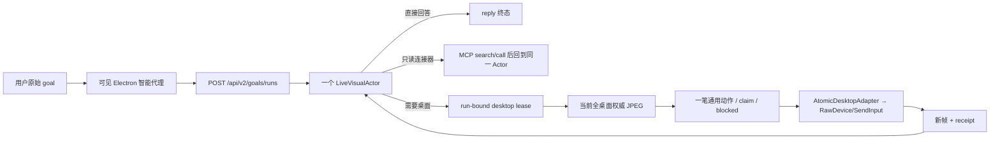

# 灵动脚本全项目精确讲解

> 主链说明最后同步：2026-08-19（`master`，唯一长期产品分支）。2026-08-14 至
> 2026-08-18 的主链瘦身与旧架构删除批次均已合入 `master`。仓库不再提交逐文件
> SHA 清单；需要路径或顶层符号时，现场运行 `python scripts/generate_project_guide.py`。
> 本套文档面向第一次接手仓库的开发者，也面向需要从“用户点发送”一路追到 Windows 物理输入和外部结果的人。
> 它不把历史设计、测试名字或模型自述当成当前实现；每个结论都应能回到真实文件、符号、合同或测试。

## 1. 这套文档解决什么问题

仓库同时包含当前 Electron + Python 产品路径、Studio、离线回放、旧 Flow/DSL、CLI、
MCP、宏和测试靶场。只阅读某个大文件，很容易得到三个错误印象：

1. 把仍被保存或测试的旧模块误认成产品默认执行链；
2. 把 Runtime 的 `done`、工具 `ok` 或模型话术误认成真实桌面任务完成；
3. 为当前模型的坐标、算术、几何或停止错误继续堆 prompt、规则、角色和应用配方。

本套文档用两层互补方式消除这些问题：

- 人工审计章节解释“为什么存在、谁调用、数据如何流动、失败在哪里分层”；
- 按需路径报告从 Git 的 NUL 分隔路径清单重建，只列路径和少量顶层符号；Git 本身负责内容身份与历史，不再维护一份容易漂移的重复 SHA 账本。

## 2. 推荐阅读顺序

| 顺序 | 文档 | 读完能回答的问题 |
| ---: | --- | --- |
| 1 | [系统架构](01-system-architecture.md) | 有哪些进程、哪一条才是产品主链、每个 owner 的边界是什么？ |
| 2 | [运行时全流程](02-runtime-flows.md) | 一条 goal 如何变成一次模型决定、一笔物理输入、新帧和最终状态？ |
| 3 | [合同、状态与接口](03-contracts-and-interfaces.md) | HTTP、WebSocket、IPC、图、帧、目标、动作、证据字段如何对齐？ |
| 4 | [测试、E2E 与故障定位](04-testing-and-debugging.md) | 什么才算真实通过；怎样沿四层证据找到首个分歧？ |
| 5 | [TypeScript/Electron 逐文件卷](05-file-reference-typescript-electron.md) | 前端、主进程、CLI、AI 接口和构建文件分别做什么？ |
| 6 | [WinPilot Python 核心逐文件卷](06-file-reference-winpilot-python.md) | 当前 vNext、兼容 Agent、感知、动作、记忆、录制各文件如何协作？ |
| 7 | [支撑代码/测试/脚本逐文件卷](07-file-reference-support-tests.md) | 两套测试、E2E runner、旧引擎、feature、模板和靶场分别验证什么？ |
| 8 | 按需路径/符号报告 | 运行 `python scripts/generate_project_guide.py --prefix <路径>`，快速查看当前工作树的文件与顶层符号。 |

逐文件三卷是历史审计入口，不是自动更新的权威清单。原仓库已有的专题文档仍然有价值，见[原文档索引](../README.md)，但事实冲突时应按“当前源码与测试 → `CLAUDE.md` 顶部当前章节 → 本套说明 → 历史记录”的顺序判断。

## 3. 一句话理解项目

灵动脚本是一个 Windows 桌面自动化与视觉 Agent 研发仓库。当前产品目标不是为有限应用编写脚本，而是让同一个模型保留原始用户目标，在每一轮读取当前权威 JPEG，只选择一笔通用键鼠动作，然后根据新画面继续判断。



## 4. 三条代码线必须分开

| 代码线 | 用户/开发入口 | 当前 owner | 可以做什么 | 不能据此声称什么 |
| --- | --- | --- | --- | --- |
| 产品 vNext | Electron“智能代理” → `/api/v2/goals/runs` | `orchestrator/live_agent.py` 组合的单一 `LiveVisualActor` + `MissionRuntime` | 直接回复、显式只读 connector、按需租约、当前帧上的通用 GUI 动作 | 旧 Agent/Flow 已成为 fallback；受控靶场通过等于任意软件可靠 |
| Studio/确定性自动化 | 流程工作台把当前 FlowScript 导出为 `runtime.kind=arp_graph` 的 Automation IR；资料页另走 `/api/replay` | `arp_graph` 进入 ARP；仅 `ACTION_BATCH` 复用 ToolSession；replay 由 Replayer/RuntimeJob 持有 | 编辑、验证、零模型确定性节点、录制/导出/重放 | Studio 节点矩阵等于自然语言 Agent 能力，或 API v2 都属于产品 vNext |
| 兼容与开发接口 | `:7880`、CLI、旧 engine、scheduler、feature（`/api/chat`、webui、AI interface 已随旧 Agent 线删除） | 各自旧 owner | 保持旧消费者、调试、迁移、脚本或外部集成 | 它们是当前 GUI 产品的第二条规划或兜底链 |

当前源码已经删除 `LEGACY_FLOW` 的执行 handler：枚举仍用于识别历史文件，但 validation 会给出迁移错误并 fail closed。旧模块仍大量存在不等于 vNext 会调用它们。

## 5. 仓库地图

| 路径 | 当前职责 | 重要边界 |
| --- | --- | --- |
| `src/main/` | Electron 生命周期、可信 preload、IPC、托管 Python、旧本地 API/调度/feature 桥 | 负责进程和前台交接，不做 Agent 语义规划 |
| `src/renderer/` | 智能代理、Studio、运行记录、资产、设置、Flow 编辑器 | `ControlPlaneClient` 只消费 Python API；浏览器状态不是服务端权威 |
| `src/cli/` | 旧命令行入口 | 是开发/兼容面，不是 GUI E2E 入口（`src/ai-interface/` 已删除） |
| `python/winpilot_home/winpilot/vnext/` | Actor、MissionRuntime、Broker、桌面 adapter 与仍在退役的 Mission/Evidence 合同 | 当前 live 执行内核；Mission/Evidence 包装不是应继续扩张的新架构 |
| `python/winpilot_home/winpilot/orchestrator/` | ARP 图/执行、goal admission、Thread、live 组合根 | `live_agent.py` 是产品主链的 canonical composition owner |
| `python/winpilot_home/winpilot/action/` | RawDevice、单写入队列、执行与 Studio/回放仍使用的旧验证基础 | 物理动作层不解释应用语义 |
| `python/winpilot_home/winpilot/visual_runtime/` | 帧权威、观察、坐标与视觉状态 | 当前 JPEG 和窗口身份的机械真相 |
| `python/winpilot_home/winpilot/modeling/` | 模型调用、协议 adapter、超时与 attempt | 不新增第二 planner 或 answer fixer |
| `python/winpilot_home/winpilot/integrations/` | 显式 MCP connector gateway | 当前只允许重新核验过的只读、非 destructive 工具 |
| `python/winpilot_home/winpilot/agent/` | AgentRunner 已删除；剩余 13 个跟踪文件服务 Studio ACTION_BATCH（`ToolSession` + mixins） | 迁移/兼容输入，不是当前在线产品依赖；迁走真实消费者后再删 |
| `python/winpilot_home/winpilot/fast/` | Legacy 快速 Controller 与 GUI 能力 | 仍有测试和复用候选，但不能整体接回主循环 |
| `python/winpilot_home/winpilot/perception/` | Win32/UIA/OCR/CV/应用发现等 | 结构化感知是可审计辅助，不替代当前像素语义 |
| `python/winpilot_home/winpilot/tasking/` | 仅剩 vNext/Studio 共享模块：`artifacts.py`（工件存储）、`execution_context.py`（桌面上下文）、`evidence.py`（技能证据） | Task Contract 编译链与 StageRuntime 已删除 |
| `python/winpilot_home/winpilot/memory/` | Memory Graph、compiler、store、feedback | 记忆只加速，不能成为冷启动硬实力补丁 |
| `python/winpilot_home/winpilot/recorder/` | Trace、human recorder、replay、export | 记录/重放忠实性与 Agent 原任务成功是两个结论 |
| `python/engine/`, `python/features/`, `python/tools/` | 旧 DSL/Flow/feature 运行设施 | 服务 Studio/兼容消费者，不进入产品视觉主循环 |
| `scripts/` | 客户端 E2E、受控矩阵、报告和清理 | runner 与 oracle 不得向生产 Agent 泄漏答案/坐标；独立 canary seal/campaign 已删除 |
| `python/winpilot_home/tests/` | WinPilot 合同、集成和 harness 测试 | 大量通过仍不是用户任务通过 |
| `tests/` | 旧引擎、feature、DSL、工具回归 | 与 vNext 主链测试口径分开 |
| `templates/`, `examples/`, `vision/`, `java-homework/` | fixture、示例、视觉工具、教学样例 | 文件存在不代表生产 Agent 有专属配方 |

## 6. 当前可信快照

以下是当前 `master` 的结构事实；同文件后面的旧数字只代表对应历史提交：

- `master` 是唯一长期产品分支；2026-08-17 旧架构删除和 2026-08-18 四个瘦身提交均已合入；
- 在线产品默认 screen-first 全桌面帧，同一个 `LiveVisualActor` 观察、行动、看新帧并决定 claim；
- trace、运行详情和 memory 只用于定位首个分歧，不参与任务通过，也不能反判模型已完成的任务；
- 在线静态依赖闭包不进入 `winpilot.agent`；Studio ACTION_BATCH 与离线 replay 仍是旧包和
  `action.verify` 的真实消费者，因此必须消费者先迁移；
- `LEGACY_FLOW` 执行 handler、旧 Agent 产品入口、第二 verifier 和双 evidence ledger 已删除；
- 2026-08-16 曾在当时源码上取得受控矩阵 `18/18`、真实软件 `29/30`。当前 HEAD 后续仍有
  execution/replay 改动，不能把这些历史结果冒充当前版本已完成可见 E2E。

## 7. 最小开发与验证入口

开发环境使用 Node.js 20、Python 3.11。支持的 Python 服务入口是 Electron 托管或 `serve.py`；直接运行 `uvicorn winpilot.server:app` 会被启动守卫拒绝。

```powershell
npm ci
python -m pip install -r requirements.txt
npm run dev
```

常规静态、单元与集成检查：

```powershell
npm test
npm run typecheck
npm run build
npm run build:all
python -m pytest python/winpilot_home/tests -q
python -m pytest tests -q
```

真实客户端检查需要先保持 `npm run dev` 的 Electron 可见，再在另一终端运行：

```powershell
npm run e2e:client:visual
npm run e2e:client:original
npm run e2e:client:mixed
```

## 8. 按需路径扫描

辅助脚本读取 `git ls-files -z`，因此中文、空格和特殊字符路径不会被 shell 分词吞掉。
它不计算内容哈希，不生成必须提交的快照，也不承担“证明零遗漏”的额外合同。

```powershell
python scripts/generate_project_guide.py --check
python scripts/generate_project_guide.py --prefix python/winpilot_home/winpilot/vnext/
python scripts/generate_project_guide.py --prefix src/ --output output/project-paths.md
```

`--check` 只验证当前跟踪路径能够扫描、受支持的源码能够解析；普通调用把简洁的
路径/类别/顶层符号报告输出到终端，只有显式传入 `--output` 才写文件。架构事实仍以
当前源码、测试和 `CLAUDE.md` 顶部当前章节为准。

## 9. 高频术语

| 术语 | 本项目中的精确定义 |
| --- | --- |
| goal | 用户提交的完整原始目标；产品主链不把它改写成关键词步骤 |
| Thread / Turn | 服务端有界对话容器 / 一次用户请求；只有成功且有用户结果的 Turn 进入后续历史 |
| ARP | 仓库中的图与执行容器；产品 vNext 固定生成 `start → full-goal AGENT_GOAL → end` 三节点壳，其中只有一个语义节点；Studio 可提交更一般的图 |
| Visual Actor | 唯一语义模型角色；先决定 reply/connector/desktop，进入桌面后每轮看权威 JPEG 选一个工具 |
| desktop lease | 某个 run 请求 Electron 让出前台并交付精确目标窗口的单次绑定 |
| target binding | `binding_id`、HWND、PID、可执行身份、标题快照、建立它的 evidence ref 与 epoch；目标 region 属于冻结目标/RuntimeFrame，不是该 wire contract 的字段 |
| authoritative frame | 与目标、epoch、区域、捕获时间和 payload hash 原子绑定的当前 JPEG |
| canonical arguments | 模型参数经过严格 schema 解析后的运行时参数；其中坐标型动作的坐标仍处于模型实际收到的 submitted-image 像素空间 |
| physical attempt | 映射到物理桌面并准备交给 RawDevice/SendInput 的实际参数记录 |
| receipt | 物理输入是否开始/完成、失败种类和机制等回执 |
| action effect | 动作后下一张权威屏幕交给同一个 Actor 观察；runtime 不生成局部像素判定 |
| E2E report | 独立于被测 Runtime 的文件、应用状态、可信事件、像素或 UI 读回；只报告测试样本真实终态，不反馈进生产执行线，也不替代 Actor 的完成判断 |
| fail closed | 身份、帧、权限、证据或结果无法证明时停止并明确失败，而不是猜测或静默降级 |

## 10. 阅读代码时最重要的判断法

遇到任何失败或“架构很高级但任务很差”的现象，先把一次真实 run 排成四列：

```text
模型原始参数
  -> canonical 参数
  -> physical_attempt / RawDevice receipt
  -> 外部应用最终状态
```

应找的是第一个“不满足本层合同，或不符合约定的确定性变换”的层，而不是机械比较数值相等：submitted 坐标映射到物理桌面后本来就可能数值不同。如果 raw 参数按合同已错，继续加入坐标补偿、按钮吸附、应用规则、答案修正或第二模型，只会让系统在样例上更复杂、在开放任务上更脆弱；如果映射与物理回执正确但外部状态错，再检查焦点、输入机制和应用状态。
