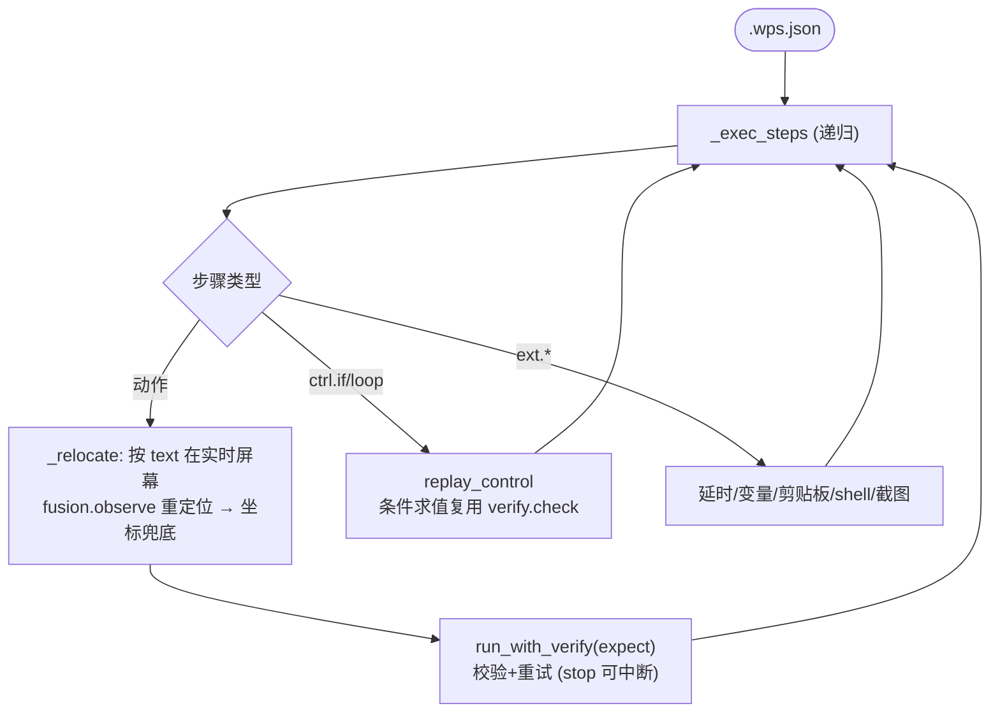
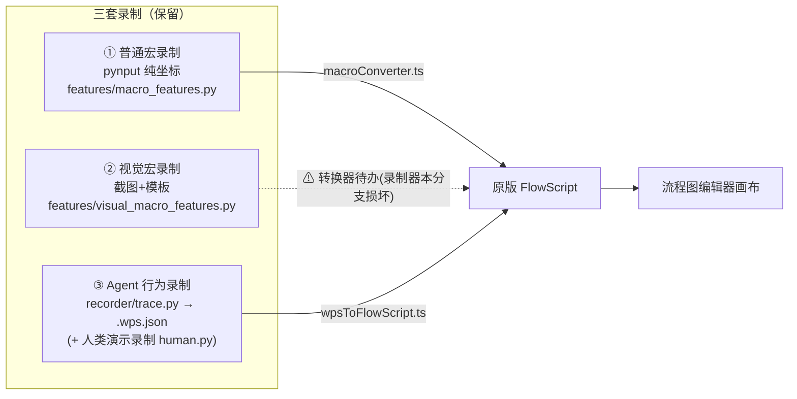

# 重放与录制

> 把 agent 跑过的流程（或人手演示）变成**可重放、可编辑**的脚本。涉及 `winpilot/recorder/*`、`utils/wpsToFlowScript.ts`、`components/ReplayEditorView.tsx`。

## 1. `.wps.json` 格式（wps/2）

WinPilot 的重放脚本格式。每一步 `tool` 字段是 agent 工具名，**自带语义选择器**（元素文字/角色/坐标/来源 + `expect` 验证条件），所以重放时能按文字在实时屏幕重定位，而非死磕绝对坐标。

```jsonc
{
  "format": "wps/2",
  "name": "登录并打开收件箱",
  "source": "agent" | "human",
  "vars": { "user": "alice" },          // ${user} 插值
  "steps": [
    { "tool": "click", "text": "登录", "role": "button", "coords": [842, 615],
      "source": "uia", "expect": { "text_appears": "欢迎" } },
    { "tool": "type_text", "text_input": "${user}", "element_text": "用户名" },
    { "tool": "ctrl.if", "cond": { "window_appears": "验证码" },
      "then": [ { "tool": "click", "text": "刷新" } ],
      "else": [] },
    { "tool": "ctrl.loop", "loop_type": "while", "cond": { "text_appears": "下一页" },
      "max_iters": 50, "body": [ { "tool": "click", "text": "下一页" } ] },
    { "tool": "ext.delay", "seconds": 1.5 }
  ]
}
```

- **动作步骤**：`click / type_text / hotkey / launch / focus_window / scroll / drag / wait / run_shell / tray_click`（与 agent 工具同构）。
- **控制流**（嵌套 children）：`ctrl.if`（cond/then/else）、`ctrl.loop`（count/while/until/infinite + `max_iters` 硬护栏）。
- **离线便利步骤**：`ext.delay / ext.var_set / ext.clipboard_set / ext.clipboard_get / ext.run_shell / ext.screenshot`。
- `${var}` 插值；`expect`/`cond` 复用 `action/verify.py` 的验证 DSL。
- **v1 兼容**：旧 `wps/1`（扁平、仅动作）可被新 Replayer 原样执行。

## 2. 离线 0-token Replayer

`recorder/trace.py` 的 `Replayer` + `recorder/replay_control.py`：



全程**不调用 LLM**（0 token）。控制流的条件判断也走本地感知。失败即停并报告卡在第几步（供 `reuse_skill` 接管）。

## 3. 三套录制（输出统一为可入流程图的格式）



| 录制 | 现状 |
|---|---|
| ① 普通宏（pynput 坐标） | 已有 `macroConverter.ts` → FlowScript；MacroPanel「转流程」。**已标 `@deprecated`**（纯坐标、换分辨率即失效） |
| ② 视觉宏（截图模板） | ⚠️ **本分支损坏**（依赖已删除的 `agent.experience_db`），其 → FlowScript 转换器待办 |
| ③ Agent 行为 / 人类演示 | `recorder/trace.py`（agent 跑过的）/ `recorder/human.py`（人手演示，点击瞬间用 `fusion.observe` 抓元素选择器）→ `.wps.json` → 经 §4 导入 |

> **已知未解决**：原版宏录制按钮的 UI 尚未真正合并出"agent 行为录制"入口；三套录制还没收进单一面板。

### 人类演示录制器（`recorder/human.py`）

- 纯逻辑 `StepBuilder`：键盘聚合成 `type_text`、组合键/功能键成 `hotkey`、点击/拖拽带语义选择器（点击瞬间 `fusion.observe` 抓命中元素的 text/role/source）。
- 外壳 `HumanRecorder`：pynput 监听 + 队列 worker（慢速 observe 不丢事件），停止后蒸馏写 `.wps.json`。

## 4. 导入到流程图（wps → 原版 FlowScript）

`utils/wpsToFlowScript.ts`（**纯代码转换层，agent 不参与**）把 `.wps.json` 步骤映射成现有 65 节点：

| wps 步骤 | 原版节点 |
|---|---|
| `click`（带 text） / `click`（仅坐标） | `click_text`（OCR 文字点击） / `click` |
| `type_text` / `hotkey` / `launch` / `focus_window` | `input_text` / `keyboard` / `launch_program` / `focus_window` |
| `scroll` / `drag` | `mouse_operation` / `swipe` |
| `ctrl.if`（then/else） | `condition`（yes/no 端口 + 子链） |
| `ctrl.loop`（body） | `loop`（loop_body 回边 + loop_end） |
| `run_shell` / `ext.run_shell` | `tool_call`（feature_name=run_shell） |
| `ext.delay` / `ext.var_set` / `ext.clipboard_set` / `ext.screenshot` | `wait` / `variable_set` / `clipboard_set` / `screenshot` |

入口：React「导入/录制」标签（`components/ReplayEditorView.tsx`）列出 WinPilot 的 trace/脚本 →「导入到流程图」→ 转换 → `store.loadScript` → 切到画布。此后即普通流程图：自由编辑、混入指令库节点、F5 用原版引擎运行。

> 因为转成了原版节点，重放内容能与 @feature/库节点**自由混编**，并复用成熟编辑器的全部能力（拖拽/属性面板/撤销/模板等）。
