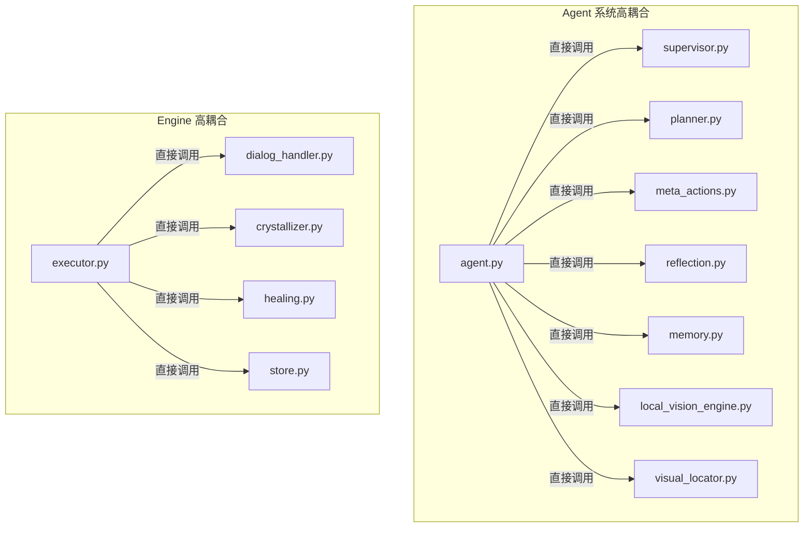
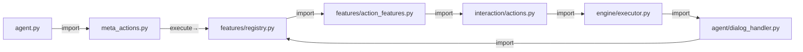
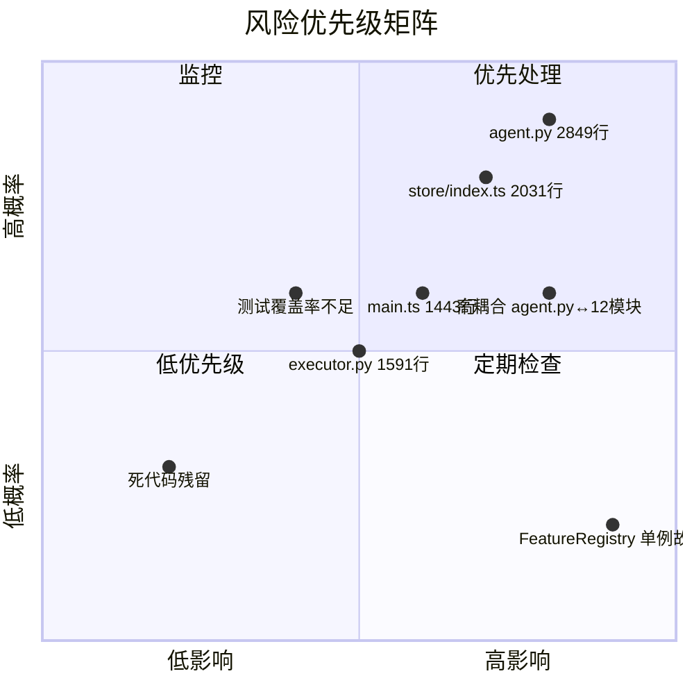

# 风险分析与架构债务

> **文档**: `docs/risk-analysis.md`
> **生成日期**: 2026-06-06
> **前置阅读**: [system-map.md](system-map.md), [architecture.md](architecture.md)

---

## 1. 超大文件 (High Risk)

| 文件 | 行数 | 风险 | 建议 | 拆分状态 |
|------|------|------|------|----------|
| `python/agent/agent.py` | **2849** | 🔴 **临界** | 系统提示词+模型检测已拆至 `prompts.py` (80行), 余下 SoM/vision 方法待拆 | 🟡 **部分完成** |
| `src/renderer/store/index.ts` | **2031** | 🔴 **临界** | `defaults.ts`(370行)+`persistence.ts`(52行) 已提取; Zustand slice 待进一步拆分 | 🟡 **部分完成** |
| `python/engine/executor.py` | **1591** | 🟡 **高** | 70+ `_exec_*` 方法应分组到子模块 | ⬜ **待处理** |
| `src/main/main.ts` | **1443** | 🟡 **高** | IPC 处理器应拆分到 handlers/ 目录 | ⬜ **待处理** |
| `python/engine/dsl_flow_converter.py` | 1476 | 🟡 **高** | dsl_to_flow 和 flow_to_dsl 应拆为两文件 | ⬜ **待处理** |
| `python/agent/meta_actions.py` | 1048 | 🟡 **高** | 27 个动作应按类别拆分 | ⬜ **待处理** |
| `python/agent/supervisor.py` | 856 | 🟡 **中** | 监督流水线逻辑密度高 | ⬜ **待处理** |
| `python/agent/planner.py` | 859 | 🟡 **中** | PlanNode/Plan/Planner/PlanExecutor 可拆 | ⬜ **待处理** |
| `src/renderer/types/index.ts` | 887 | 🟡 **中** | 55 种节点参数接口可拆分 | ⬜ **待处理** |

---

## 2. 高耦合模块 (High Risk)

| 耦合关系 | 强度 | 问题 |
|----------|------|------|
| `agent.py` ↔ 12+ 模块 | 🔴 **高** | 上帝模块，直接 import 全局子系统 |
| `executor.py` ↔ 6+ 模块 | 🟡 **中** | 直接调用 dialog_handler/crystallizer/store |
| `main.ts` ↔ 8+ 模块 | 🟡 **中** | IPC 处理器集中管理子进程 |

---

## 3. 单点故障模块 (Medium Risk)

| 模块 | 影响 | 风险 |
|------|------|------|
| `FeatureRegistry` 单例 | 所有工具调用依赖此单例初始化 | 🟡 **中** |
| `LingdongAgent` | Agent 5 种模式统一入口 | 🟡 **中** |
| `DSLExecutor` | DSL 执行唯一入口 | 🟡 **中** |
| `main.ts` | 所有 IPC 处理 + 子进程管理 | 🟡 **中** |

---

## 4. 循环依赖风险 (Low-Medium)

当前没有检测到硬循环依赖，但存在**长链间接循环**风险：
- `agent.py → features → interaction → executor → dialog → registry`
- 如果某步反向 import 会导致循环

---

## 5. 架构债务清单

| # | 债务 | 位置 | 类型 | 严重度 |
|---|------|------|------|--------|
| 1 | **Agent 5 种模式复用不足** | `agent.py` | 架构 | 🟡 **中** |
| 2 | **旧版 resolve_auto() 未删除** | `config.py:195` | 死代码 | 🟢 **低** |
| 3 | **旧版 SYSTEM_PROMPT_TEXT 未删除** | `agent.py` (注释保留) | 死代码 | 🟢 **低** |
| 4 | **MetaActions 手动维护** | `meta_actions.py:579` | 可维护性 | 🟢 **低** |
| 5 | **DirectUI 对话框不可保存** | `dialog_handler.py` | 设计限制 | 🟡 **中** |
| 6 | **region_picker.py 缺失** | `interaction/` | 完整性 | 🟢 **低** |
| 7 | **OmniParser 本地 CPU 慢** | `omniparser_client.py` | 性能 | 🟡 **中** |
| 8 | **Florence-2 已移除** | `local_vision_engine.py` | 能力减退 | 🟢 **低** |
| 9 | **HTN 前端/后端不共享** | `htnPlanner.ts` + `planner.py` | 冗余 | 🟢 **低** |
| 10 | **测试覆盖率不足** | `tests/` (部分模块0测试) | 质量 | 🟡 **中** |

---

## 6. 风险优先级矩阵

## 7. 改进建议

| 优先级 | 改进项 | 预期效果 |
|--------|--------|----------|
| P0 | 拆分 `agent.py` SoM/vision 方法 → `agent/vision_utils.py` | 降低单一文件复杂度 |
| P0 | 拆分 `store/index.ts` → Zustand slice 模式 | 提高可维护性 |
| P1 | 拆分 `main.ts` IPC 处理器 → `handlers/` 目录 | 降低单点故障风险 |
| P2 | 统一 Planner (前端 HTN + 后端 Plan DAG) | 消除冗余 |
| P2 | 增加核心模块测试覆盖 | 提高质量保证 |
