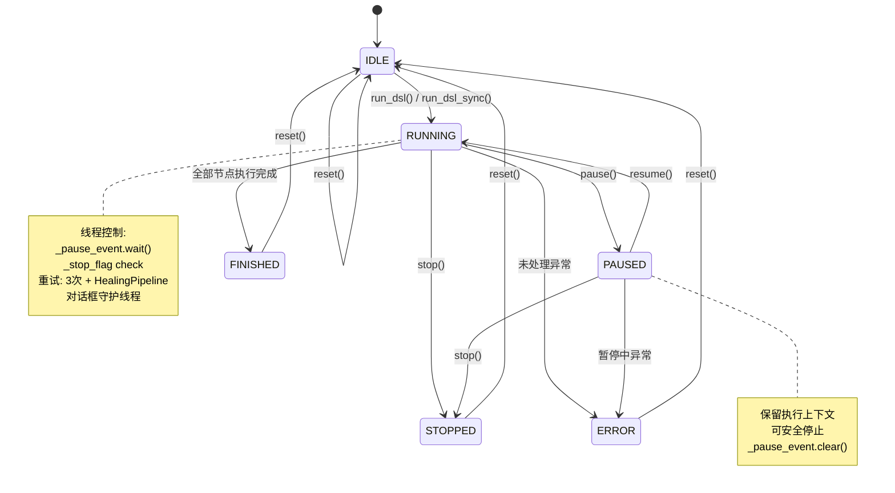
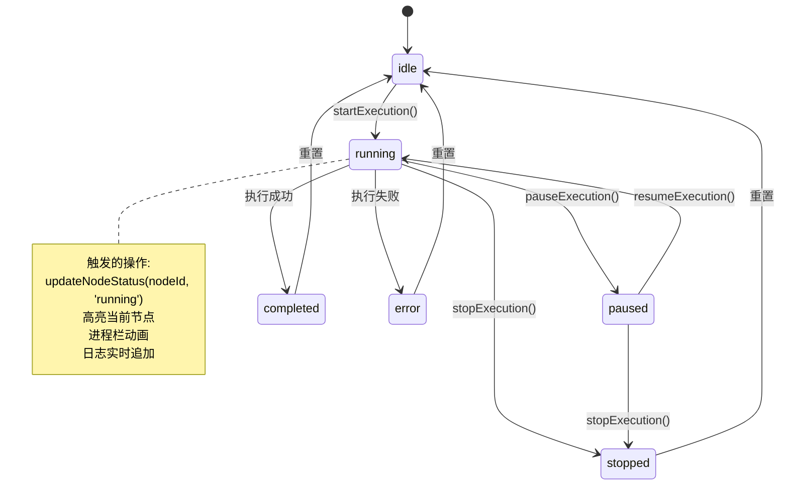
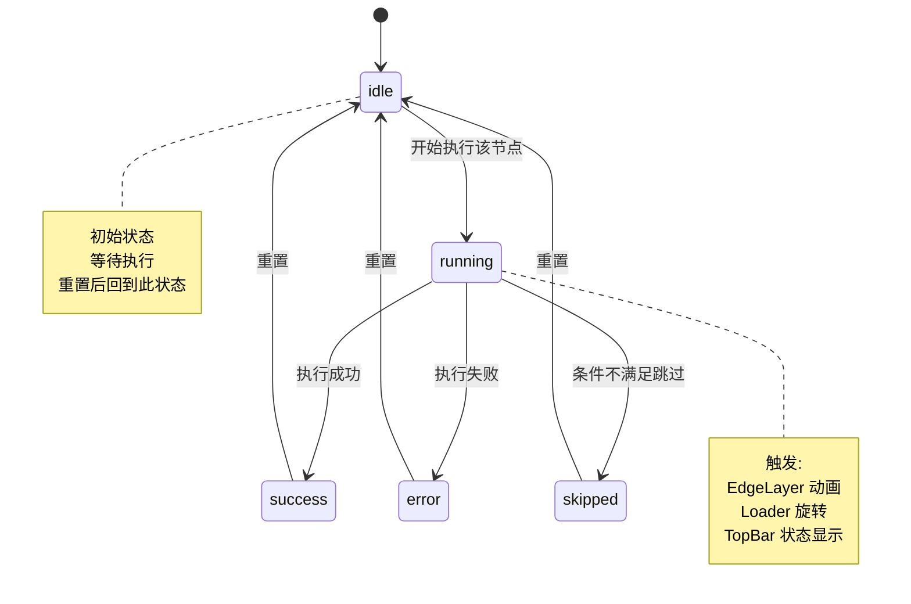
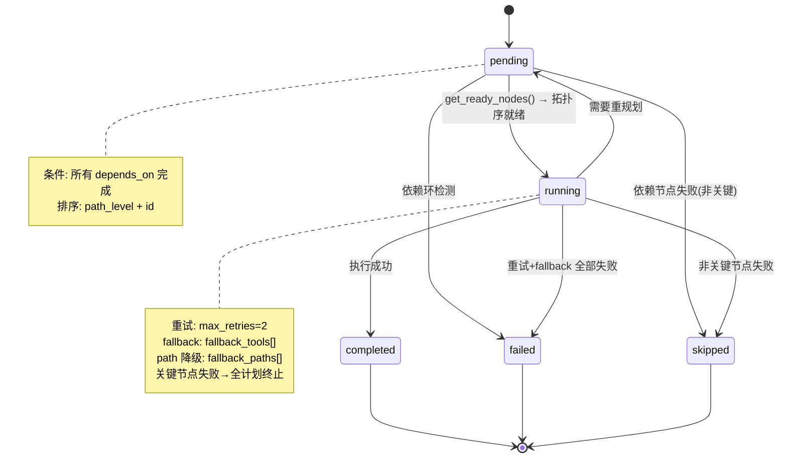
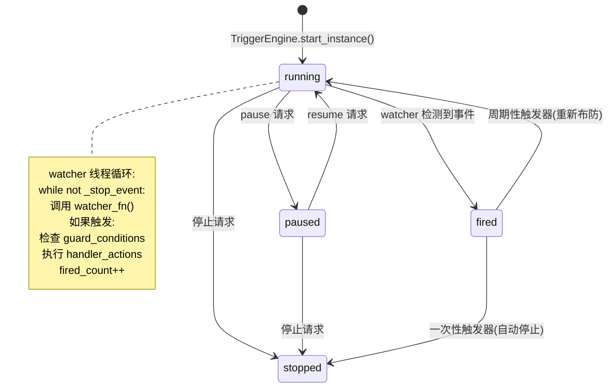

# 状态机分析

> **文档**: `docs/state-machine.md`
> **覆盖**: DSL执行器 / Agent / 流程图节点 / Plan DAG / 触发器

---

## 1. DSL 执行器状态机

**文件**: `python/engine/executor.py` (类 `DSLExecutor`, 状态字段 `_state`)



| 状态 | 含义 | `_pause_event` | `_stop_flag` | 可恢复? |
|------|------|---------------|-------------|---------|
| `IDLE` | 空闲待命 | set | clear | - |
| `RUNNING` | 执行中 | set | clear | - |
| `PAUSED` | 已暂停 | clear | clear | ✅ resume() |
| `STOPPED` | 已停止 | clear | set | ❌ 需要 reset() |
| `ERROR` | 出错 | set | clear | ❌ 需要 reset() |
| `FINISHED` | 完成 | set | clear | ❌ 需要 reset() |

---

## 2. Frontend 执行状态机

**文件**: `src/renderer/types/index.ts` (类型 `ExecutionState.status`)



---

## 3. 流程图节点状态机

**文件**: `src/renderer/types/index.ts` (类型 `FlowNode.status`)



---

## 4. Plan DAG 节点状态机

**文件**: `python/agent/planner.py` (类 `PlanNode`, 字段 `status`)



---

## 5. 触发器实例状态机

**文件**: `python/engine/triggers.py` (类 `TriggerInstance`, 字段 `status`)



---

## 6. 状态机对比汇总

| 状态机 | 位置 | 状态数 | 并发 | 持久化 |
|--------|------|--------|------|--------|
| DSL 执行器 | `engine/executor.py` | 6 | 单线程 + 并行分支 | SQLite checkpoint |
| Frontend 执行 | `types/index.ts` | 6 | N/A | localStorage |
| 流程图节点 | `types/index.ts` | 5 | N/A | FlowScript JSON |
| Plan DAG 节点 | `agent/planner.py` | 5 | 串行拓扑序 | 内存 |
| 触发器实例 | `engine/triggers.py` | 4 | 每实例一线程 | schedules.json |

### 通用状态模式

```
IDLE/RUNNING/PAUSED/STOPPED → 出现在 DSL Executor + Frontend Executor
pending/running/completed/failed → 出现在 Plan DAG + 流程图节点
running/fired/stopped → 出现在触发器
```

### 状态管理最佳实践

1. **线程安全**: 所有状态变更需通过 lock (`threading.RLock` / `threading.Event`)
2. **状态去重**: Agent token 系统防止旧进程事件污染新进程
3. **状态恢复**: DSL Executor 通过 SQLite checkpoint 保存/恢复运行状态
4. **UI 同步**: IPC 事件 (`state_change`, `node_status`) 驱动前端状态更新
