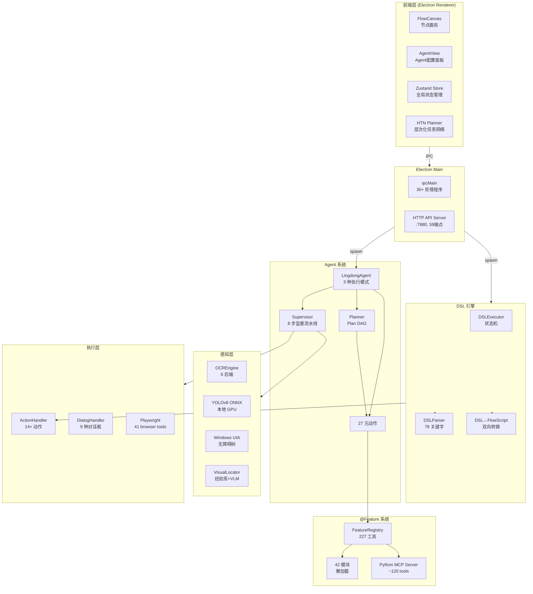
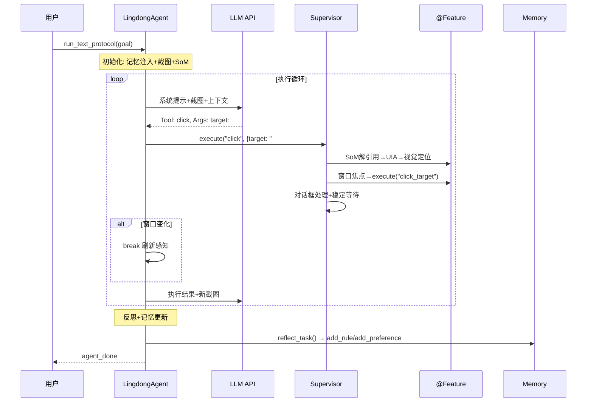
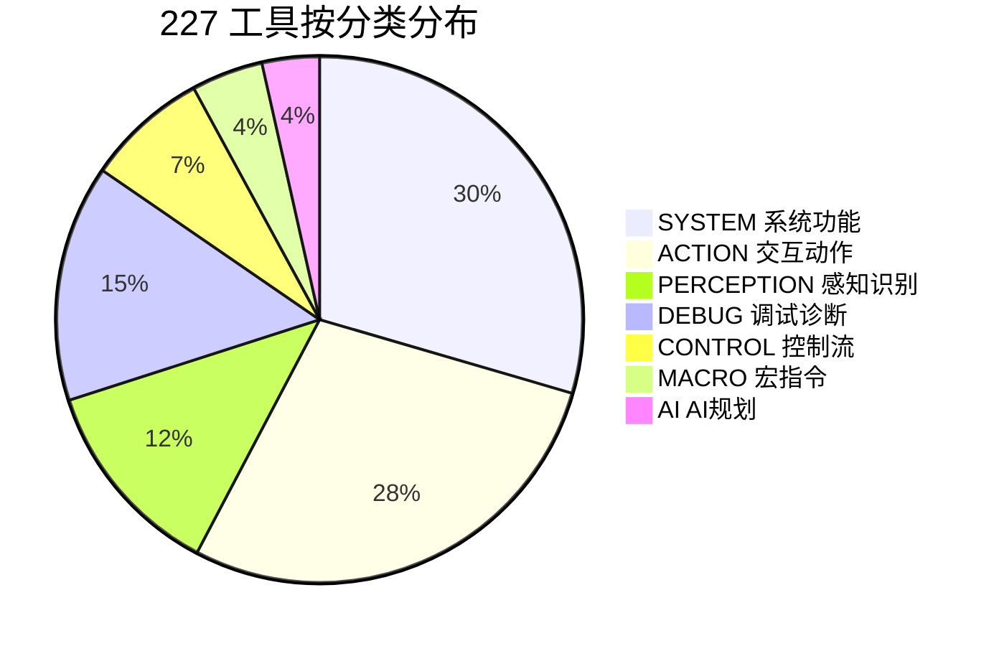

# 灵动脚本 (Lingdong Script) 系统分析报告

> **生成日期**: 2026-06-06
> **分析范围**: 全系统 12 个子系统, 9 个并行分析 Agent, ~150 个源文件
> **代码统计**: ~50K 行 Python | ~15K 行 TypeScript | 2584 测试

---

## 文档索引

| # | 文档 | 内容 | 页数估计 |
|---|------|------|----------|
| 1 | **[system-map.md](system-map.md)** | 系统总览图、目录结构、文件热力图、核心数据流 | 索引 |
| 2 | **[architecture.md](architecture.md)** | 总体架构 Mermaid 图、模块职责、数据流向、依赖深度图 | ✅ |
| 3 | **[agent-runtime.md](agent-runtime.md)** | Agent 5 种执行模式、Supervisor 8 步流水线、IPC 协议、生命周期 | ✅ |
| 4 | **[arp.md](arp.md)** | ARP 7 级路径选择、工具分类规则、降级执行链、Planner 集成 | ✅ |
| 5 | **[workflow.md](workflow.md)** | DSL 引擎、78 关键字、执行状态机、FlowScript↔DSL 转换、结晶化 | ✅ |
| 6 | **[memory.md](memory.md)** | 三轨记忆体系、MemoryStore、ReflectionEngine、视觉经验系统 | ✅ |
| 7 | **[tools.md](tools.md)** | @feature 注册表、246 工具分类、27 元动作、懒加载机制 | ✅ |
| 8 | **[state-machine.md](state-machine.md)** | 5 个状态机汇总对比 | ✅ |
| 9 | **[risk-analysis.md](risk-analysis.md)** | 超大文件、高耦合、单点故障、架构债务、改进建议 | ✅ |
| 10 | **[trace-design.md](trace-design.md)** | Trace Event Schema、埋点位置、收集器设计、可视化方案 | ✅ |

---

## 核心 Mermaid 图

### 系统架构图



### Agent 执行序列图



### 工具分类图



---

## 设计原则

1. **功能即注册**: 新增功能只需 `@feature(...)` 一处声明，MCP/CLI/HTTP/DSL 全部自动同步
2. **生成一次，永久执行**: AI 生成的流程图可离线执行，零 Token 成本
3. **先路径再工具**: ARP 7 级路径选择确保最快执行路径
4. **失败降级**: 每层有 fallback，从 DIRECT_API 一路降到 DSL_GEN
5. **视觉先本地再云端**: YOLO+OCR 本地 GPU → VLM API → OmniParser
6. **学习进化**: 经验复用 + 自我反思 + 模板结晶化

---

## 文件清单

```
docs/
├── system-map.md         # 系统总览索引
├── system-analysis.md    # 本文件 (合并摘要)
├── architecture.md       # Part 1: 总体架构
├── agent-runtime.md      # Part 3-4: Agent 执行链
├── arp.md                # Part 5: ARP 系统
├── workflow.md           # Part 9: Workflow 分析
├── memory.md             # Part 8: Memory 系统
├── tools.md              # Part 7: Tool 系统
├── state-machine.md      # Part 6: 状态机分析
├── risk-analysis.md      # Part 10: 风险分析
└── trace-design.md       # Part 11: Trace 设计
```
