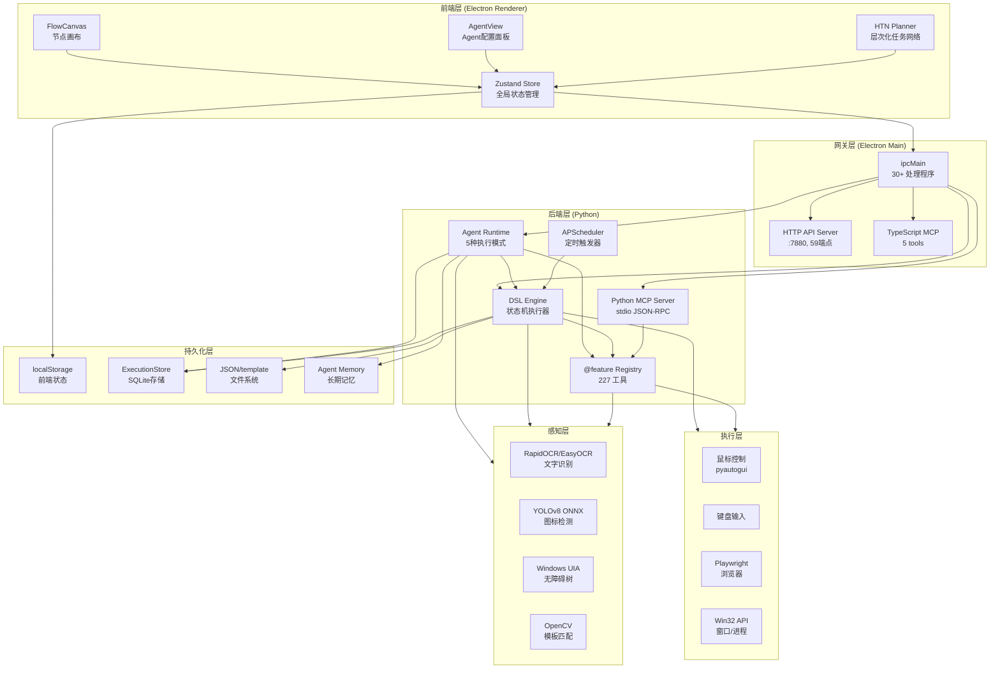
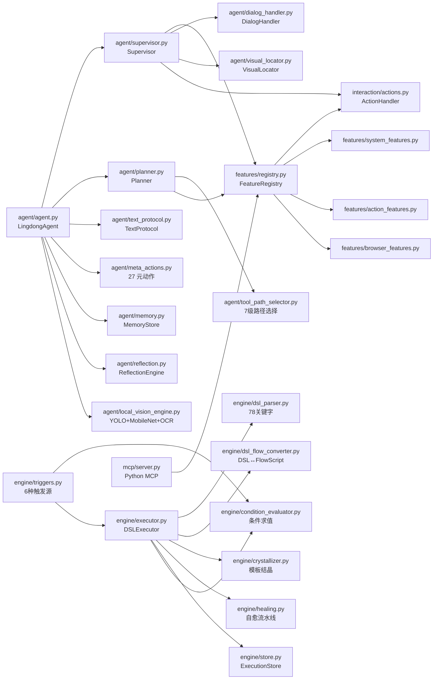

# 灵动脚本 (Lingdong Script) 系统架构地图

> **版本**: v2.0 | **生成日期**: 2026-06-06
> **用途**: 全系统架构索引，导航到各子系统深度分析文档

---

## 系统总览

灵动脚本是一个 **Electron + React + Python** 桌面自动化平台，支持三种执行范式：

| 范式 | 描述 | 适用场景 |
|------|------|----------|
| **流程图** | 可视化拖拽编排，DSL 脚本执行 | 确定性自动化流程，零 Token 执行 |
| **AI Agent** | 自然语言→LLM→自动执行 | 动态桌面任务，需要视觉理解和决策 |
| **混合** | AI 生成流程图→离线执行 | 一次 AI 生成，永久零 Token 执行 |

---



---

## 子系统导航

| # | 子系统 | 文档 | 核心文件 | 行数 | 复杂度 |
|---|--------|------|----------|------|--------|
| 1 | **Agent Runtime** | [agent-runtime.md](agent-runtime.md) | `python/agent/agent.py` | ~2850 | ⭐⭐⭐⭐⭐ |
| 2 | **DSL Engine** | [engine.md](engine.md) | `python/engine/executor.py` | 1591 | ⭐⭐⭐⭐⭐ |
| 3 | **Feature Registry** | [tools.md](tools.md) | `python/features/registry.py` | 546 | ⭐⭐⭐⭐ |
| 4 | **Planner & Router** | [planner.md](planner.md) | `python/agent/planner.py` | 859 | ⭐⭐⭐⭐ |
| 5 | **Memory & Reflection** | [memory.md](memory.md) | `python/agent/memory.py` | 267 | ⭐⭐⭐ |
| 6 | **Frontend & State** | [frontend.md](frontend.md) | `src/renderer/store/index.ts` | 2031 | ⭐⭐⭐⭐⭐ |
| 7 | **IPC & API Gateway** | [gateway.md](gateway.md) | `src/main/main.ts` | 1443 | ⭐⭐⭐⭐ |
| 8 | **MCP Integration** | [mcp.md](mcp.md) | `python/mcp/server.py` | ~500 | ⭐⭐⭐ |
| 9 | **Scheduler & Triggers** | [scheduler.md](scheduler.md) | `python/engine/triggers.py` | ~500 | ⭐⭐⭐ |
| 10 | **Perception (Vision)** | [perception.md](perception.md) | `python/perception/ocr.py` | ~400 | ⭐⭐⭐ |
| 11 | **Execution Layer** | [execution.md](execution.md) | `python/interaction/actions.py` | ~500 | ⭐⭐⭐ |
| 12 | **State Machine** | [state-machine.md](state-machine.md) | 跨组件 | — | ⭐⭐⭐⭐ |

---

## 核心数据流

### 流程图执行 (离线模式)

```
用户拖拽编排 → FlowScript JSON → IPC engine:start
  → Python Engine (executor.py)
    → DSLParser (dsl_parser.py)        AST
    → DSLExecutor (executor.py)        状态机执行
      → 每步调用 ActionHandler
        → pyautogui / win32api / etc
    → Crystallizer (crystallizer.py)   保存模板
  → IPC 事件 (node_start/done/log/execution_done)
  → Zustand Store 更新 → UI 高亮
```

### AI Agent 执行 (在线模式)

```
用户输入自然语言目标 → IPC agent:start
  → AgentIPC._cmd_start (__main__.py)
    → LingdongAgent (agent.py)
      → _unified_run() → 分派到执行模式
        → run_text_protocol() / run_langgraph() / etc
          → LLM 调用 → 解析工具调用
          → Supervisor.execute() 监督执行
            → SoM 定位 / UIA / OCR / 视觉定位
            → @feature 工具执行
            → 窗口焦点 / 对话框处理
          → 截图 → LLM → 下一步
      → 反思 (ReflectionEngine)
      → 记忆更新 (MemoryStore)
  → IPC 事件 (step_complete/log/agent_done)
  → AgentView UI 更新
```

### HTTP API 控制流 (Claude Code 远程)

```
Claude Code → curl POST :7880/api/*
  → api.ts → switch(url.pathname)
    → 直接处理 (截图/feature call/状态查询)
    → 或 IPC → Renderer (api-command)
      → Zustand action → UI 更新
    → 或 spwan Python 子进程 (DSL转换/OCR)
```

---

## 关键数字

| 指标 | 数值 |
|------|------|
| Python 文件 | 50+ feature 模块 |
| TS/前端文件 | ~25 组件 + store |
| @feature 工具 | 227 (42 模块) |
| 元动作 | 27 (高层抽象) |
| DSL 关键字 | 78 内置 + N 动态 |
| 节点类型 | 65 (流程图) |
| HTTP API 端点 | 59 |
| IPC 处理程序 | 30+ |
| Python 测试 | 2584 (15 文件) |
| TS 测试 | ~16 文件 |
| Agent 执行模式 | 5 (text/langgraph/planned/computer_use/direct) |
| 视觉策略 | 4 (cli_path/blind_guess/ocr_llm/som) |
| 触发器类型 | 6 (文件/进程/窗口/剪贴板/网络/定时) |
| 访问路径级别 | 7 (L0-L6) |

---

## 核心依赖图 (Python)



---

## 文件大小热力图

```
>=2000行: ████████████████████
1000-1999: ██████████
500-999:   █████
100-499:   ██
<100:      █

python/agent/agent.py              2849  ████████████████████  (含 prompts.py 80行拆出)
src/renderer/store/index.ts         2031  █████████████████  (含 defaults.ts 370行拆出)
python/engine/executor.py          1591  ██████████████
src/main/main.ts                   1443  █████████████
python/engine/dsl_flow_converter.py 1476  ████████████
python/agent/meta_actions.py       1048  █████████
python/agent/planner.py             859  ███████
src/renderer/types/index.ts         887  ███████
python/agent/supervisor.py          856  ███████
src/renderer/store/executor.ts      744  ██████
python/features/system_features.py  ~600  █████
python/agent/tool_path_selector.py  601  █████
python/engine/dsl_parser.py         593  █████
python/features/registry.py         546  ████
src/renderer/components/AgentView.tsx 536 ████
python/agent/config.py              403  ███
python/agent/__main__.py            398  ███
```

---

## 目录结构 (精简)

```
├── python/                       # Python 后端
│   ├── agent/                    # AI Agent 系统 (18 模块)
│   │   ├── agent.py              #   LingdongAgent 统一入口 (~2850行)
│   │   ├── prompts.py            #   系统提示词+模型检测 (80行,已提取)
│   │   ├── __main__.py           #   IPC 子进程入口 (398行)
│   │   ├── supervisor.py         #   监督执行层 (856行)
│   │   ├── config.py             #   AgentConfig (403行)
│   │   ├── planner.py            #   Plan DAG 分解执行 (859行)
│   │   ├── meta_actions.py       #   27 元动作 (1048行)
│   │   ├── text_protocol.py      #   文本协议解析 (87行)
│   │   ├── tool_path_selector.py #   7级路径选择 (601行)
│   │   ├── memory.py             #   长期记忆 (267行)
│   │   ├── reflection.py         #   自我反思 (267行)
│   │   ├── local_vision_engine.py#   本地视觉 (YOLO/OCR)
│   │   ├── visual_locator.py     #   语义→坐标定位
│   │   ├── experience_db.py      #   经验数据库
│   │   ├── dialog_handler.py     #   对话框处理
│   │   ├── menu_handler.py       #   菜单操作
│   │   ├── mimo_agent.py         #   向后兼容 (41行)
│   │   ├── omniparser_client.py  #   OmniParser 客户端
│   │   └── state_persistence.py  #   运行历史持久化
│   │
│   ├── engine/                   # DSL 执行引擎 (14 模块)
│   │   ├── executor.py           #   状态机执行器 (1591行)
│   │   ├── dsl_parser.py         #   DSL 解析器 (593行)
│   │   ├── dsl_flow_converter.py #   双向转换 (1476行)
│   │   ├── engine.py             #   stdio JSON 引擎 (153行)
│   │   ├── unified_entry.py      #   统一入口 (108行)
│   │   ├── condition_evaluator.py#   条件求值 (251行)
│   │   ├── crystallizer.py       #   模板结晶 (236行)
│   │   ├── optimizer.py          #   执行优化 (176行)
│   │   ├── healing.py            #   自愈流水线 (248行)
│   │   ├── store.py              #   SQLite 持久化 (370行)
│   │   ├── triggers.py           #   6种触发器
│   │   ├── trigger_bridge.py     #   触发器前端桥接
│   │   ├── scheduler.py          #   调度器
│   │   └── scheduler_daemon.py   #   APScheduler 守护进程
│   │
│   ├── features/                 # @feature 注册系统 (50文件, 42模块)
│   │   ├── registry.py           #   FeatureRegistry 单例 (546行)
│   │   ├── _all.py               #   42模块懒加载列表
│   │   ├── action_features.py    #   交互动作
│   │   ├── perception_features.py#   感知识别
│   │   ├── system_features.py    #   系统功能
│   │   ├── browser_features.py   #   浏览器 CDP
│   │   ├── ai_plan_features.py   #   AI 规划
│   │   └── ... (36 更多)
│   │
│   ├── interaction/              # 交互执行层
│   │   ├── actions.py            #   ActionHandler
│   │   ├── wheel_selector.py     #   滚轮选择器
│   │   └── region_picker.py      #   区域拾取
│   │
│   ├── perception/               # 视觉感知层
│   │   ├── ocr.py                #   EasyOCR/RapidOCR
│   │   ├── vision.py             #   图像/模板匹配
│   │   ├── fusion.py             #   多模态融合
│   │   └── app_adapter.py        #   应用适配器
│   │
│   ├── providers/                # LLM 提供商
│   │   ├── base.py               #   基础客户端
│   │   ├── deepseek.py           #   DeepSeek API
│   │   ├── openai.py             #   OpenAI 兼容
│   │   └── vlm.py                #   视觉语言模型
│   │
│   ├── mcp/                      # MCP 服务
│   │   └── server.py             #   Python MCP Server (stdio)
│   │
│   ├── macros/                   # 宏录制存储目录
│   └── experience/               # 视觉经验库
│
├── src/
│   ├── main/                     # Electron 主进程
│   │   ├── main.ts               #   窗口/IPC/子进程 (1443行)
│   │   ├── api.ts                #   HTTP API :7880
│   │   ├── preload.ts            #   contextBridge
│   │   ├── engine.ts             #   Python 引擎桥接
│   │   ├── state.ts              #   全局状态 + Token 系统
│   │   ├── mcp-handler.ts        #   MCP 协议处理器
│   │   ├── schedulerBridge.ts    #   APScheduler 桥接
│   │   ├── featureCallBridge.ts  #   @feature 调用转发
│   │   ├── env.ts                #   环境配置
│   │   └── cronMatcher.ts        #   Cron 匹配器
│   │
│   └── renderer/                 # React 前端 (Vite)
│       ├── App.tsx               #   根组件 (335行)
│       ├── store/
│       │   ├── index.ts          #   Zustand Store (主文件)
│       │   ├── defaults.ts       #   默认值+预设模板 (已提取)
│       │   ├── persistence.ts    #   localStorage 持久化 (已提取)
│       │   └── executor.ts       #   浏览器执行器 (744行)
│       ├── types/index.ts        #   核心类型 (887行)
│       ├── components/
│       │   ├── Canvas/           #   画布系统
│       │   │   ├── FlowCanvas.tsx#   画布组件 (473行)
│       │   │   ├── FlowNode.tsx  #   节点渲染 (488行)
│       │   │   └── EdgeLayer.tsx #   边渲染 (186行)
│       │   ├── PropertyPanel/    #   属性编辑器
│       │   ├── common/           #   通用组件
│       │   │   ├── TopBar.tsx    #   顶部栏 (609行)
│       │   │   ├── LogPanel.tsx  #   日志面板 (338行)
│       │   │   ├── AgentView.tsx #   Agent配置 (536行)
│       │   │   └── ...
│       │   └── NodeLibrary/      #   节点库面板
│       └── utils/
│           ├── htnRegistry.ts    #   HTN注册表 (425行)
│           ├── htnPlanner.ts     #   HTN规划器 (404行)
│           ├── nodeDefinitions.ts#   节点定义
│           └── ...
│
├── templates/                    # 模板文件 (.flow/.dsl)
│   └── skill_tree.json           # 模板索引
│
├── tools/                        # 工具脚本
├── tests/                        # Python 测试 (2584)
└── omni_parser_repo/             # OmniParser V2
```

---

## 详细文档入口

| 文档 | 内容 | 优先阅读 |
|------|------|----------|
| [architecture.md](architecture.md) | Part 1: 总体架构 + Mermaid 总图 | ✅ 必读 |
| [agent-runtime.md](agent-runtime.md) | Agent 5 模式 + IPC 协议 + 监督执行 | ✅ 必读 |
| [arp.md](arp.md) | ARP 路由 + 7 级路径选择 | 相关时读 |
| [workflow.md](workflow.md) | DSL Engine + 状态机 + 结晶化 | ✅ 必读 |
| [memory.md](memory.md) | 短期/长期记忆 + 反思 + 经验库 | 相关时读 |
| [tools.md](tools.md) | @feature 注册表 + MCP 工具 | 参考用 |
| [state-machine.md](state-machine.md) | 跨组件状态机汇总 | 调试时读 |
| [gateway.md](gateway.md) | IPC + HTTP API + MCP 入口 | 集成时读 |
| [frontend.md](frontend.md) | Zustand Store + 组件架构 | 前端开发读 |
| [scheduler.md](scheduler.md) | 6 种触发器 + 定时调度 | 相关时读 |
| [perception.md](perception.md) | OCR + YOLO + UIA + 融合 | 视觉相关读 |
| [execution.md](execution.md) | 鼠标/键盘/浏览器/API 执行 | 底层执行读 |

---

## 架构风格总结

```
混合架构: 前端MVVM + 后端分层 + 事件驱动 + 状态机

前端:   MVVM (React + Zustand + immer)
后端:   分层架构 (Agent → Supervisor → Feature → Execution)
引擎:   状态机 (IDLE/RUNNING/PAUSED/STOPPED/ERROR/FINISHED)
通信:   事件驱动 (IPC JSON-RPC over stdin/stdout)
扩展:   注册表模式 (@feature 装饰器, 自动 MCP/CLI/HTTP)
持久化: SQLite + JSON 文件 + localStorage
AI:     LLM 编排 (text_protocol/langgraph) + 视觉闭环
```
