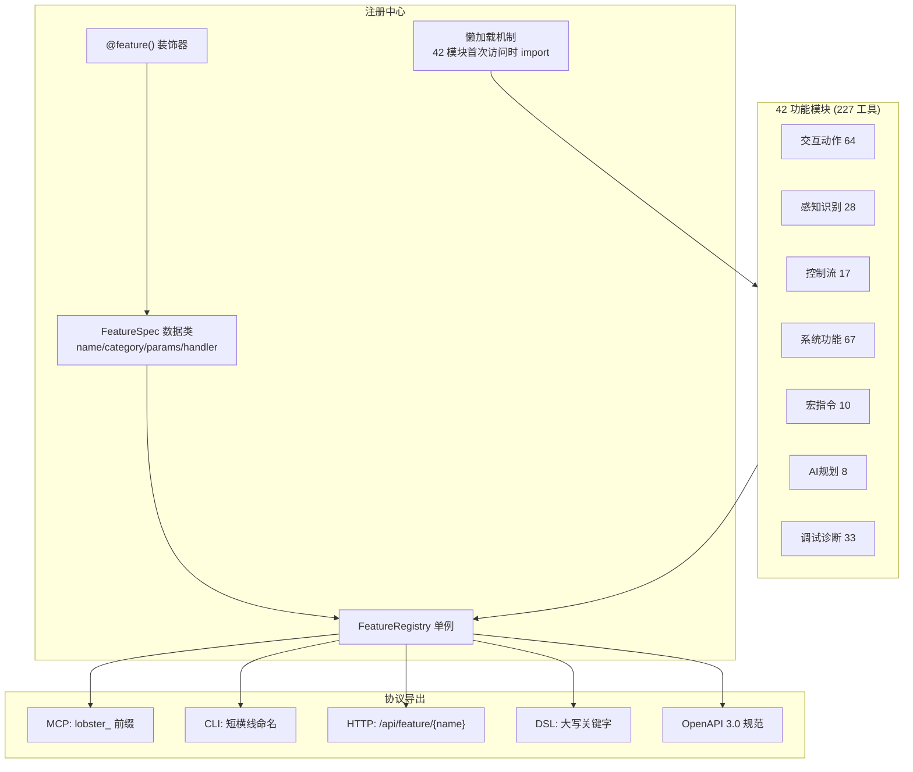
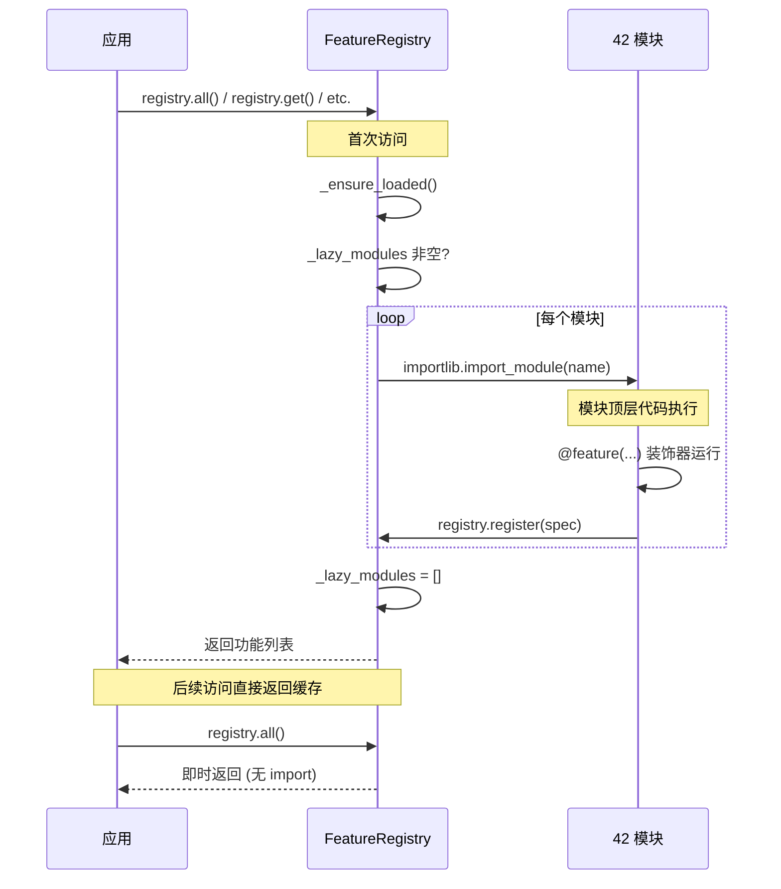
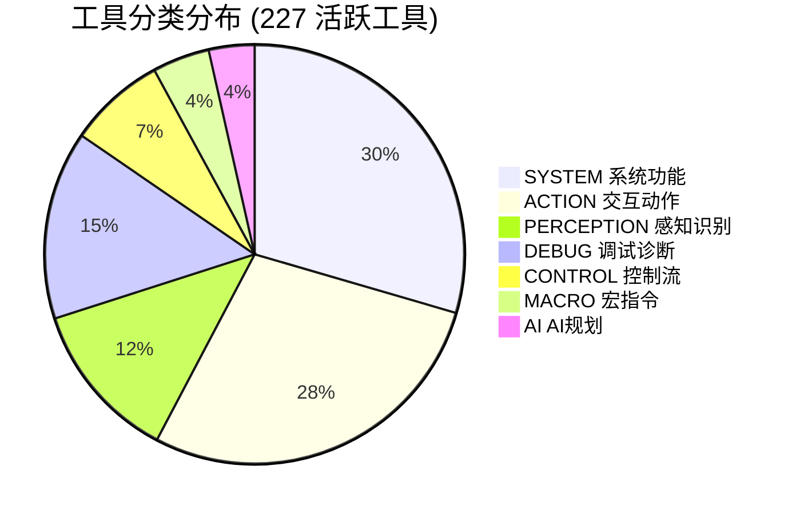
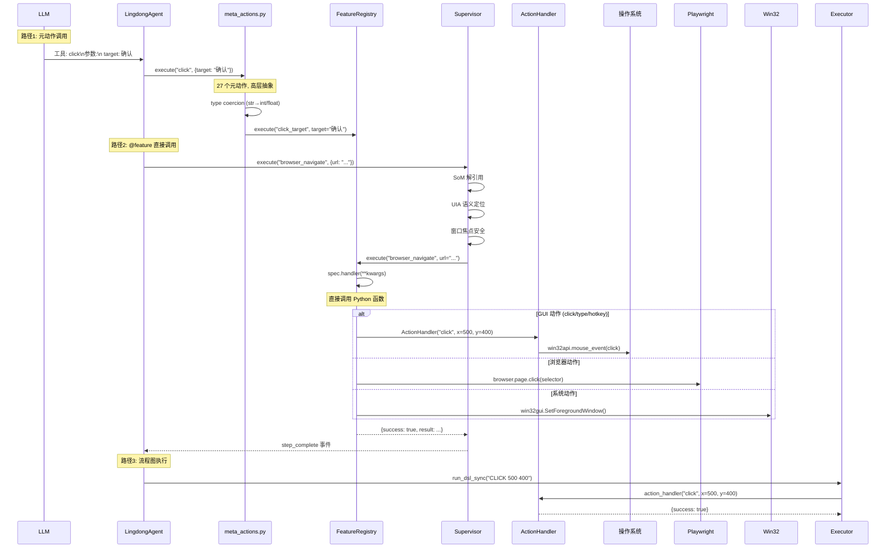
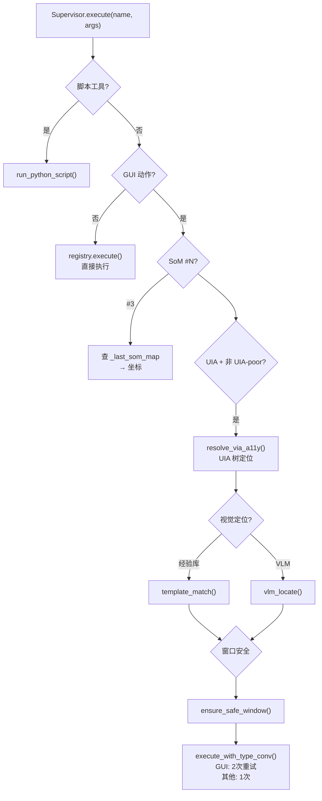

# Tool/Capability 系统深度分析

> **文档**: `docs/tools.md`
> **核心文件**: `python/features/registry.py` (546行), `_all.py` (53行), 42 模块 227 工具
> **前置阅读**: [system-map.md](system-map.md)

---

## 1. 工具系统架构



---

## 2. @feature 装饰器

```python
@feature(
    name="click_target",           # 唯一名称
    display_name="目标点击",        # 显示名
    description="根据文字/坐标点击屏幕元素",  # 描述
    category=FeatureCategory.ACTION,  # 7 分类之一
    params=[                       # 参数列表
        ParamSpec("target", "string", "点击目标", required=True),
        ParamSpec("timeout", "number", "超时秒数", default=10),
    ],
    returns="bool - 点击是否成功",
    dsl_keyword="CLICK",           # DSL 关键字 (可选)
    flow_type="click",             # 流程图节点类型 (可选)
    examples=["CLICK 500 400"],    # 使用示例
    test_cases=[                   # 测试用例
        TestCase("basic", {"target": "500,400"}, "success"),
    ],
    hidden=False,                  # MCP 是否可见
    deprecated=False,              # 是否废弃
)
def click_target(target: str, timeout: float = 10) -> bool:
    """实现代码"""
    ...
```

### 自动生成的协议映射

```python
def __post_init__(self):
    self.mcp_tool_name = f"lobster_{self.name}"    # "lobster_click_target"
    self.cli_command = self.name.replace("_", "-")  # "click-target"
    self.http_endpoint = f"/api/feature/{self.name}" # "/api/feature/click_target"
    if not self.dsl_keyword and self.category in (ACTION, SYSTEM, PERCEPTION, CONTROL):
        kw = self.name.upper()
        for suffix in ("_ACTION", "_COMMAND", "_FEATURE"):
            if kw.endswith(suffix):
                kw = kw[:-len(suffix)]
        self.dsl_keyword = kw
```

---

## 3. 懒加载机制



---

## 4. 工具按分类统计



### 按文件统计 Top 10

| 文件 | 工具数 | 占比 | 主要类别 |
|------|--------|------|----------|
| `browser_features.py` | 41 | 17% | ACTION |
| `ai_debug_features.py` | 18 | 7% | AI, DEBUG, SYSTEM |
| `perception_features.py` | 18 | 7% | PERCEPTION |
| `system_control_features.py` | 17 | 7% | SYSTEM |
| `persistence_features.py` | 12 | 5% | DEBUG, SYSTEM |
| `file_features.py` | 9 | 4% | SYSTEM |
| `software_features.py` | 9 | 4% | CONTROL |
| `scheduler_features.py` | 8 | 3% | SYSTEM, DEBUG |
| `action_features.py` | 7 | 3% | ACTION |
| `input_features.py` | 7 | 3% | ACTION, SYSTEM |

---

## 5. 工具调用链



---

## 6. 工具执行优先级

### Supervisor 执行流水线



---

## 7. 27 元动作 (Agent 高层接口)

| 类别 | 元动作 | 内部调用 @feature | 说明 |
|------|--------|-------------------|------|
| **核心桌面** | `click` | `click_target` | 文字/坐标/#N 点击 |
| | `type_text` | `type_text`, `type_clipboard` | 输入文字 |
| | `press_keys` | `hotkey` | 快捷键 |
| | `scroll` | `scroll` | 滚动 |
| | `hover` | `hover` | 悬停 |
| | `drag` | `drag` | 拖拽 |
| **屏幕读取** | `read_text` | `ocr_extract_all` | OCR 读取文字 |
| | `read_ui` | `a11y_get_tree` | UIA 树读取 |
| | `screenshot` | `screenshot` | 截图 |
| | `get_cursor` | `get_cursor_pos` | 光标位置 |
| **窗口** | `manage_window` | `window_minimize/maximize/restore/close/resize/snap` | 窗口管理 |
| | `list_windows` | `list_windows` | 窗口列表 |
| **应用** | `manage_app` | `launch_program`, `detect_process`, `kill_process` | 应用管理 |
| **系统** | `control_audio` | `volume_set`, `volume_mute` | 音频控制 |
| | `system_info` | `battery_status`, `network_status` | 系统信息 |
| | `set_brightness` | `display_brightness` | 亮度 |
| | `lock_screen` | `lock_workstation` | 锁屏 |
| | `notify` | `send_notification` | 通知 |
| **对话框** | `dialog` | `handle_dialog` | 对话框处理 |
| **网络** | `network` | `network_status`, `wifi_list/connect/disconnect` | 网络 |
| **工具** | `run_command` | — (subprocess) | 命令执行 |
| | `run_python_script` | — (subprocess) | Python 执行 |
| | `file_ops` | `file_read/write/list/delete/copy/move` | 文件操作 |
| | `wait` | — (time.sleep) | 等待 |
| **浏览器** | `browser_do` | `browser_navigate/click/type/screenshot/...` | 浏览器操作 |
| **流程图** | `generate_flow` | `generate_flow_script` | 生成流程图 |
| | `execute_flow` | `run_dsl` | 执行 DSL |
