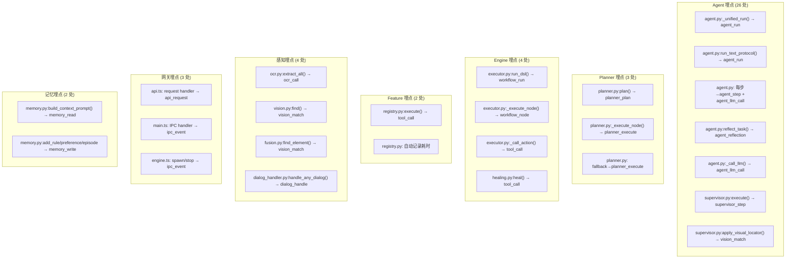
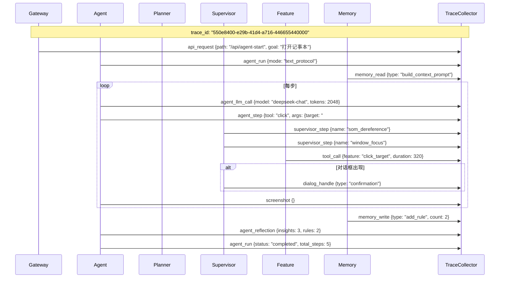
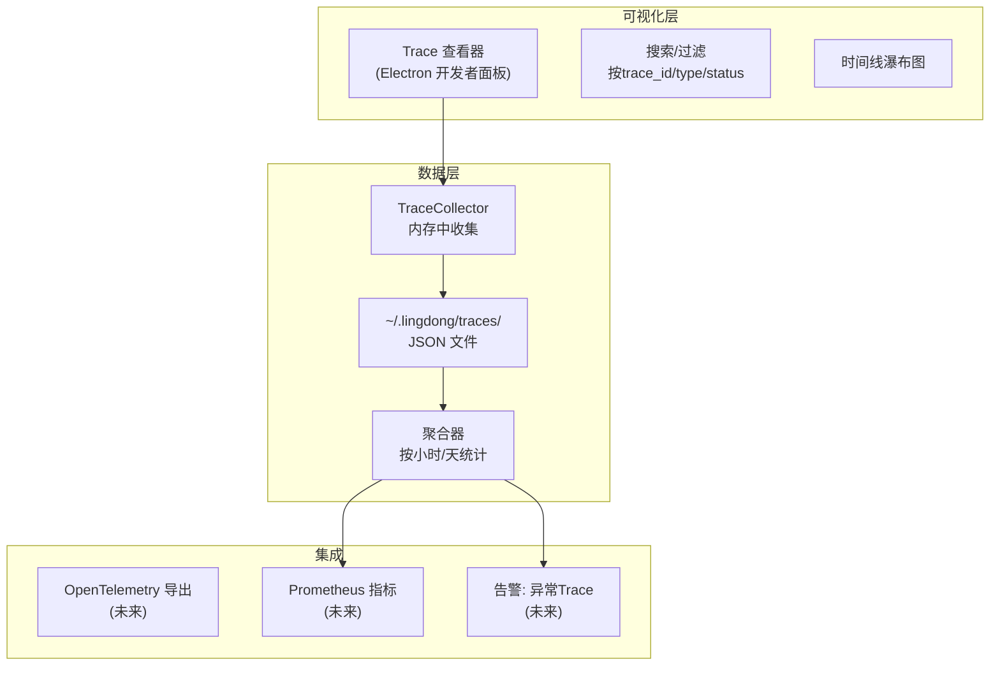

# Trace 可观测性系统设计

> **文档**: `docs/trace-design.md`
> **生成日期**: 2026-06-06
> **用途**: 为灵动脚本设计全链路可观测性系统

---

## 1. Trace Event Schema

```typescript
// 统一 Trace Event 数据结构
interface TraceEvent {
  trace_id: string;           // 全局追踪 ID (UUID v4)
  parent_span_id: string;     // 父 span ID (用于构建调用树)
  span_id: string;            // 当前 span ID
  node: string;               // 节点名称 (如 "agent.run_text_protocol")
  type: TraceEventType;       // 事件类型
  start_time: string;         // ISO 8601 开始时间
  end_time: string;           // ISO 8601 结束时间
  duration_ms: number;        // 耗时 (毫秒)
  status: 'ok' | 'error' | 'timeout';
  input: Record<string, any>; // 输入 (自动裁剪大字段)
  output: Record<string, any>;// 输出 (自动裁剪大字段)
  error?: {
    message: string;
    type: string;
    stack?: string;
  };
  tags?: Record<string, string>;  // 可搜索标签
  metrics?: Record<string, number>; // 数值指标
}

type TraceEventType = 
  | 'agent_run'          // Agent 运行
  | 'agent_step'         // Agent 单步
  | 'agent_llm_call'     // LLM 调用
  | 'agent_reflection'   // Agent 反思
  | 'planner_plan'       // Plan DAG 规划
  | 'planner_execute'    // Plan DAG 执行节点
  | 'workflow_run'       // DSL 执行
  | 'workflow_node'      // DSL 单步
  | 'tool_call'          // @feature 工具调用
  | 'tool_search'        // 路径选择
  | 'memory_read'        // 记忆读取
  | 'memory_write'       // 记忆写入
  | 'supervisor_step'    // Supervisor 流水线步骤
  | 'ocr_call'           // OCR 调用
  | 'vision_match'       // 视觉匹配
  | 'dialog_handle'      // 对话框处理
  | 'screenshot'         // 截图
  | 'ipc_event'          // IPC 事件
  | 'api_request';       // HTTP API 请求
```

---

## 2. 埋点位置



---

## 3. 完整调用链 Trace 示例



---

## 4. Trace 存储结构

```sql
-- SQLite Trace 存储
CREATE TABLE trace_spans (
    id INTEGER PRIMARY KEY AUTOINCREMENT,
    trace_id TEXT NOT NULL,          -- 全局追踪 ID
    span_id TEXT NOT NULL UNIQUE,    -- Span ID
    parent_span_id TEXT,             -- 父 Span ID (null=root)
    node TEXT NOT NULL,              -- 节点名称
    type TEXT NOT NULL,              -- 事件类型
    start_time TEXT NOT NULL,        -- ISO 8601
    end_time TEXT,                   -- ISO 8601 (null=进行中)
    duration_ms REAL,                -- 耗时
    status TEXT DEFAULT 'ok',        -- ok/error/timeout
    input TEXT,                      -- JSON 输入
    output TEXT,                     -- JSON 输出
    error TEXT,                      -- JSON 错误信息
    tags TEXT,                       -- JSON 标签
    metrics TEXT                     -- JSON 指标
);

-- 索引
CREATE INDEX idx_trace_id ON trace_spans(trace_id);
CREATE INDEX idx_span_parent ON trace_spans(parent_span_id);
CREATE INDEX idx_type ON trace_spans(type);
CREATE INDEX idx_time ON trace_spans(start_time);
CREATE INDEX idx_status ON trace_spans(status);

-- 自动过期 (保留 7 天)
-- 通过 cron `DELETE FROM trace_spans WHERE start_time < datetime('now', '-7 days')`
```

### 文件存储备选 (轻量级)

```json
// ~/.lingdong/traces/{trace_id}.json
{
  "trace_id": "550e8400-...",
  "start_time": "2026-06-06T10:00:00Z",
  "end_time": "2026-06-06T10:01:30Z",
  "duration_ms": 90000,
  "spans": [
    {
      "span_id": "span_001",
      "parent_span_id": null,
      "node": "agent_run",
      "type": "agent_run",
      "start_time": "...",
      "end_time": "...",
      "duration_ms": 90000,
      "status": "ok",
      "input": {"goal": "打开记事本"},
      "output": {"status": "completed", "steps": 5}
    },
    {
      "span_id": "span_002",
      "parent_span_id": "span_001",
      "node": "agent_step_1",
      "type": "agent_step",
      "start_time": "...",
      "end_time": "...",
      "duration_ms": 3200,
      "status": "ok",
      "input": {"tool": "click", "target": "#3"},
      "output": {"success": true}
    }
  ]
}
```

---

## 5. Trace 收集器

```python
# python/agent/trace_collector.py (新文件建议)
"""
Trace 收集器 — 全链路可观测性。

设计:
  - 装饰器模式: @trace("agent_step") 自动包装
  - 上下文管理器: with TraceSpan("tool_call"): ...
  - 线程安全: thread-local context 传递 trace_id
  - 异步友好: await with TraceSpan("llm_call"): ...
"""

import json
import os
import time
import uuid
import threading
from typing import Any, Optional
from contextvars import ContextVar
from datetime import datetime, timezone
from dataclasses import dataclass, field, asdict


@dataclass
class TraceSpan:
    trace_id: str
    span_id: str
    parent_span_id: Optional[str]
    node: str
    type: str
    start_time: str
    end_time: str = ""
    duration_ms: float = 0.0
    status: str = "ok"
    input: dict = field(default_factory=dict)
    output: dict = field(default_factory=dict)
    error: Optional[dict] = None
    tags: dict = field(default_factory=dict)
    metrics: dict = field(default_factory=dict)
    
    MAX_INPUT_SIZE = 10000  # 字符
    MAX_OUTPUT_SIZE = 10000
    
    def _truncate(self, data: dict, max_size: int) -> dict:
        s = json.dumps(data, ensure_ascii=False)
        if len(s) > max_size:
            return {"_truncated": True, "_size": len(s), "_preview": s[:1000]}
        return data
    
    def close(self, status="ok", output=None, error=None):
        self.end_time = datetime.now(timezone.utc).isoformat()
        self.duration_ms = (datetime.fromisoformat(self.end_time) - 
                          datetime.fromisoformat(self.start_time)).total_seconds() * 1000
        self.status = status
        if output:
            self.output = self._truncate(output, self.MAX_OUTPUT_SIZE)
        if error:
            self.error = {"message": str(error), "type": type(error).__name__}


class TraceCollector:
    """Trace 收集器单例"""
    
    def __init__(self, storage_dir: str = ""):
        self._storage_dir = storage_dir or os.path.join(
            os.path.expanduser("~"), ".lingdong", "traces"
        )
        self._spans: list[TraceSpan] = []
        self._lock = threading.Lock()
        self._context: ContextVar[Optional[str]] = ContextVar("current_trace_id", default=None)
        self._span_stack: ContextVar[list] = ContextVar("span_stack", default=[])
        os.makedirs(self._storage_dir, exist_ok=True)
    
    def start_trace(self, node: str, type: str, input: dict = None,
                    parent_span_id: str = None) -> TraceSpan:
        trace_id = self._context.get() or str(uuid.uuid4())
        if not self._context.get():
            self._context.set(trace_id)
        
        span_id = f"{trace_id}_{len(self._spans) + 1}"
        span = TraceSpan(
            trace_id=trace_id,
            span_id=span_id,
            parent_span_id=parent_span_id or self._current_span_id(),
            node=node,
            type=type,
            start_time=datetime.now(timezone.utc).isoformat(),
            input=input or {},
        )
        
        with self._lock:
            self._spans.append(span)
        
        stack = self._span_stack.get()
        stack.append(span_id)
        self._span_stack.set(stack)
        
        return span
    
    def _current_span_id(self) -> Optional[str]:
        stack = self._span_stack.get()
        return stack[-1] if stack else None
    
    def end_span(self, span: TraceSpan, status="ok", output=None, error=None):
        span.close(status, output, error)
        stack = self._span_stack.get()
        if stack and stack[-1] == span.span_id:
            self._span_stack.set(stack[:-1])
    
    def flush(self):
        """持久化 Trace 到文件"""
        if not self._spans:
            return
        trace_id = self._spans[0].trace_id
        data = {
            "trace_id": trace_id,
            "start_time": self._spans[0].start_time,
            "end_time": self._spans[-1].end_time,
            "duration_ms": (datetime.fromisoformat(self._spans[-1].end_time) - 
                          datetime.fromisoformat(self._spans[0].start_time)).total_seconds() * 1000,
            "spans": [asdict(s) for s in self._spans if s.end_time],
        }
        path = os.path.join(self._storage_dir, f"{trace_id}.json")
        with open(path, "w", encoding="utf-8") as f:
            json.dump(data, f, ensure_ascii=False, indent=2)


# 全局单例
_collector = TraceCollector()


def get_collector() -> TraceCollector:
    return _collector


# 装饰器用法
def trace(type: str):
    def decorator(func):
        def wrapper(*args, **kwargs):
            collector = get_collector()
            span = collector.start_trace(func.__name__, type)
            try:
                result = func(*args, **kwargs)
                collector.end_span(span, "ok", {"result": str(result)[:200]})
                return result
            except Exception as e:
                collector.end_span(span, "error", error=e)
                raise
        return wrapper
    return decorator


# 上下文管理器用法
class trace_span:
    def __init__(self, node: str, type: str, **kwargs):
        self.collector = get_collector()
        self.span = self.collector.start_trace(node, type, kwargs)
    
    def __enter__(self):
        return self.span
    
    def __exit__(self, exc_type, exc_val, exc_tb):
        if exc_type:
            self.collector.end_span(self.span, "error", error=exc_val)
        else:
            self.collector.end_span(self.span, "ok")
        return False
```

---

## 6. Mermaid 自动生成方案

### 实时 Trace → Mermaid 序列图

```python
def trace_to_mermaid(trace_data: dict) -> str:
    """将 Trace JSON 转换为 Mermaid 序列图"""
    lines = ["sequenceDiagram", "    participant User as 用户"]
    
    # 收集参与者和时间线
    participants = set()
    spans = []
    for span in trace_data.get("spans", []):
        node = span["node"]
        type_map = {
            "agent_run": "Agent", "agent_step": "Agent",
            "llm_call": "LLM", "tool_call": "Feature",
            "memory_read": "Memory", "memory_write": "Memory",
            "supervisor_step": "Supervisor",
            "workflow_node": "Engine",
        }
        participant = type_map.get(span["type"], span["type"])
        participants.add(participant)
        spans.append((span, participant))
    
    # 声明参与者
    for p in sorted(participants):
        lines.append(f"    participant {p}")
    
    # 生成交互序列
    for span, participant in sorted(spans, key=lambda x: x[0]["start_time"]):
        status = span.get("status", "ok")
        emoji = "✅" if status == "ok" else "❌" if status == "error" else "⏱️"
        label = f"{span['node']} ({span['duration_ms']:.0f}ms) {emoji}"
        lines.append(f"    {participant}->>{participant}: {label}")
        if span.get("input"):
            lines.append(f"    Note over {participant}: {json.dumps(span['input'])[:100]}")
    
    return "\n".join(lines)
```

### 自动 Trace 聚合 → 架构图

```python
def traces_to_architecture(traces_dir: str) -> str:
    """从批量 Trace 统计生成系统交互图"""
    # 收集所有跨组件调用关系
    edges = Counter()
    for f in os.listdir(traces_dir):
        with open(os.path.join(traces_dir, f)) as fp:
            trace = json.load(fp)
        for span in trace.get("spans", []):
            parent_id = span.get("parent_span_id")
            if parent_id:
                parent = next((s for s in trace["spans"] 
                             if s["span_id"] == parent_id), None)
                if parent:
                    edges[(parent["type"], span["type"])] += 1
    
    # 生成 Mermaid
    lines = ["graph LR"]
    for (src, dst), count in edges.most_common(20):
        lines.append(f"    {src}[{src}] -->|{count}| {dst}[{dst}]")
    
    return "\n".join(lines)
```

---

## 7. 可视化方案



### 推荐实现优先级

| 阶段 | 功能 | 复杂度 | 价值 |
|------|------|--------|------|
| **P0** | `TraceCollector` 核心 + 装饰器 | 🟢 低 | 高 |
| **P0** | Agent 执行 5 个关键埋点 | 🟢 低 | 高 |
| **P1** | JSON 文件持久化 + 自动清理 | 🟢 低 | 高 |
| **P1** | 审计面板 (最近 50 条 Trace) | 🟡 中 | 中 |
| **P2** | 时间线瀑布图可视化 | 🟡 中 | 中 |
| **P2** | Trace 搜索/过滤 | 🟡 中 | 中 |
| **P3** | Mermaid 自动导出 | 🔴 高 | 低 |
| **P3** | OpenTelemetry 导出 | 🔴 高 | 低 |
