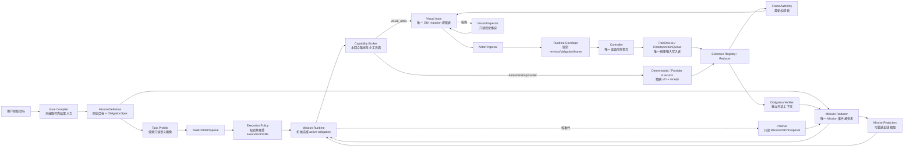

# vNext Agent 核心架构

本文是 vNext 的目标架构，不描述完整运行时已经完成的代码。P0 观测旁路和 P1 纯 Mission 合同、
Reducer、replay、MissionCard 及 legacy shadow 已实现，但尚未接入产品运行时；完整运行时的实现事实
仍以 [../architecture.md](../architecture.md) 和 [../winpilot-agent.md](../winpilot-agent.md) 为准。

## 1. 设计目标

vNext 要降低模型和本地层的重复职责，同时保留模型在未知 GUI 中最有价值的能力：视觉理解、语义判断和随机应变。

核心结构是：



## 2. 五个不可混淆的 owner

### 2.1 桌面语义动作提案

只有 **Visual Actor** 可以提出 GUI mutation。Planner、Task Profiler、Verifier、Inspector 不能点击、输入、滚动或拖拽。

### 2.2 桌面物理执行

只有 **Controller -> RawDevice/DesktopActionQueue** 可以执行物理桌面输入。Visual Actor 提案，Controller 校验并执行；Actor本身不直接接触设备。

### 2.3 Mission 状态

只有 **Mission Reducer** 可以接受 MissionEvent 并产生新的 MissionProjection。模型只能提交 proposal、claim、report 或 assessment。

### 2.4 执行策略

只有 **Execution Policy** 可以把 TaskProfileProposal 转成有效 ExecutionProfile。Profiler 负责语义建议，不拥有最终路由权。

### 2.5 证据

只有 **EvidenceRegistry/Reducer** 可以登记不可变 run-scoped evidence。模型描述、工具 `ok` 和像素变化不能绕过 evidence contract。

同一事实只能有一个 owner。Bridge 可以暂时转换数据形状，不能复制状态或重新解释语义。

## 3. 不做什么

vNext 不是：

- 第二个具有鼠标键盘权限的 Agent；
- 把一个巨型 Agent 拆成几个都能自由行动的模型；
- 根据应用名、任务标签或 benchmark 选择专用架构；
- 把 11 个测试写成 obligation 模板的规则库；
- 失败后自动切换 UIA/OCR/MCP 的 fallback 系统；
- 让 Task Profiler 或 Planner 输出按钮、工具序列和坐标；
- 让 Inspector 代替 Actor 选择动作；
- 新建另一套前端、API、E2E、Artifact 或 Evidence 系统；
- 用更长 prompt 弥补应用发现、焦点、坐标、滚轮、拖拽、截图或验证工具不可靠。

## 4. Goal Compiler、Task Profiler 与 Planner

三者处理不同问题。

| 组件 | 负责 | 禁止 |
| --- | --- | --- |
| Goal Compiler | 保留原始目标，抽取用户文本中可可靠确定的结果义务、依赖、工件和 broad capability | 猜界面、生成 GUI 步骤、决定工具 |
| Task Profiler | 判断任务结构压力、建议执行深度、认知服务和升降档触发条件 | 生成 obligation、应用流程、按钮、坐标、runtime version |
| Planner | 在预定义事件上提出高层 obligation/dependency patch | 当前 GUI 微步骤、工具调用、直接写状态 |

安全顺序是：

1. Goal Compiler 生成 lossless MissionDefinition；无法可靠拆分时保持一个覆盖 `original_goal` 的义务。
2. Task Profiler 读取原始目标、初始义务、已验证 session facts 和可用 runtime capability，提出 TaskProfileProposal。
3. Execution Policy 校验 proposal，形成 accepted ExecutionProfile；Profiler unavailable 或低置信时使用安全 `standard` 默认。
4. Planner 不是启动必需项。只有 profile 和运行事件证明需要时才调用。

详见 [execution-profile.md](execution-profile.md)。

## 5. ExecutionProfile：同一架构的不同深度

vNext 不为绘图、聊天、游戏或浏览器切换不同 Agent 架构。所有 GUI 任务共享同一骨架，只按深度和事件启用认知服务。

### `direct`

单一短义务、低风险、结果可确定或局部验证。不启动 Planner，尽量不启动额外视觉角色。

### `standard`

默认档。MissionProjection + Visual Actor + Broker + obligation verification。通常保持一个 lossless obligation，由 Actor 自主探索当前应用。

### `orchestrated`

明确存在跨应用工件、多个独立验收义务、外部等待、审批或复杂禁止效果时使用。允许多 obligation、MissionVerifier 和按需 Planner。

Depth 可以根据 accepted profile 和真实运行证据升降档，但不能由应用名、窗口标题或自由文本标签切换。`legacy/vnext` runtime version 始终由显式产品/实验配置决定，不能由 Profiler选择。

## 6. Mission：事件与证据驱动的主线

### 6.1 MissionDefinition

MissionDefinition 保存：

- `original_goal`；
- immutable ObligationSpec；
- dependency DAG；
- artifact/fact binding requirements；
- broad capability；
- acceptance criteria 与 forbidden effects。

ObligationSpec 不保存 lifecycle `status`，不包含按钮、selector、坐标或应用工作流。

### 6.2 MissionEventLog

所有状态变化由 accepted MissionEvent 记录，例如 activation、claim、verification、artifact binding、goal revision、approval 和 terminal event。事件必须绑定 revision 和 immutable evidence。

### 6.3 MissionProjection

MissionProjection 是 Reducer 从 MissionDefinition、accepted event log 和 EvidenceRegistry 产生的可重放视图。它可以缓存，但不是第二份独立真相。

状态只保存一次：

```text
obligation_states[id] = pending | active | claimed | verified | blocked | superseded | canceled
```

`verified_obligation_ids`、pending 列表和 mission coverage 只能是派生 property，不得再次序列化为权威字段。

### 6.4 机械激活

Runtime 每次最多激活一个 obligation：

1. lifecycle 为 `pending`；
2. 所有 `depends_on` 已 `verified`；
3. 没有未处理 approval；
4. 所需 artifact/fact 已绑定；
5. 按稳定拓扑顺序选择。

模型不能临时跳过依赖或自行选择另一个 obligation。

## 7. MissionCard：Actor 的有界输入

Visual Actor 每回合只处理一个 active obligation。它接收完整原始目标是为了防止局部目标失真，不是让它维护全局 todo。

MissionCard 只包含：

- `original_goal`；
- active obligation 的 desired state、criteria、forbidden effects；
- 与当前义务有关的 verified facts 和 artifact bindings；
- 必要的 preserve/future-dependency guardrails；
- 当前 target binding 摘要；
- 一个最新 transition；
- 有界 failure/verifier feedback；
- accepted ExecutionProfile 的必要摘要。

Actor 不接收：

- 其他角色 chain-of-thought；
- 整份历史任务图和所有旧截图；
- 未验证 OCR/UIA 推断；
- 全部桌面、通信、MCP、Shell 和 artifact 工具；
- legacy planner 微步骤；
- 11 个测试的示例解法。

## 8. Actor 只提交 proposal，Runtime 绑定身份

模型输出不携带 `mission_id`、revision、obligation id、frame id、evidence ids 或 broker projection id。

模型可提交：

1. 一笔 `DesktopActionProposal`；
2. `ObserveProposal`；
3. `CapabilityRequest`；
4. `InspectionRequest`；
5. `ClaimObligationDone`；
6. `BlockedReport`；
7. `ReplanRequest`。

Runtime 把 proposal 包入不可伪造的 ActorDecisionEnvelope，自动绑定：

- run/mission/revision；
- active obligation；
- 当前 authoritative frame/epoch/target binding；
- BrokerProjection；
- 当前可引用 evidence scope。

Controller、Reducer、Planner 和 Verifier只接受 Runtime-bound envelope。这样模型不需要记忆或复制机械身份，也不能提交 stale/跨义务引用。

## 9. Capability Broker：确定性路线与小工具面

Broker 不调用模型，也不理解应用工作流。它读取：

- active obligation 的 broad capability；
- accepted ExecutionProfile 与临时 capability grant；
- TargetBinding 与 FrameState 是否有效；
- PointerLease；
- current-run artifact/fact binding；
- Adapter/MCP registry、授权和 receipt 能力；
- approval、desktop action lock 和 runtime health。

Broker 不读取应用名称、窗口标题、测试题号、任务句关键词、历史坐标或 Actor自报“模式”来决定工作流。

### 9.1 典型投影

未绑定窗口：

```text
open_app  switch_window  observe  blocked
```

普通已绑定窗口：

```text
observe  click  type_text  hotkey  scroll  drag  wait
request_capability  claim_obligation_done  blocked
```

pointer lease：

```text
move_mouse  mouse_up  wait  blocked
```

视觉输出 capability 已接受时：

```text
observe  click  hotkey  draw_strokes  wait
request_capability  claim_obligation_done  blocked
```

工具目标通常小于十个。数字是认知预算，不是为凑数而硬编码；新增工具必须说明替代哪个旧入口。

### 9.2 CapabilityRequest

Actor 可以请求 broad capability，例如 `pointer.dynamic` 或 `visual.read_text`。请求只是 proposal。Broker 必须校验 catalog、active obligation、当前状态、安全、provider 与授权后，才产生绑定 obligation/revision、有期限的 grant。禁止从自由文本解析应用模式。

### 9.3 路线互斥

某些 obligation 可以走 deterministic/provider route，例如 hash、精确转换、已授权 API 或可信 receipt。只有 I/O identity、授权、schema 和 verifier 均可证明时才允许。

同一 obligation 的 mutation route 必须互斥：

- GUI route：Visual Actor -> Controller -> RawDevice；
- deterministic/provider route：精确 executor -> receipt/evidence。

Provider executor 可以修改文件或获授权的外部系统，但不能操控桌面；Visual Actor 也不能同时获得该 obligation 的 mutation 工具。

## 10. Controller：只负责如何执行

Actor 提案：

```json
{
  "kind": "desktop_action",
  "action": "click",
  "args": {"image_x": 714, "image_y": 382},
  "local_intent": "激活当前可见目标"
}
```

Runtime envelope 自动绑定当前 frame/revision/obligation，再交给 Controller。

Controller 负责：

- submitted-image、normalized-frame 与物理屏幕之间的每个坐标空间边界各映射一次，并保留 provenance；
- frame、epoch、HWND、capture region 与窗口所有权校验；
- Desktop Action Queue 和 input lease；
- SendInput 的 down/up、滚轮、按键与路径插值；
- 取消、超时、失焦和异常时释放输入；
- 动作后 settle、截图和实际执行点记录；
- 返回局部像素变化与确定性执行事实。

Controller 不得：

- 因 OCR/UIA 候选更像而移动点击点；
- 自动选择另一个按钮或改写路径；
- 根据应用名使用固定备用坐标；
- 因动作无效启动 UIA/OCR/MCP fallback cascade；
- 自行返回、重开应用或换目标；
- 把 input completed、pixel changed 或 tool `ok` 当 obligation 完成。

动作结果至少区分：

```text
input_completed
local_visual_change
target_binding_valid
frame_comparable
semantic_completion = unknown
```

## 11. 独立 Verifier

Verifier 是有价值的第二个模型角色，但不是第二个 Agent。它没有桌面、Shell、文件写入或 adapter mutation 工具。

三层验证：

1. `ActionEffectVerifier`：输入是否执行、目标区域是否有可比较局部效果，尽量确定性完成。
2. `ObligationVerifier`：acceptance criteria 是否由证据满足，必要时调用独立视觉请求。
3. `MissionVerifier`：所有 required obligation、依赖、artifact identity、forbidden effects 和 approval 是否闭合。

证据顺序：

1. 本地确定性 verifier；
2. application oracle、adapter/provider receipt；
3. 最后才是视觉 Verifier。

模型 Verifier 只输出 assessment 内容，Runtime 自动绑定 subject、revision、输入 evidence refs 和 verifier identity，形成 VerificationResult。它不读取 Actor chain-of-thought，也不能把 Actor claim 当证据。

同一个底层模型可以扮演 Actor 与 Verifier，但上下文、系统合同、schema、工具、预算和证据视角必须独立。相同模型仍有相关错误，因此 Verifier 应优先看 deterministic/oracle/receipt、前后帧或更高清终态 ROI，而不是简单重复 Actor 的同一输入。

## 12. Planner 与 Visual Inspector

### Planner

仅在 accepted profile 或真实事件触发时调用，例如：

- Compiler 无法安全表达的跨义务依赖；
- 两种实质不同的局部策略均失败；
- 用户修改目标；
- obligation 与新证据冲突；
- approval policy 要求高层权衡。

Planner 只提交无身份的 MissionPatchProposal body。Runtime 绑定 base revision 和 evidence scope；Reducer校验无环依赖、original goal coverage、artifact identity、已验证义务和禁止 GUI 步骤后决定是否接受。

### Visual Inspector

默认先使用 Actor 自己的 `observe(image_region)`。只有多个 held-out 视觉任务证明额外只读分析有稳定 external-oracle 增益时才实现 Inspector。

Inspector 请求由 Runtime 绑定冻结 frame/ROI。报告只能包含可见事实、空间关系、候选、不确定性和建议放大区域，不能包含 tool call、点击点、拖拽动作、next step 或 completion claim。

## 13. 模型角色调度

角色之间不自由对话，只通过 versioned typed contract 交换。默认顺序：

1. Goal Compiler 创建 MissionDefinition；
2. Task Profiler 低频提出 profile，Execution Policy 接受或覆盖；
3. Reducer/Runtime 选择 active obligation；
4. Broker 投影路线和工具；
5. Actor 提交 proposal；
6. Runtime 绑定 envelope；
7. action 交 Controller，claim 交 Verifier，replan 交 Planner，inspection 交 Inspector；
8. 结果只产生 typed event/evidence；
9. Reducer 产生新 MissionProjection；
10. 下一回合使用新 projection 和新权威帧。

每条链默认串行并绑定冻结 revision/frame。迟到、超时、取消、格式错误或低置信结果保持状态不变并产生 typed failure fact。

模型角色共用一个机械的 model-call Runtime，但不共享请求上下文。provider adapter 先准备一次
请求，Runtime 绑定 `model-request/0`、冻结 payload 并关闭 SDK 隐式重试；只有同一
decision/role/purpose/fingerprint 的瞬时 transport failure 才能做有界 request retry。改变
messages、工具、thinking、预算或目的属于新的 redecision；poll 不重新提交请求；响应解析和 schema
失败发生在 transport 之外。模型 request retry 也不授予任何 action replay 权限，桌面 mutation
结果不确定时必须重新观察、对账或阻塞。

这个 model-call Runtime 是 transport owner，不是新的认知角色，也不改变唯一 Visual Actor 或唯一
Controller/RawDevice 写入链。当前统一范围仅是 `python/winpilot_home/winpilot/` product package；
外围 legacy provider、全角色逐 attempt sidecar 和 legacy VLM helper 的 stop_event seam 仍是迁移
债务；Profiler 的 ArpExecution -> shadow hook/runtime/provider -> ModelCallRuntime 取消链已经闭合。

## 14. 基础工具优先

多角色系统不能替代基础工具。以下问题必须先修：

- 已运行应用、隐藏窗口、托盘和安装入口发现；
- target binding、焦点和 HWND 因果关系；
- 模型图片与动作坐标是否同一 FrameState；
- click、scroll、drag、held pointer、type 与 cancel 语义；
- post-action 权威帧及时发布；
- tool result 是否把 input completion 冒充 semantic success；
- session artifact identity；
- Broker 是否误裁剪或泄漏大工具面；
- Runtime 是否把 verifier reject 变成重复相同动作。

只有工具链正确且离线静态画面仍证明模型不能理解几何时，才归因于 Actor；只有 Inspector 在多个 held-out 拓扑有可重复收益时才增加 Inspector。

## 15. 示例

用户目标：

```text
在画板画一朵花，截图后发给手机。
```

可能的 lossless obligation：

```text
O1 产生符合描述的视觉工件
O2 捕获 O1 对应的同一工件
O3 绑定正确接收人
O4 发送 O2
O5 验证送达
```

Task Profiler 可以建议 `orchestrated`、obligation/mission verifier、artifact/recipient identity 和连续路径 capability，但不能建议 Paint、QQ、按钮或工具序列。

- O1：Actor 只看绘制状态和小工具面；claim 后独立验证。
- O2：若是确定性 capture，Runtime直接执行，Actor不参加。
- O3/O4：只有相关 capability 与 identity 具备时才加载通信能力；GUI route 与 provider route 互斥。
- O5：receipt/oracle/Verifier 闭合。所有 required obligation verified 后才完成 mission。

Actor 从未维护五步主线，也没有第二个 GUI Agent 把主线翻译成点击剧本。

## 16. `game-drag-v2` 的定位

该失败是视觉几何与动作轨迹压力测试，不进入 Compiler、Profiler 或 Broker规则。顺序是：

1. 核对图像范围、分辨率和 frame identity；
2. 核对 `observe(image_region)`；
3. 核对 drag 关键点、坐标映射、插值和 pointer oracle；
4. 失败后用最新帧重新判断；
5. 多个随机拓扑仍失败再 A/B 只读 Inspector；
6. Actor 保留最终路线决定权，轨迹只进入 held-out eval 或训练数据。

## 17. 与 legacy 的关系

vNext 复用：

- Electron 用户入口与 run/trace 绑定；
- FrameAuthority；
- FastGuiController、RawDevice 与 Desktop Action Queue；
- ScreenWatcher 与 held-pointer cleanup；
- ArtifactStore、EvidenceRegistry 与 oracle；
- AppResolver；
- `winpilot/modeling/` 的冻结请求、provider adapter 与 transport retry 合同；
- cold-start、session context 与客户端 E2E harness。

复用不等于把完整 `FastGuiController` 当作 vNext bridge。它仍包含 legacy
grounding、恢复和 adapter 行为；P4b 只能逐项抽取机械 owner，让 legacy 先委托同一
Frame、坐标、admission 与 RawDevice primitive，再由 Runtime-bound ControllerPort
调用。当前仅完成 shared frame、第一段坐标映射、run selection 和 scroll raw seam。

vNext 逐步替代：

- AgentRunner 的全局计划、固定工具全集、完成编排和重复账本；
- Compiler/StageRuntime 对未知 GUI 的重复语义拆解；
- `_EXECUTE_DESKTOP_MODEL_TOOLS` 固定大工具面；
- `done` 直接终止任务；
- DoneVerifier 中 action、obligation、mission 混合验收；
- interaction stage、subgoal、adapter 与 Controller 间重复 planner 行为。

仓库根部 `python/providers/` 的 Flow/feature provider 仍包含独立 SDK 或 direct-HTTP
重试，不是 vNext 的第二个 transport owner。P9 前必须审计其产品可达性：不可达则净删；仍有必要调用则
在独立切片迁移到同一 model-call Runtime。不能仅为统一目录外观把它长期包成第二套请求系统。

迁移分支是临时集成线。达到门槛后 vNext 合并回 `master`、旧职责净删，不能永久保留两套产品核心。具体阶段见 [migration-plan.md](migration-plan.md)。
