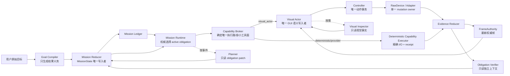

# vNext Agent 核心架构

本文是 vNext 的目标架构，不描述已经完成的代码。当前实现事实仍以 [../architecture.md](../architecture.md) 和 [../winpilot-agent.md](../winpilot-agent.md) 为准。

## 1. 设计目标

vNext 要降低模型和本地层的重复职责，同时保留模型在未知 GUI 中最有价值的能力：视觉理解、语义判断和随机应变。

核心结构是：



这里有两个不同的唯一写入权：

- **桌面写入权**：只有 Visual Actor 可以提出 GUI mutation，Controller/RawDevice 只执行该动作。
- **任务状态写入权**：只有 Mission Reducer 可以改变 MissionState。Actor、Planner、Verifier、Inspector 都不能直接改账本。

这避免“两个桌面 Agent”互相抢控制权，也避免多个模型通过自然语言暗中修改同一份主线。

## 2. 不做什么

vNext 不是：

- 第二个具有鼠标键盘权限的 Agent；
- 把一个巨型 Agent 拆成几个都能自由行动的模型；
- 根据应用名选择工具或流程的路由器；
- 把 11 个测试写成 obligation 模板的规则库；
- 失败后自动切换 UIA/OCR/MCP 的 fallback 系统；
- 让 Planner 预先输出点击、输入、滚动和坐标；
- 让 Inspector 代替 Actor 选择动作；
- 新建另一套前端、API、E2E 或 Artifact/Evidence 系统；
- 用更长 prompt 弥补应用发现、焦点、坐标、滚轮、拖拽、截图或验证工具不可靠。

### 2.1 唯一 owner 表

| 组件 | 唯一职责 | 明确禁止 |
| --- | --- | --- |
| Goal Compiler | 保留原始目标，抽取可可靠确定的结果义务、依赖和 broad capability | GUI 步骤、应用布局、坐标、题号规则 |
| Mission Reducer | 校验事件并单写 MissionState | 看图、调用工具、生成计划 |
| Mission Runtime | 机械激活 ready obligation，调度角色/验证 | 理解按钮、改 obligation 语义 |
| Capability Broker | 按本地状态选择唯一执行路线并投影工具 | 根据应用名或 prompt 规划流程 |
| Visual Actor | 从当前像素选择下一笔局部语义动作 | 维护全局主线、自验完成 |
| FrameAuthority | 原子发布唯一当前 FrameState | 截图策略、画面理解、动作选择 |
| Controller | 校验并执行一笔 canonical action transaction | OCR 吸附、换目标、恢复规划、完成判断 |
| RawDevice / Direct Executor | 执行已验证的低层输入或精确 provider I/O | 解释用户目标、选择路线 |
| Evidence Reducer/Registry | 归一化、哈希并引用动作、工件、receipt、oracle 证据 | 推断未观察到的业务事实 |
| Verifier | 按 criteria 对 evidence 给只读 verdict | 修复桌面、写 MissionState |
| Planner | 按事件提出高层 obligation patch | GUI 微步骤、直接写账本 |
| Visual Inspector | 对冻结帧/ROI 提供只读视觉事实 | 决定或执行鼠标动作 |
| AppResolver | 多源发现运行/安装/窗口候选及 provenance | 编写应用内工作流 |

同一事实只能有一个 owner。桥接层可以暂时转换数据形状，不能复制状态或重新解释语义。

## 3. Mission Ledger：主线外置

Mission Ledger 保存唯一结构化任务状态。它只做三件机械工作：

1. 保存有 evidence reference 的已确认事实、工件和绑定；
2. 根据依赖与稳定拓扑顺序选择一个 ready obligation；
3. 阻止没有合格证据的 obligation 或 mission 被标记完成。

Ledger 不看截图、不理解按钮、不生成 GUI 路线、不判断某个界面属于什么“模式”。

### 3.1 Obligation 只描述状态

合法 obligation 示例：

```json
{
  "id": "send_artifact",
  "desired_state": "当前任务捕获的图片已经发送给已绑定的手机联系人",
  "acceptance_criteria": [
    "接收人身份与当前任务绑定一致",
    "发送对象的 artifact id 与捕获结果一致",
    "存在发送后的可见证据、adapter receipt 或应用 oracle"
  ],
  "depends_on": ["capture_artifact", "bind_recipient"],
  "forbidden_effects": ["不得发送给其他联系人"],
  "required_capabilities": ["communication.send_artifact"],
  "status": "pending"
}
```

禁止写入 obligation 的内容：

- 点击某个角落或某行；
- 寻找加号、蓝色按钮或特定图标；
- 输入联系人后滚动几次；
- 某应用版本的固定坐标、控件别名或 fallback；
- Controller 应该如何重试；
- UIA/OCR 结果优先于像素的指令。

### 3.2 不可靠拆分时保持一个义务

Goal Compiler 只拆分用户文本能够可靠确定的结果依赖，例如“先产生工件，再发送同一工件”。如果拆分需要猜测界面、应用流程、联系人或中间按钮，Compiler 必须退化为：

```text
O1.desired_state = original_goal
O1.required_capabilities = [visual.interact]
```

错误拆分会把错误细节级联给 Actor，因此“一个宽义务”优于“多个猜出来的步骤”。

### 3.3 机械激活规则

Mission Runtime 每次最多激活一个 obligation：

1. 状态为 `pending`；
2. 所有 `depends_on` 已 `verified`；
3. 没有未处理 approval；
4. 所需输入 artifact/fact 已绑定；
5. 按合同中的稳定拓扑顺序选择，不由模型临时挑选阶段。

若没有 ready obligation，Runtime 只能进入 `waiting_approval`、`waiting_external`、`blocked`、`failed` 或 `verified`，不能让模型自行跳过依赖。

## 4. Visual Actor：唯一桌面语义写入者

Visual Actor 每回合只处理一个 active obligation。它接收完整原始目标是为了避免局部目标失真，不是让它重新维护全局 todo。

### 4.1 Actor 输入

Actor 的稳定输入是一个 MissionCard，加上最新权威帧和 Broker 投影的少量工具：

```json
{
  "original_goal": "用户原始表达，完整保留",
  "active_obligation": {
    "id": "...",
    "desired_state": "...",
    "acceptance_criteria": ["..."],
    "forbidden_effects": ["..."]
  },
  "verified_facts": [
    {"fact": "artifact-3 由当前任务捕获", "evidence_ref": "evidence-17"},
    {"fact": "当前目标窗口身份已绑定", "evidence_ref": "evidence-19"}
  ],
  "last_transition": {
    "action": "click",
    "input_completed": true,
    "visible_effect": "出现新的搜索界面",
    "evidence_ref": "transition-22"
  }
}
```

Actor 不接收：

- 其他模型的 chain-of-thought；
- 整份历史任务图和所有旧截图；
- 未经验证的 OCR/UIA 推断；
- 全部桌面、通信、MCP、Shell 与 artifact 工具；
- legacy planner 的微步骤；
- 11 个测试的示例解法。

### 4.2 Actor 输出

Actor 每回合只能输出以下一种 typed intent：

1. 一笔当前界面动作；
2. 请求新的完整观察或 `observe(image_region)`；
3. `claim_obligation_done`；
4. `blocked`，附局部事实；
5. `request_replan`，附冲突或重复失败证据。

Actor 不能：

- 直接改变其他 obligation；
- 把 obligation 标记为 verified；
- 调整全局依赖或任务顺序；
- 创建未经 Reducer 接受的新事实；
- 给自己最终验收通过；
- 调用未由 Broker 暴露的工具；
- 在 pointer lease 存在时启动另一笔无关 GUI 操作。

### 4.3 模型思考空间

角色边界应短而稳定，不把任务策略塞入系统 prompt。模型的推理空间来自：

- 清晰的局部状态与少量工具；
- 最新权威像素；
- 可信的动作结果；
- 在首帧、复杂几何、重复失败和 verifier reject 时使用更强 reasoning；
- 已验证的例行操作使用轻量模式。

不能通过不断追加“如果输入框怎样、如果动画怎样、如果棋盘怎样”的教学规则来提高单例成功率。

## 5. Capability Broker：确定性路线与工具投影

Broker 不调用模型，也不理解应用工作流。它只读取：

- active obligation 的显式 broad capability；
- TargetBinding 是否存在且新鲜；
- PointerLease 是否存在；
- 当前是否持有目标 obligation 需要的 artifact；
- AdapterRegistry 中是否存在匹配、获授权且可验证的 adapter；
- approval、desktop action lock 和 runtime health。

Broker 明确不读取：

- 应用名称与窗口标题来决定工作流；
- 测试题号或完整句子关键词；
- Actor 声称的“绘图模式”“通信模式”；
- 历史成功样例的坐标或 tool sequence。

### 5.1 典型工具投影

未绑定窗口：

```text
open_app  switch_window  observe  blocked
```

普通已绑定窗口：

```text
observe  click  type_text  hotkey  scroll  drag  wait
claim_obligation_done  blocked
```

pointer lease 存在：

```text
move_mouse  mouse_up  wait  blocked
```

视觉输出义务：

```text
observe  click  hotkey  draw_strokes  wait
claim_obligation_done  blocked
```

通信能力明确且所需身份/工件已具备时，才加入：

```text
open_conversation  send_text  send_artifact  verify_delivery
```

MCP capability 明确、授权和 I/O 合同匹配时，才加入：

```text
discover_mcp_tools  call_mcp_tool
```

工具名是 vNext canonical contract；兼容层可以临时映射到当前 `focus_window` 等实现，但不能把 legacy 工具全集重新暴露给 Actor。

### 5.2 Broker 不是 Planner

Broker 只做集合投影和前置条件检查。如果 capability 不可满足，它返回 typed `missing_capability`；如果 adapter 不可信，它不加载；如果窗口未绑定，它暴露发现工具。它不能自动调用工具、改变 obligation、猜测替代应用或生成恢复路线。

目标是每回合通常小于十个工具。该数字是认知负担预算，不是为了凑数的硬编码；任何新增工具必须说明为何不能由现有通用原语表达，以及它会替换哪个旧入口。

### 5.3 GUI 路线与确定性路线互斥

有些 obligation 不需要视觉模型，例如已绑定 artifact 的 hash/capture、精确文件转换、已授权 provider API 或能返回可信 receipt 的 MCP。Broker 可以在以下条件全部满足时选择 `deterministic/provider` 路线：

- active obligation 的 broad capability 明确匹配；
- 输入 artifact/fact identity 完整；
- executor 已注册、获授权且 I/O schema 精确；
- 成功结果有 deterministic evidence、provider receipt 或应用 oracle；
- 该 executor 不需要理解未知 GUI；
- 同一 obligation 不再把 mutation 工具暴露给 Visual Actor。

否则选择 `visual_actor` 或返回 `missing_capability/blocked`。Broker 不能因“这个应用通常有 MCP”或“以前 adapter 成功过”自动改路线。

Deterministic Capability Executor 可以修改文件或经授权的外部系统，但不能操控桌面；所有真实 GUI mutation 仍必须来自 Visual Actor -> Controller。两条路线的 evidence 最终进入同一个 ObligationVerifier 和 Mission Reducer。

## 6. Controller：只负责如何执行

Actor 选择：

```json
{
  "action": "click",
  "frame_id": 41,
  "image_x": 714,
  "image_y": 382
}
```

Controller 负责：

- image coordinate 到同一 FrameState/物理坐标的一次映射；
- frame id、epoch、HWND、capture region 与窗口所有权校验；
- Desktop Action Queue 和 input lease；
- SendInput 的 down/up、滚轮、按键与路径插值；
- 取消、超时、失焦和异常时释放输入；
- 动作后 settle、截图和实际执行点记录；
- 返回局部像素变化与确定性执行事实。

Controller 不得：

- 因附近 OCR/UIA 标签更像而移动点击点；
- 自动选择另一个按钮或改写路径；
- 根据应用名使用固定备用坐标；
- 因动作无效而启动 UIA/OCR/MCP fallback cascade；
- 自行返回上一步、重开应用或换目标；
- 把 input completed、pixel changed 或 tool `ok` 当 obligation 完成。

Controller 的动作结果必须区分：

```text
input_completed
local_visual_change
target_binding_valid
frame_comparable
semantic_completion = unknown
```

## 7. 独立 Verifier：只读验收

Verifier 是最有价值的第二个模型角色，但不是第二个 Agent。它没有桌面、Shell、文件写入或 adapter mutation 工具。

### 7.1 三层验证

1. `ActionEffectVerifier`：输入是否实际执行、目标区域是否发生可比较的局部效果；尽量确定性完成。
2. `ObligationVerifier`：当前 obligation 的 acceptance criteria 是否由证据满足；必要时使用独立视觉模型。
3. `MissionVerifier`：所有 required obligation、依赖、artifact identity、forbidden effects 和 approval 是否完整闭合；优先确定性完成。

### 7.2 证据顺序

验证顺序固定为：

1. 本地确定性 verifier；
2. 应用 oracle、adapter receipt 或 provider receipt；
3. 最后才使用独立视觉 Verifier。

例如文件存在、格式和 hash 不调用视觉模型；浏览器可信 pointer event 不交给 Actor 自评；消息送达优先 receipt/oracle；“画面是否像一朵花”才需要视觉判断。

### 7.3 独立上下文

Obligation Verifier 只看：

- acceptance criteria 与 forbidden effects；
- 必要的前后帧或 scoped crop；
- Controller 的可信动作摘要；
- artifact/evidence references；
- provider/oracle 结果。

它不读取 Actor 的完整推理，也不接受“我已经完成”的自然语言作为证据。输出只包含 `verified`、缺失条件、矛盾、证据引用和置信度。Verifier 的结果仍由 Mission Reducer 校验后写入 Ledger。

## 8. Planner：事件触发的只读专家

Planner 仅在以下事件出现时调用：

- 初始目标包含可可靠识别的跨应用或 artifact dependency，但纯确定性 Compiler 无法安全表达；
- 已尝试两种实质不同的局部策略且都没有进展；
- 用户在运行中修改目标；
- active obligation 与新证据发生冲突；
- 即将执行现有 approval policy 定义的不可逆动作，需要重新权衡。

Planner 输出只允许：

```json
{
  "obligations_to_add": [],
  "obligations_to_update": [],
  "dependency_changes": [],
  "reason": "基于哪些已验证事实提出修改"
}
```

Planner 禁止输出按钮、坐标、点击顺序、滚动次数、输入内容执行步骤或应用布局。它的 patch 只是提案；Mission Reducer 必须检查无环依赖、原始目标覆盖、artifact identity 和已验证义务不可被无证据降级等不变量。

Planner 不常驻、不参与普通回合，也不是 Visual Actor 的上级主管。

## 9. Visual Inspector：按需只读视觉事实

Actor 可以在极小控件、复杂路径、图表、游戏通道、局部不清晰或多个相似候选时请求 Inspector：

```json
{
  "frame_id": 41,
  "region": [110, 180, 980, 690],
  "question": "描述可通行区域的拓扑、关键转折和不确定处，不提出鼠标动作"
}
```

Inspector 只能返回：

- 可见事实；
- 区域、候选、拓扑或关系；
- 不确定性与置信度；
- 建议继续放大的区域。

Inspector 不能输出最终点击/拖拽调用，不能操作桌面，不能改 MissionState。Actor 仍根据原始画面、Inspector 事实和当前 obligation 选择最终动作。

默认先使用现有 `observe(image_region)`。只有 held-out eval 证明“单次 Actor 高清裁剪”仍在多个任务族中稳定失败，Inspector 才进入实现阶段。

## 10. 模型角色调度与上下文隔离

模型之间不进行自由对话。Mission Runtime 是唯一调度者，所有角色通过 versioned typed contract 交换结果：

| 角色 | 调用事件 | 输入 | 输出 | mutation 工具 | 可写状态 |
| --- | --- | --- | --- | --- | --- |
| Visual Actor | active visual obligation 需要下一决策 | MissionCard、当前帧、Broker 工具 | action/observe/claim/blocked/replan | 仅 Broker 当前投影 | 无，动作也由 Controller 执行 |
| Obligation Verifier | 合法 claim 或新 evidence | criteria、必要帧、transition、oracle/receipt | VerificationResult | 无 | 无 |
| Planner | 预定义跨义务事件 | original goal、obligation graph、verified facts、失败摘要 | MissionPatchProposal | 无 | 无，只提案 |
| Visual Inspector | Actor 请求且策略允许 | 冻结 frame/ROI、视觉问题 | InspectionReport | 无 | 无 |

每条决策链按顺序执行：

1. Reducer/Runtime 选择 active obligation；
2. Broker 根据当前本地状态投影工具；
3. Actor 产生一个 typed decision；
4. action 交给 Controller，claim 交给 Verifier，replan 事件交给 Planner，inspection 请求交给 Inspector；
5. Controller/认知角色只返回 typed result；
6. Reducer 校验 revision、evidence 与不变量，决定是否产生新 MissionState；
7. 新状态和新权威帧进入下一回合。

角色之间不共享 chain-of-thought，只共享经过 schema validation 的事实。Planner 不能把自己的 patch 作为 Actor 指令，Inspector 不能把候选变成 tool call，Verifier 不能在 reject 后执行修复。

同一决策链默认串行并绑定冻结 revision/frame，避免迟到结果写入新状态。只读离线分析可以并发，但所有结果提交时都必须检查 revision/frame；超时、取消、格式错误或低置信结果保持状态不变并产生 typed failure fact。

每个角色拥有独立调用预算：Actor 预算属于当前 obligation，Verifier 预算属于一次 claim/evidence generation，Planner/Inspector 预算属于对应事件。预算耗尽只能 blocked/fail closed，不能升级为另一个有 GUI 权限的模型。

## 11. 基础工具优先

多角色系统不是把所有不确定性都外包给更多模型。以下问题必须优先在基础工具和骨架解决：

- 已运行应用、隐藏窗口、托盘和安装入口发现不完整；
- target binding、焦点或 HWND 因果关系不可靠；
- 模型看到的图片与动作坐标不是同一 FrameState；
- 点击、滚轮、拖拽、held pointer、输入与取消语义不完整；
- 动作后没有及时发布新权威帧；
- tool result 把 input completed 误写成 semantic success；
- 工件与“刚刚”的 session identity 丢失；
- Broker 暴露过多或遗漏必要工具；
- runtime 把 verifier reject 当成重试相同动作的理由。

只有工具链正确且静态画面离线测试仍证明模型无法理解视觉几何时，才归因于 Actor 模型能力；只有 Inspector 在多个 held-out 拓扑上带来可重复收益时，才增加 Inspector。

## 12. 完整任务示例

用户目标：

```text
在画板画一朵花，截图后发给手机。
```

Compiler 只生成结果义务：

```text
O1 产生符合描述的视觉工件
O2 捕获 O1 对应的同一工件
O3 绑定正确接收人
O4 发送 O2
O5 验证送达
```

- O1 激活时，Actor 只看到绘制目标、验收、禁止效果和绘制所需的小工具面。
- O1 claim 后，由独立 Verifier 判断画面是否满足描述；通过后 Reducer 写入 verified。
- O2 若是确定性 artifact operation，Runtime 直接执行，Actor 不参加。
- O3 激活后 Broker 才加载窗口/通信能力，不再给 Actor 绘图工具。
- O4 若 adapter 能证明 recipient 与 artifact identity，就由 adapter 单独执行；否则同一个 Actor 通过 GUI 操作。两条路径不能同时拥有 mutation 权限。
- O5 由 receipt/oracle/Verifier 检查。所有 required obligation verified 后，Mission Reducer 才允许 mission 完成。

Actor 从未维护五步主线，也没有第二个 GUI Agent 把主线翻译成点击剧本。

## 13. `game-drag-v2` 的架构定位

该失败是视觉几何与动作轨迹压力测试，不应写入 Compiler 或 Broker。诊断顺序是：

1. 核对 Actor 实际收到的图像范围、分辨率和 frame identity；
2. 核对 `observe(image_region)` 是否足够表达高清局部观察；
3. 核对 `drag` 关键点顺序、坐标映射、路径插值与 pointer oracle；
4. 失败后废弃旧路线并用最新帧重新判断；
5. 若多个随机拓扑仍稳定失败，再 A/B 只读几何 Inspector；
6. Actor 保留最终路线决定权；成功/失败轨迹只进入 held-out eval 或训练数据。

任何具体通道中心线、转折坐标或该网页的提示都不得进入生产文档、prompt 或代码。

## 14. 与 legacy 的关系

vNext 优先复用现有窄基础：

- Electron 用户入口与 run/trace 绑定；
- FrameAuthority；
- FastGuiController、RawDevice 与 Desktop Action Queue；
- ScreenWatcher 与 held-pointer cleanup；
- ArtifactStore、EvidenceRegistry 和应用/provider oracle；
- 多源 AppResolver；
- 冷启动、session context 与客户端 E2E harness。

vNext 要旁路替代的主要职责：

- AgentRunner 中的全局计划、工具全集、完成编排和重复账本；
- Compiler/StageRuntime 对未知 GUI 的重复语义拆解；
- `_EXECUTE_DESKTOP_MODEL_TOOLS` 固定大工具面；
- `done` 直接终止任务的语义；
- DoneVerifier 中 action、obligation、mission 混合验收；
- interaction stage、subgoal、adapter 与 Controller 之间重复的 planner 行为。

具体阶段和删除门槛见 [migration-plan.md](migration-plan.md)。
