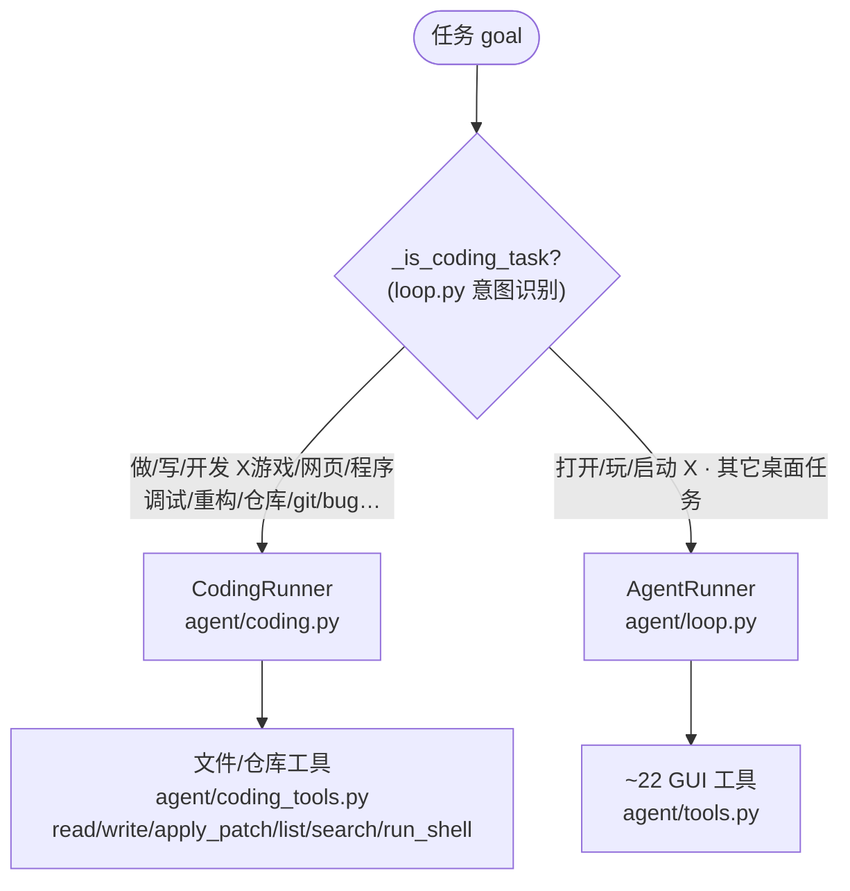
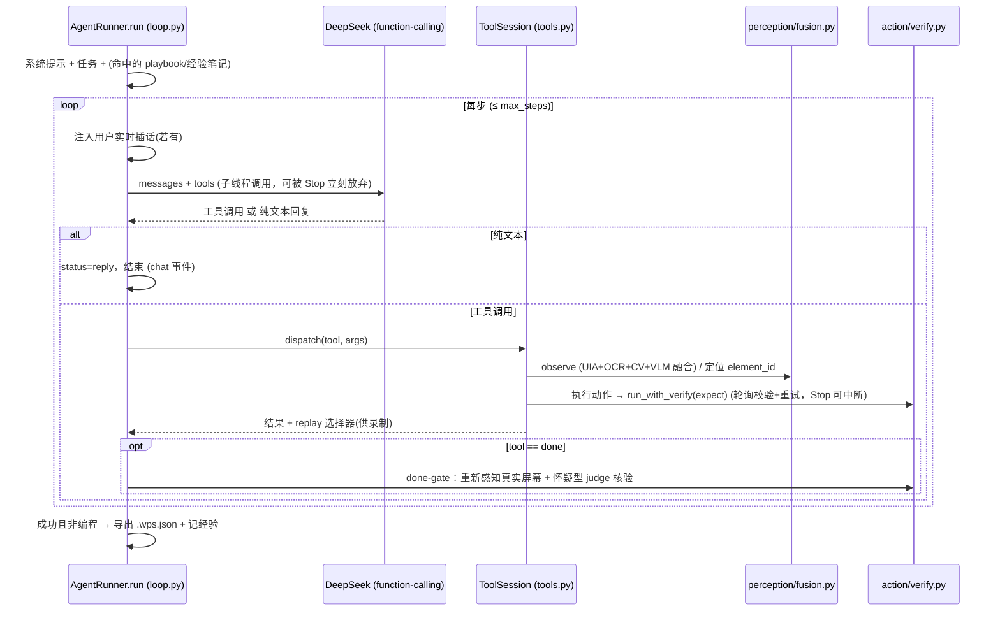

# WinPilot AI Agent

> 现役 AI Agent，位于 `python/winpilot_home/winpilot/`。取代了已删除的旧 LingdongAgent。
> 入口：`python/agent/__main__.py`（IPC 适配器）→ `winpilot/agent/router.py` → `AgentRunner`（GUI 操控）或 `CodingRunner`（编程）。

## 1. 设计原则

- **精简优先**：主 agent 只有 ~22 个 function-calling 工具，**不挂 254 @feature、不感知流程图格式**。工具表越稳定，DeepSeek 的 prefix cache 命中越高、越省钱。
- **确定性优先**：能用 `run_shell`（PowerShell）确定性完成的（文件/进程/命令/查询），不走 GUI。
- **每步验证**：每个动作可带 `expect` 验证条件，执行后轮询校验 + 失败重试；`done` 由独立怀疑型 judge 二次核验，防"假完成"。
- **专长拆分子 agent**：编程能力是独立的 `CodingRunner`（自带文件/仓库工具）；GUI agent 主路径零改动。未来其它专长同理另开子 agent。

## 2. 路由

`router.build_runner(task)`（`agent/router.py`）按 `_is_coding_task` 选择。意图识别是**正则化**的：句首"打开/启动/玩/运行"→ 一律 GUI；命中强编程词或"(做|写|开发…)…(游戏|网页|程序|应用…)"→ 编程子 agent。

## 3. GUI Agent 执行循环（AgentRunner）

### 关键工具（`agent/tools.py`，约 22 个 + 条件性）

`list_windows · observe · focus_window · find_app · find_program · tray_click · launch · click · type_text · hotkey · scroll · drag · wait · read_text · find_image · capture_template · color_probe · undo_last · search_files · done · fail`，条件启用：`run_shell`/`run_detached`（shell 开启时）、`revise_plan`/`complete_subgoal`（planning）、`remember`/`forget`/`reuse_skill`（经验）、`vlm_describe`（配置 VLM 时）。

- **优先 `element_id`**：`observe` 返回带 id 的元素，`click(element_id=…)` 走 UIA 快路径，比裸坐标稳。
- **`expect` 验证 DSL**（`action/verify.py`）：`text_appears/text_gone/window_appears/window_gone/screen_stable/color_match` + 确定性 ground-truth `file_exists/file_contains/process_running/process_gone/shell_true`。
- **Stop 响应**：LLM 调用在子线程，Stop 时立即放弃；`verify` 的轮询/重试也响应 `stop_event`——所以"停止"很快（仅已在执行中的工具会先跑完）。

## 4. 多维感知融合（`perception/fusion.py`）

`observe(hwnd)` 按优先级跑启用的维度，合并去重，给每个元素分配稳定的 `element_id`：

| 维度 | 来源 | 说明 |
|---|---|---|
| `uia` | Windows UIA 控件树 | 最可靠，带状态 |
| `win32` | Win32/Explorer | 控件 + 资源管理器项 |
| `ocr` | OCR 文字识别 | UIA 已很丰富时可跳过（省时） |
| `cv` | OpenCV 图标候选 | 无文字图标 |
| `vlm` | 多模态视觉（可选） | canvas/游戏/视频等结构化感知为空时兜底 |

空快照时有"升级阶梯"（窗口 OCR → 全屏 OCR → VLM）兜底，绝不把空屏交给模型。

## 5. 编程子 agent（CodingRunner）

`agent/coding.py` + `agent/coding_tools.py`：独立循环 + 独立工具集，**不碰 GUI 工具**。

- 工具：`read_file · write_file · apply_patch(唯一查找替换) · list_dir · search_text · run_shell · done · fail`，全部限定在**工作区根**（`config.coding.workspace`，默认用户主目录）。
- 复用 `loop.py` 的 LLM 客户端/用量统计/同款 stop-aware 子线程调用；发同样的 BUS 事件（webui 显示"🧑‍💻 编程子agent"）。
- **编程任务排除动作复用**：不导出 `.wps.json`、不存可复用 skill；但保留**事实笔记**（`remember` 的项目约定），下次同项目更快。

## 6. 记忆与 playbook

- **经验记忆** `memory/experience.py`：成功流程→可复用 skill（导出 `.wps.json` 供 `reuse_skill` 0-token 重放）；手动事实笔记（`remember`）跨任务注入且不被淘汰。编程任务只用笔记、不用动作复用。
- **Playbook** `agent/playbooks.py` + `playbooks/*.json`：按任务关键词或运行时窗口标题注入的"情境攻略"（如另存为对话框必胜法、编程工作流），**以数据形式存在、加一个 JSON 即可，不增加任何工具**。

## 7. IPC 协议（`python/agent/__main__.py`）

stdin/stdout JSON 行。命令：`start / stop / guidance / chat / status`。事件：WinPilot 原生 BUS（`agent_start / agent_step / agent_tool / agent_usage / agent_plan / chat / done_check / agent_recovery / playbook / world / agent_error / agent_done`），由适配器逐行转发给 Electron 渲染器。
