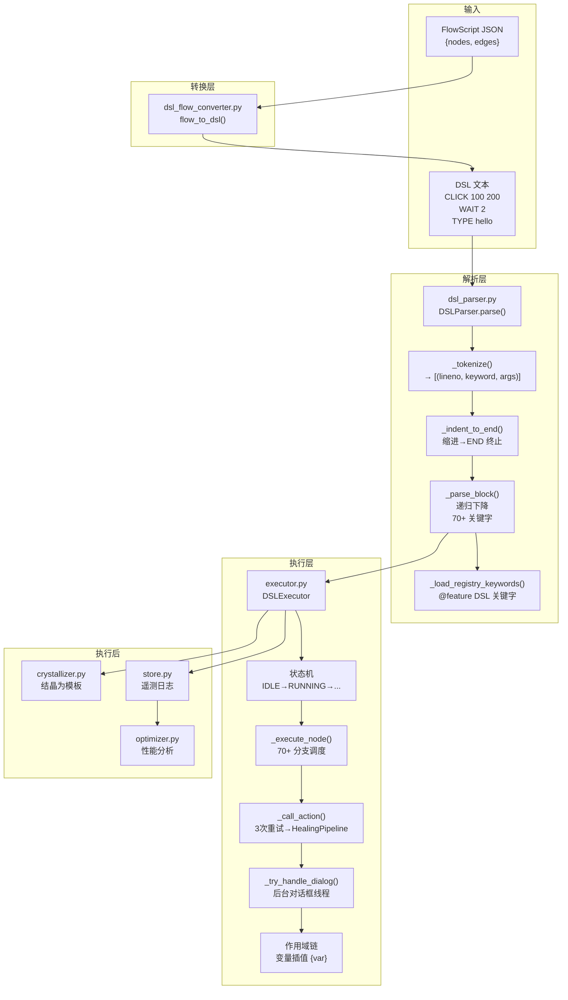
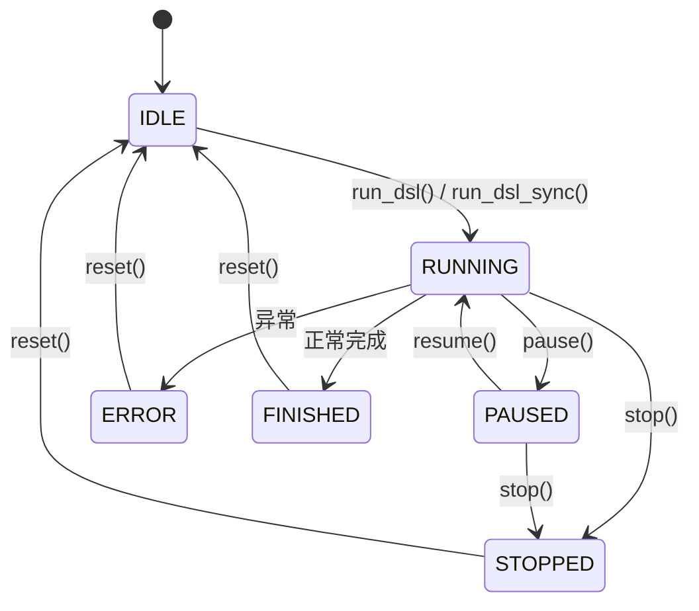
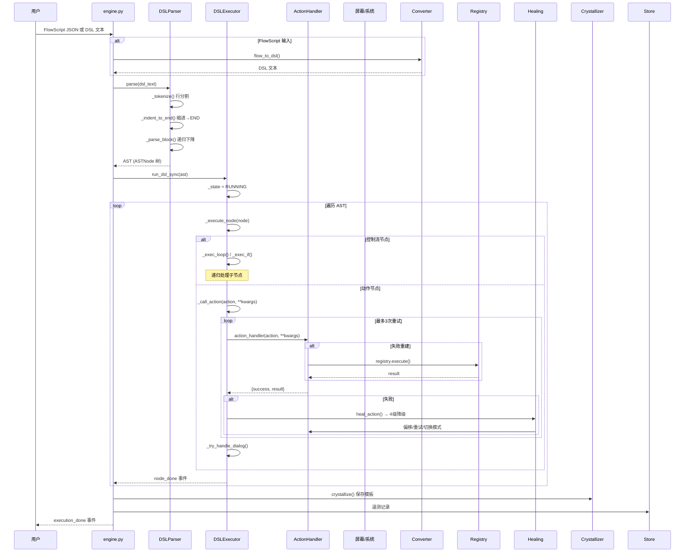
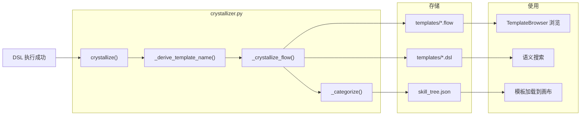
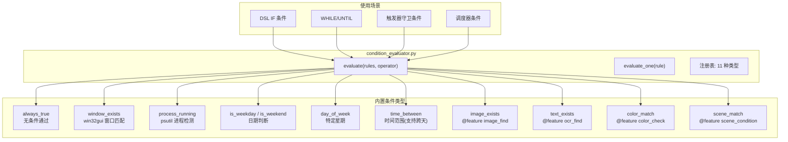

# Workflow 引擎深度分析

> **文档**: `docs/workflow.md`
> **核心文件**: `python/engine/executor.py` (1591行), `dsl_parser.py` (593行), `dsl_flow_converter.py` (1476行)
> **前置阅读**: [system-map.md](system-map.md)

---

## 1. DSL 执行引擎架构



---

## 2. DSL 语法系统

### 78 个内置关键字

| 类别 | 关键字 | 数量 |
|------|--------|------|
| **交互** | CLICK, TYPE, INPUT_TEXT, CLICK_IMAGE, CLICK_TEXT, SWIPE, SCROLL, DRAG | 8 |
| **键盘** | HOTKEY | 1 |
| **导航/焦点** | FOCUS | 1 |
| **等待/计时** | WAIT, WAIT_RANDOM, DELAY, WAITSCREEN, SCREENSTABLE | 5 |
| **控制流** | LOOP, IF, ELSE, ELSEIF, ELIF, END, BREAK, WHILE, UNTIL, PARALLEL, WITH, RETURN | 12 |
| **子程序** | SUBROUTINE, CALL, IMPORT, RUN | 4 |
| **事件** | WHEN | 1 |
| **视觉/OCR** | OCR_FIND, OCR_EXTRACT, IMAGE_FIND, IMAGE_CLICK, SCENE_CONDITION, VLM_CONDITION, VLM_ANALYZE, FINDCANVAS | 8 |
| **截图** | SCREENSHOT, REGION_SELECT, TEMPLATE_CAPTURE, REGION_WAIT, POPUP_CLOSE | 5 |
| **进度条** | PROGRESS_WAIT, PROGRESS_INIT, PROGRESS_RELOCATE | 3 |
| **颜色** | COLOR_CHECK | 1 |
| **变量** | SET, VARIABLE_INC | 2 |
| **文件** | WAIT_FILE | 1 |
| **系统电源** | SHUTDOWN, REBOOT, LOGOFF, HIBERNATE, LOCK, SLEEP, DISPLAY_OFF, DESKTOP, BATTERY, EMPTY_BIN, BRIGHTNESS | 11 |
| **音频** | VOLUME, MUTE | 2 |
| **进程** | KILL, WAIT_PROCESS, WAIT_EXIT, LAUNCH | 4 |
| **窗口** | MINIMIZE, MAXIMIZE, CLOSE_WINDOW, RESIZE_WINDOW | 4 |
| **桌面** | WALLPAPER | 1 |
| **剪贴板** | CLIPBOARD_SET, CLIPBOARD_GET | 2 |
| **文件对话框** | FILEDIALOG_SAVE, FILEDIALOG_OPEN, FILEDIALOG_FOLDER | 3 |

### 5 个别名
BROWSER_NAV, BROWSER_WAIT, BROWSER_FIND, BROWSER_TEXT, BROWSER_JS

### N 个动态关键字
从 @feature 注册表自动注入（dsl_keyword 不为空的 feature）

---

## 3. 执行状态机



### 状态字段

| 状态 | 说明 | 可执行? | 可暂停? | 可停止? |
|------|------|---------|---------|---------|
| `IDLE` | 空闲待命 | ✅ | ❌ | ❌ |
| `RUNNING` | 执行中 | ❌ | ✅ | ✅ |
| `PAUSED` | 已暂停 | ❌ | ❌ | ✅ |
| `STOPPED` | 已停止 | ❌ | ❌ | ❌ |
| `ERROR` | 错误 | ❌ | ❌ | ❌ |
| `FINISHED` | 完成 | ❌ | ❌ | ❌ |

### 线程控制

```
_pause_event = threading.Event()  # set() = 运行中, clear() = 暂停
_stop_flag = threading.Event()    # set() = 停止请求
_action_lock = threading.Lock()   # 并行分支线程安全

_check_control():
  _pause_event.wait()  # 阻塞直到 resume()
  if _stop_flag: raise StopExecution
```

---

## 4. DSL 执行流水线



---

## 5. FlowScript ↔ DSL 双向转换

```mermaid
flowchart LR
    subgraph Canvas["流程图画布"]
        Nodes["节点 [{type, x, y, params}]"]
        Edges["边 [{from, to, port}]"]
    end

    subgraph DSL["DSL 文本"]
        Code["CLICK 100 200<br/>WAIT 2<br/>TYPE hello"]
    end

    subgraph AST["AST 树"]
        ASTNode["SEQUENCE<br/>├ CLICK<br/>├ WAIT<br/>└ TYPE"]
    end

    Canvas -->|dsl_flow_converter<br/>flow_to_dsl()| DSL
    DSL -->|dsl_parser<br/>parse()| AST
    AST -->|dsl_flow_converter<br/>dsl_to_flow()| Canvas
    
    DSL -->|executor<br/>run_dsl_sync()| AST
```

### 转换映射规则

| FlowScript 节点类型 | DSL 关键字 | 说明 |
|---------------------|-----------|------|
| `click` | `CLICK x y` | 坐标点击 |
| `click_text` | `CLICK_TEXT text` | OCR 文字点击 |
| `image_click` | `IMAGE_CLICK targets` | 图片识别点击 |
| `input_text` | `TYPE text x y` | 输入文字 |
| `keyboard` | `HOTKEY keys` | 快捷键 |
| `wait` | `WAIT duration` 或 `WAITSCREEN` | 等待 |
| `condition` | `IF` / `ELSE` / `END` | 条件分支 |
| `loop` | `LOOP N` / `END` | 循环 |
| `screenshot` | `SCREENSHOT` | 截图 |
| `swipe` | `SWIPE x1 y1 x2 y2` | 滑动 |

---

## 6. 结晶化系统



### 分类映射

| 首个 DSL 关键字 | 模板分类 | 说明 |
|-----------------|----------|------|
| CLICK / TYPE | 屏幕操作 | 交互操作 |
| LAUNCH | 软件启动 | 程序启动 |
| WAIT / WAITSCREEN | 等待监控 | 等待类 |
| SCREENSHOT / IMAGE_FIND | 截图处理 | 视觉操作 |
| LOOP | 循环流程 | 循环结构 |
| IF | 条件判断 | 条件分支 |
| HOTKEY | 快捷键 | 键盘操作 |
| SET | 变量操作 | 变量使用 |
| CALL | 子流程 | 子程序调用 |
| WHEN | 事件触发 | 触发器 |

---

## 7. 条件求值系统


