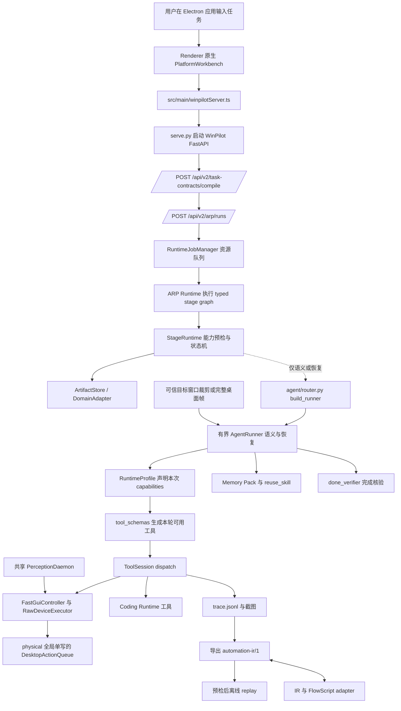
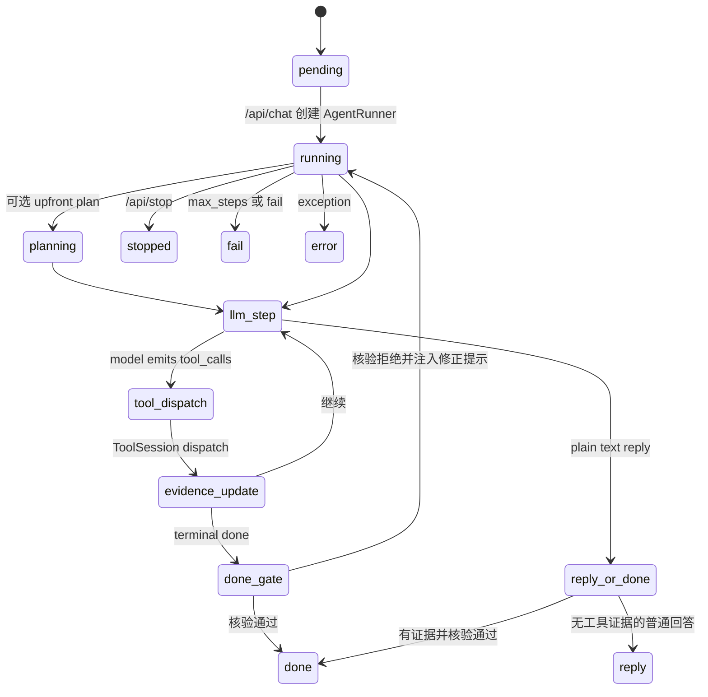

# 项目导览（面试版 / 以当前代码为准）

> 更新时间：2026-07-16。
> 本文只描述当前 `master` 的代码事实。后续如果代码和本文冲突，以代码为准，先读代码再改文档。

## 0. 一句话版本

灵动脚本是一个 Windows 桌面自动化系统：用户面对中文 Electron 原生工作台和一个统一的 WinPilot Agent；支持图片的主模型优先直接读取真实 scoped 画面，函数工具和本地控制器负责落地，严格完成门拒绝“看不清却继续”与模型自报成功；可信运行可沉淀为规范的 `automation-ir/1`，再用于离线重放、记忆 Skill 或流程图编辑。

面试里不要把它讲成“多个 Agent 拼接”或“单纯的脚本编辑器”。更准确的说法是：

- 前台产品是 Electron 桌面应用。
- AI 执行中枢是 `python/winpilot_home/winpilot/` 下的 WinPilot。
- 旧流程图/DSL 体系仍在 `src/renderer/`、`python/engine/`、`python/features/`。
- 两条线以 Automation IR 为共享语义层；`.wps.json` 与 FlowScript 现在是兼容导入/导出格式，不再是事实源。
- 当前只有一个用户可见 Agent 产品入口；`AgentRunner` 是直接聊天、显式 `agent_goal`、语义创建/编辑和异常恢复的 LLM 子路径。确定性 typed stage 由 StageRuntime/Controller 直接执行。Coding 仍只是 AgentRunner 的可选 Runtime 能力，不是独立 Coding 子 Agent。

## 1. 当前必须讲准的代码事实

### 1.1 一个产品 Agent，不等于所有阶段都进入 LLM loop

当任务确实需要 LLM runner 时，`agent/router.py` 只构造 `AgentRunner`。早期的 `CodingRunner` 已经被移除为独立规划器，`agent/coding.py` 只保留兼容 shim，避免旧测试或旧导入崩掉。原生前端会先把自然语言编译为 Task Contract/typed stage graph；应用启动、聚焦、工件捕获、通信投递和确定性验证不必创建 AgentRunner。

正确表述：

> 项目现在是一个产品 Agent、一个 Task Contract/ARP 控制面和一个可选 AgentRunner。前端 typed stage 共享能力预检、artifact、evidence、trace 与完成合同；只有语义或恢复阶段进入 AgentRunner。Coding 能力通过 RuntimeProfile 打开一组文件、搜索、patch、shell、GitHub 搜索工具，而不是切到另一个 Agent。

不要说：

- “有一个桌面 Agent 和一个 Coding Agent。”
- “CodingRunner 负责代码任务。”
- “GUI 和 Coding 是两套规划循环。”

### 1.2 两条主线：WinPilot 与 FlowScript

仓库里有两套历史来源不同的能力：

| 主线 | 当前代码位置 | 面试说法 |
| --- | --- | --- |
| WinPilot Agent | `python/winpilot_home/winpilot/`、`python/winpilot_home/serve.py`、`src/main/winpilotServer.ts` | 当前 AI 桌面 Agent 主体，负责感知、规划、操作、核验、trace、replay、memory。 |
| 流程图 / DSL / `@feature` | `src/renderer/`、`python/engine/`、`python/features/`、`tools/dsl_to_flow.py` | 旧有可视化脚本编辑和执行体系，适合人工编辑、结构化流程、传统自动化节点。 |

这两条线不是互相替代，而是通过 Automation IR 分工：

- Agent 适合第一次做未知、变化大、需要感知和判断的任务。
- `automation-ir/1` 保存步骤、条件、证据、安全约束、变量和 fallback，是新产物的唯一中间表示。
- `.wps.json` 保留旧 WinPilot replay 兼容性，FlowScript 保留可视化节点生态。
- 前端编辑器通过有校验的 adapter 在 FlowScript 与 Automation IR 之间转换，再从 IR 进入 ARP 执行。

### 1.3 两个 HTTP 控制面

不要把端口混在一起。

| 控制面 | 位置 | 用途 |
| --- | --- | --- |
| Electron HTTP API，默认 `:7880` | `src/main/api.ts` | 给外部工具/Claude Code 控制前端、操作流程图、执行 DSL、读取 renderer state。 |
| WinPilot FastAPI，动态本地端口 | `python/winpilot_home/winpilot/server.py`，由 `src/main/winpilotServer.ts` 启动 | 原生工作台的 Agent/ARP/Replay/计划任务控制面、trace、memory 和 WebSocket；旧 webui 仅作兼容诊断。 |

WinPilot 服务只能通过 `python/winpilot_home/serve.py` 启动。直接 `uvicorn winpilot.server:app` 被代码显式拦截，因为那会绕过配置路径和 Electron 管理的动态端口。

当前 renderer 与 Python 服务使用 runtime contract v2。状态接口同时报告进程加载/当前 Git commit 和 Python 源码 `loaded_stamp/current_stamp/drifted`；热更新后的源码漂移是粘性的，前端禁止启动新任务并在空闲时请求重启，`/api/v2/arp/runs` 也会独立 409。不能只看到端口在线就假设前端测试的是最新代码。

### 1.4 VLM 是可选增强，不是默认前提

图像能力要区分“主模型原生视觉”和“独立 VLM fallback”。支持图片的主模型会在初始、observe 和每笔视觉事务后直接收到真实 JPEG；这张画面是像素界面的权威状态，UIA、Win32、OCR、CV 和规则摘要只在文本查询、结构化锚定、changed-only、text-only 模型或恢复路径中补充，不能压过相反画面。独立 VLM 仍是可选增强，不是必经前置层。

当前模型事实也要讲准：`mimo-v2.5` 被显式识别为 native vision；`mimo-v2.5-pro` / `mimo-v2-pro` 按 text-only 处理，不能拿“Pro”名字推断可看截图。MiMo/Reasonix 默认关闭 provider-side thinking，避免隐藏推理吃掉工具参数预算；实验性 `controller.native_visual_thinking` 默认关闭，只针对尚未落地的连续指针几何临时开启，不是全局质量开关。

系统基础提示始终使用 compact closed-loop contract；旧 `full` 样式是兼容别名，不会自动恢复大段领域提示，playbook 默认关闭、只能显式启用。画猫、画狗只是连续指针压力测试，没有生产专属对象模板或固定步骤；手写、签名、描摹、自由路径和画布笔画共用通用 `drag/draw_strokes` 约束。

### 1.5 done 不是模型自述，而是证据核验

`AgentRunner` 接收到 `done` 或模型普通回复后，不会直接相信“我完成了”。`done_verifier.py` 会结合最近动作、工具输出、可见文本账本、截图/图像统计、确定性文件/进程/命令证据和必要时的 LLM judge 做完成核验。Task Contract 主路径则由 `CompletionContractVerifier` 按合同 obligation 与 evidence provider 验收；例如实时交互只有最新权威帧上的 `interaction.task_completed` 才是最终条件，局部回合成功或 `WaitForExternalChange` 被唤醒都不是终态。

正确表述：

> 这个系统把“任务完成”当成可核验证据问题，而不是 Agent 的一句总结。

## 2. 端到端链路

一次 Agent 运行的关键路径：

1. Electron 主进程启动 WinPilot，并把动态 URL 和每进程 bearer token 通过 preload 暴露给 renderer；密钥不注入页面或 localStorage。
2. 原生工作台先把自然语言提交 `/api/v2/task-contracts/compile`，得到结构化 intent、typed stages、artifact/state binding、能力需求和完成义务，再把图提交 `/api/v2/arp/runs`。`/api/chat` 仍是直接 Agent/诊断入口。
3. `RuntimeJobManager` 为 Agent、ARP、Replay 和计划任务创建可查询/可取消 job；共享 `interactive_runtime` 的桌面任务排队，而规划、查询和转换不必被全局 busy 锁住。
4. ARP 的 `task_stage` 先做 capability satisfiability，StageRuntime 根据阶段动态选择 Controller、ArtifactStore、DomainAdapter、证据 provider 和参数化阶段 Skill；缺失能力在执行前扩容、切换或明确失败。
5. 只有语义创建/编辑或异常恢复阶段才通过 adapter 调用 `build_runner()`。此时 `AgentRunner.run()` 创建 compact 系统提示、注入 RuntimeProfile、动态工具 schema 和权威真实帧；确定性的启动、聚焦、工件传递和验收不会逐步调用模型。
6. 每轮 LLM 至多提交一笔视觉事务；动作前用同一 scope 重截图，旧帧、窗口或几何已变就取消动作并返回新帧。明确的短动作由 `execute_subgoal` 或 `run_action_batch` 下沉到控制器。
7. `ToolSession.dispatch()` 负责外层权限、作用域、world model、证据和 trace。batch 内子动作由 `RawDeviceExecutor` 直接调用真实工具 handler，不再递归走完整外层分发。
8. `DesktopActionQueue` 将真实鼠标键盘作为全局独占资源；明确后台安全的窗口消息动作按 hwnd 隔离。共享 `PerceptionDaemon` 持续维护 screen delta、元素缓存、增量 ROI 证据和窗口 lease。
9. 工具结果规范化为 typed evidence，进入 trace、visible evidence ledger、memory 反馈和 done gate。
10. done gate 只有在当前、匹配且 verified 的证据成立时接受；非 Coding 的可信成功运行导出 `.automation.json` 并可编译成记忆 Skill。
11. Replay 执行前验证目标窗口、结构化 conditions 和可见锚点，执行后验证结构化 evidence；Flow 编辑也先转换为 Automation IR，再进入 ARP/Replay。

任务列表不是启动时冻结的。模型可用 `revise_plan(steps=...)` 整体替换/清空，也可原子执行 `add/update/remove/move/reopen`；用户插话、真实画面或证据改变最佳路线时应立刻修改，计划状态本身仍不是完成证据。

## 3. 代码目录地图

| 路径 | 当前职责 |
| --- | --- |
| `src/main/winpilotServer.ts` | Electron 主进程里管理 WinPilot FastAPI 子进程，找空闲端口，调用 `serve.py`，把 URL 暴露给 renderer。 |
| `src/main/api.ts` | Electron 自己的 `:7880` HTTP API，面向前端远程控制、流程图操作、DSL 转换和 renderer 状态读取。 |
| `src/renderer/` | 原生 React 中文 `PlatformWorkbench`，包含智能代理、流程工作台、运行记录、技能与学习、系统设置和真实 FlowCanvas。没有 Agent iframe；API/MCP/VLM 等技术标识保留。 |
| `src/renderer/utils/automationIR.ts` | Automation IR 与 FlowScript 的前端 adapter，保留 metadata、edge、条件和证据语义。 |
| `src/renderer/utils/wpsToFlowScript.ts` | 旧 `.wps.json` 的兼容导入 adapter；无法忠实映射的步骤显式标记，不允许静默假成功。 |
| `python/winpilot_home/serve.py` | WinPilot 服务唯一支持的启动器。 |
| `python/winpilot_home/winpilot/server.py` | WinPilot FastAPI：`/api/chat`、`/api/status`、trace、script、memory、replay、WebSocket、静态 UI。 |
| `python/winpilot_home/winpilot/agent/router.py` | Runner 工厂。现在只返回统一 `AgentRunner`。 |
| `python/winpilot_home/winpilot/agent/loop.py` | Agent 主循环：模型调用、工具调用、上下文折叠、trace、用量统计、done gate、记忆反馈、成功脚本导出。 |
| `python/winpilot_home/winpilot/agent/runtime_profile.py` | 一次构造并传递 desktop、coding、browser、replay、scheduler、IR、safety、async、device queue 和 perception 等 capability。 |
| `python/winpilot_home/winpilot/agent/tool_schemas.py` | OpenAI function-calling schema，按 planning、coding_runtime、GUI-only、lean profile 裁剪工具；`drawing_gui` 仅为手工配置兼容别名，不是自动绘图专属 Agent。 |
| `python/winpilot_home/winpilot/agent/tools.py` | `ToolSession`，保存当前窗口、snapshot、world model、undo stack、screen watcher、coding session，并分发工具。 |
| `python/winpilot_home/winpilot/agent/coding_tools.py` | Coding Runtime 的工作区受限文件/仓库工具，含敏感配置写保护和“只运行任务不乱改项目”的保护。 |
| `python/winpilot_home/winpilot/agent/done_verifier.py` | 完成核验，防止“假完成”。 |
| `python/winpilot_home/winpilot/tasking/` | TaskIntent/TaskContract、CapabilityPlanner、StageRuntime、ArtifactStore、InteractionStageRuntime、DomainAdapter、EvidenceRegistry 与 CompletionContractVerifier。 |
| `python/winpilot_home/winpilot/fast/` | 本地低延迟 GUI 控制器、共享感知 daemon、元素缓存、输入定位、screen watcher、批量动作和绘图辅助。 |
| `python/winpilot_home/winpilot/perception/` | UIA、Win32、OCR、CV、VLM 的感知融合和 reducer。 |
| `python/winpilot_home/winpilot/recorder/trace.py` | 异步 BUS trace/截图、Automation IR 主导出、`.wps.json` 兼容导出和离线 replay。 |
| `python/winpilot_home/winpilot/runtime_jobs.py` | Agent、ARP、Replay、Schedule 的 job 生命周期、资源排队、查询、回调与取消。 |
| `python/winpilot_home/winpilot/action/raw_device.py` | fast batch 内的真实设备 adapter，绕开每个子动作的完整 Agent 分发开销。 |
| `python/winpilot_home/winpilot/memory/` | Memory Graph、检索、打包、运行编译、reuse 反馈。 |
| `python/engine/` | 旧 FlowScript 执行引擎。 |
| `python/features/` | 旧 `@feature` 功能体系，属于流程图线，不是 WinPilot Agent 的主工具系统。 |

## 4. 核心模块按面试讲法

### 4.1 AgentRunner：有界语义与恢复执行器

`AgentRunner` 是直接 `/api/chat`、显式 `agent_goal` 和部分语义/恢复 stage 的中心对象，不是每个前端任务阶段的必经层。进入该子路径后，它负责：

- 生成 run_id。
- 创建 `ToolSession`。
- 根据任务构造 `RuntimeProfile`。
- 构造系统提示和工具 schema。
- 调用模型。
- 解析并执行工具调用。
- 折叠过大的上下文。
- 记录 LLM trace 和 BUS trace。
- 维护 recent evidence。
- 调用 done gate。
- 写入经验记忆和 Memory Graph。
- 对非 Coding 的可信成功运行导出规范 Automation IR，并可生成 WPS 兼容副本。

面试时可以概括为：

> AgentRunner 是一个“带证据链的有界 LLM 桌面执行器”，不是整个 Task Contract Runtime 的同义词，也不是单纯 while 循环调用大模型。

### 4.2 ToolSession：所有工具共享的运行态

`ToolSession` 保存本轮任务共享状态：

- 当前窗口 `hwnd`。
- 最近一次感知 `snapshot`。
- runtime profile。
- 可选 `CodingSession`。
- world model。
- 可被 `revise_plan` 随时替换、增删、移动、重开项目的 plan。
- undo stack。
- screen watcher。
- memory replay 使用情况。

它的价值是让工具之间共享上下文。例如 `observe` 后的 element id、`click` 后的 screen delta、`execute_subgoal` 的缓存、replay 的尝试记录，都能进入同一条证据链。

### 4.3 RuntimeProfile：能力开关，不是 Agent 路由

`runtime_profile.py` 的定位是“本轮运行启用哪些能力”。当前只有两个公开 label：

- `desktop`
- `coding+desktop`

Coding 判断命中时，Agent 仍是同一个 `AgentRunner`，只是工具 schema 增加仓库能力，并且提示里要求优先用确定性 repo 操作：

- `list_dir`
- `read_file`
- `search_text`
- `apply_patch`
- `write_file`
- `run_shell`
- `github_search`

这解决了旧方案的问题：如果把 Coding 做成独立 Agent，就会有两套 planner、两套 prompt、两套 tool loop、两套 done 语义，trace 和 memory 也会割裂。

### 4.4 原生真实帧与按需感知融合

支持 native vision 时，初始/动作后/observe 的真实 JPEG 是主观测；`controller.target_window_capture_enabled=true` 默认只在目标 hwnd 有效、可见、非最小化、就是前台、几何可信、确实节省画面且任务不需要多窗口上下文时裁窗，否则完整桌面 fail-safe fallback。关闭开关可强制全屏做 A/B。每个 `frame_*` 0..1000 坐标绑定到那张画面的确切 scope/region，不会把 JPEG 像素误当物理坐标。

`perception/fusion.py` 的按需补充路径：

1. 根据配置和查询决定启用哪些结构化感知维度。
2. 对 UIA、Win32、OCR、CV、VLM 的结果做合并和去重。
3. 给每个元素分配本次 observation 内稳定的 `elem_id`。
4. 输出结构化 `Snapshot` 和给模型看的文本。
5. text-only 主模型或结构化证据不足时给出明确不确定性，再走 OCR/VLM 救援路径。

`perception/reducer.py` 进一步把完整 Snapshot 压缩成更适合 LLM 热路径使用的摘要：候选元素、阶段判断、可操作建议、不确定性和最近变化区域。

确定性 Domain Adapter 另有私有 `structured_ui` 路径：先用 UIA/Win32 获取结构，不为每个本地事务支付全窗 OCR/VLM，再只对收件人、确认框、发送按钮或短控件候选区做 obligation-scoped OCR。StageRuntime 会为通信事务取得 OCR foreground lease，让尚未开始的后台预测 OCR 让位；已经进入 ONNX 的一次推理不能安全抢占。PerceptionDaemon lease 释放会取消排队工作并丢弃旧 generation 的迟到结果，保证旧 run/旧窗口状态不会污染重获 lease 后的缓存，但这不是强杀底层 inference。

### 4.5 Fast GUI Controller：把明显动作放到本地闭环

`fast/controller.py` 是“低延迟 GUI 内循环”。它负责执行短批量、已落地的 GUI 动作，例如：

- 定位并点击带 label 的元素。
- 定位输入框、点击、清空、输入。
- 批量执行 click/type/hotkey/scroll/drag/draw。
- 等待变化或稳定。
- 对视觉变化做自动验证。
- 为手写、签名、描摹、自由路径和画布等连续指针任务执行同一套 stroke/work-surface 约束。

这不是另一个 Agent。它是 `ToolSession` 拥有的本地 controller，用来减少“每点一下都问一次大模型”的延迟。

多输入协同是默认关闭的实验能力：`controller.multi_input_cooperation=false`。Windows 仍只有一个物理光标和一个键盘焦点；开启后系统优先 UIA/PostMessage 等后台安全动作，物理键盘只在目标拥有前台时执行，长动作持续复核前台和光标。用户切换窗口或移动光标时立即中止并让出控制权，不宣称存在真正“第二鼠标”。

通信 artifact 的发送后身份核验先走 ORB + RANSAC homography，并同时约束 inlier 比例、投影尺度/边界和发送前后局部变化；强几何证明成立就 early return，不继续支付多尺度模板搜索。稀疏线稿、重裁切或大形变缺少足够 keypoint 时仍要 fallback 到较慢且可能含糊的 subject-agnostic edge-template，因此不能把 ORB 优化描述成对所有图片都恒定加速。

### 4.6 DoneVerifier：反假完成

`done_verifier.py` 是面试最值得讲的亮点之一。它不是“再问一次模型做没做完”这么简单，而是先走确定性核验：

- 输入/可见文本任务：最终 screen 或 evidence 中必须出现目标文本。
- literal token：要求精确字面量出现，不能用“等价状态”糊弄。
- 连续指针任务：要求真实 drag/draw stroke 和与用户语义匹配的新鲜整图；视觉变化或颜色存在只能证明发生了像素效果。
- 通信任务：不能把 click/type 的 ok 当成发送成功，必须看到目标消息出现在聊天/收件上下文。
- 文件/命令类任务：优先相信 `run_shell`、`Test-Path`、exit code、verified 字段等确定性证据。
- 如果 deterministic guard 不足，再用 skeptical LLM judge 判断。
- 若 judge 调用异常或证据不足，当前策略是 fail-closed：拒绝 done 并继续恢复，重复声明也不能强制通过。

面试表达：

> 我们把 done gate 设计成一个独立的怀疑者。Agent 的自述只能作为输入，真正决定完成的是工具证据和最终状态。

### 4.7 Trace、Automation IR 与 Replay

`recorder/trace.py` 做三件事：

1. `TraceRecorder` 订阅 BUS 事件，写入 `python/winpilot_home/traces/<run_id>.jsonl`；截图进入有界异步队列，并用 `action_id` 配对动作前后证据，避免高速 batch 错配。
2. trace 蒸馏先得到 WPS 兼容动作，再由 `write_automation_ir()` 写出规范 `automation-ir/1`；`.wps.json` 只作为旧消费者的兼容副产物。
3. `Replayer` 接受 Automation IR 或旧 WPS，执行前强制检查目标窗口和结构化 conditions，执行后检查结构化 evidence；不满足就失败并返回具体步骤，不默认成功。

这条线可以这样讲：

> Agent 的一次成功不是只留下日志，而是蒸馏成带适用条件、证据、安全和 fallback 的 Automation IR。IR 既可 0-token replay，也可进入流程图继续编辑。

### 4.8 Memory Graph：经验是提示，不是事实替代

当前记忆体系不是简单 JSON 数组。运行完成后，`memory/compiler.py` 会把 episode、skill/procedure、warning 等写入 Memory Graph；可复用 Skill 指向规范 Automation IR，`memory/packer.py` 只把少量相关记忆打包进 LLM 上下文。

关键原则：

- Memory 只是 hint。
- 当前 screen、文件和工具结果优先级更高。
- replay 成功不等于任务完成，仍要 done gate 验证最终状态。
- Coding 任务不会导出为可复用 skill，避免把一次仓库编辑误当作通用 GUI 自动化技能。
- 只有实际尝试过 replay 的记忆才参与反馈评分，不能因为被 prompt 注入就算成功。

### 4.9 ModelAdapter：兼容 OpenAI 风格接口并归一化用量

`model_adapter.py` 的职责是薄适配：

- 识别 provider。
- 判断模型是否显式支持 vision。
- 显式把 `mimo-v2.5` 识别为 vision，同时把 `mimo-v2.5-pro` / `mimo-v2-pro` 保持为 text-only。
- 对 MiMo/Reasonix 这类 reasoning endpoint 默认禁用 provider-side thinking，避免工具调用预算被隐藏思考吃完；用户显式 `api.thinking` 才覆盖。
- 归一化 token usage。
- 估算成本。
- 保持 `client.chat.completions.create` 的调用形状。

它不是代理服务，也不直接碰 GUI controller。

## 5. 设计取舍

### 5.1 为什么不做多个用户可见 Agent

旧做法容易出现四个问题：

1. Prompt 重复：桌面 Agent 和 Coding Agent 都要解释工具、done、trace、约束。
2. 规划割裂：一个任务可能同时需要读文件、跑命令、开浏览器和看 GUI。
3. 证据割裂：两个 runner 会让 done gate、trace、memory 难以统一。
4. 用户心智复杂：用户只想“帮我完成任务”，不想选择 Agent 类型。

当前做法是统一 `AgentRunner`，任务分类只影响 runtime capability。

面试回答：

> 我没有把 Coding 做成另一个 Agent，而是做成统一 Agent 的一个 Runtime Profile。这样所有任务共享同一套工具证据、完成核验和记忆语义。

### 5.2 为什么 Agent 和流程图解耦

Agent 做“探索和第一次成功”，流程图做“可视化和稳定复用”。如果强行让 Agent 直接生成 FlowScript，会有两个问题：

- FlowScript 节点是旧体系，表达不了所有 WinPilot 语义动作，例如 selector fallback、controller evidence、绘图颜色证据。
- Agent 第一次探索时需要 trace、截图、感知、失败恢复，不应该被流程图节点模型限制。

所以当前桥接策略是：

- WinPilot 从 trace 导出规范 Automation IR，并可生成 `.wps.json` 兼容副本。
- FlowCanvas 的编辑状态先转 Automation IR，再重建 Flow graph 并进入 ARP Runtime。
- 旧 WPS/FlowScript 都通过 adapter 进入 IR；不可忠实执行的节点必须显式报错或交回 WPS replay，不能模拟成功。

### 5.3 为什么要低延迟 controller

GUI 自动化如果每一个 click、type、wait 都发给 LLM，延迟高且容易抖。当前策略是：

- LLM 负责目标、计划和异常判断。
- Controller 负责已经明确的短动作闭环。
- `run_action_batch` 支持一小段 grounded GUI batch。
- `execute_subgoal` 支持输入、点击、绘图、验证这类局部 routine。
- screen watcher 和 visual delta 提供动作后证据。

这能减少 LLM round-trip，也让工具输出更结构化。

### 5.4 为什么 done gate 要严格

桌面任务最常见的问题不是“不会点”，而是“以为点完了”。严格 done gate 可以防止：

- 输入了文字但没有发送。
- 点了按钮但页面没跳转。
- 绘图选了工具但没有画出 stroke。
- 文件任务只总结 README，没有真实运行。
- 代码任务改了文件但没验证。
- 通信任务把输入框内容当成送达证据。

代价是偶尔会多走一步 observe/read_text/run_shell，但结果可信度更高。

### 5.5 为什么保留旧 FlowScript

旧体系仍有价值：

- 可视化编辑比纯文本脚本适合人工维护。
- DSL 适合简单命令快速生成流程。
- `@feature` 可以作为流程图节点扩展。
- 对稳定、重复、结构化的自动化，传统流程图比 Agent 更可控。

所以它不是“被 WinPilot 替代”，而是转为复用和编辑层。

## 6. 运行状态机

当前可以按这个状态机理解一次运行：

状态结果主要有：

| 状态 | 含义 |
| --- | --- |
| `done` | 任务被接受为完成。可信度取决于 `_done_verified` 和是否 force-unverified。 |
| `reply` | 没有工具证据的普通回答。 |
| `fail` | Agent 判断无法完成或达到最大步数。 |
| `stopped` | 用户停止。 |
| `error` | 运行异常。 |

## 7. 高频面试问答

### Q1：这个项目和普通 RPA 有什么区别？

普通 RPA 依赖预先写死的流程和坐标。这个项目把“第一次完成任务”交给 Agent：它可以观察界面、选择工具、验证结果，并把成功路径转成 Automation IR 用于复用。后续稳定场景再走 preflight、replay 或流程图。

### Q2：这个项目和纯 LLM GUI Agent 有什么区别？

原生视觉主路径确实让支持图片的 LLM 直接看真实画面，但不是“给一张截图后无限开环点坐标”。当前系统还有：

- 每笔视觉事务后的新鲜 scoped 帧和同 scope 动作前检查。
- UIA/Win32/OCR/CV/VLM 多源感知。
- Snapshot 和 element id。
- 本地 controller 的低延迟动作闭环。
- screen watcher 和 visual delta。
- trace、截图和可重放脚本。
- 严格 done gate。
- Memory Graph 和 replay 反馈。

LLM 负责高层决策，本地工具负责落地和验证。

### Q3：为什么不直接把所有动作都写成 FlowScript？

因为第一次执行时环境不确定：窗口可能没打开、按钮文本不同、登录态不同、页面动态变化。Agent 更适合探索和处理异常。FlowScript 更适合已知稳定流程。当前设计让 Agent 先找到路径，再把路径沉淀为可编辑脚本。

### Q4：如何避免坐标脆弱？

几层措施：

- 原生视觉动作只接受当前 scoped 帧内 0..1000 的 `frame_*` 坐标，由运行时映射到同一次截图 region；不允许模型自行把缩放 JPEG 像素换成物理 `x/y`。
- 动作前重截图；目标 ROI 或整帧变化超过阈值、窗口 scope/几何改变或帧过期就取消旧动作。
- `observe` 产生 element id，工具可以按 element id 操作。
- replay 优先用文本/元素语义重新定位，坐标只是 fallback。
- `clean_selector_text()` 会清理未读数、badge 这类易变文本。
- `click_element`、`type_into_element` 会使用 anchor、fallback text、role、expected region 和 targeted observe retry。
- reducer 会把高相关候选元素给模型，而不是让模型读几百行 OCR。

### Q5：如何避免假完成？

核心是 done gate。系统不会只相信模型总结，而是看：

- 最近工具输出。
- verify 字段。
- final observe/read_text。
- 可见 evidence ledger。
- 文件、进程、命令的确定性证据。
- 绘图的 drag、visual_change、颜色和文件证据。
- 通信任务的最终可见消息。
- 必要时再用 skeptical LLM judge。

### Q6：Coding Runtime 是什么？

它是统一 Agent 的一组可选仓库工具。触发 coding task 且不是 GUI-only 时开启。开启后，Agent 可以在配置的 workspace 内：

- 列目录。
- 读文件。
- 搜索文本。
- 精确 patch。
- 写文件。
- 跑 shell。
- 搜 GitHub 仓库。

它有两个重要保护：

- 敏感配置/密钥文件写入保护。
- 如果任务只是 clone/run/verify，不允许擅自改项目文件。

### Q7：为什么 Coding 不沉淀为 replay skill？

仓库编辑通常依赖代码版本、依赖环境、文件状态和任务目标，复用一次编辑路径风险很高。当前代码明确把 Coding 成功排除在可复用脚本导出范围之外，但仍允许 factual project notes 作为只读提示进入上下文。

### Q8：低延迟 GUI 具体做了什么？

`run_action_batch` 可以执行一段短动作并返回结构化结果；`execute_subgoal` 可以把输入、点击、连续指针和验证这样的局部 routine 放进本地 controller；可信目标窗口裁剪可减少图片面积，screen watcher 和 screen delta 会提供“动作后画面是否变化”的证据。这些都减少了 LLM 往返，但不会省略动作后真实帧。

### Q9：trace 和 replay 是如何工作的？

运行时 BUS 事件写入 `python/winpilot_home/traces/<run_id>.jsonl`，动作前后截图由异步 recorder 按 `action_id` 归档。导出时只抽取可重放动作，去噪并校验成 Automation IR；离线 replay 先做窗口/条件 preflight，再用当前屏幕重新定位元素，并复用同一套 verify engine。

### Q10：如何调试失败？

主要入口：

- WinPilot UI 的事件流和聊天日志。
- `python/winpilot_home/traces/<run_id>.jsonl`。
- `python/winpilot_home/traces/<run_id>/` 下的动作截图。
- `AgentRunner._trace_debug()` 写出的 LLM request/response/tool_result JSON。
- `/api/trace/{run_id}` 和 `/api/trace/{run_id}/summary`。
- `/api/evals` 聚合评估报告。
- `done_check`、`agent_recovery`、`run_state`、`agent_tool` BUS 事件。

### Q11：项目当前最大工程风险是什么？

可以诚实回答：

- `AgentRunner`、`ToolSession`、fast controller 仍然偏大，后续还需要继续拆模块。
- 本地 controller 已经降低延迟，但还不是完整视觉伺服系统。
- native vision 已是像素界面主路径，但复杂自由形状的审美/语义质量仍受模型影响；结构化定位和 text-only fallback 仍依赖 OCR/CV/控制器启发式。
- 旧 `.wps.json` / FlowScript 到 Automation IR 是保守映射，不是所有 WinPilot 语义都能无损转换；无法执行时必须 fail-fast。
- GUI 自动化天然受窗口焦点、权限、系统弹窗、登录态影响，所以必须保留 trace 和 done gate。
- `structured_ui` 的效果依赖目标应用暴露的 UIA/Win32 质量；foreground OCR 不能抢占正在执行的 ONNX 调用；lease cancellation 只阻止旧结果进入新状态；ORB early return 只接受通过完整几何与因果变化门槛的强匹配。

真实基线也要诚实：2026-07-14 单次前端冷启动空白 Paint 执行“用画板画一只猫”约 55.3 秒，2 次点击、1 次 `draw_strokes`，没有 undo/clear 死循环；结果只能说可辨认但粗糙且有歧义，不能说“好看”。单个样本只证明链路和时延，不构成统计成功率。

2026-07-16 的最终可审计样本包括：通用拖拽 run `arp-20260716-094321-92fca7` 用 2 次模型调用、23.936 秒完成四个 typed stages，外部 ground truth 收到 pointerdown、31 次 move、pointerup 并确认 whole-object placement；关闭 Skill/Memory 的 QQ run `arp-20260716-094506-386988` 用 2 次模型调用、61.810 秒完成五阶段，创建当前 run artifact，并以正确会话中发送后发生变化的 149/111 ORB homography 匹配通过 Completion Contract。另三种改写也完成真实 E2E，但这些仍是单机有限样本，不是通用成功率。

### Q12：怎么用 2 分钟介绍这个项目？

可以这样说：

> 灵动脚本是我做的 Windows 桌面自动化系统。它不是传统 RPA 只靠固定坐标，也不是拿一张截图后开环乱点。当前核心是统一的 WinPilot AgentRunner：支持图片的主模型直接读取目标窗口裁剪或完整桌面的新鲜画面，UIA/OCR/CV 等按需补充；函数工具和 Fast GUI Controller 落地短事务，每次动作后再看真实结果。
> 
> 这个项目比较强调可信完成：Agent 说 done 后，系统会用 typed tool evidence、最终可见文本、文件/命令结果、绘图颜色和通信上下文做 fail-closed done gate，而不是相信模型自述。一次成功运行会记录 trace 和截图，并导出成带条件、证据和安全约束的 Automation IR，后续可 0-token replay 或在流程图中继续编辑。
> 
> 最近架构上我把 Coding 子 Agent 收敛成统一 Agent 的 Runtime Profile。这样代码任务、桌面任务、trace、memory、done gate 都共享同一套语义，避免双 planner 和双工具循环造成的割裂。

## 8. 演示路线

### 8.1 基础启动演示

1. `npm install`
2. `npm run dev`
3. 打开 Electron 应用。
4. 进入中文原生“智能代理”工作台。
5. 观察 Electron 主进程自动启动 WinPilot 服务，而不是手动跑 uvicorn。

重点讲：

- Electron 自己有 `:7880` API。
- WinPilot 是动态端口，并通过 preload 提供的 URL/token 连接原生 React 工作台。
- renderer 使用 WinPilot HTTP/WebSocket 控制面；`/` 下旧 webui 仅保留兼容诊断，不承载主产品路径。

### 8.2 GUI 自动化演示

可选任务：

- 打开记事本，输入指定文本，保存到指定路径。
- 打开计算器，计算表达式，并验证结果。
- 在画图中画指定颜色/形状并保存图片。

讲解点：

- `observe` 看到 UI 元素。
- `execute_subgoal` 或 `run_action_batch` 执行局部 routine。
- done gate 检查最终证据。
- trace 里有动作、截图和结果。

### 8.3 Replay 演示

1. 完成一次 GUI 任务。
2. 从 trace 导出 `.automation.json`，查看 conditions/evidence/safety/fallback。
3. 通过 preflight 后 replay，观察 0-token 执行和逐步 evidence。
4. 在 Studio 中导入 IR，查看重建后的 Flow 节点，再走 Flow -> IR -> ARP 执行链。
5. 对无法安全映射的 legacy 节点，展示 fail-fast 诊断而不是模拟成功。

### 8.4 Coding Runtime 演示

可选任务：

- “检查这个项目的某个文档是否和代码一致，并更新。”
- “在 workspace 内搜索某个函数调用并解释调用链。”
- “修一个小 bug，修改后运行最小验证命令。”

讲解点：

- 仍是一个 AgentRunner。
- 工具 schema 增加 coding tools。
- 文件路径被限制在 workspace。
- patch 需要唯一 find。
- shell 输出和 exit code 进入 evidence。
- clone/run 类任务必须实际尝试运行或验证，不能只复述 README。

## 9. 不要再讲的过时内容

| 过时说法 | 当前正确说法 |
| --- | --- |
| 有独立 CodingRunner 负责代码任务 | `CodingRunner` 只是兼容 shim；需要 LLM loop 时统一使用 `AgentRunner`，确定性 typed stage 由 StageRuntime/Controller 直接执行。 |
| Agent 和 FlowScript 是一套运行时 | 它们共享 Automation IR，但实时 Agent、Replay 和 legacy Flow executor 仍有明确的 adapter/执行边界。 |
| WinPilot 直接用 Electron `:7880` API | WinPilot 有自己的 FastAPI 动态端口；`:7880` 是 Electron 对外控制面。 |
| 直接 `uvicorn winpilot.server:app` 启动后端 | 代码明确要求通过 `serve.py` 启动，直接 uvicorn 会被拦截。 |
| 所有任务都先跑 UIA/OCR/VLM 多层感知 | native-vision 主模型先看真实 scoped 画面；结构化感知和独立 VLM 是按需补充，不能压过相反像素。 |
| `mimo-v2.5-pro` 比 v2.5 更适合看图 | 当前 `mimo-v2.5` 明确支持图片；`mimo-v2.5-pro` 按 text-only 处理。 |
| 画猫/画狗已经做成专属能力 | 这些只是连续指针压力测试；生产能力是通用 drag/stroke、scope、工作面和新鲜帧闭环。 |
| replay 成功就等于任务完成 | replay 只是动作复用；最终仍要 verify/done gate。 |
| `.wps.json` 是当前唯一脚本格式 | 新事实源是 `automation-ir/1`；`.wps.json` 只是兼容 replay 格式。 |
| `@feature` 是 WinPilot Agent 工具系统 | `@feature` 属于旧 FlowScript/流程图体系。 |
| done 是模型总结 | done 是证据核验结果。 |

## 10. 面试时可以强调的技术亮点

### 10.1 架构亮点

- Electron + Python FastAPI 双进程架构。
- WinPilot 服务由 Electron 管理生命周期和动态端口。
- 单一产品 Agent + Task Contract/StageRuntime；需要 LLM loop 时统一 AgentRunner + RuntimeProfile，避免多 Agent 语义割裂和每个确定性动作都调用模型。
- REST + WebSocket BUS 事件流。
- trace、script、memory、eval 都在同一个 WinPilot 服务下暴露。

### 10.2 Agent 亮点

- function-calling 工具链。
- GUI-only gating。
- runtime-specific tool schema。
- provider adapter 和 usage/cost normalization。
- compact closed-loop prompt；`revise_plan` 可随证据动态增删、移动、重开任务项。
- 上下文折叠兼顾 prefix cache。
- mid-run interject 支持用户实时插话。
- failure recovery layer 和 run_state。
- done gate 反假完成。

### 10.3 GUI 自动化亮点

- native-vision 真实帧优先，可信目标窗口裁剪/完整桌面 fail-safe fallback。
- UIA/Win32/OCR/CV/VLM 按需融合。
- reducer 降低 LLM 读取负担。
- element id 和 snapshot registry。
- screen watcher 和 action screen delta。
- `execute_subgoal` / `run_action_batch` 本地闭环。
- stale-frame、scope/geometry race 与 done judge 全部 fail-closed。
- 默认关闭的多输入协同实验：后台安全输入优先，用户前台/光标所有权优先。
- replay 优先语义重定位，再 fallback 坐标。

### 10.4 工程化亮点

- Automation IR/WPS 双向适配和结构校验。
- trace 到 replay 的脚本蒸馏。
- 前端保守导入 FlowScript，不丢失 WinPilot-only payload。
- Memory Graph 区分 episode、skill、procedure、warning。
- replay 反馈只记录真实尝试。
- Coding Runtime 的 workspace confinement 和敏感文件写保护。

## 11. 进一步可以优化的方向

这些可以作为“我知道还有什么没做完”的回答：

1. 继续拆分 `AgentRunner`、`ToolSession` 和 fast controller，降低单文件复杂度。
2. 把更多已验证的 GUI routine 下沉到 controller，减少 LLM 回合。
3. 继续让 Automation IR 覆盖剩余 legacy Flow/DSL 节点，最终移除双执行语义。
4. 在当前常驻变化 ROI OCR/Win32 流水线上接入可部署的轻量学习型 UI detector，并加入视觉伺服连续修正。
5. 扩大经过证明的后台安全动作目录；真实鼠标键盘仍必须全局单写，不能仅凭存在 hwnd 就并发。
6. 把画板等单次样本扩展为多应用、多任务、多轮、外部 ground truth 的统计基准，并把 eval、trace summary、失败分类和 p50/p95 指标进一步产品化。
7. 为 Coding Runtime 增加更系统的测试矩阵和安全策略审计。
8. 对 Memory Graph 增加更细的过期策略、冲突解决和 Skill A/B 评测。

## 12. 最短背诵稿

> 灵动脚本当前核心是一个 Windows 桌面自动化 Agent 系统。Electron 负责产品壳和流程图编辑，WinPilot 是 Python FastAPI 服务，真正执行 AI 桌面任务。现在架构已经收敛成一个统一的 AgentRunner，Coding 不是独立 Agent，而是通过 RuntimeProfile 打开的可选工具能力。  
> 
> 支持图片的 Agent 每轮直接拿到可信目标窗口裁剪或完整桌面的真实帧，结构化感知按需补充，再用 function-calling 调用 GUI、文件、shell、fast controller 等工具。明确的 GUI 子任务下沉到本地 controller，但每笔视觉事务后仍回到新鲜帧；任务列表可以随用户和证据动态调整。任务完成不是模型说了算，而是 done gate 基于工具输出、最终画面、文件/命令证据和必要的 judge 做核验。
> 
> 成功运行会留下 trace 和截图，并导出成规范 Automation IR，后续可以先做 applicability preflight 再离线 replay，也可以在流程图里继续编辑。这个设计把“第一次智能完成”和“后续稳定复用”分开，同时用结构化证据避免假成功。
