# 项目导览（通俗 / 面试版）

> 这份是给自己看的复习稿：要能快速讲清楚“项目是什么、为什么这么设计、技术难点在哪、面试怎么答”。更底层的代码事实见 `architecture.md`、`winpilot-agent.md`、`apis.md`。

## 1. 一句话

灵动脚本是一个 Windows 桌面自动化系统：**第一次让 AI 像人一样操作电脑完成任务，成功后把过程录成可复用脚本，之后可以不再调用大模型、直接离线重放或导入流程图编辑。**

更口语一点：

> 它既像一个能临场操作电脑的 AI 助手，又像一个能把成功操作沉淀成自动化流程图的 RPA 工具。

## 2. 它解决什么问题

日常电脑操作里有很多重复、麻烦、但又不完全固定的任务：

- 打开某个软件，搜索、点击、填表、发送消息。
- 登录系统，下载报表，保存文件。
- 在多个窗口之间切换，按条件判断下一步。
- 对一些 UIA 不好用的软件，只能靠文字识别或图像理解。

传统方案和纯 AI 方案都有明显问题：

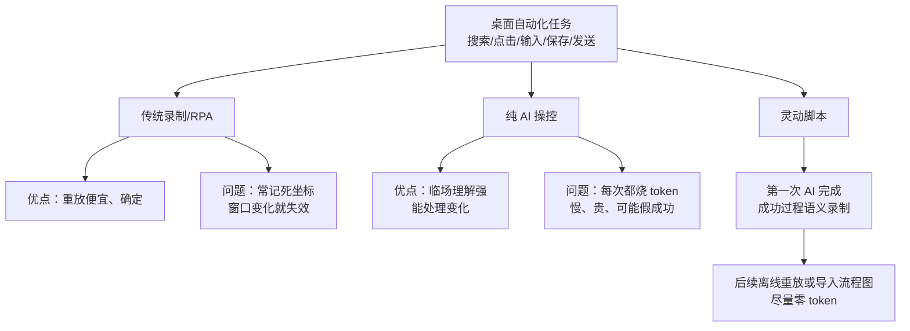

这个项目的核心思路是：**让 AI 负责最难的第一次理解和操作，让流程图/重放负责后续稳定、低成本执行。**

## 3. 用户视角的完整流程

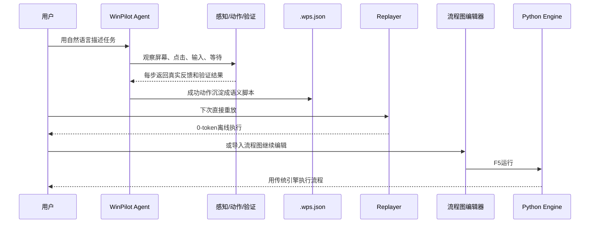

重点不是“AI 点了一次按钮”，而是这条闭环：

1. AI 临场完成。
2. 过程可审计。
3. 成果可重放。
4. 重放可编辑。
5. 以后尽量少用甚至不用 AI。

## 4. 总体架构

项目不是一个单体 Agent，而是两套系统加一条桥：

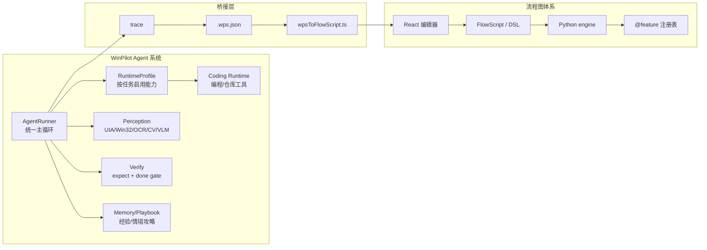

### 4.1 代码目录地图

这张图用来回答“你项目这么大，代码怎么分层”。面试时先画这张，别人会更容易相信你不是只会背概念。

```mermaid
flowchart TB
    root["仓库根目录"]

    root --> src["src<br/>Electron + React"]
    src --> main["src/main<br/>主进程/API/子进程管理"]
    src --> renderer["src/renderer<br/>流程图编辑器/Agent面板"]
    main --> api7880["api.ts<br/>HTTP API :7880"]
    main --> wpboot["winpilotServer.ts<br/>启动 WinPilot FastAPI"]
    main --> engineBridge["engine.ts<br/>Python engine 桥接"]
    renderer --> canvas["Canvas/PropertyPanel/NodeLibrary<br/>画布和节点配置"]
    renderer --> replayUI["ReplayEditorView.tsx<br/>导入 trace/.wps.json"]
    renderer --> wpsConv["wpsToFlowScript.ts<br/>语义脚本转流程图"]

    root --> py["python"]
    py --> wpHome["winpilot_home/winpilot<br/>当前 Agent 主体"]
    py --> oldAgent["agent<br/>IPC adapter + dialog/menu helper"]
    py --> engine["engine<br/>FlowScript/DSL 执行"]
    py --> features["features<br/>@feature 注册表"]
    py --> mcp["mcp<br/>Python MCP"]

    wpHome --> agentLoop["agent/loop.py<br/>AgentRunner"]
    wpHome --> profile["agent/runtime_profile.py<br/>RuntimeProfile"]
    wpHome --> tools["agent/tools.py<br/>ToolSession"]
    wpHome --> coding["agent/coding_tools.py<br/>Coding Runtime 工具"]
    wpHome --> codingCompat["agent/coding.py<br/>兼容旧 import"]
    wpHome --> perception["perception<br/>UIA/OCR/CV/VLM/Win32"]
    wpHome --> action["action<br/>executor/verify/shell"]
    wpHome --> recorder["recorder<br/>trace/replay/human"]
    wpHome --> server["server.py<br/>WinPilot REST + WS"]

    root --> docs["docs<br/>当前可信文档"]

    classDef active fill:#dcfce7,stroke:#16a34a,color:#111;
    classDef bridge fill:#dbeafe,stroke:#2563eb,color:#111;
    classDef legacy fill:#fef9c3,stroke:#ca8a04,color:#111;
    class wpHome,agentLoop,profile,tools,coding,codingCompat,perception,action,recorder,server active;
    class main,renderer,api7880,wpboot,engineBridge,replayUI,wpsConv bridge;
    class engine,features,mcp,oldAgent legacy;
```

颜色记忆：

- 绿色：当前 WinPilot Agent 主体。
- 蓝色：Electron/React 桥接层。
- 黄色：流程图/@feature/旧体系，仍重要，但不是主 Agent 工具来源。

### 4.2 一次任务的端到端调用链

这张图回答“用户在前端点运行以后，代码到底怎么走”。

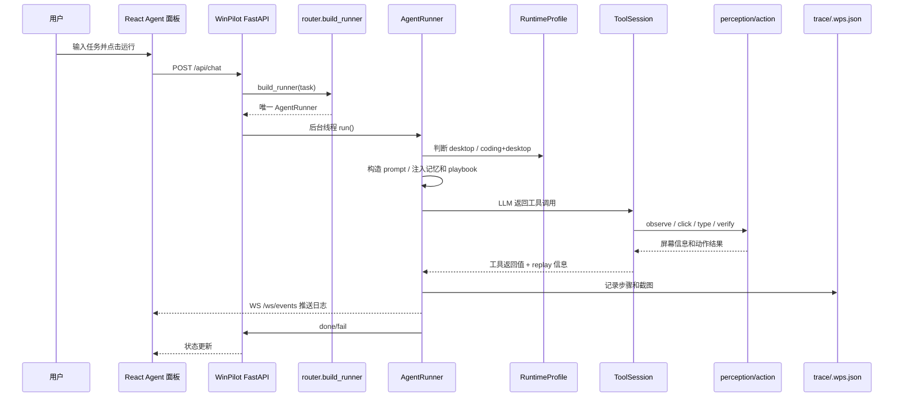

注意这里有两个“前端路径”：

- React 里的 Agent 面板实际嵌的是 WinPilot webui。
- Electron 主进程还有 `:7880` HTTP API，但那主要是给外部工具控制流程图前端，不等于 WinPilot REST。

两套系统的职责边界：

| 部分 | 负责什么 | 不负责什么 |
|---|---|---|
| WinPilot Agent | 实时操控真实电脑、感知、动作、验证、录制 | 不直接使用 @feature，不理解流程图节点 |
| 流程图体系 | 可视化编辑、DSL 执行、@feature/MCP/HTTP/CLI | 不依赖大模型才能运行 |
| `.wps.json` + `wpsToFlowScript.ts` | 把 Agent 成功过程变成可编辑流程图 | 不让 Agent 直接修改流程图内部结构 |

这就是项目最重要的架构取舍：**Agent 和流程图解耦，中间用语义脚本连接。**

### 4.3 两个 HTTP API 不要混

这张图专门防止你面试或自己调试时把端口说乱。

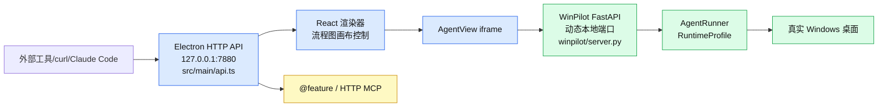

口头解释：

> `:7880` 是 Electron 主进程的外部控制 API；WinPilot REST 是 Electron 启动的动态端口，前端 Agent 面板通过 iframe 访问它。两个 API 都重要，但用途不同。

## 5. 为什么主 Agent 不能塞太多工具

项目里 `python/features/` 有很多 @feature 能力，但 WinPilot 主 Agent 不直接使用它们。原因很现实：工具太多不等于更聪明。

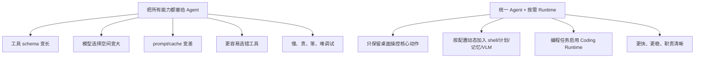

现在的设计：

- GUI Agent 有基础桌面操作工具：观察窗口、点击、输入、快捷键、滚动、拖拽、读文字、找图、颜色探测、文件搜索、完成/失败等。
- `shell_enabled` 开启时才加入 `run_shell`、`run_detached`。
- `planning_enabled` 开启时加入计划工具。
- `experience_memory` 开启时加入记忆和复用工具。
- VLM 配置有效时加入视觉描述工具。
- 编程/仓库类任务仍进入同一个 `AgentRunner`，但 `RuntimeProfile` 会启用 Coding Runtime，动态加入 `apply_patch/github_search` 并把文件/shell 工具限制在 coding workspace。

面试里可以这样讲：

> 用户始终面对一个 Agent，但它不是静态拿满所有工具。我的做法是让 `RuntimeProfile` 按任务启用 Runtime/Skill：打开软件就是 Computer Use，改 Python 项目就是 Coding Runtime，部署项目时 Coding、Terminal、Browser 可以一起工作。这样既保持统一 trace 和 done gate，又避免普通 GUI 任务被仓库工具干扰。

## 6. WinPilot Agent 内部怎么运行

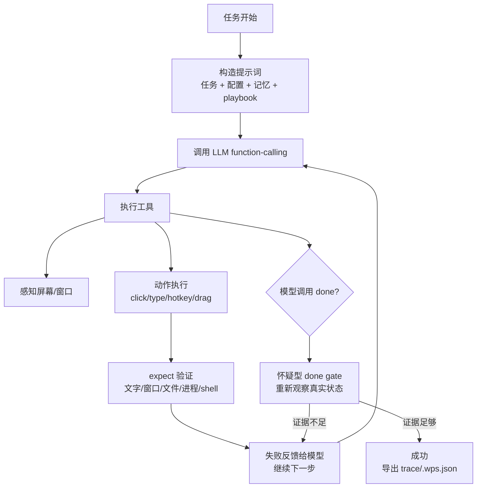

这里有两个关键词：

- **每步验证**：点击/输入不是发出去就算完，而是可以用 `expect` 检查结果。
- **完成也要验证**：模型说完成不等于真的完成，done 之后还会重新观察屏幕和证据。

## 7. 感知系统：AI 怎么“看”屏幕

WinPilot 不是只靠一种方式看屏幕，而是多维融合。

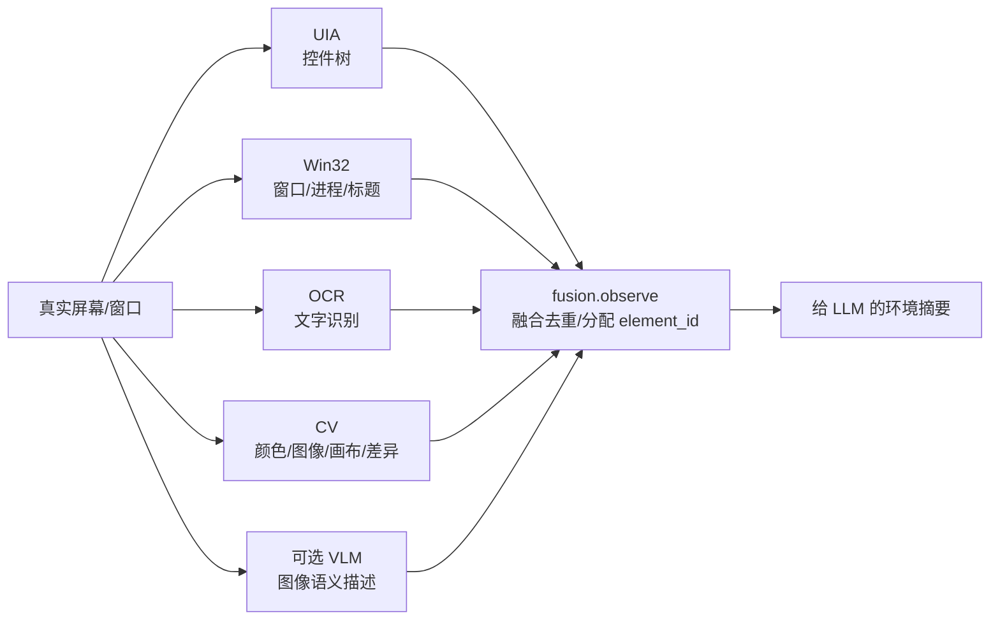

各自的优缺点：

| 感知方式 | 优点 | 局限 |
|---|---|---|
| UIA | 控件结构清楚，按钮/输入框容易定位 | 很多软件覆盖不好，比如游戏、部分国产软件、自绘 UI |
| Win32 | 能拿窗口、进程、标题、前后台关系 | 看不到窗口内部语义 |
| OCR | UIA 不行时还能读文字 | 可能误识别、噪声大、顺序乱 |
| CV | 能看颜色、画布变化、图像差异 | 语义弱，需要摘要 |
| VLM | 能理解图像内容 | 默认关闭，需要模型支持和成本控制 |

难点不只是“识别出来”，而是**把复杂感知压缩成 LLM 能理解的少量事实**。如果把所有 OCR 框、坐标、置信度都塞进去，模型反而会乱。

## 8. UIA 覆盖不到的软件怎么办

这是项目里最难的一类问题。比如某些聊天软件、媒体软件、游戏、视频发布工具，UIA 可能读不到完整控件。

通用策略不是写“QQ 专用规则”或“计算器专用规则”，而是组合通用能力：

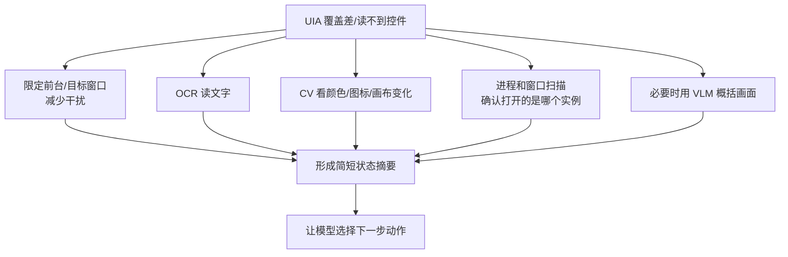

可以这样讲：

> 我不是给每个软件写专属脚本，而是增强通用感知：窗口限定、OCR、CV、进程检测、候选窗口对比、必要时 VLM。目标是让 Agent 在 UIA 不可靠时仍能形成可操作的世界状态。

## 9. 防假成功：为什么这是 Agent 的核心

用户最怕的不是失败，而是“它说成功了，其实没成功”。所以项目里很多改进都围绕防假成功。

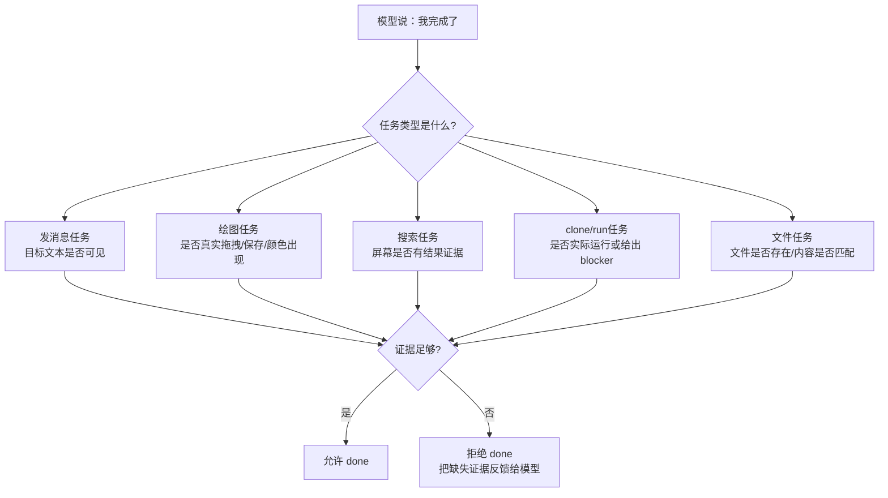

这块面试要强调：

- 不是靠“相信模型自述”。
- 要尽量用屏幕、文件、进程、shell 真值、保存结果等外部证据。
- trace 和 LLM 输入输出能帮助复盘每一步模型到底看到了什么。

## 10. 录制和重放：为什么能省 token

Agent 第一次做任务时，会把关键步骤记录下来。记录不是只有坐标，而是语义信息。

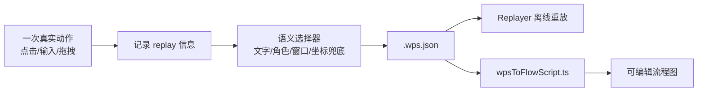

传统坐标录制：

```text
点击 (842, 615)
```

语义录制更接近：

```text
点击“登录”按钮，如果之后出现“欢迎”则算成功；找不到时再用坐标兜底。
```

这就是抗界面变化的关键。

## 11. `.wps.json` 和流程图的关系

`.wps.json` 是 Agent 侧的重放格式，FlowScript 是流程图编辑器的格式。两者不是同一个东西。

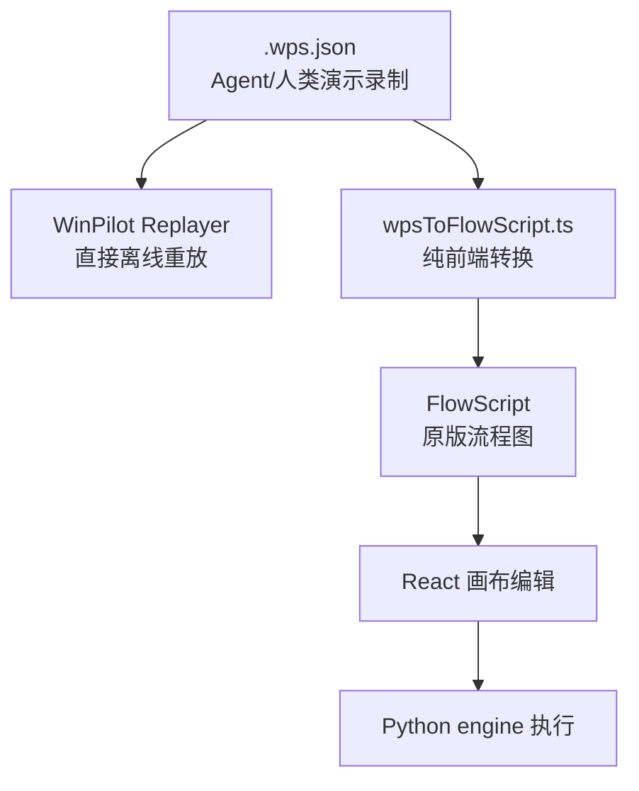

为什么不让 Agent 直接编辑流程图？

- 流程图格式复杂，塞给主 Agent 会污染 prompt。
- 转换逻辑可以用确定性代码实现，更稳定。
- Agent 只要做好真实操作和语义录制，流程图继续复用已有系统。

## 12. Coding Runtime：为什么需要它

用户可能让系统做“克隆 GitHub 项目并跑起来”这类任务。这个和 GUI 操作完全不同，需要读文件、搜索仓库、改代码、跑命令。

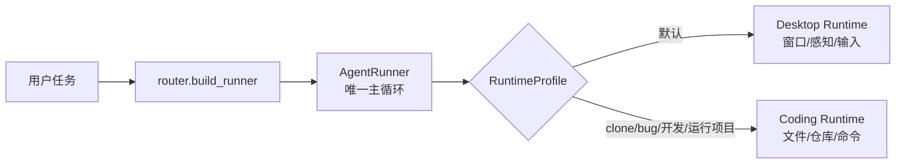

Coding Runtime 的特点：

- 有 `github_search`，不会只等用户给 URL。
- 有 `list_dir/read_file/search_text/write_file/apply_patch/run_shell`。
- 对 clone/run 类任务不能只总结 README，必须实际尝试安装、构建、运行、测试，或者给出明确 blocker。
- 它不是另一个用户可见 Agent，而是挂在同一个 `AgentRunner` 的工具循环里，所以 trace、BUS、usage、done gate 和上下文压缩都走同一套。

面试表达：

> GUI 操作和编程任务的工具集确实不同，但用户不应该面对两个 Agent。我现在把 Coding 看成一个 Runtime/Skill：任务需要时动态启用仓库工具，不需要时不暴露；这样既减少工具噪音，又保留一个统一的状态机和证据链。

## 13. 和几类系统的对比

| 对比对象 | 它们通常怎么做 | 本项目怎么做 |
|---|---|---|
| 按键精灵/宏录制 | 记录坐标和按键 | 记录语义步骤，坐标只是兜底 |
| 传统 RPA | 流程稳定但临场理解弱 | 第一次由 Agent 临场处理，后续沉淀流程 |
| Computer Use 类 Agent | 每次都由模型看图决策 | 尽量把成功经验转成离线重放和流程图 |
| 浏览器自动化 | 主要操作 DOM/网页 | 目标是通用 Windows 桌面，包括非浏览器软件 |
| 静态塞满工具的 Agent | 工具很多、上下文很重 | 一个 Agent + 按需 Runtime/Skill |

## 14. 项目最难的点

### 难点 1：非多模态/弱视觉模型怎么操作电脑

如果模型看不到图，系统必须把屏幕转成文字化、结构化、足够简短的信息。OCR/CV/UIA 的输出太复杂会让模型困惑，所以要不断打磨摘要。

### 难点 2：UIA 不可靠

Windows 上很多软件不是标准控件。UIA 读不到时，需要 OCR、CV、窗口扫描、进程检测、VLM 兜底。

### 难点 3：假成功

Agent 很容易“以为自己做完了”。必须用真实证据验证，而不是只看模型总结。

### 难点 4：通用性

不能为了计算器、QQ、抖音、网易云单独写死规则。要抽象出通用元能力：窗口扫描、聚焦窗口、输入框识别、搜索框识别、进程检测、屏幕证据验证。

### 难点 5：速度

如果每一步都全量 OCR/VLM，会很慢。必须做优先级、缓存、跳过策略、目标窗口限定和摘要压缩。

## 15. 面试回答模板

**Q：这个项目是什么？**
A：它是一个 Windows 桌面自动化系统，结合了实时 AI Agent 和流程图自动化。AI 负责第一次临场完成任务，系统把成功过程录成语义脚本，后续可以离线重放或导入流程图编辑，尽量做到一次 AI 生成、多次零-token执行。

**Q：和按键精灵/RPA有什么区别？**
A：传统录制偏坐标，界面变了容易坏。这个项目第一次由 Agent 理解屏幕并操作，录下的是带文字、角色、验证条件的语义步骤，重放时能重新定位控件，坐标只是兜底。

**Q：和 Computer Use 有什么区别？**
A：Computer Use 更像每次都让模型看屏幕并决策。本项目也追求通用电脑操控，但更强调把成功过程沉淀成 `.wps.json` 和流程图，让后续任务更快、更便宜、更可编辑。

**Q：为什么不把所有 @feature 都给 Agent？**
A：工具越多，模型不一定越强，反而会更慢、更贵、更容易选错。我的设计是用户始终面对一个 Agent，但工具按 Runtime/Skill 动态启用；流程图/@feature 体系保持独立，不直接塞进主提示词。

**Q：怎么处理 UIA 不支持的软件？**
A：不写软件专属规则，而是用通用感知组合：窗口/进程检测、目标窗口限定、OCR、CV、可选 VLM，再把这些信息压缩成模型能理解的摘要。

**Q：怎么防止假成功？**
A：每步动作可以带 expect 验证；完成时会重新观察屏幕；对发送消息、绘图、搜索、上传、clone/run 等任务有额外证据 gate，并保留 trace 来复盘模型每一步看到的信息。

**Q：为什么要有 `.wps.json`？**
A：它是 Agent 成功过程的语义脚本格式。它既能被 WinPilot Replayer 直接离线重放，也能被 `wpsToFlowScript.ts` 转成流程图，连接了“AI 临场操作”和“传统自动化复用”。

**Q：项目的核心工程判断是什么？**
A：把“临场智能”和“稳定复用”分开。Agent 负责第一次处理不确定性，流程图/Replayer 负责后续低成本执行；主 Agent 保持统一，复杂能力按 Runtime/Skill 按需启用。

## 16. 面试深挖问题：怎么答才不虚

这一节更重要。面试官通常不会只问“项目是什么”，会追着问“你真的懂吗”“你自己能改吗”“哪里最容易坏”。

### Q1：你这个项目里哪些是你真正理解的，哪些是 AI 生成的？

可以诚实但要有掌控感：

> 这个项目一开始确实借助 AI 快速搭了很多代码，但后面我做了大量架构梳理和重构。现在我能讲清楚当前主线：WinPilot Agent 在 `python/winpilot_home/winpilot/`，流程图体系在 `src/renderer/`、`python/engine/`、`python/features/`，两者通过 `.wps.json` 和 `wpsToFlowScript.ts` 连接。我不会把所有历史文档都当真，而是按代码入口、测试和真实运行 trace 去确认事实。

不要说“全是我手写的”，也不要说“都是 AI 写的我不懂”。重点是：

- 我知道系统边界。
- 我能按代码追调用链。
- 我知道哪些文档曾经过时。
- 我能验证改动是否真的生效。

### Q2：如果不用 AI，你自己能不能改？

答法：

> 能，但我会按模块边界来改，不会凭感觉乱动。比如要改 Agent 工具，我先看 `agent/tools.py` 的 schema 和 dispatcher，再看 `agent/loop.py` 怎么调用 `tool_schemas()`，然后补测试到 `python/winpilot_home/tests/`。如果改流程图节点，我会同时检查 `types/index.ts`、`nodeDefinitions.ts`、属性面板、`dsl_flow_converter.py` 和 `executor.py`，因为这些是同一条链。

可以补一句：

> AI 对我来说是加速器，不是替代理解。真正关键的是我知道改哪里、会影响哪里、怎么验证。

### Q3：怎么证明不是“日志成功但实际没成功”？

答法：

> 我把这个当成 Agent 项目的核心问题。系统不是只看模型说 done，而是重新观察屏幕或检查外部证据。比如发消息任务要看到目标文本，绘图任务要看到拖拽、保存文件和颜色证据，clone/run 要实际运行或给 blocker。调试时还看 trace、截图、保存文件、进程状态。

可以举例：

- 发 QQ 消息：不是日志说成功，要看聊天窗口里是否出现指定文本。
- 绘画：不是调用了 drag 就算，要看画布是否变化、保存文件是否存在。
- 跑项目：不是 clone 完就算，要看依赖安装、启动命令、端口或错误输出。

### Q4：为什么不直接用多模态模型做 Computer Use？

答法：

> 多模态很有帮助，但我不想让系统强依赖它。原因是成本、速度、稳定性和可控性。我的思路是文本模型路径也要尽量可用：UIA、OCR、CV、Win32 先形成结构化摘要；VLM 作为可选增强。这样如果视觉模型慢或不可用，系统仍能操作很多普通软件。

强调差异：

- Computer Use 偏每步看图决策。
- 本项目偏第一次智能操作，成功后沉淀为可重放流程。
- VLM 是增强，不是唯一支柱。

### Q5：UIA 不好用的软件你怎么处理？

答法：

> 我不会给每个软件写专属规则，而是做通用能力组合：目标窗口限定、OCR、CV、进程检测、窗口候选扫描、必要时 VLM 摘要。比如 QQ、抖音、网易云这类 UIA 不稳定的软件，关键是让 Agent 知道当前聚焦窗口是不是目标窗口、有哪些候选窗口、屏幕上可见哪些文本和按钮，而不是硬编码“点某个坐标”。

一个很典型的坑是：屏幕确实变化了，但变化发生在错误窗口里。比如 Codex 窗口在前台时，`type_text` 可能把文字打进 Codex 输入框，而 OCR 又在全屏里看到了这段文字，于是系统误判成功。现在普通可见动作会记录 `screen_delta` 和 `action_target`，重点看 `foreground_matches_target`；只有目标窗口本身，或目标窗口 owner/祖先关系明确的弹窗，才有资格进入成功判断。

### Q6：为什么要有流程图？Agent 不就能直接操作吗？

答法：

> Agent 擅长处理第一次的不确定性，但不适合每次都烧模型重做。流程图的价值是可编辑、可复用、可审计、零-token执行。我的项目不是二选一，而是让 Agent 产物进入流程图体系，形成闭环。

### Q7：如果用户任务很复杂，Agent 会不会忘？

答法：

> 会，所以我做了几层缓解：planning 工具可以拆子目标，session memory 记录上下文，world model 记录卡住和重复状态，trace 记录 LLM 每一步收到的信息。长任务最重要的是把状态外显，而不是只靠模型隐式记忆。

### Q8：世界模型到底是什么，不是普通记忆吗？

答法：

> 不是同一个东西。长期记忆记录用户偏好或历史经验；世界模型更像当前任务的短期状态板，比如当前目标窗口、重复失败、是否卡在某个弹窗、画布是否真的变化。它的作用是帮助模型形成“我现在在哪、刚刚做了什么、哪里不对”的状态感。

### Q9：`.wps.json` 和 FlowScript 有什么区别？

答法：

> `.wps.json` 是 Agent 侧的语义重放脚本，记录工具动作、语义选择器、expect。FlowScript 是流程图编辑器的节点格式。两者通过 `wpsToFlowScript.ts` 转换。这样 Agent 不需要理解复杂流程图格式，流程图也不需要依赖 Agent 才能运行。

### Q10：项目里最容易出 bug 的地方？

答法：

> 最容易出问题的是跨边界的地方：感知输出影响 LLM 行为，工具 schema 影响模型选择，`.wps.json` 转 FlowScript 会影响重放，节点类型变化会影响前端、DSL 转换和执行器。还有一个高风险点是假成功，所以所有完成判断都要有真实证据。

### Q11：你怎么做测试？

答法：

> 三类测试。第一是单元测试，比如 WinPilot 的工具、路由、假成功 gate、replay。第二是前端 vitest，保证流程图转换和 UI 状态逻辑。第三是真实 GUI 测试，要截图和看 trace，因为 Agent 项目很容易“单元测试过了但真实屏幕没点到”。

可以说当前常用命令：

```bash
python -m pytest python/winpilot_home/tests -q
npx vitest run
npm run build
```

### Q12：你怎么定位一次 Agent 失败？

答法：

> 我会按四层看：第一看真实屏幕截图，确认它实际在哪；第二看 trace 里 LLM 每一步看到的信息；第三看工具返回值，确认点击/输入/observe 是否真的成功；第四看 done gate 为什么放行或拒绝。很多 Agent bug 不是模型笨，而是给它的信息不对、太多、太乱，或者验证条件太弱。

排查顺序可以背：

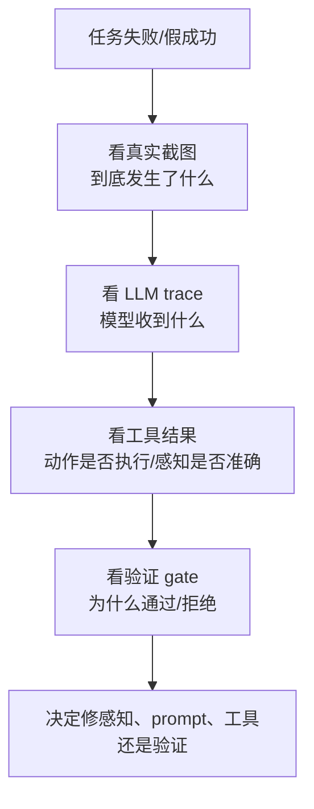

### Q13：你项目里的技术亮点和工程亮点分别是什么？

技术亮点：

- 多维感知融合。
- function-calling 工具执行。
- expect 验证和 done gate。
- `.wps.json` 语义重放。
- Agent trace 转流程图。

工程亮点：

- 主 Agent 和流程图解耦。
- 用户面对一个 Agent，能力按 Runtime/Skill 动态启用。
- 运行数据和配置隔离。
- 文档按代码事实更新，不盲信旧文档。
- 测试区分 WinPilot 当前主线和历史旧测试。

### Q14：如果面试官问“这个是不是太大太散？”

答法：

> 是的，它确实大，所以我后来做的重点就是切边界。现在可以按三条主线理解：WinPilot 负责实时操作，流程图体系负责零-token执行，`.wps.json` 负责桥接。只要边界清楚，大项目就不会散；真正危险的是把所有能力静态塞进同一个提示词和工具列表。

### Q15：如果问“你会怎么继续优化？”

答法：

> 我会优先优化三件事：第一是感知摘要，把 OCR/CV/UIA 噪声压缩成模型能理解的信息；第二是假成功验证，让任务完成必须有真实证据；第三是长任务状态管理，让 Agent 知道当前窗口、目标、失败原因和下一步，而不是一直重复点。

## 17. 不依赖 AI，自己怎么改代码

这一节是给你自己看的。以后面试官问“你自己能不能改”，你要能说出具体路径。

### 17.1 先判断你要改的是哪条链

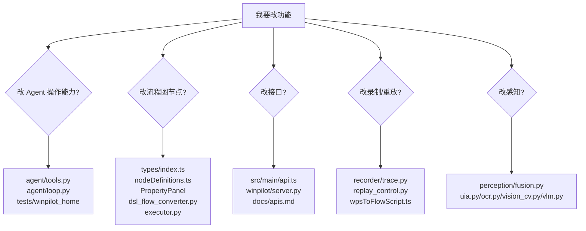

### 17.2 改 WinPilot GUI 工具

相关文件：

| 文件 | 作用 |
|---|---|
| `winpilot/agent/tool_schemas.py` | 统一 function schema；Coding Runtime 激活时动态加入 repo 工具 |
| `winpilot/agent/tools.py` | ToolSession 状态、dispatcher、runtime 挂载 |
| `winpilot/agent/loop.py` | 主循环、工具调用、done gate、GUI-only 限制 |
| `winpilot/action/verify.py` | expect 验证 |
| `winpilot/action/executor.py` | 实际点击/输入/热键 |
| `python/winpilot_home/tests/` | 当前 WinPilot 测试 |

怎么改：

1. 先在 `tool_schemas()` 里确认工具是否已经存在。
2. 如果新增工具，要加 schema，也要在对应 mixin 里加 `_t_工具名`。
3. schema 描述要短、明确，不要塞长篇提示词。
4. 如果动作会改变外部状态，要考虑 replay 记录和 expect。
5. 加测试，至少覆盖 dispatcher 或 gate 行为。

容易踩坑：

- 工具一多会拖慢/干扰模型。
- schema 描述写太复杂会让模型误解。
- 只实现工具不加验证，会增加假成功。
- 只改工具不改 loop 的 GUI-only 限制，可能被任务 gate 拦掉。

### 17.3 改感知输出

相关文件：

| 文件 | 作用 |
|---|---|
| `perception/fusion.py` | 多维感知融合主入口 |
| `perception/uia.py` | UIA 控件树 |
| `perception/ocr.py` | OCR |
| `perception/vision_cv.py` | CV、颜色、画布、差异 |
| `perception/vlm.py` | 可选视觉模型 |
| `agent/tools.py` | `observe` 输出和视觉摘要 |

怎么改：

1. 先看失败 trace：模型到底收到了什么。
2. 判断是少信息、错信息，还是信息太多。
3. 优先做摘要和排序，不要直接增加大量原始字段。
4. 注意目标窗口限定，避免把命令行、后台窗口混进来。
5. 加测试，比如 `test_visual_state_summary.py`、`test_fusion_modal_skip.py`。

容易踩坑：

- OCR 文本多不等于有用。
- 坐标框太多会让模型无法选择。
- UIA 卡住会拖慢整轮 Agent。
- VLM 输出如果太长，也会变成新噪声。

### 17.4 改 done gate / 假成功判断

相关文件：

| 文件 | 作用 |
|---|---|
| `agent/loop.py` | done 验证、任务类型判断、工具限制 |
| `action/verify.py` | expect 检查 |
| `perception/fusion.py` | done 时重新观察 |
| `tests/test_false_success_guards.py` | 假成功防护测试 |

怎么改：

1. 明确任务的真实完成证据是什么。
2. 优先用确定性证据：文件存在、进程存在、shell true、屏幕文字。
3. 不要写成某个软件专属规则，尽量抽象成任务类型。
4. done 被拒时，要让模型知道缺少什么证据。

容易踩坑：

- gate 太弱：假成功。
- gate 太强：明明完成也不放行。
- 证据只看日志：没有意义。
- 针对单软件硬编码：泛化变差。

### 17.5 改 Coding Runtime

相关文件：

| 文件 | 作用 |
|---|---|
| `agent/runtime_profile.py` | 决定是否启用 Coding Runtime、workspace、max_steps |
| `agent/coding_tools.py` | workspace-confined 文件/仓库/命令工具 |
| `agent/file_tools.py` | Coding Runtime 激活时委托同名文件工具 |
| `agent/system_tools.py` | Coding Runtime 激活时委托 `run_shell` |
| `agent/tool_schemas.py` | 动态加入 `apply_patch`、`github_search` |
| `agent/coding.py` | 兼容旧 import 的 `CodingRunner` 别名，不再放主循环 |
| `tests/test_coding_tools.py` | 编程工具测试 |
| `tests/test_unified_coding_runtime.py` | 统一 runtime schema/path 行为 |
| `tests/test_coding_run_gate.py` | clone/run gate 测试 |

怎么改：

1. 判断是工具能力不足，还是系统提示词/任务 gate 不足。
2. 搜索能力在 `github_search`。
3. clone/run 类任务必须实际运行或说明 blocker。
4. 注意 workspace 限制和敏感文件保护。
5. 保证 GUI-only 任务不会启用 Coding Runtime，但“部署项目”这类混合任务可以同时使用 Coding、Terminal、Browser/GUI 能力。

容易踩坑：

- 让 Coding Runtime 改出工作区。
- 让它读取/写入 secret。
- 只 clone 不 run，却说成功。
- GUI-only 任务误启用 Coding Runtime。

### 17.6 改流程图节点

这是牵连最大的改动之一。

相关文件：

| 文件 | 作用 |
|---|---|
| `src/renderer/types/index.ts` | `NodeType` 和参数类型 |
| `src/renderer/utils/nodeDefinitions.ts` | 节点默认定义、端口、默认参数 |
| `src/renderer/components/PropertyPanel/params/` | 参数编辑 UI |
| `python/engine/dsl_flow_converter.py` | FlowScript 和 DSL 转换 |
| `python/engine/dsl_parser.py` | DSL 解析 |
| `python/engine/executor.py` | DSL 执行 |
| `src/renderer/test/` | 前端节点/转换测试 |

改一个节点通常要检查：

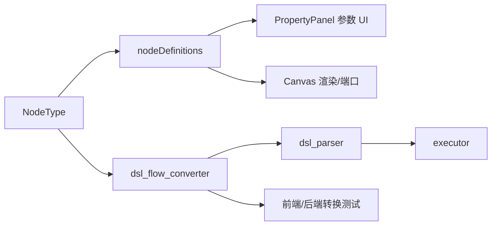

容易踩坑：

- 只加了前端节点，执行器不认识。
- 只改了执行器，前端不能配置参数。
- 端口名改了，旧流程图连线断。
- 删除旧节点，旧模板打不开。

### 17.7 改 `.wps.json` / replay / 导入流程图

相关文件：

| 文件 | 作用 |
|---|---|
| `winpilot/recorder/trace.py` | trace 导出、Replayer 基础 |
| `winpilot/recorder/replay_control.py` | if/loop/变量/ext 控制流 |
| `winpilot/recorder/human.py` | 人类演示录制 |
| `src/renderer/utils/wpsToFlowScript.ts` | `.wps.json` 转 FlowScript |
| `src/renderer/components/ReplayEditorView.tsx` | 导入/录制 UI |
| `src/renderer/test/wpsToFlowScript.test.ts` | 转换测试 |

怎么改：

1. 如果改 `.wps.json` 字段，要考虑旧脚本兼容。
2. 如果新增 step 类型，要同时改 Replayer 和 `wpsToFlowScript.ts`。
3. 如果改 selector 逻辑，要确认 replay 仍能重新定位。
4. 录制输出、离线重放、导入流程图三条路径都要测。

容易踩坑：

- 新 `.wps.json` 旧 Replayer 不能跑。
- Replayer 能跑，但导入流程图丢信息。
- 转换成 FlowScript 后参数名不对，engine 执行失败。

### 17.8 改接口

有两套接口，不要混。

| 接口 | 文件 | 用途 |
|---|---|---|
| Electron HTTP API | `src/main/api.ts` | 控制前端流程图、宏、@feature、HTTP MCP |
| WinPilot REST | `winpilot/server.py` | Agent chat、trace、script、replay、memory、session |

改接口时必须同步：

- `docs/apis.md`
- 前端调用处
- 测试或手动 curl
- 如果是 WinPilot REST，还要看 webui 的 `app.js`

容易踩坑：

- 把 Electron `:7880` 和 WinPilot 动态端口混在一起。
- 文档写了端点，但前端其实没调用。
- 改了响应字段，UI 没同步。

## 18. 改哪里会导致哪里出问题

这张表你要熟，面试问“改动影响面”时就按它讲。

### 18.1 改动风险总图

这张图适合回答“为什么你说这个项目难维护”。越靠中心，越容易牵连其它模块。

```mermaid
flowchart TB
    core["高风险核心<br/>一动牵全身"]
    medium["中风险模块<br/>需要同步上下游"]
    low["低风险模块<br/>通常局部影响"]

    core --> loop["agent/loop.py<br/>主循环/done gate/任务限制"]
    core --> tools["agent/tools.py<br/>工具 schema + dispatcher"]
    core --> fusion["perception/fusion.py<br/>LLM 看到的屏幕事实"]
    core --> converter["wpsToFlowScript.ts<br/>Agent 产物进流程图"]
    core --> dslconv["dsl_flow_converter.py<br/>FlowScript/DSL 互转"]

    medium --> config["config.py<br/>默认行为/工具开关"]
    medium --> server["server.py<br/>WinPilot REST"]
    medium --> api["src/main/api.ts<br/>Electron HTTP API"]
    medium --> nodeDef["nodeDefinitions.ts<br/>节点定义"]
    medium --> executor["executor.py<br/>流程图执行"]
    medium --> replay["trace.py/replay_control.py<br/>离线重放"]

    low --> docs["docs/*.md<br/>说明同步"]
    low --> playbooks["playbooks/*.json<br/>情境知识"]
    low --> examples["examples/templates<br/>示例"]

    classDef high fill:#fee2e2,stroke:#dc2626,color:#111;
    classDef mid fill:#fef9c3,stroke:#ca8a04,color:#111;
    classDef ok fill:#dcfce7,stroke:#16a34a,color:#111;
    class core,loop,tools,fusion,converter,dslconv high;
    class medium,config,server,api,nodeDef,executor,replay mid;
    class low,docs,playbooks,examples ok;
```

解释方式：

- 红色不是不能改，而是改前必须先查调用链、补测试、真实验证。
- 黄色通常要同步文档或前后端调用。
- 绿色相对安全，但也不能写出和代码冲突的说明。

| 你改的地方 | 可能影响 | 必须检查 |
|---|---|---|
| `agent/tools.py` 工具 schema | LLM 是否会正确选工具、工具调用是否能 dispatch | `tool_schemas()`、`ToolSession.dispatch`、WinPilot tests、真实 trace |
| `agent/loop.py` | 主循环、done gate、GUI-only 限制、路由后的行为 | 假成功测试、GUI-only 任务、长任务 |
| `perception/fusion.py` | observe 输出、元素 id、OCR/UIA/CV 融合 | 真实截图、trace、fusion tests |
| `perception/uia.py` | UIA 速度和控件质量 | UIA 卡顿、模态窗口、目标窗口识别 |
| `vision_cv.py` | 绘图/颜色/画布判断 | 绘图任务、保存图颜色 gate |
| `verify.py` | 每步 expect 和 done 证据 | 所有动作验证、误拒/误放行 |
| `runtime_profile.py` | 每次 run 的 runtime 开关 | GUI-only 不误启用 Coding，编程/部署任务能拿到 repo 工具 |
| `coding_tools.py` | Coding Runtime 能力和安全 | workspace 限制、secret 保护、clone/run gate |
| `router.py` | 是否只构建统一 AgentRunner | 不重新引入用户可见的多 runner |
| `config.py` | 默认行为、工具是否暴露、感知开关 | `config.example.json`、webui 配置、测试默认 |
| `server.py` | WinPilot REST/API | webui、Agent 面板、docs/apis |
| `src/main/api.ts` | 外部控制前端、HTTP MCP | Claude Code/curl 控制、docs/apis |
| `types/index.ts` | 前端节点类型 | nodeDefinitions、PropertyPanel、转换器、旧模板 |
| `nodeDefinitions.ts` | 节点默认参数和端口 | Canvas、属性面板、模板加载 |
| `PropertyPanel/params` | 用户能否配置节点 | UI 表单、参数名、执行器参数 |
| `dsl_flow_converter.py` | FlowScript/DSL 互转 | DSL 测试、导入导出、F5 |
| `executor.py` | 流程图实际执行 | 旧模板、系统/窗口/图像动作 |
| `wpsToFlowScript.ts` | Agent 录制导入流程图 | replay 导入测试、节点参数 |
| `trace.py/replay_control.py` | `.wps.json` 离线重放 | Replayer、reuse_skill、人类录制 |
| `playbooks/*.json` | 任务提示策略 | prompt 长度、任务误触发、窗口触发 |

### 18.2 三条最容易断的链

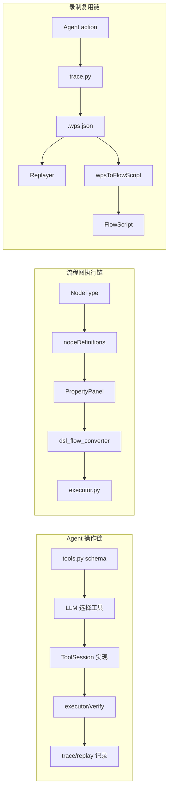

只要你改的是链条中间的一环，就要检查左右两边。

## 19. 自己改代码的安全流程

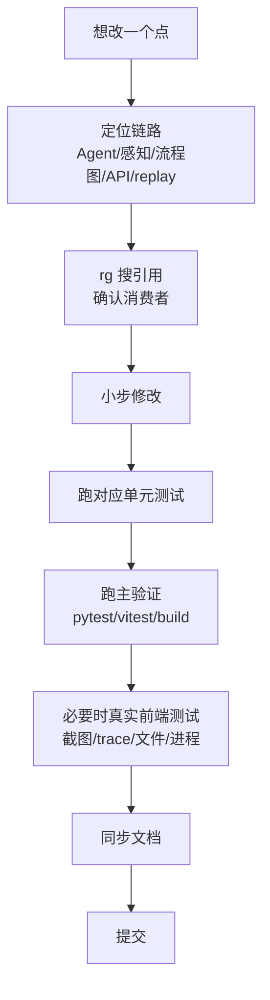

最低验证组合：

```bash
python -m pytest python/winpilot_home/tests -q
npx vitest run
npm run build
```

如果改流程图旧体系，再额外查：

```bash
python -c "import sys; sys.path.insert(0,'python'); from features._all import *; from features.registry import registry; print(len(registry.all()))"
```

如果改真实 GUI Agent 行为，单元测试不够，要：

- 看真实屏幕。
- 看 trace。
- 看 LLM 收到的 observe 信息。
- 看输出文件/进程/窗口是否真实存在。

### 19.1 验证矩阵

这张图用来回答“你怎么确认改动没把系统弄坏”。

```mermaid
flowchart TB
    change["一次改动"]

    change --> unit["单元测试<br/>pytest / vitest"]
    change --> build["构建检查<br/>npm run build"]
    change --> static["静态/文档检查<br/>git diff --check / rg"]
    change --> real["真实 GUI 验证<br/>截图 / trace / 文件 / 进程"]

    unit --> u1["WinPilot: python/winpilot_home/tests"]
    unit --> u2["前端: src/renderer/test"]
    unit --> u3["旧体系: tests/ 需区分历史实验"]

    real --> r1["看屏幕是否真变了"]
    real --> r2["看 LLM 收到的信息"]
    real --> r3["看 done gate 证据"]
    real --> r4["看保存文件/进程/窗口"]

    static --> s1["端点是否漏文档"]
    static --> s2["配置示例是否同步"]
    static --> s3["旧文档是否误导"]
```

不同改动的最低验证：

| 改动类型 | 最低验证 |
|---|---|
| 文档 | `git diff --check` + 关键词/事实扫描 |
| WinPilot 工具/loop | `python -m pytest python/winpilot_home/tests -q` + 真实 trace |
| 前端/流程图 | `npx vitest run` + `npm run build` |
| API | 文档端点对比 + 前端/手动请求 |
| 录制重放 | Replayer 测试 + `wpsToFlowScript` 测试 |
| GUI 行为 | 截图 + trace + 外部证据 |

## 20. 面试时可以主动展示的“我懂影响面”

你可以主动说：

> 这个项目最大风险不是某个函数写错，而是跨层改动没同步。比如我改一个流程图节点，不只是改前端类型，还要改默认参数、属性面板、DSL 转换、执行器和测试。再比如我改 Agent 工具，不只是加 schema，还要考虑 LLM 会不会误用、ToolSession 有没有实现、expect 怎么验证、trace 能不能复用。我的修改流程是先 `rg` 查消费者，再小步改，再跑对应测试和真实前端验证。

这句话很重要，因为它能证明你不是只会“让 AI 改代码”，而是知道工程系统的牵连关系。

## 21. 30 秒 / 2 分钟 / 5 分钟讲法

先看这张路线图。面试时不要一上来讲细节，先从上往下展开。

```mermaid
flowchart TB
    start["开场：一句话<br/>AI 操作电脑 + 流程图零-token复用"]
    pain["痛点<br/>坐标录制脆 / 纯 AI 贵慢 / 假成功"]
    arch["架构<br/>WinPilot + 流程图体系 + .wps.json 桥"]
    agent["Agent 内部<br/>小工具集 / 感知融合 / 验证"]
    reuse["复用闭环<br/>trace -> .wps.json -> Replayer/FlowScript"]
    quality["工程质量<br/>边界清晰 / Runtime / 测试 / 真实验证"]
    future["继续优化<br/>感知摘要 / 长任务状态 / UIA 不可靠场景"]

    start --> pain --> arch --> agent --> reuse --> quality --> future

    classDef intro fill:#dbeafe,stroke:#2563eb,color:#111;
    classDef core fill:#dcfce7,stroke:#16a34a,color:#111;
    classDef risk fill:#fee2e2,stroke:#dc2626,color:#111;
    class start,pain intro;
    class arch,agent,reuse core;
    class quality,future risk;
```

### 30 秒

> 我做的是一个 Windows 桌面自动化系统。用户说一句话，WinPilot Agent 会实际操作电脑并验证结果；成功过程会保存成 `.wps.json`，之后可以离线重放，也可以转成可编辑流程图，用原有引擎零-token执行。架构上我把实时 Agent 和流程图体系解耦，用户始终面对一个 Agent，但 Coding、Computer Use、Terminal、Browser 等能力按 Runtime/Skill 动态启用。

### 2 分钟

> 这个项目解决的是桌面自动化里“传统录制不够智能、纯 AI 每次都太贵太慢”的矛盾。第一次任务由 WinPilot Agent 操作真实 Windows 桌面，它会通过 UIA、OCR、CV、窗口/进程信息和可选 VLM 形成屏幕摘要，然后用点击、输入、拖拽等工具操作，每一步可以带验证条件。成功后，动作会沉淀成 `.wps.json`，里面不是单纯坐标，而是文字、角色、窗口、expect 等语义信息。这个脚本既可以被 Replayer 零-token重放，也可以通过 `wpsToFlowScript.ts` 转成原来的流程图节点，继续编辑和 F5 执行。架构上我刻意不把 @feature 和流程图能力静态塞进主 Agent；用户面对的是一个 Agent，内部通过 RuntimeProfile 按任务启用 Coding、Desktop、Terminal、Browser 等能力。

### 5 分钟

可以按这个顺序讲：

1. 痛点：坐标录制脆，纯 AI 贵慢且会假成功。
2. 解法：第一次 AI 临场操作，后续语义录制和零-token复用。
3. 架构：WinPilot Agent、流程图体系、`.wps.json` 桥接。
4. Agent：小工具集、多维感知、每步验证、done gate。
5. 泛化：UIA 不可靠时用 OCR/CV/VLM/窗口进程通用能力，不做软件专属规则。
6. 复用：Replayer 直接重放，或导入 FlowScript 编辑。
7. 工程取舍：用户面对一个 Agent，复杂能力按 Runtime/Skill 数据化、模块化、按需启用。

## 22. 你自己复习时要记住的关键词

最后用一张总图把关键词串起来：

```mermaid
flowchart TB
    root["灵动脚本复习总图"]

    root --> goal["目标"]
    goal --> goal1["通用桌面 Agent"]
    goal --> goal2["第一次 AI 完成"]
    goal --> goal3["后续零-token复用"]

    root --> arch2["架构"]
    arch2 --> arch21["WinPilot Agent"]
    arch2 --> arch22["流程图体系"]
    arch2 --> arch23[".wps.json 桥接"]

    root --> agent2["Agent"]
    agent2 --> agent21["小工具集"]
    agent2 --> agent22["RuntimeProfile"]
    agent2 --> agent23["World model"]
    agent2 --> agent24["Playbook"]
    agent22 --> agent25["Coding Runtime"]

    root --> sense2["感知"]
    sense2 --> sense21["UIA"]
    sense2 --> sense22["OCR"]
    sense2 --> sense23["CV"]
    sense2 --> sense24["Win32"]
    sense2 --> sense25["可选 VLM"]
    sense2 --> sense26["摘要压缩"]

    root --> verify2["验证"]
    verify2 --> verify21["expect"]
    verify2 --> verify22["done gate"]
    verify2 --> verify23["trace"]
    verify2 --> verify24["截图/文件/进程证据"]

    root --> change2["修改"]
    change2 --> change21["rg 查消费者"]
    change2 --> change22["小步改"]
    change2 --> change23["跑测试"]
    change2 --> change24["真实 GUI 验证"]
```

- **一次 AI 生成，多次零-token重放**
- **一个 Agent，Runtime/Skill 按需启用，不塞 @feature**
- **Agent 和流程图解耦**
- **`.wps.json` 是桥**
- **UIA + OCR + CV + Win32 + 可选 VLM**
- **感知要压缩，不要信息过载**
- **done 必须有真实证据**
- **不要做软件专属适配，要做通用元能力**
- **Coding Runtime 是把 Coding 当 Skill/Runtime 的样板**

## 2026-07-03 低延迟 GUI 靶场案例

这次新增了一个很重要的网页靶场：`python/winpilot_home/eval_targets/gui_agent_target.html`。它不是为了让 agent 专门学会某个网页，而是为了给“通用 GUI 能力”提供一个可复现、可截图、可对照 trace 的测试场。

为什么需要靶场：

- 记事本变化太少，agent 说成功时很难判断它到底点没点、看没看、是不是假成功。
- 网页靶场可以主动制造“只有局部变化”的状态卡，比如点击“只改局部状态”后出现 `LOCAL_COUNTER_1`。
- 这样可以检查低延迟架构里最关键的一条链：`screen_watch` 发现变化 -> 保留最近 ROI -> `observe(changed_only=true)` 只看变化区域 -> `done_verifier` 用真实画面证据收束。

这验证的是通用元能力：

```mermaid
flowchart LR
    A["点击任意 GUI 元素"] --> B["独立前后帧 screen_delta"]
    B --> C["screen_watch 缓存 recent/action ROI"]
    C --> D["changed-only observe 优先动作 ROI"]
    D --> E["LLM 看更少、更相关的信息"]
    E --> F["done gate 用 fresh screen 防假成功"]
```

最新真实通过的 run 是 `20260703-025138-dcf2c6`。关键证据：

- `launch` 只花约 110ms，并且成功聚焦 Chrome 靶场窗口，没有被 Codex 窗口遮挡。
- agent 使用 `run_action_batch(subgoal="触发局部状态变化")`，一次批量执行点击和等待稳定，summary 里 `round_trips_saved=1`。
- `observe(changed_only=true)` 返回 `Changed-only observe: OCR/CV/Win32 filtered to recent screen_watch ROI(s)`，并在 ROI 里直接识别 `LOCAL COUNTER`，说明它没有退回全屏观察。
- 最终截图 `batch_after_002.jpg` 可以看到 `LOCAL_COUNTER_1`。
- `done_check` 通过 fresh screen OCR 证据确认 `LOCAL_COUNTER`，不是相信 agent 自己的总结。
- 最新继续推进后，`screen_watch` 可以自动启动和结束：agent 有目标窗口或准备做可见动作时，系统自己开始廉价看屏幕；任务结束自动停掉，不让后台截图线程一直跑。
- trace summary 里新增 `low_latency` 和更细的 `fast_gui` 指标，可以直接看慢在截图、感知、LLM 决策、动作执行、动作后验证、重规划、VLM 调用、skill 复用、batch 子目标、controller phase、锚点缓存命中还是锚点失败。

这轮还发现并修掉一个很典型的低延迟并发问题：后台 `screen_watch` 一直在 8FPS 左右采样，如果动作验证也直接复用 watcher 的 `_prev`，动作前后的两张图中间可能被后台线程“抢帧”，导致 ROI 归因偏到弹层、画布动画或别的噪声区域。现在普通可见动作会自己抓“动作前帧”和“动作后帧”做 diff，并把动作 ROI 写进 `action_changed_regions`；`changed_only` 会优先看新鲜动作 ROI，再退回普通 recent ROI。

当前 15 项低延迟改造的真实状态：已经有自动 watcher、recent/action ROI、batch subgoal、窗口保护、canvas fast path、部分 world model、锚点缓存复验、证据型 done gate 和初版低延迟指标；还没有完成真正的轻量 UI 视觉模型、视觉伺服、LLM 只处理异常、跨任务稳定 skill 复用和成熟 dashboard。后续优化要继续围绕这些通用机制，不要为了 QQ、计算器、网易云等单个软件写专属规则。
