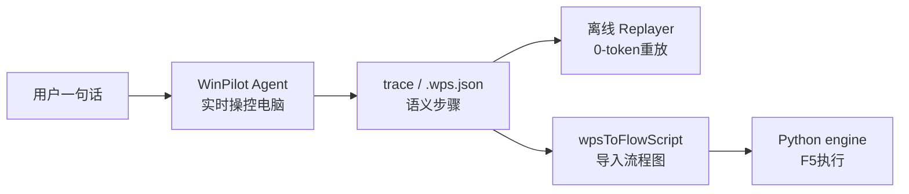

# 项目导览（通俗 / 面试版）

## 一句话

灵动脚本是一个 Windows 桌面自动化系统：AI 第一次帮你操作电脑完成任务，系统把成功过程录成可编辑脚本，以后可以不调用大模型、直接重放。

## 解决什么问题

传统自动化常记死坐标，窗口移动、分辨率变化、按钮位置变了就容易失败。纯 AI 操控每次都要调用模型，慢、贵、还可能假成功。

本项目把两条路接起来：

1. WinPilot Agent 实时看屏幕、点按钮、输入、验证。
2. 成功流程记录成 `.wps.json`。
3. `.wps.json` 可直接离线重放，也可转成 FlowScript 进入流程图编辑器。
4. 后续用流程图/脚本零-token执行。

## 架构怎么讲

项目有两套系统：

- **WinPilot Agent**：负责临场操控真实桌面。
- **流程图体系**：负责可编辑、可保存、可复用、零-token执行。

两套系统通过 `.wps.json` 和 `wpsToFlowScript.ts` 连接。Agent 不需要理解流程图内部格式，流程图也不依赖 Agent 才能运行。

## 技术亮点

### 1. 主 agent 保持小工具集

项目里有大量 @feature 能力，但 WinPilot 主 agent 不直接使用它们。原因是工具越多，模型越慢、越容易选错、prompt 越难缓存。

现在做法是：

- GUI agent 只保留桌面操控必需工具。
- 编程/仓库任务切到独立 `CodingRunner`。
- 未来其它专长也应独立成子 agent，而不是塞进主 agent。

### 2. 多维感知

WinPilot 通过 UIA、Win32、OCR、CV、可选 VLM 获取屏幕信息。UIA 覆盖不到的软件可以靠 OCR/CV/VLM 和窗口/进程信息补足。

关键不是把所有识别框都发给模型，而是把它们压缩成模型能理解的环境摘要。

### 3. 防假成功

WinPilot 不只相信模型说“完成了”：

- 动作可以带 expect 验证。
- done 会重新观察真实屏幕。
- 通信任务要看到目标文本。
- 绘图任务要看到真实拖拽、保存文件和颜色证据。
- 编程 clone/run 任务必须实际尝试运行或给出明确 blocker。

### 4. 可复用

trace 和人类演示录制都会生成 `.wps.json`。重放时优先按文字/角色重新定位，坐标只是兜底。

## 面试回答模板

**Q：和按键精灵/RPA有什么区别？**
A：传统录制偏坐标，界面一变就坏。这个项目第一次用 Agent 理解屏幕并完成任务，录下的是语义步骤；后续重放可以重新定位文字/控件，而且不再调用大模型。

**Q：为什么不把所有工具都给 Agent？**
A：这会让模型更慢、更贵、更容易选错工具。我们把主 GUI agent 做小，专门任务拆成子 agent。流程图/@feature 体系保持独立。

**Q：如何减少假成功？**
A：每步动作可以验证；完成声明会二次观察；对消息、绘图、搜索、上传、clone/run 等高风险任务有额外 gate，并保存 trace 复盘模型每一步看到的信息。

**Q：项目最难的地方？**
A：不是打开某个软件，而是让通用 agent 在 UIA 不可靠、OCR 噪声大、模型无视觉或弱视觉时仍能理解屏幕，并且用真实证据验证结果。

## 30 秒介绍

> 我做的是一个 Windows 桌面自动化系统。用户说一句话，WinPilot Agent 会实际操作电脑并验证结果；成功过程会保存成 `.wps.json`，之后可以离线重放，也可以转成可编辑流程图，用原有引擎零-token执行。架构上我把实时 Agent 和流程图体系解耦，主 agent 保持小工具集，专门能力拆成子 agent，这样更快也更稳。
