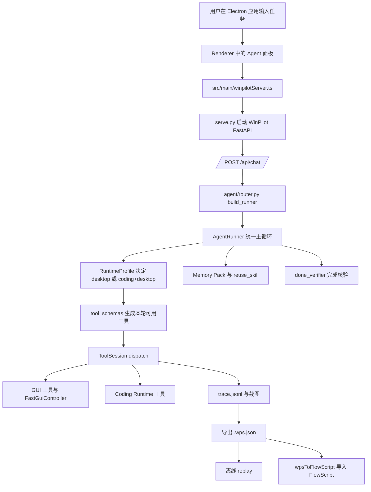
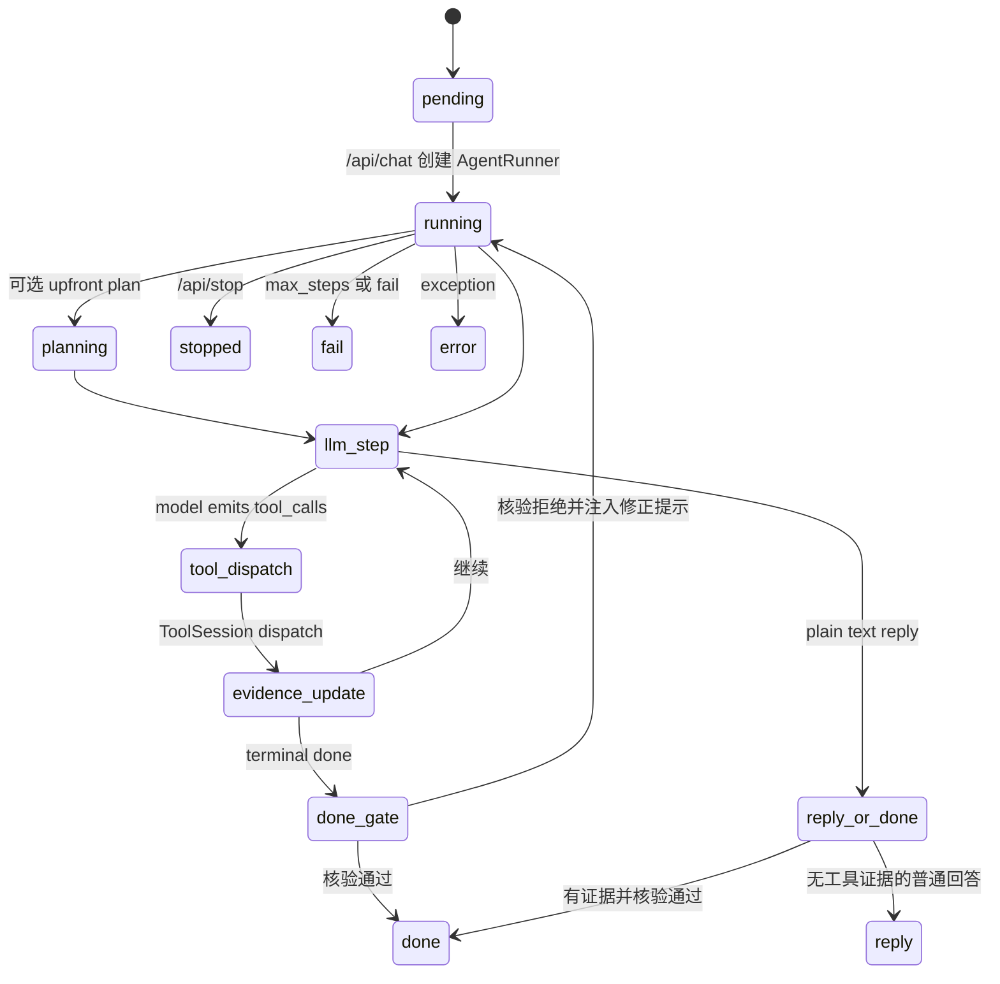

# 项目导览（面试版 / 以当前代码为准）

> 更新时间：2026-07-04。  
> 本文只描述当前 `master` 的代码事实。后续如果代码和本文冲突，以代码为准，先读代码再改文档。

## 0. 一句话版本

灵动脚本是一个 Windows 桌面自动化系统：用户面对的是 Electron 应用和一个统一的 WinPilot Agent；Agent 通过多源感知、函数工具、低延迟本地控制器和严格完成核验来完成真实桌面任务；成功运行可以沉淀为 `.wps.json` 语义重放脚本，再离线重放，或导入旧有流程图编辑器转换为 FlowScript 继续编辑和执行。

面试里不要把它讲成“多个 Agent 拼接”或“单纯的脚本编辑器”。更准确的说法是：

- 前台产品是 Electron 桌面应用。
- AI 执行中枢是 `python/winpilot_home/winpilot/` 下的 WinPilot。
- 旧流程图/DSL 体系仍在 `src/renderer/`、`python/engine/`、`python/features/`。
- 两条线通过 `.wps.json` 和 `wpsToFlowScript.ts` 衔接，但没有强耦合。
- 当前只有一个用户可见 Agent：`AgentRunner`。Coding 只是该 Agent 的可选 Runtime 能力，不是独立 Coding 子 Agent。

## 1. 当前必须讲准的代码事实

### 1.1 一个 Agent，不是双 Agent

当前入口 `agent/router.py` 只构造 `AgentRunner`。早期的 `CodingRunner` 已经被移除为独立规划器，`agent/coding.py` 只保留兼容 shim，避免旧测试或旧导入崩掉。

正确表述：

> 项目现在是统一 AgentRunner 架构。桌面 GUI、仓库/代码任务、trace、BUS 事件、记忆、done gate 都走同一条主循环。Coding 能力通过 RuntimeProfile 打开一组文件、搜索、patch、shell、GitHub 搜索工具，而不是切到另一个 Agent。

不要说：

- “有一个桌面 Agent 和一个 Coding Agent。”
- “CodingRunner 负责代码任务。”
- “GUI 和 Coding 是两套规划循环。”

### 1.2 两条主线：WinPilot 与 FlowScript

仓库里有两套历史来源不同的能力：

| 主线 | 当前代码位置 | 面试说法 |
| --- | --- | --- |
| WinPilot Agent | `python/winpilot_home/winpilot/`、`python/winpilot_home/serve.py`、`src/main/winpilotServer.ts` | 当前 AI 桌面 Agent 主体，负责感知、规划、操作、核验、trace、replay、memory。 |
| 流程图 / DSL / `@feature` | `src/renderer/`、`python/engine/`、`python/features/`、`tools/dsl_to_flow.py` | 旧有可视化脚本编辑和执行体系，适合人工编辑、结构化流程、传统自动化节点。 |

这两条线不是互相替代，而是分工：

- Agent 适合第一次做未知、变化大、需要感知和判断的任务。
- `.wps.json` 适合把一次成功 Agent 运行变成可重放动作序列。
- FlowScript 适合把脚本可视化、人工编辑、加入旧节点生态。
- `wpsToFlowScript.ts` 是桥，不是把 WinPilot 重写成 FlowScript 引擎。

### 1.3 两个 HTTP 控制面

不要把端口混在一起。

| 控制面 | 位置 | 用途 |
| --- | --- | --- |
| Electron HTTP API，默认 `:7880` | `src/main/api.ts` | 给外部工具/Claude Code 控制前端、操作流程图、执行 DSL、读取 renderer state。 |
| WinPilot FastAPI，动态本地端口 | `python/winpilot_home/winpilot/server.py`，由 `src/main/winpilotServer.ts` 启动 | Agent 聊天、状态、配置、trace、script、memory、replay、WebSocket 事件和嵌入式 Web UI。 |

WinPilot 服务只能通过 `python/winpilot_home/serve.py` 启动。直接 `uvicorn winpilot.server:app` 被代码显式拦截，因为那会绕过配置路径和 Electron 管理的动态端口。

### 1.4 VLM 是可选增强，不是默认前提

感知融合默认按配置使用 UIA、Win32、OCR、CV。VLM 只有在配置可用时才进入视觉模式辅助或空快照救援路径。面试时可以说“支持 VLM 辅助”，但不要说“系统必须靠 VLM 才能工作”。

### 1.5 done 不是模型自述，而是证据核验

`AgentRunner` 接收到 `done` 或模型普通回复后，不会直接相信“我完成了”。`done_verifier.py` 会结合最近动作、工具输出、可见文本账本、截图/图像统计、确定性文件/进程/命令证据和必要时的 LLM judge 做完成核验。

正确表述：

> 这个系统把“任务完成”当成可核验证据问题，而不是 Agent 的一句总结。

## 2. 端到端链路

一次 Agent 运行的关键路径：

1. Electron 端确保 WinPilot 服务已在 `127.0.0.1` 的动态端口启动。
2. 前端调用 WinPilot `/api/chat`。
3. FastAPI 检查当前是否已有任务、录制或重放在运行。当前实现是一时间只允许一个运行态任务。
4. `build_runner()` 创建统一 `AgentRunner`。
5. `AgentRunner.run()` 创建系统提示、注入运行时能力、可选计划、记忆提示和工具 schema。
6. 每轮 LLM 决策产出工具调用。
7. `ToolSession.dispatch()` 负责作用域保护、GUI-only 限制、screen delta、world model、缓存失效和工具分发。
8. GUI 操作用 `execute_subgoal`、`run_action_batch`、`click`、`type_text`、`observe` 等；代码任务额外拿到 `list_dir`、`read_file`、`search_text`、`apply_patch`、`run_shell`、`github_search` 等。
9. 工具结果进入 trace、recent evidence、visible evidence ledger、memory 反馈和 done gate。
10. done gate 接受后发布 `agent_done`；非 Coding 的可信成功运行可以导出 `.wps.json` 并写入记忆图。
11. `.wps.json` 可直接离线 replay，也可通过 `wpsToFlowScript.ts` 映射为流程图。

## 3. 代码目录地图

| 路径 | 当前职责 |
| --- | --- |
| `src/main/winpilotServer.ts` | Electron 主进程里管理 WinPilot FastAPI 子进程，找空闲端口，调用 `serve.py`，把 URL 暴露给 renderer。 |
| `src/main/api.ts` | Electron 自己的 `:7880` HTTP API，面向前端远程控制、流程图操作、DSL 转换和 renderer 状态读取。 |
| `src/renderer/` | React 前端、流程图编辑器、Agent iframe、脚本导入入口和 FlowScript 类型。 |
| `src/renderer/utils/wpsToFlowScript.ts` | 把 WinPilot `.wps.json` 保守转换为 FlowScript。无法忠实映射的 WinPilot-only 步骤会变成 `tool_call` 占位并保留原始 payload。 |
| `python/winpilot_home/serve.py` | WinPilot 服务唯一支持的启动器。 |
| `python/winpilot_home/winpilot/server.py` | WinPilot FastAPI：`/api/chat`、`/api/status`、trace、script、memory、replay、WebSocket、静态 UI。 |
| `python/winpilot_home/winpilot/agent/router.py` | Runner 工厂。现在只返回统一 `AgentRunner`。 |
| `python/winpilot_home/winpilot/agent/loop.py` | Agent 主循环：模型调用、工具调用、上下文折叠、trace、用量统计、done gate、记忆反馈、成功脚本导出。 |
| `python/winpilot_home/winpilot/agent/runtime_profile.py` | 根据任务判定 runtime：普通 desktop 或 `coding+desktop`。 |
| `python/winpilot_home/winpilot/agent/tool_schemas.py` | OpenAI function-calling schema，按 planning、coding_runtime、GUI-only、lean/drawing profile 裁剪工具。 |
| `python/winpilot_home/winpilot/agent/tools.py` | `ToolSession`，保存当前窗口、snapshot、world model、undo stack、screen watcher、coding session，并分发工具。 |
| `python/winpilot_home/winpilot/agent/coding_tools.py` | Coding Runtime 的工作区受限文件/仓库工具，含敏感配置写保护和“只运行任务不乱改项目”的保护。 |
| `python/winpilot_home/winpilot/agent/done_verifier.py` | 完成核验，防止“假完成”。 |
| `python/winpilot_home/winpilot/fast/` | 本地低延迟 GUI 控制器、元素缓存、输入定位、screen watcher、批量动作和绘图辅助。 |
| `python/winpilot_home/winpilot/perception/` | UIA、Win32、OCR、CV、VLM 的感知融合和 reducer。 |
| `python/winpilot_home/winpilot/recorder/trace.py` | BUS trace、截图、`.wps.json` 导出、结构校验、离线 replay。 |
| `python/winpilot_home/winpilot/memory/` | Memory Graph、检索、打包、运行编译、reuse 反馈。 |
| `python/engine/` | 旧 FlowScript 执行引擎。 |
| `python/features/` | 旧 `@feature` 功能体系，属于流程图线，不是 WinPilot Agent 的主工具系统。 |

## 4. 核心模块按面试讲法

### 4.1 AgentRunner：统一任务执行器

`AgentRunner` 是每次任务运行的中心对象。它负责：

- 生成 run_id。
- 创建 `ToolSession`。
- 根据任务构造 `RuntimeProfile`。
- 构造系统提示和工具 schema。
- 调用模型。
- 解析并执行工具调用。
- 折叠过大的上下文。
- 记录 LLM trace 和 BUS trace。
- 维护 recent evidence。
- 调用 done gate。
- 写入经验记忆和 Memory Graph。
- 对非 Coding 的可信成功运行导出 `.wps.json`。

面试时可以概括为：

> AgentRunner 是一个“带证据链的桌面任务状态机”，不是单纯 while 循环调用大模型。

### 4.2 ToolSession：所有工具共享的运行态

`ToolSession` 保存本轮任务共享状态：

- 当前窗口 `hwnd`。
- 最近一次感知 `snapshot`。
- runtime profile。
- 可选 `CodingSession`。
- world model。
- plan。
- undo stack。
- screen watcher。
- memory replay 使用情况。

它的价值是让工具之间共享上下文。例如 `observe` 后的 element id、`click` 后的 screen delta、`execute_subgoal` 的缓存、replay 的尝试记录，都能进入同一条证据链。

### 4.3 RuntimeProfile：能力开关，不是 Agent 路由

`runtime_profile.py` 的定位是“本轮运行启用哪些能力”。当前只有两个公开 label：

- `desktop`
- `coding+desktop`

Coding 判断命中时，Agent 仍是同一个 `AgentRunner`，只是工具 schema 增加仓库能力，并且提示里要求优先用确定性 repo 操作：

- `list_dir`
- `read_file`
- `search_text`
- `apply_patch`
- `write_file`
- `run_shell`
- `github_search`

这解决了旧方案的问题：如果把 Coding 做成独立 Agent，就会有两套 planner、两套 prompt、两套 tool loop、两套 done 语义，trace 和 memory 也会割裂。

### 4.4 感知融合：UIA / Win32 / OCR / CV / VLM

`perception/fusion.py` 的基本思路：

1. 根据配置决定启用哪些感知维度。
2. 对 UIA、Win32、OCR、CV、VLM 的结果做合并和去重。
3. 给每个元素分配本次 observation 内稳定的 `elem_id`。
4. 输出结构化 `Snapshot` 和给模型看的文本。
5. 如果大窗口几乎没有可读元素，会给出警告，防止模型假装知道画面内容。
6. 空快照时会走 OCR/VLM 救援路径。

`perception/reducer.py` 进一步把完整 Snapshot 压缩成更适合 LLM 热路径使用的摘要：候选元素、阶段判断、可操作建议、不确定性和最近变化区域。

### 4.5 Fast GUI Controller：把明显动作放到本地闭环

`fast/controller.py` 是“低延迟 GUI 内循环”。它负责执行短批量、已落地的 GUI 动作，例如：

- 定位并点击带 label 的元素。
- 定位输入框、点击、清空、输入。
- 批量执行 click/type/hotkey/scroll/drag/draw。
- 等待变化或稳定。
- 对视觉变化做自动验证。
- 绘图时选择颜色、画 stroke、返回颜色证据。

这不是另一个 Agent。它是 `ToolSession` 拥有的本地 controller，用来减少“每点一下都问一次大模型”的延迟。

### 4.6 DoneVerifier：反假完成

`done_verifier.py` 是面试最值得讲的亮点之一。它不是“再问一次模型做没做完”这么简单，而是先走确定性核验：

- 输入/可见文本任务：最终 screen 或 evidence 中必须出现目标文本。
- literal token：要求精确字面量出现，不能用“等价状态”糊弄。
- 绘图任务：要求真实 drag/draw stroke、视觉变化、必要的输出文件和颜色证据。
- 通信任务：不能把 click/type 的 ok 当成发送成功，必须看到目标消息出现在聊天/收件上下文。
- 文件/命令类任务：优先相信 `run_shell`、`Test-Path`、exit code、verified 字段等确定性证据。
- 如果 deterministic guard 不足，再用 skeptical LLM judge 判断。
- 若 judge 调用异常，当前策略是 fail-open，避免系统卡死；但会写 trace。

面试表达：

> 我们把 done gate 设计成一个独立的怀疑者。Agent 的自述只能作为输入，真正决定完成的是工具证据和最终状态。

### 4.7 Trace、`.wps.json` 与 Replay

`recorder/trace.py` 做三件事：

1. `TraceRecorder` 订阅 BUS 事件，写入 `traces/<run_id>.jsonl`，并在动作前后保存截图。
2. `export_script()` 从 trace 中抽取 replay 步骤，去掉重复和不稳定文本，生成 `format: "wps/2"` 的 `.wps.json`。
3. `Replayer` 离线执行 `.wps.json`，通过文本选择器优先重新定位元素，失败时退回记录坐标，并复用 verify engine。

这条线可以这样讲：

> Agent 的一次成功不是只留下日志，而是能被蒸馏成“语义动作脚本”。脚本既可 0-token replay，也可以导入流程图继续编辑。

### 4.8 Memory Graph：经验是提示，不是事实替代

当前记忆体系不是简单 JSON 数组。运行完成后，`memory/compiler.py` 会把 episode、skill/procedure、warning 等写入 Memory Graph；`memory/packer.py` 会把少量相关记忆打包进 LLM 上下文。

关键原则：

- Memory 只是 hint。
- 当前 screen、文件和工具结果优先级更高。
- replay 成功不等于任务完成，仍要 done gate 验证最终状态。
- Coding 任务不会导出为可复用 skill，避免把一次仓库编辑误当作通用 GUI 自动化技能。
- 只有实际尝试过 replay 的记忆才参与反馈评分，不能因为被 prompt 注入就算成功。

### 4.9 ModelAdapter：兼容 OpenAI 风格接口并归一化用量

`model_adapter.py` 的职责是薄适配：

- 识别 provider。
- 判断模型是否显式支持 vision。
- 对 MiMo/Reasonix 这类 reasoning endpoint 默认禁用 provider-side thinking，避免工具调用预算被隐藏思考吃完。
- 归一化 token usage。
- 估算成本。
- 保持 `client.chat.completions.create` 的调用形状。

它不是代理服务，也不直接碰 GUI controller。

## 5. 设计取舍

### 5.1 为什么不做多个用户可见 Agent

旧做法容易出现四个问题：

1. Prompt 重复：桌面 Agent 和 Coding Agent 都要解释工具、done、trace、约束。
2. 规划割裂：一个任务可能同时需要读文件、跑命令、开浏览器和看 GUI。
3. 证据割裂：两个 runner 会让 done gate、trace、memory 难以统一。
4. 用户心智复杂：用户只想“帮我完成任务”，不想选择 Agent 类型。

当前做法是统一 `AgentRunner`，任务分类只影响 runtime capability。

面试回答：

> 我没有把 Coding 做成另一个 Agent，而是做成统一 Agent 的一个 Runtime Profile。这样所有任务共享同一套工具证据、完成核验和记忆语义。

### 5.2 为什么 Agent 和流程图解耦

Agent 做“探索和第一次成功”，流程图做“可视化和稳定复用”。如果强行让 Agent 直接生成 FlowScript，会有两个问题：

- FlowScript 节点是旧体系，表达不了所有 WinPilot 语义动作，例如 selector fallback、controller evidence、绘图颜色证据。
- Agent 第一次探索时需要 trace、截图、感知、失败恢复，不应该被流程图节点模型限制。

所以当前桥接策略是：

- WinPilot 记录 `.wps.json`。
- `.wps.json` 保留 WinPilot 语义和 replay 能力。
- `wpsToFlowScript.ts` 尽量映射已有节点。
- 无法忠实映射的步骤导入为 `tool_call` 占位，并保留原 payload 供人工修订。

### 5.3 为什么要低延迟 controller

GUI 自动化如果每一个 click、type、wait 都发给 LLM，延迟高且容易抖。当前策略是：

- LLM 负责目标、计划和异常判断。
- Controller 负责已经明确的短动作闭环。
- `run_action_batch` 支持一小段 grounded GUI batch。
- `execute_subgoal` 支持输入、点击、绘图、验证这类局部 routine。
- screen watcher 和 visual delta 提供动作后证据。

这能减少 LLM round-trip，也让工具输出更结构化。

### 5.4 为什么 done gate 要严格

桌面任务最常见的问题不是“不会点”，而是“以为点完了”。严格 done gate 可以防止：

- 输入了文字但没有发送。
- 点了按钮但页面没跳转。
- 绘图选了工具但没有画出 stroke。
- 文件任务只总结 README，没有真实运行。
- 代码任务改了文件但没验证。
- 通信任务把输入框内容当成送达证据。

代价是偶尔会多走一步 observe/read_text/run_shell，但结果可信度更高。

### 5.5 为什么保留旧 FlowScript

旧体系仍有价值：

- 可视化编辑比纯文本脚本适合人工维护。
- DSL 适合简单命令快速生成流程。
- `@feature` 可以作为流程图节点扩展。
- 对稳定、重复、结构化的自动化，传统流程图比 Agent 更可控。

所以它不是“被 WinPilot 替代”，而是转为复用和编辑层。

## 6. 运行状态机

当前可以按这个状态机理解一次运行：

状态结果主要有：

| 状态 | 含义 |
| --- | --- |
| `done` | 任务被接受为完成。可信度取决于 `_done_verified` 和是否 force-unverified。 |
| `reply` | 没有工具证据的普通回答。 |
| `fail` | Agent 判断无法完成或达到最大步数。 |
| `stopped` | 用户停止。 |
| `error` | 运行异常。 |

## 7. 高频面试问答

### Q1：这个项目和普通 RPA 有什么区别？

普通 RPA 依赖预先写死的流程和坐标。这个项目把“第一次完成任务”交给 Agent：它可以观察界面、选择工具、验证结果，并把成功路径转成 `.wps.json` 用于复用。后续稳定场景再走 replay 或 FlowScript。

### Q2：这个项目和纯 LLM GUI Agent 有什么区别？

不是只让 LLM 看截图后点坐标。当前系统有：

- UIA/Win32/OCR/CV/VLM 多源感知。
- Snapshot 和 element id。
- 本地 controller 的低延迟动作闭环。
- screen watcher 和 visual delta。
- trace、截图和可重放脚本。
- 严格 done gate。
- Memory Graph 和 replay 反馈。

LLM 负责高层决策，本地工具负责落地和验证。

### Q3：为什么不直接把所有动作都写成 FlowScript？

因为第一次执行时环境不确定：窗口可能没打开、按钮文本不同、登录态不同、页面动态变化。Agent 更适合探索和处理异常。FlowScript 更适合已知稳定流程。当前设计让 Agent 先找到路径，再把路径沉淀为可编辑脚本。

### Q4：如何避免坐标脆弱？

几层措施：

- `observe` 产生 element id，工具可以按 element id 操作。
- replay 优先用文本/元素语义重新定位，坐标只是 fallback。
- `clean_selector_text()` 会清理未读数、badge 这类易变文本。
- `click_element`、`type_into_element` 会使用 anchor、fallback text、role、expected region 和 targeted observe retry。
- reducer 会把高相关候选元素给模型，而不是让模型读几百行 OCR。

### Q5：如何避免假完成？

核心是 done gate。系统不会只相信模型总结，而是看：

- 最近工具输出。
- verify 字段。
- final observe/read_text。
- 可见 evidence ledger。
- 文件、进程、命令的确定性证据。
- 绘图的 drag、visual_change、颜色和文件证据。
- 通信任务的最终可见消息。
- 必要时再用 skeptical LLM judge。

### Q6：Coding Runtime 是什么？

它是统一 Agent 的一组可选仓库工具。触发 coding task 且不是 GUI-only 时开启。开启后，Agent 可以在配置的 workspace 内：

- 列目录。
- 读文件。
- 搜索文本。
- 精确 patch。
- 写文件。
- 跑 shell。
- 搜 GitHub 仓库。

它有两个重要保护：

- 敏感配置/密钥文件写入保护。
- 如果任务只是 clone/run/verify，不允许擅自改项目文件。

### Q7：为什么 Coding 不沉淀为 replay skill？

仓库编辑通常依赖代码版本、依赖环境、文件状态和任务目标，复用一次编辑路径风险很高。当前代码明确把 Coding 成功排除在可复用脚本导出范围之外，但仍允许 factual project notes 作为只读提示进入上下文。

### Q8：低延迟 GUI 具体做了什么？

`run_action_batch` 可以执行一段短动作并返回结构化结果；`execute_subgoal` 可以把输入、点击、绘图、验证这样的局部 routine 放进本地 controller；screen watcher 和 screen delta 会提供“动作后画面是否变化”的证据。这些都减少了 LLM 往返。

### Q9：trace 和 replay 是如何工作的？

运行时 BUS 事件写入 `traces/<run_id>.jsonl`，动作前后保存截图。导出时只抽取可重放动作，去噪并校验结构，生成 `.wps.json`。离线 replay 再用当前屏幕重新定位元素，并复用同一套 verify engine。

### Q10：如何调试失败？

主要入口：

- WinPilot UI 的事件流和聊天日志。
- `traces/<run_id>.jsonl`。
- `traces/<run_id>/` 下的动作截图。
- `AgentRunner._trace_debug()` 写出的 LLM request/response/tool_result JSON。
- `/api/trace/{run_id}` 和 `/api/trace/{run_id}/summary`。
- `/api/evals` 聚合评估报告。
- `done_check`、`agent_recovery`、`run_state`、`agent_tool` BUS 事件。

### Q11：项目当前最大工程风险是什么？

可以诚实回答：

- `AgentRunner`、`ToolSession`、fast controller 仍然偏大，后续还需要继续拆模块。
- 本地 controller 已经降低延迟，但还不是完整视觉伺服系统。
- VLM 是可选增强，很多视觉复杂场景仍依赖 OCR/CV/控制器启发式。
- `.wps.json` 到 FlowScript 是保守映射，不是所有 WinPilot 语义都能无损转换。
- GUI 自动化天然受窗口焦点、权限、系统弹窗、登录态影响，所以必须保留 trace 和 done gate。

### Q12：怎么用 2 分钟介绍这个项目？

可以这样说：

> 灵动脚本是我做的 Windows 桌面自动化系统。它不是传统 RPA 只靠固定坐标，也不是纯截图 Agent。当前核心是统一的 WinPilot AgentRunner：它通过 UIA、Win32、OCR、CV、可选 VLM 观察界面，用函数工具执行 click、type、hotkey、shell、文件操作等动作，并用本地 Fast GUI Controller 把明确的短 GUI routine 放到低延迟闭环里。  
> 
> 这个项目比较强调可信完成：Agent 说 done 后，系统会用工具证据、最终可见文本、文件/命令结果、绘图颜色和通信上下文做 done gate，而不是相信模型自述。一次成功运行会记录 trace 和截图，还可以导出成 `.wps.json` 语义脚本，后续 0-token replay，或者导入旧流程图编辑器转成 FlowScript 继续编辑。  
> 
> 最近架构上我把 Coding 子 Agent 收敛成统一 Agent 的 Runtime Profile。这样代码任务、桌面任务、trace、memory、done gate 都共享同一套语义，避免双 planner 和双工具循环造成的割裂。

## 8. 演示路线

### 8.1 基础启动演示

1. `npm install`
2. `npm run dev`
3. 打开 Electron 应用。
4. 进入 Agent 面板。
5. 观察 Electron 主进程自动启动 WinPilot 服务，而不是手动跑 uvicorn。

重点讲：

- Electron 自己有 `:7880` API。
- WinPilot 是动态端口，并嵌入到 Agent 面板。
- renderer 使用 WinPilot 原生 Web UI 和 HTTP/WebSocket API，不在 React 里重写 Agent UI。

### 8.2 GUI 自动化演示

可选任务：

- 打开记事本，输入指定文本，保存到指定路径。
- 打开计算器，计算表达式，并验证结果。
- 在画图中画指定颜色/形状并保存图片。

讲解点：

- `observe` 看到 UI 元素。
- `execute_subgoal` 或 `run_action_batch` 执行局部 routine。
- done gate 检查最终证据。
- trace 里有动作、截图和结果。

### 8.3 Replay 演示

1. 完成一次 GUI 任务。
2. 从 trace 导出 `.wps.json`。
3. 在 WinPilot 中 replay。
4. 导入流程图，查看 `wpsToFlowScript.ts` 映射后的 FlowScript 节点。
5. 对无法映射的 WinPilot-only 步骤，展示 `tool_call` 占位和原 payload。

### 8.4 Coding Runtime 演示

可选任务：

- “检查这个项目的某个文档是否和代码一致，并更新。”
- “在 workspace 内搜索某个函数调用并解释调用链。”
- “修一个小 bug，修改后运行最小验证命令。”

讲解点：

- 仍是一个 AgentRunner。
- 工具 schema 增加 coding tools。
- 文件路径被限制在 workspace。
- patch 需要唯一 find。
- shell 输出和 exit code 进入 evidence。
- clone/run 类任务必须实际尝试运行或验证，不能只复述 README。

## 9. 不要再讲的过时内容

| 过时说法 | 当前正确说法 |
| --- | --- |
| 有独立 CodingRunner 负责代码任务 | `CodingRunner` 只是兼容 shim；统一 `AgentRunner` 负责所有任务。 |
| Agent 和 FlowScript 是一套运行时 | 它们是两条线，通过 `.wps.json` 和 `wpsToFlowScript.ts` 桥接。 |
| WinPilot 直接用 Electron `:7880` API | WinPilot 有自己的 FastAPI 动态端口；`:7880` 是 Electron 对外控制面。 |
| 直接 `uvicorn winpilot.server:app` 启动后端 | 代码明确要求通过 `serve.py` 启动，直接 uvicorn 会被拦截。 |
| VLM 是默认核心感知 | VLM 是可选增强；UIA/Win32/OCR/CV 才是基本感知维度。 |
| replay 成功就等于任务完成 | replay 只是动作复用；最终仍要 verify/done gate。 |
| `.wps.json` 是普通日志 | 它是从 trace 抽取、去噪、校验后的语义重放脚本。 |
| `@feature` 是 WinPilot Agent 工具系统 | `@feature` 属于旧 FlowScript/流程图体系。 |
| done 是模型总结 | done 是证据核验结果。 |

## 10. 面试时可以强调的技术亮点

### 10.1 架构亮点

- Electron + Python FastAPI 双进程架构。
- WinPilot 服务由 Electron 管理生命周期和动态端口。
- 统一 AgentRunner + RuntimeProfile，避免多 Agent 语义割裂。
- REST + WebSocket BUS 事件流。
- trace、script、memory、eval 都在同一个 WinPilot 服务下暴露。

### 10.2 Agent 亮点

- function-calling 工具链。
- GUI-only gating。
- runtime-specific tool schema。
- provider adapter 和 usage/cost normalization。
- 上下文折叠兼顾 prefix cache。
- mid-run interject 支持用户实时插话。
- failure recovery layer 和 run_state。
- done gate 反假完成。

### 10.3 GUI 自动化亮点

- UIA/Win32/OCR/CV/VLM 多源融合。
- reducer 降低 LLM 读取负担。
- element id 和 snapshot registry。
- screen watcher 和 action screen delta。
- `execute_subgoal` / `run_action_batch` 本地闭环。
- replay 优先语义重定位，再 fallback 坐标。

### 10.4 工程化亮点

- `.wps.json` 结构校验。
- trace 到 replay 的脚本蒸馏。
- 前端保守导入 FlowScript，不丢失 WinPilot-only payload。
- Memory Graph 区分 episode、skill、procedure、warning。
- replay 反馈只记录真实尝试。
- Coding Runtime 的 workspace confinement 和敏感文件写保护。

## 11. 进一步可以优化的方向

这些可以作为“我知道还有什么没做完”的回答：

1. 继续拆分 `AgentRunner`、`ToolSession` 和 fast controller，降低单文件复杂度。
2. 把更多已验证的 GUI routine 下沉到 controller，减少 LLM 回合。
3. 为 `.wps.json` 到 FlowScript 的映射补更多节点等价物，减少 `tool_call` 占位。
4. 给 replay 增加更强的 selector 策略和失败恢复。
5. 对视觉任务引入更稳定的局部视觉伺服，而不是只靠一次 visual delta。
6. 把 eval、trace summary、失败分类进一步产品化，方便定位回归。
7. 为 Coding Runtime 增加更系统的测试矩阵和安全策略审计。
8. 对 Memory Graph 增加更细的过期策略和冲突解决。

## 12. 最短背诵稿

> 灵动脚本当前核心是一个 Windows 桌面自动化 Agent 系统。Electron 负责产品壳和流程图编辑，WinPilot 是 Python FastAPI 服务，真正执行 AI 桌面任务。现在架构已经收敛成一个统一的 AgentRunner，Coding 不是独立 Agent，而是通过 RuntimeProfile 打开的可选工具能力。  
> 
> Agent 每轮通过多源感知拿到 UI snapshot，用 function-calling 调用 GUI、文件、shell、fast controller 等工具。明确的 GUI 子任务会下沉到本地 controller 批量执行，降低 LLM round-trip。任务完成不是模型说了算，而是 done gate 基于工具输出、最终画面、文件/命令证据和必要的 judge 做核验。  
> 
> 成功运行会留下 trace 和截图，并能导出成 `.wps.json` 语义脚本，后续可以离线 replay，也可以导入旧流程图体系变成 FlowScript。这个设计把“第一次智能完成”和“后续稳定复用”分开，既保留 Agent 的适应性，也保留传统自动化的可控性。
