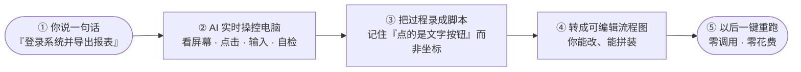

# 项目导览（面试 / 通俗版）

> 不懂技术也能看懂这个项目是什么、解决什么问题、为什么这么设计。文末附"面试怎么讲"。

---

## 一句话

**灵动脚本 = 一个能"自己动手操作电脑"的 AI 助手 + 一个"把操作画成流程图、以后不花钱也能自动重跑"的编辑器。**

---

## 它解决什么问题？（先讲痛点）

电脑上有大量**重复、繁琐**的操作：每天登录系统填表、整理文件、从网页抄数据、点一堆按钮……

现有两类方案都不够好：

| 方案 | 问题 |
|---|---|
| 传统"按键精灵"录制（记坐标） | 换个分辨率、窗口挪了位置就**全失效**，很脆 |
| 直接让 AI（如 GPT）每次操作 | 每跑一次都要**花钱调用大模型**，慢、贵、还可能不稳定 |

**这个项目把两者的优点合起来**：
- 让 AI **第一次**帮你把事情做成功（智能、能应对变化）；
- 然后把这次成功的过程**录下来、变成一张可编辑的流程图**；
- 以后**不再调用 AI**，直接零成本重跑——而且重跑时是"按文字找按钮"而不是"按死坐标"，界面变了也能找到。

> 核心理念：**一次 AI 生成，永久零成本重放。**

---

## 它怎么工作？（最简版）

- **第②步的关键**：AI 不是"盲点坐标"，而是先用多种方式"看懂"屏幕（读控件、识文字、看图标），找到"登录"这个按钮再点。
- **第③步的关键**：录下来的是"点了写着登录的那个按钮"，所以下次按钮挪了位置也能靠文字重新找到。

---

## 两个最值得讲的创新点

### 1）"一次生成，永久零 Token 重放"
别的 AI agent 每次都烧钱调大模型；这里只在**第一次**用 AI，成功后存成脚本，之后**完全离线重跑**（0 token）。对企业批量自动化，这是省钱和稳定性的关键。

### 2）"主 AI 保持极简，专长拆成子 AI"
项目里有 250 多个底层能力（点击、OCR、文件、窗口……）。一个常见错误是把这 250 个全塞给 AI 选——结果 AI 被淹没、变慢变笨。

这里的做法：**主 AI 只拿约 22 个最常用的精简工具**；遇到"写代码"这类专门任务，**切换到一个独立的'编程子 AI'**（它才有读写文件、改代码、跑测试的工具）。
> 这是个反直觉但很重要的工程判断："给 AI 加工具"经常是**负优化**——工具越多，提示词越臃肿、越慢、越容易选错。

---

## 技术亮点（面试可逐条展开）

- **多维感知融合**：同时用 Windows 控件树(UIA) + 文字识别(OCR) + 图像 + 可选视觉大模型，融合成"屏幕上有哪些元素"，每个元素有稳定编号，AI 按编号操作最准。
- **每一步都验证**：每个动作可带"期望结果"（如"应出现『保存成功』"/"文件应存在"），做完自动校验+失败重试；连"我做完了"也由一个**怀疑型复核**重新看屏幕确认，防止 AI 假装完成。
- **可中断**：点"停止"能立刻打断正在进行的大模型调用，不用干等。
- **复用成熟的流程图编辑器**：AI 产出的脚本用**纯代码转换**成原有的流程图节点，直接进成熟编辑器，能和现成的 250+ 指令库节点自由拼装——不重复造轮子。
- **多种接入**：内置 HTTP API + 三个 MCP 入口，能被 Claude Code 等外部工具远程驱动。

---

## 关键取舍 +"为什么"（面试官最爱问）

| 取舍 | 为什么这么选 |
|---|---|
| 主 agent 只给 ~22 工具，不给全部 250+ | 工具多会拖垮模型、破坏提示词缓存（贵+慢）；少而精反而更准 |
| 编程能力做成独立子 agent | 不污染主 agent；可单独换更强模型；职责清晰 |
| AI 产物转成"原版流程图节点"而不是新做一套编辑器 | 复用成熟 UI/引擎，用户体验一致，开发成本低 |
| 重放时"按文字重定位"而非死坐标 | 抗界面变化，这是比传统录制更稳的根本原因 |
| 两套体系（AI / 流程图）刻意解耦 | 各自演进互不拖累；AI 不必懂流程图，流程图不必依赖 AI |

---

## 模拟面试问答

**Q：和市面上的 RPA（按键精灵那类）有什么区别？**
A：传统 RPA 录的是坐标，脆；我们第一次用 AI 智能完成并理解屏幕，录下的是"语义"（点的是哪个文字/控件），重放按文字重定位，抗变化；而且重放零成本。

**Q：为什么不把所有工具都给 AI，让它自己选最灵活？**
A：实测那是负优化——工具一多，提示词暴涨、命中缓存率下降（更贵更慢），模型还容易选错工具。我们让主 agent 精简，把专长（如编程）拆成独立子 agent 按意图路由。

**Q：怎么保证 AI 真的把任务做对了，而不是"以为做对了"？**
A：每步带可验证的期望条件（文字出现/文件存在/命令真值），做完自动校验重试；任务声明完成时，再由一个独立的怀疑型复核重新观察真实屏幕确认。

**Q：这个项目最难的部分？**
A：让"重放"既零成本又稳。难点在于录制时要抓住稳定的语义选择器、重放时在变化的真实屏幕上重新定位，并保留验证能力——这套 `.wps.json` 格式 + 离线 Replayer 是核心。

---

## 电梯陈述（背下来）

**30 秒**：
> "我做了一个 Windows 桌面自动化系统。你说一句话，AI 就能实时操控电脑帮你完成；它会把这次成功的过程录成可编辑的流程图，以后零成本、不调大模型地自动重跑，而且因为记的是'文字按钮'而不是坐标，界面变了也照样能跑。"

**2 分钟**（加这些）：
> "架构上我特意把'会操控电脑的 AI'和'流程图编辑器/引擎'两套体系解耦。AI（我们叫 WinPilot）保持极简——只有约 22 个工具，绝不把 250 多个底层能力全塞给它，因为那会拖垮它；专门任务比如写代码，会路由到一个独立的'编程子 AI'。AI 的产物通过纯代码转换成原有流程图节点，复用成熟编辑器。感知上融合了控件树/OCR/图像/视觉模型，每步操作都有期望验证和失败重试，连'完成'都要二次复核防造假。"

---

> 想深入：架构图见 [architecture.md](architecture.md)，AI 细节见 [winpilot-agent.md](winpilot-agent.md)，重放/录制见 [replay-recording.md](replay-recording.md)。
